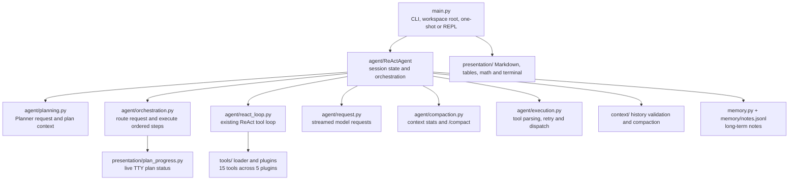
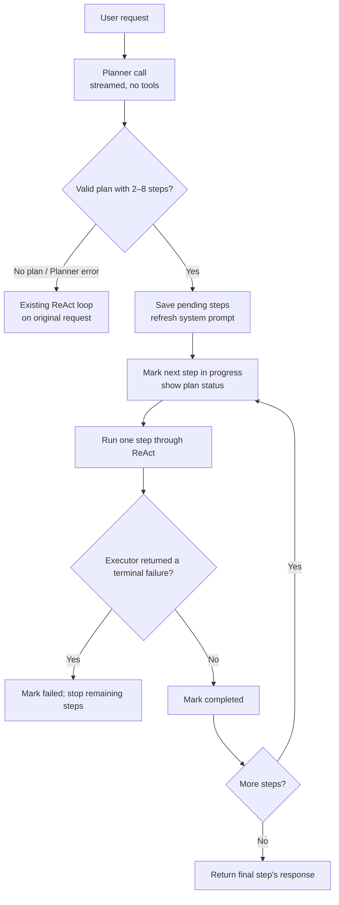

# Planning Agent

The eighth entry in the `mini-agent-system/` series: the same multi-turn ReAct agent, context
compaction, long-term memory and fifteen tools as
[`../07-multi-round-agent-with-memory/`](../07-multi-round-agent-with-memory/) — with an explicit
plan in front of each user request.

07 let the model choose each next action from the conversation as it went. That works well when the
next step depends on what a tool just found, but a long task has no separate record of its overall
steps. 08 adds a small Planner stage: it decides whether a request needs multiple steps, returns a
bounded JSON list when it does, and the agent runs those steps in order through the existing ReAct
loop. Planning is agent state, not a new tool and not long-term memory.

| What 07 does | What 08 adds |
| --- | --- |
| The model decides the next action each ReAct round | A Planner classifies each user request and can produce an ordered plan first |
| The REPL displays context and memory commands | A multi-step plan is shown up front and its progress is updated while it runs |
| ReAct execution uses the shared round budget | All planned steps for one request share that same `MAX_ROUNDS` budget |
| A broken tool or API request follows the existing error paths | Planner errors or invalid JSON fall back to the normal ReAct path; executor failures stop the remaining steps |
| Conversation compaction and long-term memory are separate | Plan status is refreshed in the protected system message; memory remains for cross-session notes |

The Planner and executor use the same model. This is a lightweight Plan-and-Execute shape, not a
multi-agent system: the Planner returns data, and the existing ReAct loop still handles tools,
observations, retries and final responses.

## Structure

The public entry point is still `ReActAgent`; the implementation is split into focused mixins and
packages rather than one large agent module:



`tools/` remains the plugin-loaded toolkit from 07. The planning layer does not add a tool or alter
the tool-call / tool-result message protocol.

## Requirements

- Python 3.x.
- The `openai` Python package (`pip install openai`); this repository does not pin a version or
  include a dependency manifest.
- A DeepSeek-compatible API key and endpoint. The configured default model is `deepseek-flash`;
  set a model that supports the configured thinking mode and streamed completions.
- Optional tool dependencies are imported lazily by the tool functions that need them: `requests`,
  `beautifulsoup4` with `lxml`, `ddgs`, and `feedparser`. A missing optional package is returned to
  the model as a tool observation when that tool is called.
- `readline` is optional. It enables line editing and Unicode-aware backspace where available;
  without it, the REPL falls back to `input()`.

## Setup

Configuration is read from environment variables in `config.py`:

| Variable | Default |
| --- | --- |
| `DEEPSEEK_API_KEY` | `sk-your-key-here` (must be replaced) |
| `DEEPSEEK_BASE_URL` | `https://api.deepseek.com` |
| `DEEPSEEK_MODEL_NAME` | `deepseek-flash` |
| `DEEPSEEK_THINKING` | `enabled` |
| `DEEPSEEK_CONTEXT_WINDOW` | `784000` tokens, for the occupancy display |

```bash
export DEEPSEEK_API_KEY=sk-...
```

The key is required for a session. `--help` prints before the key check and does not create a log
file or change the working directory.

## Running

Run from this lesson directory. The `--root` option makes another existing directory the working
directory for tools and runtime files (`logs/`, `memory/`, and `tmp/`):

```bash
cd 08-planning-agent

python3 main.py --help
python3 main.py                                  # multi-turn REPL
python3 main.py --root /path/to/project          # REPL rooted at that project
python3 main.py --msg 'inspect and explain this project'
python3 main.py --root /path/to/project --msg 'summarize the project'
python3 main.py 'inspect and explain this project' # compatible bare-prompt form
```

In the REPL, `/help` lists the commands: `/compact`, `/context`, `/memory`, `/help` and `/exit`.
`exit`, `quit` and Ctrl-D also leave. Slash-prefixed paths such as `/etc/hosts` remain valid
prompts; only a single slash-prefixed word is treated as a possible command.

## How one request works

Every user request gets one streamed Planner call. The response must be a JSON object with a boolean
`needs_plan` and a `steps` list. Plans must contain at least two non-empty strings and no more than
`PLAN_MAX_STEPS` (8). A simple request returns `needs_plan=false`; a multi-step request returns an
ordered list. Invalid output and Planner exceptions are recorded and the original prompt proceeds
through ReAct directly.



The orchestration can be summarized as:

```python
needs_plan, steps, error = request_plan(user_prompt)
if error or not needs_plan:
    return run_react(user_prompt)

plan = [{"text": step, "status": "pending"} for step in steps]
for step in plan:
    step["status"] = "in_progress"
    refresh_system_message_with_plan(plan)
    result = run_react(prompt_for_this_step)
    if is_terminal_executor_failure(result):
        step["status"] = "failed"
        stop_remaining_steps()
    step["status"] = "completed"
return result
```

Each step prompt carries the original task and says to execute only that step. Later prompts also
include the results from completed steps. The last step is asked to answer the original task. The
plan is refreshed inside `messages[0]`, where compaction preserves it, and its status is also shown
in the terminal footer when stdout is a TTY. When there is no TTY, the plan and step headings are
printed as ordinary terminal output.

### What counts as a completed step

The wrapper marks a step `completed` when its ReAct executor returns normally. It marks a step
`failed` when the executor raises, reaches `MAX_ROUNDS`, or returns a terminal LLM-call error. A
tool-level error is an observation to ReAct; the model may recover from it and still finish the
step. Completion is therefore an execution outcome, not an independent check that the requested
result is true.

All plan steps share the remaining `MAX_ROUNDS` budget for the user request. The existing per-round
tool-call cap, argument parsing, retry rules, observation clipping and API message shape continue to
apply inside each step.

## Planning and the existing session features

The plan belongs to the current task. It replaces the previous plan when a new request starts and is
not written to `memory/notes.jsonl`. Long-term memory still loads its index at the start of a
conversation, while `recall_notes`, `write_note` and `forget_note` operate on persistent notes.

Compaction remains a user-invoked operation. It summarizes older conversation history, preserves
the system message, validates the candidate history and swaps it in only after checks succeed. The
current plan is rebuilt into the system message whenever its status changes, so it does not depend
on the summary to survive compaction. Context occupancy comes from the API usage report; `/context`
also shows a local character count for comparing compaction results.

Ctrl-C during a REPL turn rolls back the message history, turn counter, round budget and plan state
to the pre-turn snapshot. The Planner request itself is also streamed: reasoning may be shown as it
arrives, while the JSON content is assembled for validation rather than printed as an answer.

## Tools

The same fifteen tools in five plugins are available to the ReAct executor:

| Plugin | Tools |
| --- | --- |
| `local.py` | `read_file`, `write_file`, `execute_command`, `list_directory` |
| `network.py` | `search_web`, `fetch_webpage`, `get_news`, `download_file` |
| `runtime.py` | `run_python` |
| `vcs.py` | `git_status`, `git_diff`, `git_log` |
| `notes.py` | `write_note`, `recall_notes`, `forget_note` |

`tools/__init__.py` discovers and imports plugins, then exposes `TOOLS` and `TOOLS_DESC`. Plugin
import failures are collected in `FAILED` and reported at startup. Planning stays in the agent
control layer: it does not ask the model to mutate plan state through a tool call.

## Logging and testing

When enabled, one log is written under `logs/deepseek_log_<timestamp>.log`. `EXPORT_LOG_CHOICES`
controls individual sections. The `planning` gate records the generated plan and step outcomes;
the existing gates record model messages, tool observations, usage, finish reasons and compaction.
The OpenAI SDK's debug logger also writes to the configured log file.

Run the offline assertion suite from this lesson directory; it stubs API responses and needs no
API key. The unittest suite is available as a second entry point:

```bash
cd 08-planning-agent
python3 _test.py
python3 -m unittest discover -s tests
```

The tests cover plan parsing, simple-request routing, ordered execution, fallback on planner errors,
failed-step handling, shared budgets, streamed Planner output, CLI behavior, memory, context,
presentation and tools. No live API request is made by these suites.

## Differences from 07

| | 07 | 08 |
| --- | --- | --- |
| Request control | ReAct chooses the next action directly | Planner first classifies the request; planned tasks run step by step |
| Plan state | `self.plan` was an unused placeholder | Ordered step dictionaries carry `pending`, `in_progress`, `completed` or `failed` status |
| Progress | No task plan display | Plan is printed or shown in a fixed TTY footer and logged under `planning` |
| Planner failure | Not applicable | Invalid output or request errors fall back to the original ReAct prompt |
| Execution budget | Up to `MAX_ROUNDS` per run | The same cap is shared by every step in one planned request |
| Tools, memory and compaction | Fifteen tools, long-term notes, manual compaction | Retained; planning adds no tool and does not store plans as notes |

The central change is that the task's outline now exists as program state as well as conversation
context. The executor still uses ReAct because individual actions must respond to tool observations;
the plan supplies the broader order and a visible progress record.

## Limitations

- Every request costs a Planner model call, including simple questions that bypass planned execution.
- Planner classification and plan quality are model-generated. JSON validation checks shape and
  step count, not whether the steps are complete, correctly ordered or achievable.
- A failed step stops the rest of the plan. There is no automatic replanning, resumption or
  per-step user approval.
- A normally returned ReAct result is considered a completed step; there is no separate verifier.
- The plan is session/task state, not durable storage. It is not restored across processes.
- The shared round cap can be consumed by early steps, leaving later steps no execution rounds.
- Existing limitations remain: tool execution is not sandboxed, context compaction is manual, and
  long-term notes can be stale. Use the tools only in a workspace and environment you trust.

## Layout

```text
main.py              CLI, workspace root, one-shot mode and REPL commands
config.py            API/model settings, runtime budgets, prompts and log gates
agent/
  core.py            ReActAgent state and mixin composition
  planning.py        Planner request, response routing and model-visible plan context
  orchestration.py   plan display, ordered step execution and failure handling
  react_loop.py      ReAct rounds, tool calls, observations and final responses
  request.py         streamed completion requests and response metadata
  execution.py       tool argument parsing, retries and dispatch
  compaction.py      context usage, summarization and transactional compaction
  helpers.py         stream serialization and plan/answer validation
context/             message history validation, splitting and compaction transforms
memory.py            long-term note storage, retrieval and index rendering
presentation/        Markdown, tables, math, terminal and plan-progress display
tools/                plugin loader and local, network, runtime, VCS and notes tools
tests/                offline assertion groups, including planning and CLI behavior
_test.py              stable offline suite entry point
doc/                  planning design and implementation history
```
