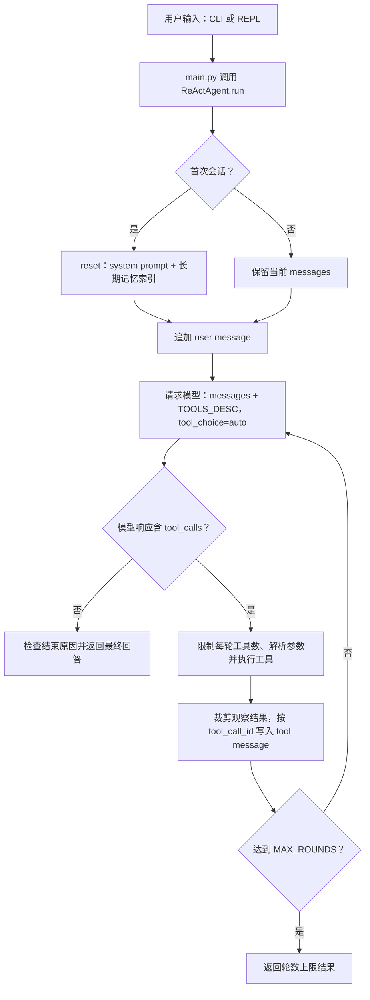
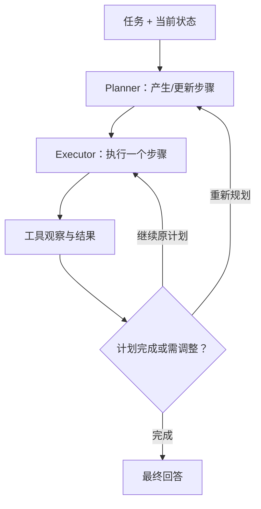
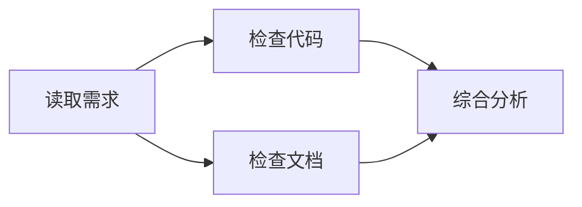
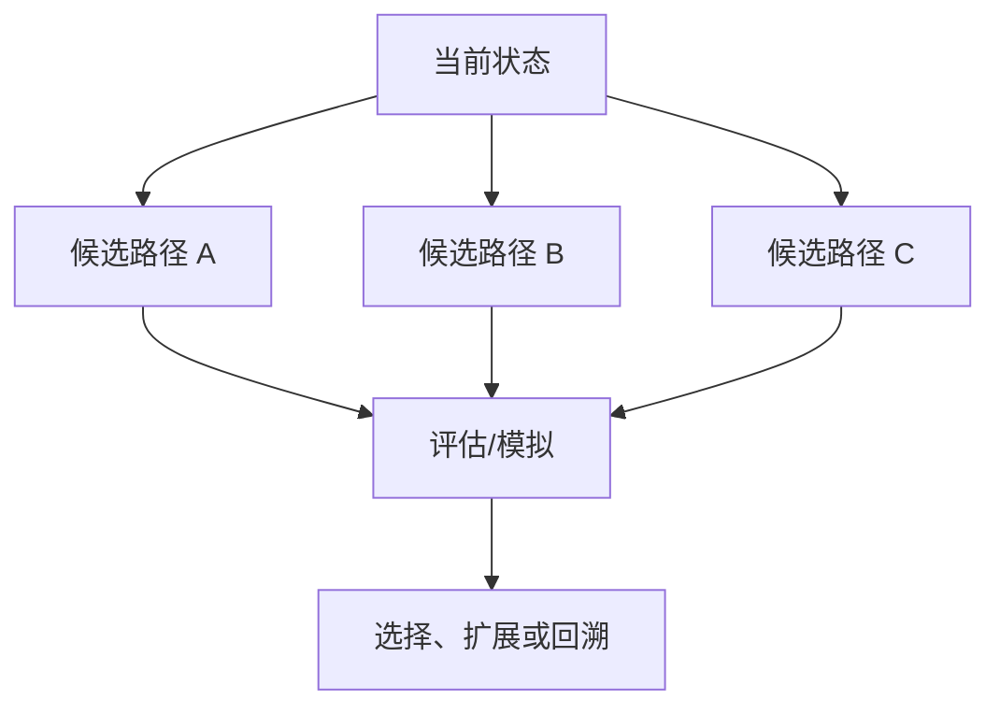
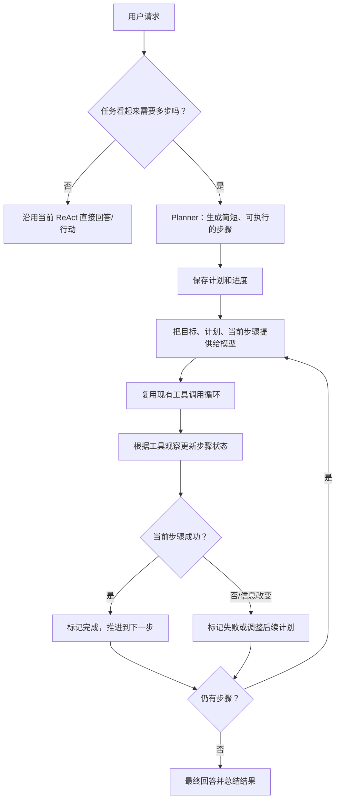

# 给 mini-agent-system 添加 Planning：现状分析与设计

状态说明：本文最初记录的是加入 Planning 前的架构分析与设计提案。Planning 已在当前代码中实现；其中描述基线行为的段落是历史背景，当前模块边界以 ../README.md 和目录结构为准。

本文保留原始基线分析和架构比较，供学习者理解 Planning 的设计动机；基线行为不代表当前代码。文中的架构比较来自论文和项目文档；针对本仓库的方案是结合现有代码作出的设计建议，不代表这些论文或框架规定了唯一实现。

## 1. Planning 实现前的基线架构

### 1.1 模块分工

| 模块 | 职责 |
| --- | --- |
| `main.py` | 解析命令行参数、设置工作目录、启动一次性请求或 REPL，并提供 `/compact`、`/context`、`/memory` 等命令。 |
| `agent/` | `ReActAgent` 公共入口及按规划、压缩、执行、编排和 ReAct 循环划分的实现模块。 |
| `config.py` | 模型/API 配置、系统提示词、最大轮数和工具调用数、重试与压缩预算、长期记忆索引预算。 |
| `tools/` | 工具插件。`tools/_spec.py` 的 `@tool` 同时登记 Python 函数和发给模型的 JSON Schema；`tools/__init__.py` 自动加载插件并生成 `TOOLS` 与 `TOOLS_DESC`。 |
| `context/` | 对话历史校验、压缩变换、摘要转录和上下文展示等纯函数。 |
| `memory.py` | 独立的 JSONL 长期笔记存储、检索和索引渲染；`tools/notes.py` 暴露写入、召回、删除工具。 |
| `presentation/` 与 `utils.py` | 终端 Markdown/表格/数学渲染；工具观察文本裁剪。 |

### 1.2 一次任务的控制流

`run()` 在进程内保留 `self.messages`，每轮把完整对话历史和工具 schema 交给模型。模型可直接回答，也可返回一个或多个工具调用；Agent 执行调用，把每个观察结果以对应 `tool_call_id` 加回历史，再请求模型继续。`MAX_ROUNDS` 限制外层循环，`MAX_TOOL_CALLS_PER_ROUND` 限制一轮中实际执行的调用数量；工具级可重试错误由 `_call_tool()` 按配置退避重试。这些机制控制执行边界和故障恢复，但不维护任务步骤。

在当前实现中，`context/` 提供压缩纯函数，`agent/compaction.py` 负责调用并替换会话状态，把较早的对话折叠为摘要，同时保留最近历史和合法的工具调用/结果结构。这解决的是上下文长度问题。长期记忆则是跨进程的另一层：`reset()` 把 `memory.py` 渲染的索引放进 system message，模型需要细节时可调用 `recall_notes`。记忆保存的是过去会话中的事实或偏好，不是当前任务的步骤进度。

**基线结论：当时的系统有 ReAct 式“边想边行动”的闭环，但没有显式、由程序维护的任务计划。** 模型可以根据当前上下文临时决定下一步；Agent 并没有一个结构化计划，去记录每个步骤是待做、进行中、已完成还是失败。

## 2. Planning 是什么：几种常见架构

Planning 的范围很广：从模型在每个回合临时选下一步，到生成并执行完整步骤清单，再到搜索多个可能路径或运行固定工作流，都可以称为规划能力。判断一个系统是否有“显式规划”，可以问：计划是否作为状态存在、是否能追踪完成情况，以及观察或失败后是否会更新计划。

### 2.1 ReAct：交错推理与行动

ReAct 将自然语言推理痕迹与可执行动作交错生成：模型根据当前信息选择行动，接收环境观察，再继续推理和行动。它可以诱导或更新短期行动计划，但计划常隐含在模型输出和对话历史中，不一定是独立、可校验的状态。[ReAct 论文](https://arxiv.org/abs/2210.03629)；[Google Research 对 ReAct 的介绍](https://research.google/blog/react-synergizing-reasoning-and-acting-in-language-models/)

适合需要边探索边决策、后续步骤取决于工具结果的任务。优点是结构简单、反馈及时；缺点是长任务容易丢失全局目标或重复尝试，计划进度也不易直接显示或验证。当前仓库就是这类循环。

### 2.2 Plan-and-Solve：先拆解，再逐步求解

Plan-and-Solve Prompting 的核心是先把问题分解为子任务，再执行这些子任务，目标之一是减少直接逐步推理中的漏步骤问题。[Plan-and-Solve 论文](https://arxiv.org/abs/2305.04091)

适合步骤相对清晰、可以先拆分的任务，例如“查找项目配置、比较两种实现、总结差异”。相比纯 ReAct，它更容易让人检查全局步骤；但若计划依赖尚未知的信息，固定计划可能很快过时。需要在计划阶段之外保留修订能力。

### 2.3 Planner–Executor：规划器与执行器分离

Planner–Executor 把“决定要做什么”和“实际做某一步”分成两个职责或组件。Planner 输出步骤，Executor 按步骤调用工具、汇报结果；之后 Planner 可根据结果继续、调整计划或结束。LangChain 的 Plan-and-Execute 介绍描述了这类结构，并指出它面向较长程规划时会增加模型调用成本。[Plan-and-Execute Agents](https://www.langchain.com/blog/plan-and-execute-agents)

分离职责有利于审查、记录和独立优化；代价是规划与执行接口更复杂，可能多一次或多次模型调用。小型 Agent 可以先由同一个模型承担两个角色，不必一开始就部署两个模型或两个 Agent。

### 2.4 工作流 / DAG：把流程表示成图

工作流（workflow）把执行过程拆成节点和边；DAG（有向无环图）允许显式表达依赖、并行分支和汇合。LangGraph 将有状态 Agent 与工作流表示为由状态、节点和边构成的图，也提供循环、检查点等机制。[LangGraph 官方概念文档](https://docs.langchain.com/oss/python/langgraph/graph-api)；[Thinking in LangGraph 指南](https://docs.langchain.com/oss/javascript/langgraph/thinking-in-langgraph)

当流程固定、分支条件明确、并行执行有价值时，图结构清晰且易于审计。面对开放式任务，过早把所有决策硬编码成节点会降低灵活性，因此可以把图用于稳定骨架，让模型在特定节点内作判断。

### 2.5 搜索式规划：比较多条候选路径

搜索式规划不只生成一个计划，而是探索多个候选推理/行动路径，再评分、验证或回溯。例如 Tree of Thoughts 把中间推理表示为可搜索的树，并用评估和搜索策略选择路径。[Tree of Thoughts 论文](https://arxiv.org/abs/2305.10601)。更一般的模型辅助规划也可把语言模型与明确的状态转移规则或求解器组合；这适合结果代价高、路径选择重要且有可评估状态的任务。

搜索能比较备选项、发现更好的策略，但需要额外模型调用、状态评估方法和预算控制。对当前工具型教学 Agent 来说，它不是第一步的必要复杂度。

### 2.6 架构对照

| 架构 | 计划何时产生 | 谁/什么推进执行 | 适用特点 | 主要成本或风险 |
| --- | --- | --- | --- | --- |
| ReAct | 每轮即时决定，计划可能隐含 | 同一个模型循环调用工具 | 开放任务、依赖观察反馈 | 长程目标和进度不够显式 |
| Plan-and-Solve | 执行前先分解 | 单模型按步骤求解 | 步骤可预先列出 | 计划容易因新信息过时 |
| Planner–Executor | Planner 生成，观察后可更新 | 执行器运行当前步骤 | 长任务、需要职责边界 | 多次模型调用与接口管理 |
| 工作流 / DAG | 通常由开发者定义骨架，运行时填状态 | 图引擎按节点/边路由 | 稳定流程、依赖或并行关系明确 | 开放任务难以完全预编码 |
| 搜索式规划 | 运行时生成多个候选 | 评估器与搜索策略筛选 | 需要权衡路径、可模拟状态 | 调用、实现和评估成本较高 |

这些模式并非只能单独使用。例如，工作流节点可以调用一个 ReAct 子循环，Planner–Executor 也可以用 ReAct 方式执行当前步骤。

## 3. 本仓库是否已经有 Planning？

基线版本中，`ReActAgent.__init__()` 的 `self.plan = []` 只是预留占位，没有计划执行逻辑；后续实现说明见本文件第 4 节。

当前实际行为是：

1. `run()` 把用户请求写入 `self.messages`，然后在最多 `MAX_ROUNDS` 轮中反复请求模型。
2. 每一轮由模型自行决定是返回答案还是请求工具；工具观察进入对话历史，影响下一轮决策。
3. Agent 没有计划阶段、步骤状态、当前步骤指针、进度展示或计划验证接口。

对第 1 节所描述的基线版本，可以这样准确描述：**Agent 有隐式、逐轮的局部规划能力（ReAct），没有显式的任务计划管理。** `MAX_ROUNDS` 是循环上限，不代表计划包含多少步；`context/` 的 compaction 是历史压缩；`memory.py` 的长期记忆是跨会话信息检索。这三者都不等同于当前任务的计划状态。

## 4. 已采用的方案（原始提案）

### 4.1 第一阶段：在现有 ReAct 循环前加入显式计划

建议采用**轻量 Plan-and-Execute + ReAct 执行**：先让模型为多步骤任务产生一个简短计划，再沿用现有工具调用循环执行。一个模型即可兼任规划与执行，避免立即引入多 Agent 或新框架。

计划作为 `ReActAgent` 的会话状态保存在 `self.plan`，每步至少包含可读的任务描述和状态。建议的最小状态集合为 `pending`、`in_progress`、`completed`、`failed`；Agent 同时记录当前步骤位置。计划不需要做成工具：它首先是 Agent 控制层的状态，不是用户工作区中的一种资源。UI/日志可以展示计划，模型则通过上下文了解当前进度。

这里“任务是否需要多步”的判断可以由模型在入口阶段给出，也可以第一版对所有请求生成很短的计划，并允许返回“无需拆解”。为了控制额外成本，推荐让第一版使用轻量判断，只对明显包含多个目标、依赖或产物的请求调用计划生成；简单问答仍走原路径。

### 4.2 与现有组件的衔接

- **与 `self.messages`：** 计划应作为明确标注的状态摘要提供给模型。推荐把“当前计划”放在 `messages[0]` 的 system prompt 受控区段中，并在发送每次请求前用 `self.plan` 刷新该区段；不要在 `assistant(tool_calls)` 与 tool messages 之间插入消息，也不要把计划伪装成工具结果。这样计划不会成为 ``context/`` 摘要区的一部分而丢失，且不必每轮重复追加整份计划。更新时限制步骤描述和状态摘要长度，避免计划占用过多上下文。
- **与工具调用：** 继续沿用 `TOOLS_DESC`、`_call_tool()` 和现有工具消息协议。工具调用是完成当前步骤的手段，不必为每个计划步骤新造工具。模型可在一个步骤中调用多个工具，步骤完成判定应结合工具观察和模型明确的进度更新，而不是假设“一次调用等于一步”。
- **与压缩：** `self.plan` 是 Agent 状态，不应只存在于可被压缩的普通历史文本中。`context/` 只处理 conversation history messages；后续实现应在每次压缩后仍从 Agent 状态重新注入最新计划摘要。压缩摘要也可保留已经完成的关键事实，但不可成为计划状态的唯一来源。
- **与长期记忆：** 长期记忆可以帮助 Planner 理解用户偏好或项目背景，但当前任务的 pending/completed 状态默认只属于本次会话。不要把每个临时步骤都写成长期笔记；只有用户明确要求保留或对未来会话有持续价值的信息，才使用现有记忆工具。
- **与结束条件：** 计划有未完成步骤时，模型给出看似最终的回答也不应自动等于计划完成。Agent 应要求对步骤状态做明确更新；必要时允许“目标已满足，剩余步骤不再需要”的终止理由。

### 4.3 示例：整理一个小型代码库

用户请求：“检查这个项目的配置和主要模块，解释 Agent 的控制流程，并指出添加 planning 的切入点。”

示例计划：

1. 读取入口、配置和 Agent 主循环。
2. 检查工具注册与执行协议。
3. 检查上下文压缩和长期记忆边界。
4. 综合当前能力并提出增量设计。

执行中，工具观察能证明某一步已完成，Agent 就更新状态；如果文件读取失败，则把该步骤标记为失败并重试或调整范围；如果发现关键模块不在原先假设的路径上，则重规划剩余步骤。最终回答应区分已经检查到的事实和设计建议。

### 4.4 关键失败模式与处理

| 情况 | 处理建议 |
| --- | --- |
| 计划遗漏步骤或顺序不合理 | 保留在途观察，允许模型重规划未完成部分，并记录原因。 |
| 步骤依赖未知信息 | 将步骤标注为探索/信息收集；根据观察再生成后续步骤，不要求预先猜出完整路径。 |
| 工具报错或返回空结果 | 不把工具调用本身当作步骤完成；将错误观察交回模型，重试策略仍由现有 `_call_tool()` 负责，超出重试后更新计划状态。 |
| 模型重复执行已完成工作 | 每次请求都提供稳定的步骤编号与状态；检查更新是否与已有状态矛盾，并提醒模型按当前步骤继续。 |
| 计划太长、占用上下文 | 给计划设置简短预算，只在上下文携带步骤和状态摘要；详细执行证据留在已有对话/压缩摘要中。 |
| 计划无法完成但模型想结束 | 允许标记阻塞并说明原因；区分“完成目标”与“达到轮数上限”。 |
| 用户中途改变目标 | 以新请求修订或替换剩余计划，保留已完成事实，不盲目执行旧步骤。 |

显式计划提高可观察性，但并不能保证模型一定制定正确步骤。计划状态也只是控制层记录；步骤成功仍需由可见工具结果、规则校验或用户确认支持。

## 5. 渐进学习与实现顺序

1. **先做会话内显式计划。** 定义最小计划状态与步骤状态；只对多步骤任务生成计划；复用原 ReAct 执行工具，并在每个观察后推进或重规划。
2. **补充可观察与可验证性。** 在 REPL/日志中显示步骤状态；为计划结构和状态转换增加离线断言；验证 compaction 前后计划仍可用、工具失败不会错误地标记完成。
3. **再按需求增加校验和人工确认。** 对有副作用或不可逆的操作，在执行前确认；对可验证步骤加入确定性条件，例如文件是否存在、命令退出码是否成功。
4. **最后考虑更复杂架构。** 当确实需要独立职责、并行步骤、持久恢复或候选路径搜索时，再评估 Planner–Executor、DAG/工作流、检查点或搜索式规划。第一版不需要多 Agent，也不需要 MCTS/Tree of Thoughts。

第一阶段的验收重点应是：简单请求仍可正常走 ReAct；多步骤请求能生成可见计划；工具观察能更新步骤状态；失败后不会谎报完成；重规划只改动尚未完成的部分；上下文压缩后计划状态仍可恢复。当前任务只要求分析设计，这些是未来实现时可采用的验收标准。

## 参考资料

- Yao et al., [ReAct: Synergizing Reasoning and Acting in Language Models](https://arxiv.org/abs/2210.03629), ICLR 2023。
- Wang et al., [Plan-and-Solve Prompting: Improving Zero-Shot Chain-of-Thought Reasoning](https://arxiv.org/abs/2305.04091), ACL 2023。
- Yao et al., [Tree of Thoughts: Deliberate Problem Solving with Large Language Models](https://arxiv.org/abs/2305.10601), NeurIPS 2023。
- LangChain, [Plan-and-Execute Agents](https://www.langchain.com/blog/plan-and-execute-agents)。
- LangChain, [LangGraph Graph API](https://docs.langchain.com/oss/python/langgraph/graph-api) 与 [Thinking in LangGraph](https://docs.langchain.com/oss/javascript/langgraph/thinking-in-langgraph)。
