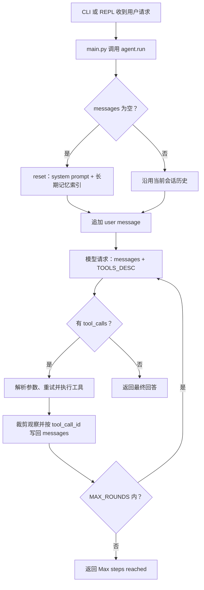
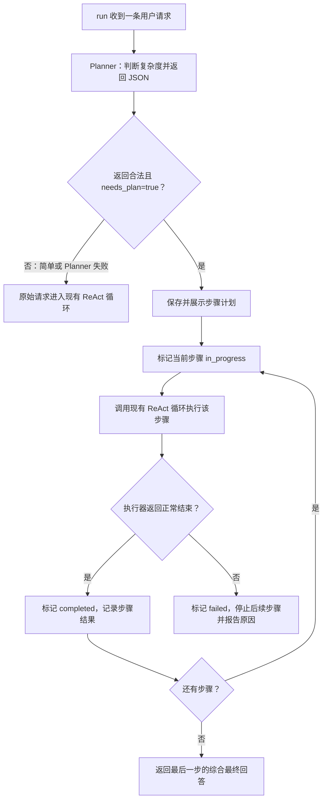

# Plan-and-Execute：第一版实现说明

状态说明：本文是已完成实现的历史配套指南，代码已按后续职责拆分；示例用于说明原始实现过程，当前入口与模块位置见 ../README.md。

本文保留第一版 Plan-and-Execute 的实现步骤，供学习者查阅。当前代码已按 ../README.md 所示的包结构完成该功能；本文件中的旧版插入点和片段是历史材料，不应直接套用。

> 本文代码块记录了当时的实现草案，当前源代码以 `agent/`、`context/` 和 `tests/` 中的实现为准。

## 1. 初始实现前的基线流程

### 1.1 模块职责

| 模块 | 目前负责什么 | 与 Planning 的关系 |
| --- | --- | --- |
| `main.py` | CLI/REPL、调用 `agent.run(prompt)`、处理 `/compact` 与中断回滚 | 不需要增加 Planner 逻辑；计划展示由 Agent 执行阶段输出。 |
| `agent/` | `ReActAgent` 状态、规划、压缩、工具执行、流式响应与 ReAct 循环 | 已实现计划生成与按步骤调度，复用 ReAct 工具循环。 |
| `config.py` | 系统提示词、模型参数、轮数/工具数上限、压缩预算 | 增加计划生成提示词及计划步骤/输出预算。 |
| `tools/` | 工具函数及其 API schema | 第一版不添加工具；继续复用 `TOOLS`、`TOOLS_DESC` 和 `_call_tool()`。 |
| `context/` | 历史裁剪、合法性校验、摘要转录与压缩纯函数 | 保持消息协议；计划快照仍写入受保护的 `messages[0]` system message。 |
| `memory.py` | 跨进程长期笔记 | 不用于存放本次任务计划或步骤状态。 |
| `tests/`、`_test.py` | 分组的离线断言与稳定运行入口 | 覆盖 Planner 解析、调度、失败回退和执行状态。 |

### 1.2 基线控制流



初始基线中 `self.plan = []` 只是占位；此处为实现前状态记录，当前规划与调度逻辑已位于 `agent/`。模型每轮根据历史决定下一步，因此已有 ReAct 的局部决策循环，但程序没有单独保存计划、逐项调度步骤或显示计划进度。`MAX_ROUNDS` 是防止循环无限延长的上限，不是计划步骤数。`context/` 的 compaction 是历史压缩；`memory.py` 是跨会话记忆；两者都不跟踪本次任务计划。

### 1.3 当前一次工具调用的往返

模型返回的 `tool_calls` 会先被写成 assistant message；每个调用执行后追加一个带相同 `tool_call_id` 的 tool message。下一次请求才继续模型循环。因此新增代码必须沿用这组消息配对，不能在 assistant tool call 与 tool 结果之间插入计划消息。工具参数解析、错误重试和观察裁剪都应继续走现有 `_parse_args()`、`_call_tool()` 与 `clip()`。

## 2. 第一版实现目标（已完成）

每次 `run(prompt)` 开始时，新增一次不带工具的 Planner 请求。Planner 负责判断任务是否复杂：简单任务直接交给现有 ReAct 循环；复杂任务返回步骤清单，Agent 保存并展示计划，然后依次将每个步骤交给现有 ReAct 执行循环。一个步骤完成后，Agent 更新状态并调度下一步。Planner 请求失败或结果无效时，任务退回原 ReAct 流程。



这一设计让 Planner 和 Executor 在职责上分开，但仍使用同一个模型和现有工具。每条用户请求都产生一次分类调用，所以简单问题也会多一次模型请求；这是“由模型判断是否需要计划”的直接成本。Planner 只负责初始拆解，本版本遇到步骤执行错误时停止并说明失败位置，不自动生成替代计划。自动重规划属于后续增强。

## 3. 改动范围

需要修改四个文件：

1. `config.py`：增加 Planner 提示词和输出/步骤预算常量。
2. `agent/`：增加计划解析、状态渲染、执行调度；把现有 `run()` 的 ReAct 循环抽成可复用的内部执行方法。
3. `main.py`：在现有 REPL 中断回滚时同步回滚计划状态。
4. `_test.py`：增加完全离线的 Planner 与调度断言。

不要改 `tools/`：计划不是一个外部动作工具，不应由模型通过普通工具调用修改 Agent 状态。不要把任务计划写进 `memory/notes.jsonl`：计划只属于当前用户请求。不要改 `context/`：system message 已由现有 compaction 的 `keep_head=1` 保护，状态摘要可以在压缩后重新生成。

## 4. 代码修改步骤

以下代码块按顺序应用。代码风格使用 `agent/` 现有的 tab 缩进和 `tests/` 的四空格缩进。

### 4.1 在 `config.py` 增加 Planner 配置

在 `MAX_ROUNDS` 等运行上限附近插入以下常量：

```python
PLAN_MAX_STEPS = 8
PLAN_MAX_TOKENS = 800

PLAN_PROMPT = """You are the planning stage of a tool-using assistant.
Decide whether the user's request needs multiple distinct execution steps.
For a simple question or one direct action, return needs_plan=false and an empty steps list.
For a task with multiple goals, dependencies, or information-gathering stages, return
needs_plan=true and an ordered list of short, concrete steps. Each step should describe
one outcome the executor can work toward using the available conversation and tools.
Do not claim that any step has already been executed. Do not include tool-call JSON.

Return exactly one JSON object, with this shape and no markdown fences or extra text:
{"needs_plan": false, "steps": []}

When a plan is needed, use this shape:
{"needs_plan": true, "steps": ["First step", "Second step"]}
"""
```

`PLAN_MAX_STEPS` 限制模型返回的步骤数量；`PLAN_MAX_TOKENS` 限制 Planner 输出长度。这里不打开 provider 特定的 `response_format=json_object`，因为项目使用 OpenAI 兼容 endpoint，提示词加本地 JSON 校验可避免把可选 API 参数变成启动依赖。

同时在现有 `EXPORT_LOG_CHOICES` 字典中增加一项（建议放在 `"turn": True` 附近）：

```python
"planning": True,
```

这是必需的：`_log_section()` 使用 `EXPORT_LOG_CHOICES[gate]` 严格索引，缺键会抛 `KeyError`。

### 4.2 在 `agent/` 引入常量

在现有 `from config import ...` 区域新增：

```python
from config import PLAN_MAX_STEPS, PLAN_MAX_TOKENS, PLAN_PROMPT
```

### 4.3 添加 JSON 响应解析函数

在 `_answer_warning()` 后、`ReActAgent` 类定义前加入以下纯函数。它不做网络调用，便于离线验证；只接受标准 JSON，不静默猜测模型意图。

```python
def _parse_plan_response(content: str, max_steps: int = PLAN_MAX_STEPS) -> tuple:
	"""Return (needs_plan, steps, error). Invalid output returns an error."""
	try:
		data = json.loads((content or "").strip())
	except json.JSONDecodeError as e:
		return False, [], f"invalid JSON: {e}"

	if not isinstance(data, dict):
		return False, [], "top-level JSON value must be an object"
	if not isinstance(data.get("needs_plan"), bool):
		return False, [], "needs_plan must be a boolean"

	needs_plan = data["needs_plan"]
	steps = data.get("steps")
	if not isinstance(steps, list):
		return False, [], "steps must be a list"
	if any(not isinstance(step, str) or not step.strip() for step in steps):
		return False, [], "every step must be a non-empty string"
	steps = [step.strip() for step in steps]

	if not needs_plan:
		return False, [], ""
	if len(steps) < 2:
		return False, [], "a planned task must contain at least two steps"
	if len(steps) > max_steps:
		return False, [], f"plan has {len(steps)} steps; limit is {max_steps}"

	return True, steps, ""
```

### 4.4 为 Agent 添加计划状态与 helper 方法

#### 初始化及 reset

保留 `__init__()` 中的 `self.plan = []`，并在它之后增加：

```python
		self.plan_request = None
		self.plan_error = None
```

在 `reset()` 尾部、`self.task_text = None` 附近增加以下重置，确保新会话不沿用上次状态：

```python
		self.plan = []
		self.plan_request = None
		self.plan_error = None
```

每条新的用户请求也会创建自己的计划；会话历史仍保留，以支持 REPL 多轮对话。

#### 插入 `_request_plan()`、`_render_plan()` 和执行状态 helper

在 `ReActAgent.context_stats()` 之后、现有 `_log_section()` 或 `_call_tool()` 方法之前插入以下方法：

```python
	def _request_plan(self, prompt: str) -> tuple:
		"""Classify a request and, when needed, return its ordered steps."""
		try:
			# 先给终端可见反馈；流式读取 reasoning_content，隐藏供解析的 JSON。
			print("🧭 Planning request…", flush=True)
			request = {
				"model": MODEL,
				"messages": [
					{"role": "system", "content": PLAN_PROMPT},
					{"role": "user", "content": prompt},
				],
				"max_tokens": PLAN_MAX_TOKENS,
				"stream": True,
				"extra_body": {"thinking": {"type": THINKING}},
			}
			if REQUEST_USAGE:
				request["stream_options"] = {"include_usage": True}
			stream = self.client.chat.completions.create(**request)
			msg = self._consume_stream(stream, show_content=False)
			if msg.usage is not None:
				self.last_usage = msg.usage
			needs_plan, steps, error = _parse_plan_response(msg.content)
		except Exception as e:
			return False, [], f"Planner request failed: {type(e).__name__}: {e}"
		if error:
			return False, [], f"Planner response rejected: {error}"
		return needs_plan, steps, ""

	def _render_plan(self) -> str:
		"""Render the current plan into a compact, model-visible status block."""
		if not self.plan:
			return ""
		lines = ["当前任务计划："]
		for i, step in enumerate(self.plan, 1):
			marker = "→" if step["status"] == "in_progress" else (
				"✓" if step["status"] == "completed" else (
				"✗" if step["status"] == "failed" else "·"))
			lines.append(f"{marker} {i}. [{step['status']}] {step['text']}")
		return "\n".join(lines)

	def _refresh_plan_context(self):
		"""Refresh the system message; it is protected by compaction's keep_head."""
		if not self.messages or self.messages[0].get("role") != "system":
			return
		content = self.system_prompt
		if self.memory_index:
			content += MEMORY_INDEX_HEADER + self.memory_index
		plan_text = self._render_plan()
		if plan_text:
			content += "\n\n" + plan_text + (
				"\n按顺序执行当前步骤。每完成一个步骤后再继续；"
				"最后一步完成时，结合原始用户目标给出 Final Answer。")
		self.messages[0]["content"] = content

	@staticmethod
	def _execution_failed(result: str) -> bool:
		"""Detect terminal failures returned by the existing ReAct loop."""
		return (result == "Max steps reached"
				or result.startswith("Error during LLM call ("))
```

Planner 错误会被作为 `(False, [], message)` 返回，由调用方记录并走原 ReAct 路径。只有可解析且符合 schema 的 `needs_plan=true` 才进入计划执行。Planner 使用流式请求以便实时显示 `reasoning_content`，但通过 `_consume_stream(..., show_content=False)` 隐藏用于解析的 JSON；它不传工具 schema，也不把 Planner 的 JSON 加进用户对话历史。请求前显示 `🧭 Planning request…`，避免等待模型时终端看起来没有响应。若配置 `DEEPSEEK_THINKING=disabled` 或服务端不返回 reasoning channel，则仍会显示阶段提示，但不会有思考文本。

为支持这种调用，给现有 `_consume_stream()` 增加可选参数 `show_content=True`。默认值保持原 ReAct 的流式回答行为；设为 `False` 时仍在内存中收集 `.content`、工具调用、usage 和 finish reason，但不向终端打印 content，也不启用 Markdown 渲染器。reasoning channel 仍按原有行为实时打印。

`_refresh_plan_context()` 每次根据 `self.plan` 重建 system message，而不是不断追加文本。因此 `context/` 压缩历史后，计划仍从 Agent 状态重新渲染；`messages[0]` 作为 system message 会被 `keep_head=1` 保留。计划索引只包含步骤与状态，具体结果仍留在对话历史中。

### 4.5 把原 ReAct 循环抽成 `_run_react()`，并新增 `run()` 调度器

当前 `run()` 同时负责 session 初始化、追加 user message 和执行 ReAct 循环。为能逐步执行多个计划步骤，需要把现有循环复用为内部方法。

#### 第一步：改名并缩小原方法开头

把现有：

```python
def run(self, prompt: str) -> str:
```

改为：

```python
def _run_react(self, prompt: str, first_turn: bool = False) -> str:
```

在该方法中，保留从“清理孤立 surrogate 字符”开始的 prompt 清理代码。然后将原来从 `first_turn = not self.messages` 到 `self.turn += 1` 的初始化片段替换为下面代码。注意不要在这个 helper 里调用 `reset()`；外层 `run()` 统一初始化会话：

```python
		if self.task_text is None:
			self.task_text = prompt
		self.messages.append({"role": "user", "content": prompt})
```

原有 `if first_turn and ... initial-messages` 日志条件继续有效，`first_turn` 由 wrapper 只在本次进程的第一次 ReAct 执行时传入。原有 `turn` 日志和递增由 wrapper 管理，不要在 helper 每个步骤都增加用户 turn。

#### 第二步：在 class 中新增 `run()` wrapper

将下面方法放在 `_run_react()` 前面。它处理每条用户请求：初始化会话、增加一次 turn、请求 Planner、显示计划并按顺序执行各步。

```python
	def run(self, prompt: str) -> str:
		"""Plan when useful, then execute each planned step through ReAct."""
		prompt = prompt.encode("utf-8", "surrogateescape").decode("utf-8", "replace")
		first_turn = not self.messages
		if first_turn:
			self.reset()
		if self.task_text is None:
			self.task_text = prompt
		self.turn += 1
		self.plan_request = prompt
		self.plan_error = None
		self.plan = []
		self._refresh_plan_context()

		if EXPORT_LOG and EXPORT_LOG_CHOICES["turn"]:
			with open(EXPORT_LOG_PATH, "a", encoding="utf-8") as f:
				f.write(f"Turn {self.turn}\n--------------------\nUser: {prompt}\n\n")

		needs_plan, steps, error = self._request_plan(prompt)
		if error:
			self.plan_error = error
			print(f"⚠ {error}; falling back to the ReAct loop")
			self._log_section("planning", error)

		if not needs_plan:
			self._refresh_plan_context()
			return self._run_react(prompt, first_turn=first_turn)

		self.plan = [{"text": step, "status": "pending"} for step in steps]
		self._refresh_plan_context()
		print("\nPlan:")
		for i, step in enumerate(self.plan, 1):
			print(f"  {i}. {step['text']}")
		self._log_section("planning", "Plan:\n" + "\n".join(
			f"{i}. {step['text']}" for i, step in enumerate(self.plan, 1)))

		results = []
		for i, step in enumerate(self.plan):
			step["status"] = "in_progress"
			self._refresh_plan_context()
			print(f"\n--- Plan step {i + 1}/{len(self.plan)} ---")
			if i == 0:
				step_prompt = (
					f"Original task: {prompt}\n\n"
					f"Execute only plan step {i + 1}/{len(self.plan)}: {step['text']}\n"
					"Use the available tools as needed. Give a concise step result. "
					"Do not claim the whole task is finished unless this is the final step.")
			else:
				completed = "\n".join(
					f"Step {j + 1} result: {result}" for j, result in enumerate(results))
				step_prompt = (
					f"Original task: {prompt}\n\n"
					f"Already completed work:\n{completed}\n\n"
					f"Execute only plan step {i + 1}/{len(self.plan)}: {step['text']}\n"
					"Use the available tools as needed. Give a concise step result. "
					"Do not claim the whole task is finished unless this is the final step.")
			if i == len(self.plan) - 1:
				step_prompt += (
					" This is the final step: finish by answering the original task, "
					"starting the final response with 'Final Answer:'.")

			try:
				result = self._run_react(step_prompt, first_turn=(first_turn and i == 0))
			except Exception as e:
				step["status"] = "failed"
				self._refresh_plan_context()
				message = (f"Plan stopped at step {i + 1}/{len(self.plan)}: "
					f"{type(e).__name__}: {e}")
				self._log_section("planning", message)
				return message

			results.append(result)
			if self._execution_failed(result):
				step["status"] = "failed"
				self._refresh_plan_context()
				message = (f"Plan stopped at step {i + 1}/{len(self.plan)}. "
					f"Execution result: {result}")
				self._log_section("planning", message)
				return message

			step["status"] = "completed"
			self._refresh_plan_context()
			self._log_section("planning", f"Step {i + 1} completed: {step['text']}")

		return results[-1] if results else "No plan steps were executed."
```

#### 第三步：处理 `_run_react()` 中的旧 turn 计数与首次日志

原 `run()` 中的 `self.turn += 1` 和 `Turn {self.turn}` 写入已移到 wrapper，因此从 `_run_react()` 中删除这两项重复逻辑。保留原有每轮 Round、模型请求、工具调度、最终回答检查、上下文记录和最大轮数处理。

在 `__init__()` 与 `reset()` 中初始化 `self._rounds_used = 0`；每次外层 `run()` 开始新用户请求时也重置为 0。将 `_run_react()` 中的轮数预算设为 `max(0, MAX_ROUNDS - self._rounds_used)`，并在每次进入模型请求循环时递增 `_rounds_used`。这样简单任务最多使用 `MAX_ROUNDS` 轮，多步骤计划的所有步骤合计也最多使用 `MAX_ROUNDS` 轮，不会变成“每步各有一份上限”。

原始日志初始化块：

```python
if first_turn and EXPORT_LOG and EXPORT_LOG_CHOICES["initial-messages"]:
```

保持原样；wrapper 只把 `first_turn=True` 传给本次请求的第一个执行步骤。简单任务也把该值直接传入 `_run_react()`。

原有 `reset()` 会把 `messages` 重置为 system message。新 wrapper 仍只在 `messages` 为空时调用一次 `reset()`；后续每个计划步骤都由 `_run_react()` 追加 user message，不会重置对话。Turn 日志只由 wrapper 写一次；删除 `_run_react()` 中原来每次执行都会记录的 Turn/User 块，避免每个计划子步骤都伪装成单独用户请求。

### 4.6 输出与日志行为

计划会在执行前打印为 `Plan:` 列表；每一步开始时打印 `--- Plan step i/n ---`。状态摘要通过 `_refresh_plan_context()` 写入 system message，写日志使用新增的 `planning` gate 和现有日志文件路径配置。

`completed` 表示当前步骤的 ReAct 执行器正常返回了一个结束结果，不是独立的事实校验。工具返回错误时，现有 ReAct 模型可以继续修复或解释；只有 ReAct 循环达到 `MAX_ROUNDS`、LLM 请求最终失败或内部执行抛出异常时，本 wrapper 才将该步骤标为 `failed` 并停止后续步骤。

### 4.7 中断与会话语义

`main.py` 在 `KeyboardInterrupt` 时会回滚 `messages` 并恢复 `turn`，但新计划状态也要一并恢复，否则显示的计划会与历史不一致。在 `try: agent.run(prompt)` 之前保存运行状态快照。可在 `main.py` 顶部加入 `import copy`，然后在 `start = len(agent.messages)` 附近加：

```python
start_plan = copy.deepcopy(agent.plan)
start_plan_request = agent.plan_request
start_plan_error = agent.plan_error
start_turn = agent.turn
start_rounds_used = agent._rounds_used
```

在现有 `except KeyboardInterrupt` 回滚块中增加：

```python
agent.plan = start_plan
agent.plan_request = start_plan_request
agent.plan_error = start_plan_error
agent._rounds_used = start_rounds_used
agent._refresh_plan_context()
```

这些快照必须在调用 `agent.run()` 之前创建；如果放在 `except KeyboardInterrupt` 中读取，保存的将是已被打断请求改写后的状态。完整修改文件范围为 `config.py`、`agent/`、`main.py` 和 `_test.py`。

## 5. 测试计划

新增断言放在对应的 `tests/` 模块，完全使用伪造响应，不调用真实 API。可将下面测试组加入对应的测试模块；它们覆盖解析器与 wrapper 的路由、顺序和故障路径。`_request_plan` 和 `_run_react` 都是可直接 monkeypatch 的实例方法。

```python
# ---- Planning：JSON 校验、复杂任务顺序执行与故障回退 -----------------------
from agent.helpers import _parse_plan_response

# 纯解析：合法简单请求、合法计划、非法 JSON/schema、步骤数上限
assert _parse_plan_response('{"needs_plan": false, "steps": []}') == (False, [], "")
assert _parse_plan_response(
    '{"needs_plan": true, "steps": ["read", "summarize"]}') == (
        True, ["read", "summarize"], "")
assert _parse_plan_response("not json")[2].startswith("invalid JSON")
assert _parse_plan_response('{"needs_plan": "yes", "steps": []}')[2]
assert _parse_plan_response(
    '{"needs_plan": true, "steps": ["only one"]}')[2]
assert _parse_plan_response(
    '{"needs_plan": true, "steps": ["a", "b", "c"]}', max_steps=2)[2]
print("Planning parser: valid and invalid JSON cases")

# 多步骤计划按序执行，状态结束后都为 completed；不触碰真实客户端/网络
agent = ReActAgent()
agent._request_plan = lambda prompt: (True, ["inspect files", "summarize findings"], "")
executed = []
def fake_react(prompt, first_turn=False):
    executed.append((prompt, first_turn))
    return f"result-{len(executed)}"
agent._run_react = fake_react
result = agent.run("inspect this project and explain it")
assert len(executed) == 2, executed
assert "step 1/2" in executed[0][0].lower()
assert "step 2/2" in executed[1][0].lower()
assert result == "result-2", result
assert [step["status"] for step in agent.plan] == ["completed", "completed"]
assert executed[0][1] is True and executed[1][1] is False
print("Planning executor: steps run in order and update status")

# 简单请求走原 ReAct，不留下计划状态
simple = ReActAgent()
simple._request_plan = lambda prompt: (False, [], "")
simple_calls = []
simple._run_react = lambda prompt, first_turn=False: simple_calls.append(prompt) or "direct answer"
assert simple.run("what is 2 + 2?") == "direct answer"
assert len(simple_calls) == 1 and simple.plan == []
print("Planning router: simple request uses ReAct directly")

# Planner 异常/解析失败以错误返回时，仍回退到 ReAct
fallback = ReActAgent()
fallback._request_plan = lambda prompt: (False, [], "Planner response rejected: invalid JSON")
fallback_calls = []
fallback._run_react = lambda prompt, first_turn=False: fallback_calls.append(prompt) or "fallback answer"
assert fallback.run("do something") == "fallback answer"
assert len(fallback_calls) == 1 and fallback.plan_error
print("Planning fallback: invalid planner output does not block the request")

# 执行失败时停止后续步骤，并将当前步骤标为 failed
failed = ReActAgent()
failed._request_plan = lambda prompt: (True, ["step one", "step two"], "")
failure_calls = []
def failing_react(prompt, first_turn=False):
    failure_calls.append(prompt)
    return "Max steps reached"
failed._run_react = failing_react
failure_result = failed.run("multi-step task")
assert len(failure_calls) == 1, failure_calls
assert failed.plan[0]["status"] == "failed"
assert failed.plan[1]["status"] == "pending"
assert "stopped at step 1/2" in failure_result.lower()
print("Planning failure: failed step stops the remaining plan")

# Planner 调用异常通过 _request_plan 收口为 fallback 结果
broken_planner = ReActAgent()
class BrokenCompletions:
    def create(self, **kwargs):
        raise ConnectionError("offline")
broken_planner.client = SimpleNamespace(
    chat=SimpleNamespace(completions=BrokenCompletions()))
assert broken_planner._request_plan("task")[0:2] == (False, [])
assert "ConnectionError" in broken_planner._request_plan("task")[2]
print("Planning request: API exception is converted to a ReAct fallback")

# 同一 Agent 的下一条用户请求会替换旧计划，不会沿用旧步骤
resetting = ReActAgent()
plans = iter([
    (True, ["old step one", "old step two"], ""),
    (True, ["new step one", "new step two"], ""),
])
resetting._request_plan = lambda prompt: next(plans)
resetting._run_react = lambda prompt, first_turn=False: "ok"
resetting.run("first request")
resetting.run("second request")
assert [step["text"] for step in resetting.plan] == ["new step one", "new step two"]
print("Planning state: each user request replaces the previous plan")

# Planned steps share one MAX_ROUNDS budget for the whole user request.
from config import MAX_ROUNDS
budget = ReActAgent()
budget._rounds_used = MAX_ROUNDS
assert budget._run_react("budget exhausted") == "Max steps reached"
assert budget._rounds_used == MAX_ROUNDS
print("Planning budget: exhausted request budget blocks additional ReAct rounds")
```

再增加一个状态重置断言：对同一个 Agent 连续调用两次 `run()`，第二次请求的新计划必须覆盖第一条计划；测试继续 stub `_request_plan` 和 `_run_react`，不需要测试 API 请求或终端 Markdown 渲染。

运行命令：

```bash
python3 _test.py
```

按仓库指南，行为变更后应运行离线断言脚本。CLI 参数未变，因此不需要 `python3 main.py --help`。人工验收时，在配置好 API Key 的开发环境中各运行一次简单请求和多步骤请求，确认简单任务显示 ReAct 回答，多步骤任务先显示计划、逐步显示进度，最后一步返回整体答案。实时 API 检查不替代离线测试。

## 6. 验收标准与已知限制

- 简单请求由 Planner 分类后走旧 ReAct 循环；复杂请求有顺序计划，并逐步进入同一 ReAct 工具执行逻辑。
- 计划与状态保存在 `ReActAgent` 中，并在 system message 展示；上下文 compaction 不会成为其唯一状态来源。
- 每个计划步骤使用现有工具 schema、参数解析、重试和 tool-call/tool-result 配对，不会破坏 API 历史形状。
- Planner JSON 格式错误或网络/API 失败会记录原因并降级到 ReAct；执行阶段终止错误会停止后续步骤并说明停在哪一步。
- 所有离线测试使用 fake/stub，无需 API Key 或网络；人工 API 检查只用于确认最终交互体验。
- 本版本不做人工审批；计划自动执行。后续加入审批时，应在展示计划之后、执行第一步之前增加等待用户确认的边界。
- Planner 每条请求多一次模型调用；简单任务也承担该分类成本。`completed` 表示执行器正常结束，并不代表步骤结果经过独立验证。
- 步骤失败时本版停止，不自动修订计划。若后续要支持重规划，应保留已完成步骤和结果，只让 Planner 生成剩余步骤。

## 7. 实现前必须按代码锚点复核

本仓库的 `agent/` 使用 tab 缩进；`tests/` 与 `tools/` 使用四空格缩进。实现时应按本文的函数/代码锚点定位，而不要整文件格式化。原 `run()` 较长，抽出 `_run_react()` 时除初始化、turn 计数和日志归属外，应保留请求错误处理、`finish_reason` 检查、ReAct marker 判断、工具数上限、观察裁剪和原日志行为。

本文给出的 wrapper 示例要求 `main.py` 同步快照计划状态，因此计划状态应是普通 list/dict 数据，可由 `copy.deepcopy()` 复制。加入代码后先运行 `_test.py`，再人工执行简单任务和两步以上任务，检查打印、日志、工具调用和最终答案。
