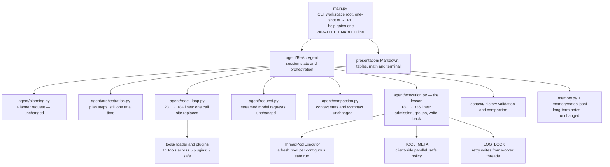
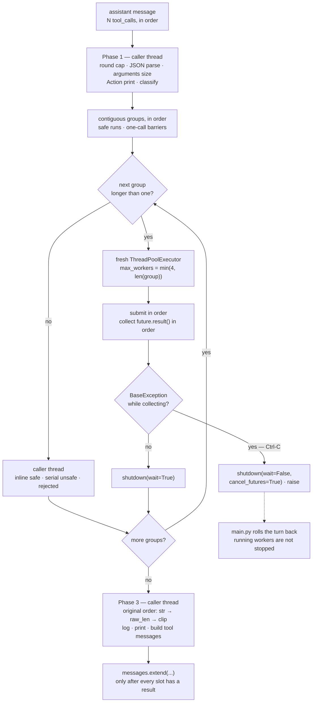

# Parallel Tool Execution

The ninth entry in the `mini-agent-system/` series: the same multi-turn ReAct agent, context
compaction, long-term memory, Planner stage and fifteen tools as
[`../08-planning-agent/`](../08-planning-agent/) — with one round's tool calls able to overlap.

08 ran a round's calls in a `for` loop on the caller's thread, so a batch of reads cost the sum of
their times. 09 leaves the model-facing protocol untouched and changes only the executor: every call
is admitted and classified on the caller thread, each *contiguous* run of independently safe calls
is executed in a pool, and the results are written back in the original `tool_calls` order. The model
decides whether to batch; the harness decides what may overlap.

| What 08 does | What 09 adds |
| --- | --- |
| Every call in a round runs inline, in order, on the caller thread | Contiguous `parallel_safe` runs run in a pool; every other call is a barrier |
| Tool declarations carry the schema only | `@tool(..., parallel_safe=False)` and a client-side `TOOL_META` |
| A round's wall time is the sum of its calls | A safe batch can approach its slowest call; both numbers are logged |
| A 429 is a deterministic 4xx failure | A 429 raises `ConnectionError` and is retried with the transient errors |
| One execution path | `PARALLEL_ENABLED=0` reproduces the 08 tool-message list |

The first two rows are the lesson. The other three are what the lesson dragged in: sharing one log
file across worker threads forced `_LOG_LOCK` and the `id=` / `[i/N]` labels; sharing one rate limit
forced the 429 branch; and the read-only git tools needed `GIT_OPTIONAL_LOCKS=0` before three
commands that can quietly refresh `.git/index` could honestly be called safe.

Read 09 as a diff against 08. Of the 42 files the two lessons share, **29 are byte-for-byte
identical** and 13 differ; 09 adds `tests/test_parallel.py` and two `doc/` files, and 08's
`README.md` is the only file absent. Seven of the eight tool files changed: four plugin files only
add `parallel_safe` markers, while `tools/_spec.py`, `tools/__init__.py` and `tools/_common.py` carry
the metadata plumbing and the 429 fix — the model-facing schema (`TOOLS_DESC`) is unchanged. The
algorithm is concentrated in one file: `agent/execution.py` grows from 187 to 336 lines, and
`agent/react_loop.py` shrinks from 231 to 184 because its serial block becomes one call.

## Structure

The public entry point is still `ReActAgent`; the package layout is 08's. The scheduler lives
entirely in `agent/execution.py`, and the only other new state is the metadata projection in
`tools/__init__.py`:



Three files carry the change:

- **`agent/execution.py` is the only new algorithm.** Phase 1 admission, Phase 2 grouping and pool
  lifetime, Phase 3 ordered write-back. It imports `TOOL_META` and the two `PARALLEL_*` constants;
  no tool name appears in it — classification is a metadata lookup.
- **`agent/react_loop.py` is where the serial block disappeared.** The assistant-message
  construction is 08's; the only call site is
  `self.messages.extend(self._execute_tool_calls(msg.tool_calls))`.
- **`tools/` records a policy, not a mechanism.** `@tool` gains one keyword,
  `tools/__init__.py` validates it and projects `TOOL_META`, `TOOLS_DESC` is unchanged, `main.py`
  gained one help line, and `config.py` gained two constants and two log gates.

## Requirements

- Python 3.x.
- The `openai` Python package (`pip install openai`); this repository does not pin a version or
  include a dependency manifest.
- A DeepSeek-compatible API key and endpoint. The configured default model is `deepseek-flash`;
  set a model that supports the configured thinking mode and streamed completions.
- Optional tool dependencies are imported lazily by the tool functions that need them: `requests`,
  `beautifulsoup4` with `lxml`, `ddgs`, and `feedparser`. A missing optional package is returned to
  the model as a tool observation when that tool is called.
- `readline` is optional. It enables line editing and Unicode-aware backspace where available;
  without it, the REPL falls back to `input()`.
- **No new dependency.** The scheduler uses only `threading` and `concurrent.futures` from the
  standard library — no async framework, no executor package, no tokenizer.

## Setup

Configuration is read from environment variables in `config.py`:

| Variable | Default |
| --- | --- |
| `DEEPSEEK_API_KEY` | `sk-your-key-here` (must be replaced) |
| `DEEPSEEK_BASE_URL` | `https://api.deepseek.com` |
| `DEEPSEEK_MODEL_NAME` | `deepseek-flash` |
| `DEEPSEEK_THINKING` | `enabled` |
| `DEEPSEEK_CONTEXT_WINDOW` | `784000` tokens, for the occupancy display |
| `PARALLEL_ENABLED` | `1` — every value except the literal `0` enables it |

```python
PARALLEL_ENABLED = os.getenv("PARALLEL_ENABLED", "1") != "0"
PARALLEL_MAX_WORKERS = 4   # configured cap per safe group; clamped to >= 1
```

`PARALLEL_MAX_WORKERS` is a source constant, not an environment variable; the per-group worker
count is `max(1, min(PARALLEL_MAX_WORKERS, len(group)))`. `PARALLEL_ENABLED` is read once when
`config.py` is imported, so it is a process-level switch: `"false"`, `"off"` and `"no"` all leave
parallelism **on**.

```bash
export DEEPSEEK_API_KEY=sk-...
PARALLEL_ENABLED=0 python3 main.py --msg 'read these two files and compare them'
```

## Running

The command line is 08's: `--root <dir>`, `--msg <text>`, `--help`, or a bare prompt. There is no
new flag and no new REPL command; `--help` gains one environment line:

```text
PARALLEL_ENABLED          0 disables parallel tool execution (default enabled)
```

```bash
cd 09-parallel-tool-execution

python3 main.py --help
python3 main.py                                  # multi-turn REPL
python3 main.py --root /path/to/project          # REPL rooted at that project
python3 main.py --msg 'inspect and explain this project'
python3 main.py --root /path/to/project --msg 'summarize the project'
python3 main.py 'inspect and explain this project' # compatible bare-prompt form
PARALLEL_ENABLED=0 python3 main.py --msg '...'    # serial A/B
```

Pool threads inherit the process's working directory, so `--root` still governs every tool path;
`logs/`, `memory/` and `tmp/` are created beside it. The switch affects scheduling and terminal
ordering only — the tool messages in history are the same either way.

## How it works

The whole lesson is the body of `_execute_tool_calls`; everything around it is 08's. The function
has three phases, and only the middle one can run more than one thing at a time.

### ① Parallelism starts after the model has finished a message

One assistant message carries N `tool_calls`, and the API requires exactly N tool messages, in the
same order, with matching `tool_call_id`s — the rule `context.validate_history()` checks. Nothing
in this lesson touches that protocol. `_consume_stream()` already reassembles fragmented calls and
returns them sorted by index, so the scheduler receives a list in the model's order and returns a
list in the same order.

The scope is one round of one ReAct step. Plan steps are still executed one at a time, rounds never
overlap, and a tool is never started while the response is still streaming. There is also no
`parallel_tool_calls` request parameter and no prompt instruction asking the model to batch: the
batch is whatever the model emitted, and a round with one call simply pays the classification pass.

### ② Three phases: admit, run, write back

- **Phase 1 — caller thread.** The per-round cap is applied, arguments are parsed, the
  `arguments-size` line is logged, the `Action` line is printed, and each call is classified. An
  over-cap or unparseable call gets a pre-filled error observation and is never dispatched.
- **Phase 2 — group by group.** The admitted calls are split into contiguous groups (④). A
  multi-call safe group gets a fresh `ThreadPoolExecutor`; a one-call group or an unsafe call runs
  inline on the caller thread; a rejected call produces its error without executing. Groups run
  one after another.
- **Phase 3 — caller thread again.** The plans are iterated in their original order, each
  observation is normalized (`str()` → `raw_len` → `clip()`), logged and printed, and exactly one
  `role: "tool"` message per call is built. `react_loop.py` extends `self.messages` only after the
  helper returns.

The staging is visible on screen: all `Action` lines print before any `Observation` line. When a
round has more than one call, both labels gain an `[i/N]` prefix.



### ③ `parallel_safe` is metadata, and it fails closed

The scheduling policy is declared next to the function, not inferred from its name:

```python
@tool(description="Read content from a file",
      parameters={"path": {"type": "string"}},
      required=["path"],
      parallel_safe=True)
def read_file(path: str) -> str:
    ...
```

`parallel_safe=False` is the default, so a new tool is a barrier until its author says otherwise.
The loader rejects a non-bool declaration (`parallel_safe must be a bool, got ...`), and
`tools/__init__.py` projects the registry into
`TOOL_META = {name: {"parallel_safe": bool}}`. `TOOLS_DESC` never includes the field — it is
client-side policy, and a test asserts that no model-facing function object contains it.

The classifier is deliberately narrow:

```python
def _parallel_safe(self, name: str) -> bool:
    return TOOL_META.get(name, {}).get("parallel_safe") is True   # unknown → False
```

`is True`, not truthiness: `1`, `"yes"` and a missing entry all fail closed. Six tools remain
unsafe because concurrency would change their meaning: `write_file` (a concurrent read can see a
partial file), `execute_command` (arbitrary side effects), `download_file` (writes the target and
may remove a partial file), `run_python` (arbitrary code, and its `tmp/agent_py_<ms>.py` path can
collide), `write_note` (reads the store, computes `max(id)+1`, then appends) and `forget_note`
(rewrites through a fixed temp file). Misclassification is a correctness bug, not a missed
optimization; the exact nine-tool safe set is pinned by the first test group.

### ④ A barrier is a contiguous run, not a lock

Grouping is a single pass over the admitted plans in order. A safe call extends the current run; an
unsafe or rejected call flushes the run, becomes a one-element group, and starts the next run. There
is no dependency graph, no merging across a barrier, and no per-call lock.

```text
[R, R, W]     -> [R, R] in a pool, then W on the caller thread
[R, W, R]     -> R inline, W inline, R inline   (no run spans the barrier)
[W, R, R]     -> W inline, then [R, R] in a pool
[bad, R, R]   -> bad is a barrier, then [R, R] in a pool
```

The consequence is a read-after-write guarantee: `read -> write -> read` returns the first read's
old value, the write's result, then the new value, because the two reads are in different runs. The
grouping code is small enough to quote:

```python
groups, run = [], []
for plan in plans:                                  # plans keep tool_calls order
    if plan["error"] or not plan["safe"]:
        if run:
            groups.append(run)
            run = []
        groups.append([plan])                       # a one-element barrier
    else:
        run.append(plan)
if run:
    groups.append(run)
```

Rejected calls are barriers too, even though they have no side effects; that keeps the rule "only
contiguous executable safe calls overlap" and makes the scheduler easy to audit. `parallel=False`
turns every call into a barrier, because a call is classified safe only when
`not error and parallel and self._parallel_safe(name)`.

### ⑤ Results are collected in submission order

Within a group, all futures are submitted first and collected second — in submission order, not
`as_completed`:

```python
workers = max(1, min(int(PARALLEL_MAX_WORKERS), len(group)))
executor = ThreadPoolExecutor(max_workers=workers, thread_name_prefix="tool")
try:
    futures = [(p["i"], executor.submit(self._run_worker, p)) for p in group]
    for i, future in futures:
        outcomes[i] = future.result()          # submission order, not as_completed
except BaseException:
    executor.shutdown(wait=False, cancel_futures=True)
    raise
else:
    executor.shutdown(wait=True)
```

Execution still overlaps; only collection and printing are ordered. `outcomes` is keyed by the
original plan index, and Phase 3 iterates the plans — so completion order never reaches the history.
The test proves this directly: the first call blocks until the second has run, completion reverses,
and the returned messages are still `["s1", "s2"]` with contents `["slow", "fast"]`.

The write-back is equally literal:

```python
messages = []
for k, plan in enumerate(plans, 1):            # original tool_calls order
    observation, duration = outcomes[plan["i"]]
    observation = str(observation)
    raw_len = len(observation)
    observation = clip(observation)            # MAX_OBS_CHARS
    # log the size and duration, print the Observation, then build the message
    messages.append({"role": "tool", "tool_call_id": plan["tc"].id,
                     "content": observation})
return messages

# agent/react_loop.py — the only line where the serial block used to be
self.messages.extend(self._execute_tool_calls(msg.tool_calls))
```

### ⑥ Failure and interruption leave by different doors

| Where the failure happens | What the caller sees |
| --- | --- |
| Worker raises `Exception` | `_call_tool` returns `Error: ...`; one observation |
| Worker raises `BaseException` (e.g. `SystemExit`) | `_run_worker` catches it; one observation |
| Inline call raises `KeyboardInterrupt` / `SystemExit` | Propagates as in 08; `main.py` rolls the turn back |
| Caller receives `KeyboardInterrupt` in `future.result()` | Queued futures cancel, `shutdown(wait=False, cancel_futures=True)`, re-raise |
| `ThreadPoolExecutor(...)` construction fails | Propagates out of `run()`; there is no serial fallback |

A worker catching `BaseException` is what guarantees one observation per `tool_call`: the protocol
does not allow a missing slot, so even a tool that calls `sys.exit()` becomes an error string. Inline
calls keep 08's semantics precisely because the caller thread can still be interrupted normally.

Retries are unchanged and stay per call: `RETRIABLE_ERRORS = (subprocess.TimeoutExpired,
ConnectionError, TimeoutError)`, up to `MAX_TOOL_RETRIES = 3`, backoff
`min(0.5 * 2**(attempt-1), 10)` — inside the worker, so one call's backoff does not stop its
siblings. The assistant message was already appended before the scheduler; only the tool messages
are deferred. On Ctrl-C the REPL restores the history, plan, plan request/error, turn counter and
`_rounds_used` to the pre-turn snapshot.

### ⑦ The log shows overlap; only a barrier proves it

Each round appends one `parallel` line and each executed call one `tool-duration` line:

```text
Parallel: enabled=True calls=2 groups=[safe x2] max_workers=4 wall=1.001s sum_call_time=2.001s
Tool duration: [1/2] read_file id=call_a 1.000s
Tool duration: [2/2] read_file id=call_b 1.001s
```

`wall` covers all of Phase 2, including inline barriers; `sum_call_time` sums every executed call,
including retries and backoff. A `sum_call_time / wall` ratio above 1 is evidence that something
overlapped in a safe batch, but it is not proof — timing is noisy. The proof is structural:
`tests/test_parallel.py` makes two safe calls meet at a `threading.Barrier(2, timeout=2)`, which a
serial implementation cannot satisfy.

The retry line takes a process-wide `_LOG_LOCK`, because workers share one log file. The Phase 1 and
Phase 3 lines do not: they run while no normal worker is executing. After Ctrl-C that assumption is
gone — a running worker cannot be stopped — so an orphaned retry line can interleave with the next
turn's logs.

## Parallelism and the existing session features

- **Planning.** Each plan step is still one `_run_react`, and steps still run in order;
  parallelism is inside a round, never across steps. The plan in `messages[0]` and its Ctrl-C
  restore are unchanged.
- **Compaction.** The message shape is identical, so `validate_history()` passes on the produced
  history (the last test group asserts it) and `context/` needs no parallel special case.
- **Memory.** `recall_notes` is safe; `write_note` and `forget_note` are barriers; the index inside
  `messages[0]` is untouched.
- **Thinking.** `reasoning_content` is attached to the assistant message before execution; the
  scheduler never reads or modifies it.
- **Rollback.** The turn is atomic from the outside. A `KeyboardInterrupt` rolls it back; any other
  `BaseException` propagates, and an orphaned worker can still be running after the rollback line.

## Tools

The same fifteen tools in five plugins; nine declare `parallel_safe=True`:

| Class | Tools |
| --- | --- |
| Safe — may share a contiguous run | `read_file`, `list_directory`, `search_web`, `fetch_webpage`, `get_news`, `git_status`, `git_diff`, `git_log`, `recall_notes` |
| Unsafe — always a barrier | `write_file`, `execute_command`, `download_file`, `run_python`, `write_note`, `forget_note` |

The markers live in `local.py` (2), `network.py` (3), `notes.py` (1) and `vcs.py` (3);
`tools/runtime.py` did not change and is the only byte-identical tool file. The loader gained one
check (`parallel_safe` must be a bool) and one projection (`TOOL_META`); `TOOLS_DESC` is unchanged.

Two non-scheduler changes came out of running tools concurrently:

- **429 is now retriable.** `_common._http_error` raises `ConnectionError("HTTP 429 rate limited for
  URL: ...")` before the 5xx branch. 5xx still raises, other 4xx still return a deterministic
  string. This changes retry behavior globally, not only in parallel batches.
- **Git read tools set `GIT_OPTIONAL_LOCKS=0`**, so `git_status` does not try to refresh the index
  while a sibling command holds `.git/index.lock`. It reduces contention; it does not make git
  commands generally concurrency-safe.

A safe tool is expected to be self-contained: no `print`/`input`, no access to the agent's history,
no waiting on the main thread, no shared mutable state, and a bounded runtime. `parallel_safe=True`
is a promise the scheduler cannot verify.

## Logging and testing

`EXPORT_LOG_CHOICES` now has 21 gates — 08's 19 plus two:

| New gate | What it records |
| --- | --- |
| `parallel` | one line per round: enabled flag, call count, group shape, max workers, wall time, sum of call times |
| `tool-duration` | one line per executed call: index, tool name, `tool_call_id`, seconds |

Existing lines changed to survive concurrency: `arguments-size` and `observation-clipped` always
carry `[i/N]`; `tool-retry` carries `id={tool_call_id or '-'}` and takes `_LOG_LOCK`; the terminal
`Action` / `Observation` labels add `[i/N]` only when the round has more than one call. The rest of
the log — messages at the beginning, the LLM response, usage, finish reason, context, compact,
memory, planning — is 08's.

The offline suite is 08's plus one group:

```bash
cd 09-parallel-tool-execution
python3 _test.py
python3 -m tests.test_parallel        # logs/ must already exist; _test.py creates it
python3 -m unittest discover -s tests # same requirement
```

`_test.py` creates `logs/` before importing the groups, stubs the API and the summarizer, and makes
no network call; it is the reliable entry point. `unittest discover` imports the groups and their
module-level assertions run, but they are plain scripts rather than `TestCase` classes, so unittest
reports `Ran 0 tests` and exits 5 — judge that command by the printed assertions, not the exit
status. `tests/test_parallel.py` asserts eight things: the exact nine-tool safe set and
that `parallel_safe` never reaches `TOOLS_DESC`; real overlap through `threading.Barrier(2)`;
unsafe calls never overlap and run on the main thread; read→write→read ordering; reversed completion
with unchanged history order; `RuntimeError`/`SystemExit` containment; cap, parse and unknown-tool
calls each still producing a message; enabled and disabled paths producing identical tool messages;
and `validate_history()` accepting the result. (The module has nine code blocks — 0 and (a)–(h) —
but the printed summary names eight, because reverse-completion is part of "order".)

## Differences from 08

This directory started as a copy of 08. Of the 42 files the two lessons share, 29 are byte-for-byte
identical and 13 differ; the change is one new algorithm, one new test group, two new design
documents, and metadata on the tools. The code/test diff is +393/−65 lines (a recursive diff with
`README.md` and `doc/` excluded; `git diff --stat` cannot reproduce it while 09 is untracked).

### The scheduler

| | 08 | 09 |
| --- | --- | --- |
| Where a round's calls run | a `for` loop in `react_loop.py` | Phase 1/2/3 in `execution.py` |
| Concurrency | none | contiguous safe runs, one fresh pool each |
| Order | insertion order because execution was serial | the same order enforced by index, independent of completion |
| Failure containment | exceptions propagate from `_call_tool` | worker `BaseException` becomes an observation; inline unchanged |
| Ctrl-C | stops between calls | cancels queued futures; running threads continue |
| Disabled path | n/a | `PARALLEL_ENABLED=0` reproduces the 08 tool-message list |

### The metadata

| | 08 | 09 |
| --- | --- | --- |
| `@tool` | no scheduling field | `parallel_safe=False` default |
| Loader checks | three | four (the bool check) |
| Model-visible schema | `TOOLS_DESC` | unchanged |
| Client-side registry | `TOOLS` | `TOOLS` + `TOOL_META` |

### Everything else

| File | 08 | 09 |
| --- | --- | --- |
| `agent/execution.py` | 187 lines | 336 — the scheduler |
| `agent/react_loop.py` | 231 lines | 184 — one call site |
| `config.py` | 151 lines, 19 gates | 157, 21 gates, two constants |
| `main.py` | 296 lines | 297 — one help line |
| `tools/_spec.py` | 34 lines | 35 — one keyword, one registry key |
| `tools/__init__.py` | 153 lines | 163 — bool check + `TOOL_META` |
| `tools/local.py`, `network.py`, `notes.py`, `vcs.py` | unmarked | nine `parallel_safe=True` markers |
| `tools/_common.py` | 168 lines | 172 — 429 is retriable |
| `tools/runtime.py` | 63 lines | 63 — identical |
| `tests/test_parallel.py` | — | new, 188 lines |
| `tests/test_tools.py` | 163 lines | 169 — one loader case |
| `_test.py` | 11 lines | 11 — one import |
| planning, compaction, memory, CLI, REPL | — | unchanged |

Four things about the change are substantive:

**The protocol order survived; the execution order did not.** 08 could rely on "executed in order"
because execution was a loop. 09 has to enforce that separately: `outcomes` is keyed by the plan
index, Phase 3 iterates the plans, and the only thing allowed to complete out of order is the work
inside a safe group. The message-shape rule that 06 turned into `validate_history()` is now also a
scheduler invariant, and the last test group checks the two agree.

**Safety is a declaration, not an inference.** The scheduler never guesses from a tool's name,
docstring or observed behavior. `parallel_safe=False` is the default, `is True` is the test, and
unknown names fail closed. That is why the exact safe set can be pinned by an assertion — the policy
is data, not a heuristic.

**Determinism is enforced at both ends.** Phase 1 does every operation that can reject a call before
any worker starts; Phase 3 does every operation that can modify or print a result after every worker
has finished. The middle is the only part that is allowed to be nondeterministic, which keeps the
history and the log reproducible.

**The batch is still the model's decision.** There is no `parallel_tool_calls` parameter, no prompt
instruction, and no plan-step fan-out. 09 accelerates a batch that already exists; it does not ask
for one. The design documents leave prompt A/B as a separate, measurable change.

Three things got worse or remain open:

- **A wrong `parallel_safe=True` is a data race.** The scheduler trusts the declaration; nothing
  checks self-containment, shared state or runtime bounds.
- **Threads are not killable.** Ctrl-C cancels queued calls only; a running tool continues, and a
  hung `read_file` can keep `shutdown(wait=True)` and process exit waiting.
- **There is no executor-level timeout.** The only timeouts are inside tools, and `read_file` /
  `list_directory` have none.

Everything else is unchanged: the round loop, `_parse_args`, `RETRIABLE_ERRORS` and its four rules,
the `str()` → `raw_len` → `clip()` ordering, the round cap that answers over-cap calls with a tool
result instead of trimming `msg.tool_calls`, history validation, compaction, memory, the CLI/REPL,
the surrogate scrub and the Ctrl-C rollback.

## Limitations

- **Parallelism only helps if the model batches.** There is no `parallel_tool_calls` request
  parameter and no prompt forcing; a one-call round pays the classification pass and gains nothing.
- **One assistant message is the whole scope.** No cross-round, cross-plan-step, DAG, eager
  streaming execution, or multi-agent fan-out.
- **Threads are not killable.** `Future.cancel()` only cancels unstarted futures; Ctrl-C cancels the
  queue and returns, while running workers continue. Non-daemon pool threads are joined at
  interpreter exit, and an orphaned worker can write retry logs into the next turn.
- **There is no executor-level timeout.** `future.result()` waits forever; a hung `read_file` or
  `list_directory` can block its group and `shutdown(wait=True)`.
- **A wrong `parallel_safe=True` is a correctness bug.** The safe set is a declaration; nothing
  verifies the contract behind it.
- **Duplicate `tool_call_id` is not detected.** `validate_history()` checks coverage and order, not
  uniqueness.
- **Pool-creation failure aborts the run.** The executor is constructed outside the `try`, there is
  no serial fallback, and the REPL catches only `KeyboardInterrupt`.
- **429 retries can amplify.** Every affected parallel call retries with the same fixed backoff;
  there is no jitter, no `Retry-After`, and no per-host semaphore.
- **The disabled path is not a byte-for-byte replay of 08's terminal output.** History is identical,
  but all `Action` lines print before any `Observation`.
- **Free-threaded Python is unverified.** The design targets I/O-bound tools on the standard GIL
  build; CPU-bound Python tools do not overlap.
- **`TOOL_META` is invisible to the model.** The model cannot know which tools are safe, so batching
  remains its own decision.
- **Existing limitations remain:** the tools are unsandboxed, compaction is manual, notes can be
  stale, retries ignore idempotency, `download_file` writes arbitrary URLs and `run_python` executes
  model-written code. Use the tools only in a workspace and environment you trust.

## Layout

```text
main.py              CLI, workspace root, one-shot or REPL; + one PARALLEL_ENABLED help line
config.py            API/model settings, budgets, prompts, 21 log gates, PARALLEL_*
agent/
  core.py            ReActAgent state and mixin composition
  planning.py        Planner request — unchanged
  orchestration.py   plan steps, still sequential
  react_loop.py      ReAct rounds; one call to the scheduler
  request.py         streamed requests — unchanged
  execution.py       three-phase scheduler, _parallel_safe, _run_inline/_run_worker, _LOG_LOCK
  compaction.py      context usage and compaction — unchanged
  helpers.py         stream and plan helpers — unchanged
context/             history validation and compaction — unchanged
memory.py            long-term note storage — unchanged
presentation/        Markdown, tables, math, terminal and plan progress — unchanged
tools/               loader + 15 tools; 9 parallel_safe, 6 barriers
tests/               offline groups; test_parallel.py is the new one
_test.py             stable offline entry point (imports test_parallel last)
doc/                 two inherited planning docs + the parallel design and implementation records
```

Agent-side files (`main.py`, `config.py`, `utils.py`, `agent/`, `presentation/`) are tab-indented;
`memory.py`, `context/`, `tools/` and `tests/` use 4 spaces. Match the file you are editing.
