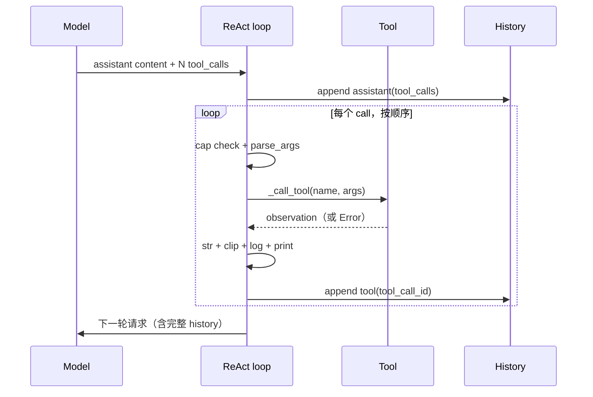
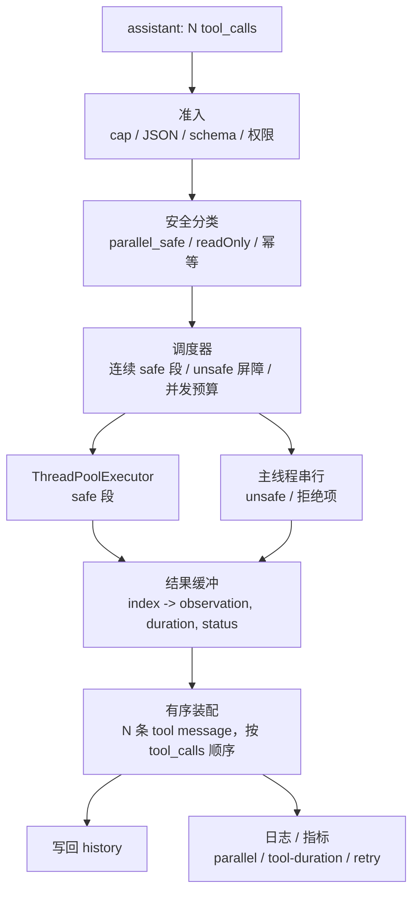
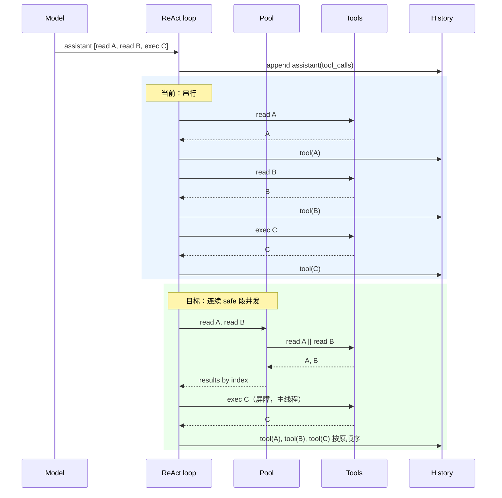

# Parallel Tool Execution：调研、业界实现与本仓库设计

> 状态说明：本文写于 2026-10-25，对应 `../ROADMAP.md` §4「09 — Parallel Tool Execution」。本文的设计已在 2026-10-25 实现，并通过离线 + live 验证（实现与验证记录见 `PARALLEL_TOOL_EXECUTION_IMPLEMENTATION.md` §5.8）。文中的“当前代码”和行号是写作时的基线；实现后以源码为准。
>
> 来源标注：本文把 **官方文档**、**源码/PR/issue**、**第三方逆向分析** 分开。Claude Code 是闭源的；`StreamingToolExecutor`、`partitionToolCalls`、默认并发 10 等细节来自公开的源码分析仓库，不是 Anthropic 的官方承诺，且会随版本变化。Codex、Gemini CLI、OpenAI Agents SDK、LangGraph 的结论来自其公开仓库/文档。网络资料会过时，实现前应重新核对。

---

## 0. 一页结论

### 0.1 直接回答两个问题

| 问题 | 一句话回答 | 详见 |
| --- | --- | --- |
| parallel tool execution 是什么？ | 它是**两层**能力的合称：模型在一轮里发出多个 tool call（协议/模型能力），以及 harness 同时执行这些 call（运行时调度能力）。两层可以独立存在。 | §2 |
| 主流 agent 有哪些种类？ | 至少五类：A 模型侧批量、B 运行时批次并发、C 流式/提前执行、D 依赖感知调度、E 工具内部/子 agent fan-out。另有 workflow 并行与多 agent 两条边界。 | §3 |
| 它们的实现思路和架构？ | 共同骨架是“准入 → 安全分类 → 调度 → 执行 → 结果归位 → 有序写回”。差异在：元数据放哪、是否流式提前、是否做依赖图、同步还是异步、并发上限多少。 | §4、§5 |
| 这个 mini agent 做到了什么程度？ | **协议层已经具备**：assistant 消息一次携带全部 `tool_calls`，history 校验强制 N 个 call → N 条 tool 消息；日志证明模型确实会一次发 2–3 个 call。**运行时层为零**：`for i, tc in enumerate(...)` 逐个执行。 | §6 |
| 想添加应该怎么做？ | 给 `@tool` 加 `parallel_safe=False` 并投影成 `TOOL_META`；把执行拆成三阶段；连续 safe 段用 `ThreadPoolExecutor`，unsafe/拒绝项在主线程串行；结果按原 index 归位后一次性写回；新增 `PARALLEL_ENABLED`/`PARALLEL_MAX_WORKERS` 与两个日志 gate；用 `Barrier/Event` 写离线测试。 | §7 |

### 0.2 五条结论

1. **“模型发了多个 call”不等于“它们会并发执行”。** 本仓库就是反例：模型已经批量发调用，循环仍然串行。反过来，Claude Code 的流式执行器可以在模型还没说完时就开始执行一个 call——即使那一轮只有一个 call。两个层次必须分开讨论。
2. **顺序是协议，执行顺序是自由。** 执行可以乱序完成，写回 history 必须按 `tool_calls` 原始顺序、按 `tool_call_id` 匹配。少一条、乱序、丢 `reasoning_content`，下一轮就是 400。这是整个设计的第一约束。
3. **安全分类必须显式、默认关闭（fail-closed）。** 不要从工具名字猜“有没有 write”。本仓库的 `write_note`/`forget_note`/`download_file`/`run_python` 都有真实的读改写或路径竞争；误标一个，并行就把“慢”变成“错”。
4. **并行收益不是免费的。** 它把延迟问题换成了四类语义问题：顺序、副作用、部分失败、取消。业界成熟实现都在这四件事上做了取舍，而不是只加一个线程池。
5. **本仓库的改动是局部的，但前提是先把测试和日志判据写好。** 推荐顺序：元数据 → 抽出串行 helper → 并行调度 → 日志 → 提示词/429。每一步都能单独回滚。

### 0.3 本文不做什么

- 不实现代码，不改 `config.py`/`agent/`/`tools/`/`tests/`/`README.md`/`CLAUDE.md`。
- 不把 plan step 并行、多 agent fan-out、流式提前执行混进这一课；它们分别是后续课程（ROADMAP §4 的 11/15 与本文 §3.3）。
- 不声称任何外部系统的内部细节是官方事实；闭源系统的结论都标了来源性质。

### 0.4 阅读路线

- 只想快速知道怎么改：读 §0、§6.6、§7.2–§7.7。
- 想理解概念和业界做法：读 §1–§5。
- 想评审设计：重点看 §2.3–§2.4（为什么不能全并行）、§7.5（判据）、§7.6（失败矩阵）、§8（限制）。

---

## 1. 基线：现在的工具执行是怎么跑的

这一节只描述当前代码，不评价。所有行号按本目录 2026-10-25 的源码。

### 1.1 一轮的消息形状

模型的一次响应被 `_consume_stream` 重组成一个非流式形状的对象：`content`、`tool_calls[i].id/.function.name/.function.arguments`、可选的 `reasoning_content`、`usage`、`finish_reason`。`_run_react` 在**执行任何工具之前**，先把这一轮的全部 `tool_calls` 构造成**一条** assistant 消息并追加到 `self.messages`（`agent/react_loop.py:151-169`）：

```python
assistant_message = {
    "role": "assistant",
    "content": content,
    "tool_calls": [{
        "id": tc.id,
        "type": "function",
        "function": {"name": tc.function.name, "arguments": tc.function.arguments},
    } for tc in msg.tool_calls],
}
reasoning = getattr(msg, "reasoning_content", None)
if reasoning is not None:                 # 注意：is not None，不是 truthiness
    assistant_message["reasoning_content"] = reasoning
self.messages.append(assistant_message)
```

这条消息的形状是后续所有设计的硬约束：

- 一轮只有一条 assistant 消息，但它可以携带 **N 个** `tool_calls`。
- `reasoning_content` 只要服务器发过这个通道，就必须原样回传；空字符串也算（`is not None`）。
- 这条消息在执行之前就已经写进 history。因此执行阶段一旦抛异常，history 会处于“assistant 有 N 个 call、tool 结果不足 N 条”的非法状态；`main.py` 的 Ctrl-C 回滚（`main.py:273-295`）正是为这种状态准备的。

### 1.2 串行执行块

真正的执行在 `agent/react_loop.py:179-217`：

```python
for i, tc in enumerate(msg.tool_calls):
    action_name = tc.function.name

    args_len = len(tc.function.arguments or "")
    if EXPORT_LOG and EXPORT_LOG_CHOICES["arguments-size"]:
        with open(EXPORT_LOG_PATH, "a") as f:
            f.write(f"Arguments size: {action_name} {args_len} chars\n")

    if i >= MAX_TOOL_CALLS_PER_ROUND:
        observation = (f"Error: The maximum number of tool calls per round is "
                       f"{MAX_TOOL_CALLS_PER_ROUND}, this call was not executed. "
                       f"Please replan and initiate this call in the next round.")
    else:
        action_args, parse_error = self._parse_args(tc)
        if parse_error:
            observation = parse_error
        else:
            print(f"🔧 Action: {action_name}({action_args})")
            observation = self._call_tool(action_name, action_args)

    observation = str(observation)
    raw_len = len(observation)
    observation = clip(observation)

    if EXPORT_LOG and EXPORT_LOG_CHOICES["observation-clipped"]:
        with open(EXPORT_LOG_PATH, "a") as f:
            f.write(f"Observation size: {action_name} {raw_len} chars"
                    f"{f' -> clipped to {len(observation)}' if raw_len > MAX_OBS_CHARS else ''}\n")

    print(f"👁 Observation: {observation[:200]}{'...' if len(observation) > 200 else ''}")

    tool_message = {"role": "tool", "tool_call_id": tc.id, "content": observation}
    self.messages.append(tool_message)
```

逐步看，它有五件事：

1. **上限检查**：`i >= MAX_TOOL_CALLS_PER_ROUND`（默认 20）。超限的 call 不执行，但仍然生成一条 `Error: ...` observation。
2. **参数解析**：`_parse_args`（`agent/execution.py:19-39`）只做 JSON 解析和“必须是 object”检查；坏 JSON 直接变成 observation，不执行。
3. **执行**：`print` Action，然后 `_call_tool`。
4. **规范化**：`str()` → 记录原始长度 → `clip()`（超过 8000 字符时保留前 6000 + 后 1500）。
5. **立即写回**：每执行完一个 call，就 append 一条 `role:"tool"` 消息。

关键点：**执行和写回是同一个循环**。这就是并行的改动点——执行可以并行，写回不能。

### 1.3 每个 call 的重试与错误收口

`_call_tool`（`agent/execution.py:41-71`）是每个 call 的独立执行单元：

```python
attempt = 0
while True:
    try:
        observation = TOOLS[action_name](**action_args)
        return str(observation)
    except RETRIABLE_ERRORS as e:
        attempt += 1
        if attempt > MAX_TOOL_RETRIES:
            return f"Error: {action_name} failed after {MAX_TOOL_RETRIES} retries ..."
        if EXPORT_LOG and EXPORT_LOG_CHOICES["tool-retry"]:
            with open(EXPORT_LOG_PATH, "a") as f:
                f.write(f"Tool retry {attempt}/{MAX_TOOL_RETRIES}: {action_name} — ...\n")
        time.sleep(min(TOOL_RETRY_BACKOFF * 2 ** (attempt - 1), MAX_TOOL_RETRY_BACKOFF_TIME))
    except Exception as e:
        return f"Error: {action_name} failed due to {type(e).__name__}: {e}"
```

- `RETRIABLE_ERRORS = (subprocess.TimeoutExpired, ConnectionError, TimeoutError)`，最多 3 次重试（共 4 次尝试），退避 0.5/1/2 秒。
- 其他 `Exception`（包括未知工具的 `KeyError`、参数不匹配的 `TypeError`）在第一次就变成 `Error: ...`。
- `BaseException`（`KeyboardInterrupt`、`SystemExit`、`MemoryError` 等）**不会**被 `_call_tool` 捕获。当前串行路径下，Ctrl-C 会一路冒到 `main.py`，由它回滚整个 turn。
- 重试日志是**唯一**从 worker 线程可达的文件写；它现在没有锁、没有 call 序号、没有 `tool_call_id`。这是并行化时必须补的三件事（§7.3.4）。

### 1.4 日志与可观测性

- `config.py:18-38` 有 19 个 gate，`EXPORT_LOG_CHOICES[gate]` 是**严格索引**而不是 `.get()`；新增 gate 必须同时加进 `config.py`，否则 `KeyError`。
- 大多数日志是裸 `open(EXPORT_LOG_PATH, "a")`；一个 section 通常由多次 `write` 组成，所以多线程写会交错。`agent/compaction.py:41-51` 的 `_log_section` 也是一样的裸写。
- `EXPORT_LOG_PATH` 在 `config.py` import 时按时间戳生成，一个进程一个文件，append 模式，**没有任何东西会截断它**。
- OpenAI SDK 的 `FileHandler` 有 stdlib logging 的锁；但 agent 自己的裸 `open` 完全绕过它。两者写的是同一个文件。

### 1.5 现有的协议约束

`context/history.py:136-192` 的 `validate_history()` 没有被正常执行路径调用（只有 `compact()` 在换 history 前调用），但它是这套协议的权威描述：

- 非空；`messages[0]` 必须是 system。
- 带 `tool_calls` 的 assistant 消息，`reasoning_content` 必须“全有或全无”（空字符串算有）。
- 每条带 `tool_calls` 的 assistant 消息后面，必须紧跟**连续的 N 条** `role:"tool"` 消息，`tool_call_id` 列表与 `tool_calls` 的 id 列表**完全相等、顺序一致、数量一致**。
- 孤立的 tool 消息是违规。

正常路径靠“构造方式”保证合法；并行化如果破坏了这个构造方式，API 会在下一轮返回 400，`validate_history` 只是事后的检查器。

### 1.6 一次工具调用的时序（当前）



---

## 2. 概念：什么叫 parallel tool execution

### 2.1 两个独立层次

**层次 A：模型侧批量（model-side parallel tool calls / parallel function calling）**

模型在一次 assistant 响应里返回多个 tool call。它由协议和模型决定：

- OpenAI Chat Completions：`parallel_tool_calls` 请求参数；为 `true` 时 `tool_calls` 数组可以有多个元素；为 `false` 时“恰好零个或一个”。
- Anthropic Messages：一次响应里可以有多个 `tool_use` block；默认开启；`tool_choice` 里的 `disable_parallel_tool_use: true` 可以关掉。
- Gemini：一次响应里可以有多个 `functionCall`。
- DeepSeek：OpenAI 兼容的 `tool_calls` 数组；本仓库的日志里已经出现 2–3 个 call 的响应。

这只是“模型把多个请求写进了同一条消息”。**它不保证客户端会并发执行。**

**层次 B：运行时并发（runtime-side concurrent execution）**

harness 收到这条消息后，用线程池、`asyncio.gather`、`Promise.all`、进程池或流式执行器，让多个 call 同时在飞。它由 harness 决定，取决于：

- 工具的安全分类（只读？幂等？会写共享状态？）；
- 并发预算（最多几个 worker、每主机几个请求）；
- 结果归位方式（按 index / 按 id）；
- 取消和超时策略；
- 日志和终端输出如何保持可读。

**两层可以任意组合**：

| | 运行时串行 | 运行时并发 |
| --- | --- | --- |
| 模型发一个 call | 传统 ReAct（本仓库） | 没意义，除非流式提前执行（C） |
| 模型发多个 call | 本仓库现状：批量到达，逐个执行 | 本课目标：批量到达，安全并发 |

Claude Code 的 `StreamingToolExecutor` 甚至可以在模型还在生成时就开始执行已经完整的 call——这把“层次 B”从“等整条消息到齐”推进到“边收边跑”（§3.3）。

### 2.2 一次批量调用的生命周期

不管哪种实现，都可以拆成同样的七步：


本仓库现在把 B–G 全部塞在同一个 `for` 循环里，所以“执行”和“写回”无法分开。并行化的本质是**把 E 从循环里拿出来，让 F/G 留在主线程**。

### 2.3 并发安全 ≠ 只读 ≠ 结果无关

这是设计里最容易混淆的三个概念：

| 概念 | 定义 | 反例 |
| --- | --- | --- |
| **只读（read-only）** | 不修改环境 | `git_status` 通常只读，但它可能刷新 index；`search_web` 只读，但会占用外部配额 |
| **幂等（idempotent）** | 同样参数重复调用没有额外副作用 | `write_file(path, content)` 重复写同样的内容是幂等的；`write_note` 追加会重复；`execute_command("rm x")` 第二次会失败 |
| **并发安全（concurrency-safe）** | 与**这一批里的其他 call** 同时跑不会产生错误结果 | `read_file` 与另一个 `read_file` 通常安全；`read_file` 与 `write_file(same path)` 不安全；两个 `git_status` 可能抢 `.git/index.lock` |

**只读是一个好的起点，但不是充分条件**：一个只读工具可能因为外部限流、内部锁、缓存刷新而不适合并发（`git_status` 就是例子）。反过来，并发安全也不要求只读：两个写不同路径的调用可能是并发安全的，但我们不假设这一点。**并发安全还依赖上下文**：同一个 `read_file`，和另一个读同一个文件安全，和写同一个文件不安全。

因此，工程上不能只用 `readOnly` 一个布尔；Claude Code 就把 `isReadOnly`（权限/UI）和 `isConcurrencySafe`（调度）分成两个方法，且都是输入相关的（§4.2）。本仓库的简化版用一个 `parallel_safe` 元数据，默认 `False`，由人显式标记。

### 2.4 同轮调用的真实风险：共享工作区副作用

同一轮里的 call，参数在模型生成时就已经固定；一个 call 的**返回值**不可能喂给同轮的另一个 call（模型还没看到结果）。所以同轮并行不会产生“参数依赖”问题。

但同轮调用会**互相观察对方的副作用**，因为工具共享同一个工作区（cwd、文件系统、`memory/notes.jsonl`、`tmp/`、网络外部状态）。本仓库的具体反例：

| 批次 | 串行语义 | 如果“全部 safe 先跑、再全部 serial”会怎样 |
| --- | --- | --- |
| `write_file(path)`, `read_file(path)` | 读到新内容 | `read_file` 被归为 safe 先跑，读到旧内容或 `FileNotFoundError` |
| `execute_command("touch x")`, `read_file("x")` | 读得到 | 读先跑，报不存在 |
| `write_note(...)`, `recall_notes(...)` | 召回得到新笔记 | 召回先跑，看不到新笔记 |
| `run_python(...)`, `list_directory("tmp")` | 看得到新 `agent_py_*.py` | 列目录先跑，看不到 |
| `download_file(url, path)`, `read_file(path)` | 读得到下载内容 | 读先跑，失败 |

这些例子说明：**“safe”只能表示“与任何其他 safe 调用并发安全”，不能表示“可以越过一个 unsafe 调用”**。所以调度必须按原始顺序切段：连续 safe 调用可以互相并行，unsafe 调用是屏障，不能跨过去（§7.2 决策 D3）。

Claude Code 的 `partitionToolCalls` 和 Gemini CLI 的连续只读批都是这个思路（§4.2、§4.6）。

### 2.5 术语与边界

| 术语 | 含义 |
| --- | --- |
| **parallel tool calls（模型侧）** | 一条 assistant 消息里有多个 tool call |
| **concurrent tool execution（运行时侧）** | harness 同时执行多个 call |
| **batch / barrier** | 等整条 assistant 消息到齐后，再开始执行；本课采用这种方式 |
| **eager / streaming execution** | 不等整条消息，call 一完整就开始执行；Claude Code 的 `StreamingToolExecutor` |
| **contiguous safe run** | 原始顺序中连续的一段 safe call；段内可并发，段与段之间按顺序 |
| **exclusive unsafe** | unsafe call 独占执行：它跑的时候不允许其他 call 同时跑 |
| **sibling abort** | 一个 call 失败时取消同批其他 call；Claude Code 对 Bash 这么做，本课不采用 |
| **fan-out** | 一个工具/agent 内部再并发多个子任务；属于工具实现或 agent 层，不是本课的 tool-call 层 |
| **workflow parallelization** | 把工作流画成并行分支（sectioning/voting）；属于 workflow 层，不是 tool-call 层 |

本课的边界：**只做“一条 assistant 消息内的多个 tool call 的运行时并发”**。不做 plan step 并行、不做多 agent、不做流式提前执行、不做依赖图。

---

## 3. 实现思路的分类学

这一节回答“有哪些种类”。每一类给出：谁负责、架构、代表实现、适用条件、代价。

### 3.1 A 类：模型侧批量（model-side batching）

**做什么**：让模型在一次响应里输出多个 tool call。

**谁负责**：协议 + 模型 + prompt。

**架构**：

```text
system prompt / tool schemas
        |
        v
model decides: one call or several?
        |
        v
assistant message: [tc0, tc1, ...]
```

**代表实现**：

- OpenAI Chat Completions 的 `parallel_tool_calls`（§4.1）。
- Anthropic 的多 `tool_use` block；`disable_parallel_tool_use` 关闭。
- Gemini 的多 `functionCall`。
- DeepSeek 的 OpenAI 兼容 `tool_calls`（本仓库日志已出现 2–3 个）。

**适用条件**：模型支持；prompt 明确鼓励“独立操作一次发出”；history 格式正确（Anthropic 特别指出，按 call 分开的 user 消息会让模型“学会”不并行）。

**代价/风险**：模型可能把有依赖的调用放进同一批；模型可能为了并行而发出不必要的调用；不同 provider 的默认值不同。

**本仓库现状**：✅ 已具备。模型不需要额外提示就会批量发；日志实测 6/13 条响应带 2–3 个 call（§6.4）。

### 3.2 B 类：运行时批次并发（barrier-parallel）

**做什么**：等整条 assistant 消息到齐，解析出 N 个 call，安全分类后并发执行，结果按原顺序写回。

**谁负责**：harness 的调度器。

**架构**：

```text
assistant message (N calls)
        |
        v
[admission] cap / parse / permission
        |
        v
[partition] contiguous safe runs | unsafe barriers
        |
        v
safe run -> ThreadPoolExecutor / asyncio.gather / Promise.all
unsafe   -> serial queue (or exclusive lock)
        |
        v
[index-keyed result buffer] -> ordered tool messages -> history
```

**代表实现**：

- LangGraph `ToolNode`：同步路径 `ThreadPoolExecutor` + `executor.map`，异步路径 `asyncio.gather`（§4.5）。
- OpenAI Agents SDK：`asyncio.gather` + 可配置的 `max_function_tool_concurrency`（§4.4）。
- Claude Code 的批量路径 `runTools()`/`partitionToolCalls`（§4.2）。
- Gemini CLI 的 `CoreToolScheduler`：连续只读批 `Promise.all`（§4.6）。
- **本课的目标形态**。

**适用条件**：工具是同步/异步可调用的；有安全元数据；能按 index 归位结果。

**代价/风险**：慢 call 仍会拖住同一批的收尾；unsafe call 是屏障；需要处理部分失败、重试、日志交错。

### 3.3 C 类：流式/提前执行（eager/streaming execution）

**做什么**：不等整条 assistant 消息结束，某个 tool call 的 id/name/arguments 一旦完整，就立刻开始执行；后续 call 继续流入，按安全规则决定能不能加入。

**谁负责**：harness 的流式执行器 + 协议支持（细粒度 tool input streaming）。

**架构**：

```text
model stream: [tc0 args ...][tc1 args ...][tc2 args ...]
                    |              |              |
                    v              v              v
              executor admits tc0, then tc1 if safe, ...
                    |
                    v
              results yielded FIFO (original order)
```

**代表实现**：

- Claude Code 的 `StreamingToolExecutor`：准入规则是“空闲时任何 call 都能进；忙时只有新 call 和所有在跑的 call 都 concurrency-safe 才能进；unsafe call 独占”。结果 FIFO 产出（§4.2，源码分析）。
- Anthropic 的 fine-grained tool streaming（`eager_input_streaming`）：工具参数边生成边到达；社区包 `eager-tools-anthropic`/`eager-tools-langgraph` 在 block 一闭合就 dispatch（见 §10.3）。
- 一些 IDE agent 在流式参数上做“边收边执行”，但参数未完整就开始执行只对支持流式输入的工具安全。

**适用条件**：流式协议能给出完整的 call 边界；工具能在参数完整后立即开始；需要更复杂的准入和取消。

**代价/风险**：实现复杂度显著高于 B；部分参数、交错流、ID 碰撞都是坑（Gemini CLI 的流式并行 ID 碰撞修复，§4.6）；本课不做。

### 3.4 D 类：依赖感知调度（dependency-aware / DAG）

**做什么**：把多个 call 表示成有依赖的 DAG；没有依赖的节点并行，有依赖的等前驱完成；可以用占位符把前一个结果喂给后一个。

**谁负责**：planner + 调度器。

**架构**：

```text
planner -> DAG: task1, task2 -> task3($1, $2)
                 |       |
                 v       v
              executor (parallel)
                 |
                 v
        Task Fetching Unit: 依赖满足就 dispatch
```

**代表实现**：

- LLMCompiler：LLM Planner 生成 DAG（含 `$1`/`$2` 占位符），Task Fetching Unit 在依赖满足时 dispatch，Executor 并行执行；论文报告最高 3.7× 延迟、6.7× 成本收益（§4.8）。
- 一些 agent 框架的 `dependsOn`/read-write set 调度（Gemini CLI 的 epic 讨论、多 agent 协调研究）。

**适用条件**：能预先规划依赖；工具调用之间确实有数据依赖；能处理动态重规划。

**代价/风险**：需要 planner 质量；依赖判断错误会导致错误结果；比 B 复杂一个数量级。本课不做。

### 3.5 E 类：工具内部并行与子 agent fan-out

**做什么**：一个 tool call 内部再并发多个子任务；或者一个“工具”其实是一个子 agent，内部有自己的工具循环。

**代表实现**：

- Gemini CLI 的 `ReadManyFiles`、`RipGrep` 等工具内部并发读/搜（§4.6）。
- Claude Code 的 `Task` 工具：一次启动多个子 agent；这是 agent 级 fan-out，不是 tool-call 级。
- OpenAI Agents SDK 的 “parallel agents” cookbook：`asyncio.gather` 多个 `Runner.run()`（§4.4）。

**适用条件**：单个 call 的工作量足够大；子任务之间独立；需要上下文隔离时用子 agent。

**代价/风险**：子 agent 有自己的上下文/预算；错误传播和取消更复杂；不是本课范围。

### 3.6 两条边界：workflow 并行与多 agent

| 边界 | 是什么 | 与本课的关系 |
| --- | --- | --- |
| **Workflow parallelization** | 把工作流画成并行分支：sectioning（分段并行）、voting（多路投票）。Anthropic 的 “Building Effective Agents” 把它列为 workflow 模式，而不是 tool-call 模式。 | 不同层；它并行的是“步骤/分支”，不是一条 assistant 消息里的 call。 |
| **Multi-agent fan-out** | 多个 agent 各自有上下文，fan-out/fan-in。Claude Code 的 Task、OpenAI Agents SDK 的 parallel agents、Gemini CLI 的 subagents。 | 不同层；ROADMAP 把它放在 15。本课的调度器是它的地基，但不等于它。 |

### 3.7 分类学对照表

| 类型 | 谁负责 | 典型实现 | 前提 | 收益 | 复杂度 | 本课 |
| --- | --- | --- | --- | --- | --- | --- |
| A 模型侧批量 | 模型/协议 | OpenAI/Anthropic/Gemini/DeepSeek | 模型支持 + prompt | 减少往返 | 低 | ✅ 已有 |
| B 运行时批次并发 | harness | LangGraph、Agents SDK、Claude Code 批量路径、Gemini CLI | 安全元数据 + 执行器 | 降同批延迟 | 中 | 🎯 目标 |
| C 流式提前执行 | harness + 协议 | Claude Code `StreamingToolExecutor`、eager streaming | 流式边界 + 准入 | 降首工具延迟 | 高 | ❌ 后续 |
| D 依赖感知调度 | planner + harness | LLMCompiler | DAG/读写集 | 最大化并行 | 很高 | ❌ 后续 |
| E 工具内部/子 agent | 工具/agent | ReadManyFiles、Task、parallel agents | 工具内部并发 | 降单 call 延迟 | 中 | ❌ 边界 |
| Workflow 并行 | workflow | sectioning/voting | 工作流图 | 降整体时间 | 中 | ❌ 边界 |
| 多 agent fan-out | agent 层 | Task/subagents | 上下文隔离 | 降墙钟 + 专业化 | 高 | ❌ 15 课 |

---

## 4. 业界怎么做（survey）

这一节只讨论外部系统与概念，不写本仓库行号。每条结论尽量给出来源；来源性质见 §4.13。

### 4.1 协议层：多 call 怎么表示，结果怎么回

**OpenAI Chat Completions / Responses**

- Chat Completions 用 `parallel_tool_calls` 控制模型能否在一轮里发多个 call；官方 function-calling 指南的措辞是“模型可能在一轮里调用多个函数”，把 `parallel_tool_calls` 设为 `false` 可以“确保零个或一个工具被调用”[[官方]](https://developers.openai.com/api/docs/guides/function-calling)。
- 每个 call 有自己的 `id`/`call_id`；结果按 id 关联。Responses API 用 `function_call_output` item 关联 `call_id`；Chat Completions 用一条 `role:"tool"` 消息 + `tool_call_id`。
- OpenAI 的新方向是 **Programmatic Tool Calling**：模型生成 JavaScript，在托管的 V8 沙箱里用 `Promise.all` 编排多个工具调用，只有最终结果回到模型上下文（§4.9）。

**Anthropic Messages**

- 默认就允许一次响应里出现多个 `tool_use` block；`tool_choice` 里的 `disable_parallel_tool_use: true` 可以关掉。注意它不是顶层参数，而在 `tool_choice` 对象里。
- 客户端可以并发、串行或混合执行；API 不规定执行顺序。官方建议：独立只读操作通常可以并发；有副作用、共享状态、顺序要求的工具应串行[[官方]](https://platform.claude.com/docs/en/agents-and-tools/tool-use/parallel-tool-use)。
- 每个 `tool_use` 都要在下一条 **user 消息**里返回一个 `tool_result`，用 `tool_use_id` 匹配，所有 `tool_result` 放在文本内容之前；如果某个调用没执行，也要返回 `is_error: true` 的结果。
- 官方特别提醒：把每个 `tool_result` 放进单独的 user 消息，会“教”模型不要并行；history 格式本身就是并行行为的训练信号。
- 细粒度 tool streaming（`eager_input_streaming`）让工具参数边生成边到达；它只负责“输入流”，不负责“开始执行”，但它是 C 类提前执行的前提[[官方]](https://platform.claude.com/docs/en/agents-and-tools/tool-use/fine-grained-tool-streaming)。

**Gemini**

- 一次响应可以有多个 `functionCall`；客户端执行后回传结果。Gemini CLI 的流式并行实现遇到过一个真实 bug：并行调用两个同名工具时，用 `name` 去匹配流式 chunk 会碰撞，必须用“顺序计数器 + call index”生成合成 ID，否则参数会串线[[源码]](https://github.com/google-gemini/gemini-cli/pull/26646)。

**DeepSeek**

- OpenAI 兼容的 `tool_calls` 数组；本仓库通过 `openai` SDK 调用，日志里已经出现一条 assistant 消息带 2–3 个 call 的情况（§6.4）。协议的通用形状与 OpenAI 相同。

**协议层的小结**：协议只保证“模型可以把多个 call 放进一条消息”，以及“结果要按 id 关联”。执行顺序、并发、安全分类全是客户端的事。**这就是为什么“parallel tool calls”这个词经常被误读**：它描述的是模型输出，不是运行时行为。

### 4.2 Claude Code

Claude Code 是闭源的；下面把 **官方文档能确认的** 和 **源码分析仓库推断的** 分开。

**官方能确认的**：

- Claude Agent SDK 的自定义工具用 MCP 注解 `readOnlyHint` 控制能否与其他只读工具并行；官方文档原话：`readOnlyHint` “controls whether the tool can be called in parallel with other read-only tools”。注解是元数据，不是强制；“A tool marked `readOnlyHint: true` can still write to disk if that's what the handler does”[[官方]](https://code.claude.com/docs/en/agent-sdk/custom-tools)。
- SDK 的权限、allowedTools、错误结果等是另一套管线，和并发调度分开。

**源码分析仓库给出的内部结构（非官方，版本相关）**：

- **两个独立的安全标记**：`isConcurrencySafe(input)` 控制调度，`isReadOnly(input)` 控制权限/UI；两者都是输入相关的，默认都返回 `false`（fail-closed）。新建工具默认串行、默认需要权限[[源码分析]](https://github.com/Windy3f3f3f3f/how-claude-code-works/blob/main/en/docs/04-tool-system.md)。
- **批量路径**：`runTools()` 不把所有只读 call 塞进一个 `Promise.all`，而是用 `partitionToolCalls` 把**连续**的 concurrency-safe call 分成一个并行批；一个 unsafe call 开启新的串行批。核心合并条件是“新 call safe 且上一批也 safe”。
- **流式路径**：`StreamingToolExecutor` 在模型还在流式输出时就开始执行已经完整的 call。准入规则是：执行器空闲时任何 call 都能进；忙时只有“新 call safe 且所有在跑的 call 都 safe”才能进；unsafe call 独占。工具状态机是 `queued → executing → completed → yielded`；结果按原始顺序 FIFO 产出。
- **错误语义**：工具错误变成 `tool_result` 数据（`is_error: true`），模型可以自我纠正；Bash 失败会触发 `siblingAbortController` 取消同批其他工具，Read/WebFetch 的失败不会级联。
- **并发上限**：静态路径由 `getMaxToolUseConcurrency()` 控制，默认 10，可用 `CLAUDE_CODE_MAX_TOOL_USE_CONCURRENCY` 调整；流式路径没有数字上限，只按安全规则准入。
- **权限管线**：lookup → schema/业务校验 → PreToolUse hook + Bash 分类器 → 权限决策 → `tool.call()` → 结果映射 → post-hook → 消息发射；deny > ask > allow。并发执行和权限决策是两条相交但不同的管线。

**架构图（按源码分析归纳）**：

```text
assistant stream
   |
   +--> StreamingToolExecutor: 每个 call 一完整就尝试准入
   |        safe? -> 与其它 safe 并行
   |        unsafe? -> 独占
   |
   +--> 批量路径 runTools(): partitionToolCalls
            [safe, safe] -> concurrent batch (max 10)
            [unsafe]     -> serial batch
   |
   v
results yielded FIFO (original tool_use order)
```

**对本课的启示**：

1. 安全分类和权限分类分开；调度只看 `isConcurrencySafe`。
2. 连续 safe 批，而不是“全部 safe 先跑”。
3. unsafe 独占（至少不能跨过它）。
4. 结果按原始顺序产出。
5. 错误是数据；sibling abort 是产品策略，不是通用必需。

### 4.3 Codex CLI

Codex 是开源的 Rust CLI；它的并行开关是**服务器/工具级 opt-in**，默认保守。

- **MCP server 级开关**：`config.toml` 里可以给每个 MCP server 设 `supports_parallel_tool_calls = true`。默认 MCP 调用是串行的；只有显式 opt-in 的 server 才允许并发。理由是“并行安全取决于 server 实现”，而不是工具名字。Codex 把这个 flag 读进 `ToolRouter`，执行时按 `ToolPayload::Mcp { server, .. }` 判断[[源码/PR]](https://github.com/openai/codex/pull/17667)。
- **readOnlyHint 覆盖**：后续 PR 把 MCP 的 `readOnlyHint: true` 也接进调度：带这个注解的工具即使 server 没有 opt-in 也可以并行；`supports_parallel_tool_calls` 仍是非只读工具的加法开关。这带来一个明确的安全 caveat：注解标错，工具就会被当成并行安全[[源码/PR]](https://github.com/openai/codex/pull/23750)。
- **shell 工具**：commit 33dc93e “Enable parallel shell tools” 给 `exec_command`、local shell、shell command 等 spec 打上 `supports_parallel_tool_calls`；`write_stdin` 仍然是串行。flag 通过 `push_spec_with_parallel_support(spec, true)` 表示[[源码/commit]](https://github.com/openai/codex/commit/33dc93e4d2913ba940213ede693b84ebaf80b3f6)。
- PR 里的实测：两个各 25 秒的 MCP delay 工具，串行 ~58.8s，并行 ~31.7s，不开 flag 仍 ~56.7s。这是一个很直观的“并行只对同批多个 call 有效”的例子。

**架构图**：

```text
model -> tool calls
          |
          v
     ToolRouter: payload -> server / tool
          |
          v
  server opt-in? readOnlyHint? -> parallel eligible
          |
          v
     async tasks: eligible calls concurrent
     others: serial path
```

**对本课的启示**：opt-in 是合理的默认；闭源/第三方工具的并行安全性不能靠猜；注解需要审计。

### 4.4 OpenAI Agents SDK

OpenAI Agents SDK 把“模型侧能不能发多个”和“运行时并发多少”拆成两个旋钮，这是最清晰的分层之一：

- **模型侧**：`ModelSettings.parallel_tool_calls`。文档说它是 nullable boolean；不设置（`None`）时跟随 provider 默认；大多数 provider（包括 OpenAI）通常是 `True`；设为 `False` 则“at most one tool call per turn”[[官方]](https://openai.github.io/openai-agents-python/ref/model_settings/)。
- **运行时侧**：`RunConfig(tool_execution=ToolExecutionConfig(max_function_tool_concurrency=N))`（v0.16.0 引入）。默认 `None` 表示“同一轮的所有本地 function call 都并发启动”；设为 N 则限制并发数；结果仍按模型请求顺序返回[[源码/文档]](https://github.com/openai/openai-agents-python/releases/tag/v0.16.0)[[文档]](https://github.com/openai/openai-agents-python/pull/3164)。
- **执行**：同一轮的多个 function call 用 `asyncio.gather` 并发。同步 `def` 工具会阻塞事件循环；要真正并发，工具应是 `async def`（issue #2386）[[源码/issue]](https://github.com/openai/openai-agents-python/issues/2386)。
- **错误**：每个 task 自己捕获；一个失败不会取消整批（用 `return_exceptions=True` 或逐 task try/except）。
- 官方 cookbook 的 “parallel agents” 是 agent 级 fan-out，不是 tool-call 级；两者不要混。

**架构图**：

```text
model response: N function calls
        |
        v
Runner: asyncio.gather (bounded by max_function_tool_concurrency)
        |
        v
results in request order -> next turn
```

**对本课的启示**：把“模型侧开关”和“运行时并发上限”分开命名；结果按请求顺序；同步工具在异步框架里会退化。

### 4.5 LangGraph ToolNode

LangGraph 的 `ToolNode` 是“预置的批量执行节点”：

- 同步 `_func`：解析最后一条 `AIMessage` 里的全部 `tool_calls`，用 `ThreadPoolExecutor` + `executor.map(self._run_one, tool_calls, config_list)` 执行；`executor.map` 保序，所以 `ToolMessage` 按原 `tool_calls` 顺序返回[[源码/文档]](https://reference.langchain.com/javascript/langchain-langgraph/prebuilt/ToolNode)。
- 异步 `_afunc`：`asyncio.gather(*(self._arun_one(...) for call in tool_calls))`。
- 并发上限：`config["configurable"]["max_concurrency"]`；旧版本默认 1 是一个常见坑，新版本默认会跟随 call 数。第三方分析还指出异步路径可能忽略 `max_concurrency`（LangGraph issue #8517），如果依赖这个上限，需要在资源边界再加 `Semaphore`[[第三方]](https://www.xbstack.com/en/ai/langgraph-toolnode-max-concurrency-ignored/)。
- 每个 call 的错误由 `handle_tool_errors` 在 `_run_one` 内部处理（True/字符串/异常类型/callable/False），所以一个失败不会让整批消失。
- `create_react_agent` v2 还会用 `Send` API 把每个 call 派发到独立的 `tools` 节点，便于并行和 human-in-the-loop。

**对本课的启示**：`executor.map` 的保序 + 每 call 独立错误处理，是非常适合教学的最小实现；`max_concurrency` 必须真的生效，不能只写在配置里。

### 4.6 Gemini CLI

Gemini CLI 的并行实现是“调度器 + 连续只读批”：

- 给 `DeclarativeTool` 增加 `isReadOnly`；`CoreToolScheduler._processNextInQueue` 把**连续的只读 call** 分成一批，`attemptExecutionOfScheduledCalls` 用 `Promise.all` 并发；写操作继续串行。测试覆盖“只读/写混合批次的 wave 执行”[[源码/PR]](https://github.com/google-gemini/gemini-cli/pull/18791)。
- 只读工具包括 ReadFile、Glob、Grep、LS、RipGrep、ReadManyFiles、WebFetch、WebSearch、ActivateSkill、Enter/ExitPlanMode、GetInternalDocs 等；子 agent 的 `isReadOnly` 由它封装的工具推导（有一个不可写就不可只读）。
- 流式并行有一个真实坑：同名工具的并行调用如果按 name 匹配 chunk 会碰撞；修复用“顺序计数器 + local index”生成合成 ID，并依赖 Gemini API 的 “content.parts 顺序与 functionCalls 顺序一致”保证[[源码/PR]](https://github.com/google-gemini/gemini-cli/pull/26646)。
- 设计 epic 里还讨论了依赖图（`dependsOn`）、prepare/commit/rollback、资源信号量、per-call timeout 等更进一步的方案，但主线实现仍是“连续只读批 + 写串行”[[讨论]](https://github.com/google-gemini/gemini-cli/issues/17120)。

**对本课的启示**：连续只读批是工业界反复出现的模式；写操作保持串行；流式 ID 必须按顺序生成，不能按名字匹配。

### 4.7 MCP 与工具注解

MCP 的 `ToolAnnotations` 是四个布尔 hint：`readOnlyHint`（默认 false）、`destructiveHint`（默认 true）、`idempotentHint`（默认 false）、`openWorldHint`（默认 true）。规范反复强调它们是 **hint，不是 guarantee**；客户端“不应基于不可信 server 的注解做工具使用决策”[[官方]](https://modelcontextprotocol.io/docs/concepts/tools#tool-annotations)。

但工业界正在把 `readOnlyHint` 变成**调度信号**：

- Claude Agent SDK 的官方文档说它“controls whether the tool can be called in parallel with other read-only tools”[[官方]](https://code.claude.com/docs/en/agent-sdk/custom-tools)。
- Codex 的 PR #23750 把它接进并行调度，并明确注解标错会导致并发写竞争[[源码/PR]](https://github.com/openai/codex/pull/23750)。
- 一项针对 Claude Code 的实证研究（第三方）报告：带 `readOnlyHint: true` 的 MCP 工具并行派发率约为不带注解的两倍；不带注解的工具按设计被串行化；IPC 开销约 5ms/call[[第三方]](https://github.com/greynewell/mcp-serialization-repro)。

**对本课的启示**：注解可以作为默认值，但必须有“可信来源”/审计；对于本仓库这种工具和 agent 同仓的代码，`@tool(parallel_safe=...)` 是同一种思想，只是元数据在本地。

### 4.8 LLMCompiler

LLMCompiler 是“依赖感知并行”的代表论文（Kim et al., ICML 2024）：

- **LLM Planner** 生成一个任务 DAG，节点是工具调用，边是依赖；依赖的输入用 `$1`/`$2` 这样的占位符。
- **Task Fetching Unit** 在依赖满足时把任务 dispatch 给 executor；它把占位符替换成前驱结果。
- **Executor** 并行执行独立任务；结果可以触发动态重规划。
- 论文报告最高 3.7× 延迟加速、6.7× 成本节省、约 9% 准确率提升；它也支持开源模型（LLaMA-2 70B），而 OpenAI 的 parallel function calling 当时主要面向自家模型[[论文]](https://arxiv.org/abs/2312.04511)。

**对本课的启示**：DAG 调度能榨出更多并行，但需要 planner 和依赖表示；本课的连续 safe 段是它的一个保守特例（依赖只由“顺序 + safe/unsafe”近似）。

### 4.9 OpenAI Programmatic Tool Calling

这是另一种架构：模型不直接发多个 function call，而是生成一段 JavaScript，在 OpenAI 托管的 V8 沙箱里执行；代码里用 `await Promise.all([tools.get_inventory(...), tools.get_demand(...)])` 这样的写法并发调用工具，只有最终结果回到模型上下文。

- 通过 `{"type": "programmatic_tool_calling"}` hosted tool 开启；每个 function 可以设 `allowed_callers: ["direct"]`/`["programmatic"]`/两者。
- 响应里有 `program` item（含 `code`、`call_id`、`fingerprint`）和 `program_output`；嵌套的 function call 带 `caller: {type: "program"}`，必须原样回传才能恢复暂停的程序。
- 沙箱限制：没有 Node/npm/网络/文件系统/子进程/console；支持顶层 `await`；输出用 `text(...)`/`image(...)`[[官方]](https://developers.openai.com/api/docs/guides/tools-programmatic-tool-calling)。

**对本课的启示**：并行编排可以下沉到“模型生成的代码”里，从而把多轮往返变成一段程序；这是与 B/C/D 都不同的路线。它要求 hosted sandbox 和结构化输出，不适合本仓库这种本地教学 agent。

### 4.10 Cline / Roo Code / Cursor

这些是产品级的 coding agent，细节随版本变化，只作为“产品形态”的参考：

- **Roo Code** 3.46（2026-01）把 parallel tool calling 设为默认：一次响应里批量执行独立的读、搜、编辑，减少往返[[发布说明]](https://roocodeinc.github.io/Roo-Code/update-notes/v3.46.0/)。
- **Cline** 的 subagent 工具可以声明 `executionMode: "parallel"`，让同一响应里的连续子 agent 调用并发；串行调用形成严格的栅栏（例如 `read_file → [spawn A, spawn B] → edit_file`：先读，两个子 agent 并发，最后编辑）。工具准备/审批仍然串行[[第三方/源码分析]](https://deepwiki.com/cline/cline/3.6-subagents-and-focus-chain)。
- **Cursor** 的系统提示词鼓励“需要多个操作时并发调用所有相关工具”；实现上有一个已知坑：并行调用的部分参数流可能交错，下游如果按 name 而不是 call id 匹配就会串线；有项目用“记录完整 call 后原子发射”的方式规避[[第三方/源码]](https://github.com/lidge-jun/opencodex/commit/9ff7e23165ad9727ea8b429e6dffa332438afa8f)。

**对本课的启示**：产品层已经把并行当作默认体验；但“同一工具多次调用 + 流式参数 + 无语义 ID”是反复出现的 bug 源。

### 4.11 横向对比表

| 系统 | 模型侧批量 | 运行时并发 | 安全分类 | 流式提前 | 并发上限 | 结果顺序 | 取消/超时 | 依赖感知 |
| --- | --- | --- | --- | --- | --- | --- | --- | --- |
| Claude Code | 模型默认 | 批量 + 流式执行器 | `isConcurrencySafe`（fail-closed） | ✅ | 静态路径默认 10；流式无数字上限 | FIFO 原始顺序 | AbortController/子进程；线程语义取决于实现 | ❌ |
| Codex CLI | 模型默认 | Rust 异步并发 | MCP server opt-in + `readOnlyHint` | 未在 PR 中确认 | 未公开 | 未在 PR 中说明 | 进程/PTY | ❌ |
| OpenAI Agents SDK | `parallel_tool_calls` | `asyncio.gather` | 无内置工具级分类 | ❌ | `max_function_tool_concurrency` | 请求顺序 | 每 task 错误；超时需工具自己 | ❌ |
| LangGraph ToolNode | 模型默认 | 线程池 / `asyncio.gather` | 无内置分类（由工具/图作者决定） | ❌ | `max_concurrency` | `executor.map` 保序 | 每 call 错误处理；超时需工具自己 | ❌（图作者可做） |
| Gemini CLI | 模型默认 | `CoreToolScheduler` + `Promise.all` | `isReadOnly` | 流式 ID 修复 | 未公开 | 原始顺序 | 部分 | 讨论中 |
| MCP | N/A | 客户端决定 | `readOnlyHint` 等 hint（不可信） | N/A | 客户端决定 | 客户端决定 | 客户端决定 | ❌ |
| LLMCompiler | 模型生成 DAG | Executor 并行 | 由 planner/工具决定 | ❌ | 论文实现 | 依赖图 | 研究原型 | ✅ |
| Programmatic Tool Calling | 模型生成 JS | 沙箱内 `Promise.all` | 由工具定义/沙箱 | ❌ | 沙箱 | 代码控制 | 沙箱 | 代码控制 |
| 本仓库（现状） | ✅ | ❌ | ❌ | ❌ | ❌ | ✅（串行） | 无 | ❌ |
| 本仓库（目标） | ✅ | ✅ | `parallel_safe`（fail-closed） | ❌ | `PARALLEL_MAX_WORKERS` | index 归位 | 文档化限制 | ❌ |

### 4.12 共识与分歧

**共识**：

1. **显式安全元数据，默认保守**：Claude Code 的 `isConcurrencySafe`、Codex 的 opt-in、MCP 的 `readOnlyHint`、本仓库的 `parallel_safe`，都是“默认不并行，显式打开”。
2. **safe 并行、unsafe 串行/独占**：本调查里的实现没有把写操作和读操作无差别并发。
3. **结果按原始顺序装配**：`executor.map`、FIFO、index 归位，都是同一个意思。
4. **每个 call 都有自己的结果**：失败也要有一条 `Error`/`is_error`，否则下一轮协议不合法。
5. **per-call 重试/错误处理**：不是 round 级。
6. **并发有预算**：10、N、server 级 opt-in、每主机限流。
7. **可观测性**：call id、顺序、耗时、状态。

**分歧**：

1. **批次 vs 流式提前**：LangGraph/Agents SDK 等整条消息；Claude Code 两种都有。流式提前收益更大，但复杂度高。
2. **线程 vs async**：LangGraph 两者都有；Agents SDK 以 async 为主，同步工具会阻塞；本仓库是同步工具链，线程是最小改动。
3. **元数据位置**：Claude Code 每工具；Codex MCP server 级；MCP 注解；本仓库每工具。
4. **依赖感知**：LLMCompiler 做 DAG；生产 harness 大多只做 safe/unsafe 粗分类。
5. **sibling abort**：Claude Code 对 Bash 取消同批；LangGraph/本课不取消，每个 call 都返回结果。
6. **默认值**：Claude Code 模型侧默认并行；Codex MCP 默认串行；OpenAI 模型侧默认随 provider；本仓库不设 `parallel_tool_calls`，跟随 DeepSeek 默认。

### 4.13 来源可靠性

| 标签 | 含义 | 本文中的例子 |
| --- | --- | --- |
| 官方 | 厂商/项目官方文档或官方仓库 | Anthropic parallel tool use、OpenAI function calling、OpenAI Agents SDK docs、Claude Agent SDK custom tools、MCP spec、Codex/Gemini CLI PR、LLMCompiler 论文 |
| 源码/PR/issue | 开源仓库的代码、PR、issue | Codex PR #17667/#23750、Gemini CLI PR #18791/#26646、Agents SDK issue #2386、LangGraph issue #8517 |
| 第三方/逆向 | 非官方的源码分析、博客、实证 | Claude Code `StreamingToolExecutor` 细节、MCP 并行实证、Cursor 的 partial-argument 问题 |

**使用建议**：把“官方”当事实，把“源码/PR”当实现证据，把“第三方/逆向”当线索；实现前重新核对版本。

---

## 5. 参考架构与共性问题

### 5.1 参考架构

把 §2.2 的七步展开成一张可复用的架构图：



**这条流水线的七个不变量**：

1. **准入在主线程**：cap、JSON 解析、schema、权限都不依赖 worker。
2. **安全分类 fail-closed**：未知/未标注 = unsafe。
3. **执行顺序自由，写回顺序固定**：结果按 index 归位。
4. **每个 call 恰好一条 tool 消息**：成功、失败、超限、坏参数都一样。
5. **重试是 per-call**：一个 call 的退避不阻塞其他 call。
6. **并发有上限**：worker 数、每主机请求数、外部配额。
7. **可观测**：call index、tool_call_id、start/end、duration、status。

### 5.2 顺序是协议

- OpenAI Chat Completions：assistant 消息里的 `tool_calls` 数组顺序就是调用顺序；客户端按 `tool_call_id` 回填。多数服务端实现期望 tool 消息紧跟 assistant 消息。
- Anthropic：所有 `tool_result` 放在下一条 user 消息里，按 `tool_use_id` 匹配，放在文本之前；顺序最好与 `tool_use` 一致。
- 本仓库：`validate_history()` 要求 tool 消息的 id 列表与 `tool_calls` 的 id 列表**完全相等且顺序一致**。这是最严格的一种，也是压缩、日志、调试都依赖的形状。

**推论**：任何并行实现都必须有一个“按 index 归位”的步骤；`as_completed` 只能用来通知完成，不能直接按完成顺序写 history。

### 5.3 安全分类

- **默认值保守**：Claude Code 的 `isConcurrencySafe` 默认 false；MCP 的 `readOnlyHint` 默认 false；Codex MCP 默认串行；本仓库 `parallel_safe=False`。
- **分类粒度**：工具级（本仓库）、输入级（Claude Code 的 `isConcurrencySafe(input)`，比如 Bash 命令内容）、server 级（Codex MCP）。
- **分类依据**：只读、幂等、是否写共享状态、是否依赖顺序、是否有外部限流、是否能被取消。
- **注解不可信**：MCP 的注解来自 server；Codex 的 `readOnlyHint` 直接信任它，这是有意的取舍，但注解标错就是数据竞争。
- **审计**：每次新增工具都问四个问题：它会写什么？它读什么？它和同批其他 call 有共享状态吗？它失败了会留下什么？

### 5.4 部分失败

三种策略：

| 策略 | 行为 | 代表 | 适用 |
| --- | --- | --- | --- |
| **每 call 独立**（本课） | 一个失败只影响自己的 observation；其他 call 继续；所有 call 都有结果 | LangGraph、本课 | 教学、可恢复、模型能自我纠正 |
| **sibling abort** | 一个失败取消同批其他 call；未执行的 call 也要返回 `is_error` | Claude Code 对 Bash | 有强依赖/危险的批次 |
| **整批重试** | 把整轮当一个重试单元 | 不推荐 | 几乎不适用；一个 call 的退避会阻塞其他 |

本课选“每 call 独立”，因为：

- history 协议要求每个 `tool_call_id` 都有一条结果；独立策略最自然。
- 模型看到错误 observation 可以自我纠正。
- 不需要实现取消传播（线程取消本来就困难）。

### 5.5 重试与限流

- **per-call 重试**：本仓库 `_call_tool` 已经是 per-call；并行化不能把它改成 round 级。
- **可重试分类**：`subprocess.TimeoutExpired`、`ConnectionError`、`TimeoutError`。5xx 通过 `_http` 转成 `ConnectionError`；4xx 是确定性错误，直接回模型。
- **429**：`_http_error` 现在把 429 当 4xx（确定性错误），并行搜索时会把“限流”变成“直接失败”。建议把 429 单独 raise `ConnectionError`，并考虑 jitter/`Retry-After`（§7.3.7）。
- **退避放大**：N 个并行 call 同时退避会放大负载；生产实现通常加 jitter、每主机 semaphore、`Retry-After`。本课只做最小修复。
- **超时**：`_call_tool` 没有整体超时；超时是各工具自己的（`execute_command` 30s、`fetch_webpage` 5/20s、`download_file` 5/60s、`run_python` 参数）。并行化不改变这一点。

### 5.6 并发预算

- **worker 数**：Claude Code 静态路径 10、LangGraph/Agents SDK 可配置、本课建议 4。
- **每主机/每服务**：并行网络请求需要 semaphore 或 provider 配额；本课暂不做。
- **全局**：`MAX_TOOL_CALLS_PER_ROUND=20` 是批次上限；worker 数应小于等于它。
- **退避**：见 §5.5。

### 5.7 取消与超时

- **线程**：Python 的 `ThreadPoolExecutor` worker 是非 daemon 线程；解释器退出时 `concurrent.futures.thread._python_exit` 会 join 它们。`Future.cancel()` 只能取消未开始的 future，不能杀正在跑的线程。`shutdown(wait=True)` 会等所有 worker；`shutdown(wait=False, cancel_futures=True)` 会取消排队中的，但正在跑的继续。
- **Ctrl-C**：SIGINT 只投递给主线程；worker 看不到 Ctrl-C。主线程在 `future.result()` 里收到 `KeyboardInterrupt` 后，如果直接 `with` 退出，会等待所有已提交的 call，可能看起来像卡住。
- **建议**：在并行执行器里显式处理 `BaseException`：`shutdown(wait=False, cancel_futures=True)` 然后 `raise`；正常路径才 `shutdown(wait=True)`。这不能杀掉正在跑的 safe call，但能取消排队中的，并让 Ctrl-C 更快返回。
- **进程**：进程池可以硬杀，但需要可序列化的工具/状态、独立的日志/路径；本课不做，留给 stage 18（sandbox）。
- **工具自己的超时**：是唯一的“软超时”；对 `read_file` 这类没有超时的工具，挂起的文件系统/NFS 仍然可能拖住 shutdown。

### 5.8 权限与审批

本仓库没有权限系统。真实 agent（Claude Code、Codex）有：

- 只读工具可以自动批准；写工具需要询问/策略。
- 并行审批很麻烦：多个 call 同时弹窗、用户如何按顺序批准、批准一个是否代表整批。
- Claude Code 的权限管线在工具执行前；并发调度和权限决策是两条管线。Codex 用 sandbox/approval 模式。

本课不做权限；但设计上要保证“准入/权限在主线程”，这样未来加审批时不需要重写 worker。

### 5.9 可观测性

最小可观测字段：

- `call index / N`：在批次里的位置。
- `tool_call_id`：和 history/日志对得上。
- `tool name`：人读。
- `start / end / duration`：证明重叠、算收益。
- `status`：ok / error / rejected / retried。
- `group shape`：哪些 call 在一个 safe 段、哪些是屏障。
- `wall time` 和 `sum(call time)`：并行收益的分子/分母。

本仓库现有 `Arguments size`/`Observation size`/`Tool retry` 都没有 call id；并行后必须加前缀，否则日志不可读。

### 5.10 GIL 与线程/async/进程

- **线程**：`requests`、`subprocess.run`、文件 I/O 在等待时会释放 GIL；纯 Python CPU 计算不会。本仓库的工具几乎都是 I/O-bound（网络、磁盘、子进程），线程池有真实收益。
- **async**：需要工具是 `async def` 且整个调用链是 async；本仓库的 `openai` 客户端、工具、循环都是同步的，改造成本大。LangGraph/Agents SDK 的 async 路径适合它们自己的生态。
- **进程**：能绕过 GIL、能硬取消，但序列化、共享状态、日志、路径都更复杂；属于 sandbox/安全阶段。
- **结论**：本课用 `ThreadPoolExecutor`，是对现有代码侵入最小的选择。

### 5.11 测试并发不要用墙钟

- **不要**断言 `elapsed < 0.9`：CI/负载下会抖。
- **用** `threading.Barrier(n, timeout=...)`/`threading.Event`：只有真正并发，N 个 worker 才能同时到达 barrier；串行实现会让 barrier 超时，变成错误 observation，测试失败。
- **unsafe 最大并发 1**：用计数器 + 一个短 sleep 窗口，或者用 barrier 的“会超时才是正确”的反向断言；更好的是断言 unsafe 调用发生在主线程（结构性证据）。
- **完成顺序反转**：让第一个 call 等第二个 call 的 Event；断言 history 顺序仍是原始顺序。
- **部分失败**：一个 fake 抛 `RuntimeError`，一个抛 `SystemExit`；断言 N 条消息、id 对齐、错误落在正确的 index。

---

## 6. 本仓库现状

### 6.1 架构地图

```text
main.py (CLI / REPL)
  └── agent.ReActAgent                       agent/core.py
        ├── TaskOrchestrationMixin.run()     agent/orchestration.py
        ├── PlanningMixin                     agent/planning.py
        ├── ReActLoopMixin._run_react()       agent/react_loop.py
        ├── ModelRequestMixin                 agent/request.py
        ├── ExecutionMixin                    agent/execution.py
        └── CompactionMixin                   agent/compaction.py

tools/_spec.py        @tool 声明 + registry
tools/__init__.py     插件发现 + 校验 + TOOLS / TOOLS_DESC
tools/local.py        read_file / write_file / execute_command / list_directory
tools/network.py      search_web / fetch_webpage / get_news / download_file
tools/notes.py        write_note / recall_notes / forget_note
tools/runtime.py      run_python
tools/vcs.py          git_status / git_diff / git_log
```

执行相关的所有权：

| 模块 | 负责 |
| --- | --- |
| `ReActLoopMixin` | 一轮的模型请求、assistant 消息构造、工具执行的调用点 |
| `ExecutionMixin` | `_parse_args`、`_call_tool` 重试、`_append_assistant_reply`、流式组装 |
| `tools/` | 工具函数与 schema |
| `context/history.py` | `validate_history`、压缩 |
| `config.py` | 上限、重试、日志 gate、提示词 |

### 6.2 已经具备的

| 能力 | 状态 | 证据 |
| --- | --- | --- |
| 模型侧多 call | ✅ | 日志里 6/13 条响应带 2–3 个 call（§6.4） |
| 一条 assistant 消息携带全部 calls | ✅ | `agent/react_loop.py:151-169` |
| N call → N tool 消息、按序、id 匹配 | ✅ | 串行循环 + `context/history.py:136-192` |
| 每轮上限 | ✅ | `MAX_TOOL_CALLS_PER_ROUND=20` |
| per-call 重试 | ✅ | `agent/execution.py:41-71` |
| 错误即 observation | ✅ | `_call_tool`、`_parse_args`、cap 分支 |
| 日志 gate | ✅ | 19 个 gate、`_log_section` |
| 离线测试 | ✅ | `_test.py` + 7 个 `tests/test_*.py` |
| 运行时并发 | ❌ | `for i, tc in enumerate(...)` |
| 安全元数据 | ❌ | 无 `parallel_safe`/`TOOL_META` |
| 调度器/配置 | ❌ | 无 `PARALLEL_*` |
| 线程安全日志 | ❌ | 裸 `open(..., "a")` |
| 并行测试 | ❌ | 无 `tests/test_parallel.py` |
| 提示词批量引导 | ❌ | `config.py:86-99` 没有 |
| 流式提前执行 | ❌ | 工具在整条流结束后才开始 |
| 依赖感知 | ❌ | 无 DAG/读写集 |
| 取消/硬超时 | ❌ | 线程不可杀；工具自己的超时 |
| 429 特判 | ⚠️ | `search_web` 的 `RatelimitException` → `ConnectionError`；HTTP 429 仍是确定性 4xx |
| 权限/审批 | N/A | 没有权限系统 |

### 6.3 缺失的

按依赖顺序：

1. **元数据**：`@tool` 的 `parallel_safe` + `TOOL_META` 投影 + loader 校验。
2. **执行器**：把执行从写回里拆出来，按 index 归位。
3. **配置**：`PARALLEL_ENABLED`、`PARALLEL_MAX_WORKERS`、两个 gate。
4. **日志**：worker 可达的重试写加锁 + id；主线程日志加前缀。
5. **测试**：`tests/test_parallel.py` + loader case。
6. **提示词/429**：独立变更，先测量再决定。

### 6.4 日志实测证据

对 `logs/` 里的日志做结构化解析（不是 `grep`，因为 tool 输出里也可能出现 `tool_calls` 字样）：

| 文件 | assistant 响应数 | 0 call | 1 call | 2 calls | 3 calls | 2+ calls |
| --- | ---: | ---: | ---: | ---: | ---: | ---: |
| `deepseek_log_20261024_220844.log`（1.2 MB） | 13 | 3 | 4 | 5 | 1 | **6** |
| 8 个 3,104 B 测试日志 | 1 each | 1 | 0 | 0 | 0 | 0 |
| 2 个 parser-fallback 日志（442/166 B） | 0 | 0 | 0 | 0 | 0 | 0 |
| `deepseek_log_20261025_103958.log`（0 B） | 0 | 0 | 0 | 0 | 0 | 0 |

**重要来源说明**：这个 1.2 MB 日志是从 `08-planning-agent` 复制过来的（`CLAUDE.md` 记录了本目录与 08 的 md5 一致性）。它证明的是**模型行为**，不是本目录的并行执行。日志里的工作区路径也指向 `08-planning-agent`。

6 条多 call 响应的组成：

- 4 条：`execute_command` + `execute_command`（全 unsafe）。
- 1 条：`run_python` + `execute_command`（全 unsafe）。
- 1 条：`read_file` + `read_file` + `execute_command`（2 个 safe + 1 个 unsafe）。

也就是说，**在这份日志里，真正能并行的只有那 2 个 `read_file`**。其他课的日志出现过最多 9 个 call 的批，说明批量行为不是异常；但“批量”不等于“可并行”，`parallel_safe` 分类很关键。

### 6.5 一个混合批的 before/after

日志里的这条（`deepseek_log_20261024_220844.log`，约 689 行）：

```json
{
  "role": "assistant",
  "content": "现在开始读取文件内容。...",
  "reasoning_content": "Let me read the files. Start with README, AGENTS.md, then main.py, config.py, and module docstrings. Let me batch reads.",
  "tool_calls": [
    {"id": "call_00_GaAv2iyXV6Jzc6D8uFUq8629", "function": {"name": "read_file", "arguments": "{\"path\": \".../README.md\"}"}},
    {"id": "call_01_eIBlp1kNcZQFQuqRkHnc0705", "function": {"name": "read_file", "arguments": "{\"path\": \".../AGENTS.md\"}"}},
    {"id": "call_02_PXEROsG4On6Q0FLsw1tJ9046", "function": {"name": "execute_command", "arguments": "{\"command\": \"...\"}"}}
  ]
}
```

当前实现：

```text
assistant [read_file A, read_file B, execute_command C]
  -> A (t_A) -> B (t_B) -> C (t_C)
  wall = t_A + t_B + t_C
```

目标实现（连续 safe 段）：

```text
assistant [read_file A, read_file B, execute_command C]
  -> [A || B] -> C
  wall = max(t_A, t_B) + t_C
```

日志里 `execute_command` 的输出 29001 字符、裁剪到 7530 字符；两次 `read_file` 分别 2858/2528 字符。这个例子的并行收益是两次读的较小者，命令仍然是屏障。如果是 3 个 `fetch_webpage`，收益会明显得多。

### 6.6 做到了什么程度

一句话：**协议层 100%，运行时层 0%。**

- 模型已经把多个 call 放进一条消息；history 协议、cap、per-call 重试、错误收口都已具备。
- 但执行仍然是 `for i, tc in enumerate`，一个 30 秒的 `find /` 会阻塞同轮所有其他调用。
- 缺的不是“让模型并行”，而是“让 harness 并发”。

用 ROADMAP 的话说：08 的模型已经能一轮返回多个 `tool_calls`，但循环仍逐个执行；这课的改动局部、收益立刻可见，而且是后面“计划步骤并行”和“多 Agent fan-out”的地基。

---

## 7. 给本仓库添加并行执行

### 7.1 目标与非目标

**目标**：

- 一轮里的多个 call，**连续 safe 段**并发执行，unsafe call 串行/独占。
- N 个 call 永远产出 N 条 tool 消息，按原始顺序、id 匹配。
- 失败/超限/坏参数仍然各有一条 observation。
- 每个 call 保留自己的 `_call_tool` 重试。
- 默认配置可关闭，关闭时行为与今天一致。
- 离线测试能证明并发、顺序、失败隔离、unsafe 串行。
- 日志能看清批次组成和每个 call 的耗时。

**非目标**：

- 不并行 plan steps（`agent/orchestration.py` 的 `for i, step` 保持不变）。
- 不做多 agent（ROADMAP 15）。
- 不做流式提前执行（C 类）。
- 不做依赖图（D 类）。
- 不做权限/审批。
- 不引入 asyncio/进程池。
- 不改变 `TOOLS_DESC` 的模型可见 schema。

### 7.2 设计决策

| # | 决策 | 选择 | 备选 | 理由 |
| --- | --- | --- | --- | --- |
| D1 | 安全元数据的来源 | `@tool(parallel_safe=False)` + `TOOL_META` | 从名字猜、从 `readOnly` 猜 | 显式、可审计、fail-closed；名字/注解都会骗人 |
| D2 | 默认值 | `False`（unsafe） | `True` | 误标一个写工具就是数据竞争；默认关闭最安全 |
| D3 | 调度粒度 | **连续 safe 段**；unsafe/拒绝项是屏障 | ROADMAP 草图的“全部 safe 先跑、再全部 serial” | 保持 `write→read`、`write_note→recall` 的顺序语义；与 Claude Code/Gemini CLI 一致 |
| D4 | 准入在哪做 | 主线程：cap、JSON、schema、日志 | worker | 拒绝路径不依赖线程池；错误可预测 |
| D5 | 结果归位 | `index -> observation`，最后按 index 写回 | `as_completed` 直接写 | history 顺序是协议 |
| D6 | 重试单元 | per-call `_call_tool` | 整轮重试 | 一个 call 的退避不能阻塞其他 call |
| D7 | 并发原语 | `ThreadPoolExecutor` | asyncio、进程池 | 现有工具/客户端是同步的；I/O-bound；侵入最小 |
| D8 | worker 异常 | worker 内 catch `BaseException`；inline 不 catch | 全部 catch / 全部不 catch | worker 必须保证每个 call 有结果；inline 必须让 Ctrl-C 冒到 `main.py` 回滚 |
| D9 | 取消 | 显式 `shutdown(wait=False, cancel_futures=True)` 后 `raise` | `with` 默认等待 | 避免 Ctrl-C 后等所有已提交 call |
| D10 | 日志 | 主线程写；worker 只有 retry 写，加锁 + id | 全部加锁、事件缓冲 | 当前 worker 可达的写只有 retry；最小正确 |
| D11 | 默认开关 | `PARALLEL_ENABLED=True`（可环境变量覆盖） | 默认 False | 本课是演示功能；分类 fail-closed；测试覆盖 False 路径 |
| D12 | worker 数 | `PARALLEL_MAX_WORKERS=4`，每段 `max(1, min(...))` | 10、20 | 覆盖常见 2–3 call 批；降低 429/限流风险；可配置 |
| D13 | 失败策略 | 每 call 独立，不 sibling abort | Claude Code 式取消同批 | 协议要求每个 id 有结果；模型可自我纠正 |
| D14 | 提示词/429 | 独立变更，先测量 | 一起改 | 提示词改模型行为，429 改全局重试；混在一起无法归因 |
| D15 | git 读工具 | 加 `GIT_OPTIONAL_LOCKS=0` | 标为 unsafe | `git status` 可能刷新 index；环境变量只影响这三个只读工具 |

### 7.3 逐文件改动

> 下面是设计草图，不是最终实现；缩进按仓库约定：`agent/`/`config.py` 用 tab，`tools/`/`tests/` 用 4 空格。

#### 7.3.1 `tools/_spec.py`

给 `tool()` 增加 `parallel_safe=False`，写进 registry：

```python
def tool(description, parameters, required=(), name=None, parallel_safe=False):
    def deco(fn):
        _REGISTRY.append({
            "name": name or fn.__name__,
            "fn": fn,
            "description": description,
            "parameters": parameters,
            "required": list(required),
            "parallel_safe": parallel_safe,
        })
        return fn
    return deco
```

放在参数列表最后，现有调用（全部用 keyword）不受影响。

#### 7.3.2 `tools/__init__.py`

在现有的 per-tool 校验循环（`tools/__init__.py:117-135`）里加 bool 校验：

```python
if not isinstance(_t["parallel_safe"], bool):
    raise RuntimeError(
        f"{_t['name']}: parallel_safe must be a bool, "
        f"got {_t['parallel_safe']!r}")
```

在 `TOOLS` / `TOOLS_DESC` 旁边投影元数据（**在**校验循环之后，避免把非法值投影出去）：

```python
TOOL_META = {t["name"]: {"parallel_safe": t["parallel_safe"]} for t in _tools}
```

**不要让 `parallel_safe` 进入 `TOOLS_DESC`**。模型不需要知道客户端的调度策略；多出来的 schema 字段可能被某些 provider 拒绝。测试里加一条断言：`"parallel_safe" not in json.dumps(TOOLS_DESC)`。

#### 7.3.3 15 个工具的标记

按 ROADMAP §4 的初始表，**9 safe / 6 unsafe**：

| 工具 | 模块 | `parallel_safe` | 理由 |
| --- | --- | --- | --- |
| `read_file` | `tools/local.py` | ✅ True | 只读文件 |
| `list_directory` | `tools/local.py` | ✅ True | 只读目录 |
| `search_web` | `tools/network.py` | ✅ True | 网络读；注意 ddgs 限流 |
| `fetch_webpage` | `tools/network.py` | ✅ True | 网络读 + 本地解析；连接/读超时 |
| `get_news` | `tools/network.py` | ✅ True | 网络读；同一 host 可能限流 |
| `git_status` | `tools/vcs.py` | ✅ True | 只读；但需 `GIT_OPTIONAL_LOCKS=0`（§7.3.8） |
| `git_diff` | `tools/vcs.py` | ✅ True | 只读 |
| `git_log` | `tools/vcs.py` | ✅ True | 只读 |
| `recall_notes` | `tools/notes.py` | ✅ True | 只读 JSONL |
| `write_file` | `tools/local.py` | ❌ False | 写路径；两个写同一路径会互相覆盖 |
| `download_file` | `tools/network.py` | ❌ False | 写目标路径；超限时会 `os.remove` |
| `execute_command` | `tools/local.py` | ❌ False | 任意副作用、互相依赖、超时重试会重放 |
| `run_python` | `tools/runtime.py` | ❌ False | 任意代码；`tmp/agent_py_{ms}.py` 同毫秒会碰撞 |
| `write_note` | `tools/notes.py` | ❌ False | `memory.append` 的 `max(id)+1` 读改写 |
| `forget_note` | `tools/notes.py` | ❌ False | 固定 `.tmp` + `os.replace` |

**注意**：`git_status`/`git_diff` 的“只读”不是零副作用；`git status` 可能刷新 index 并抢 `.git/index.lock`。见 §7.3.8。

标记示例（`tools/local.py`，4 空格）：

```python
@tool(
    description="Read a UTF-8 text file and return its contents.",
    parameters={"path": {"type": "string", "description": "Path to the file to read"}},
    required=["path"],
    parallel_safe=True,
)
def read_file(path: str) -> str:
    ...

@tool(
    description="Write text to a file, creating parent directories if needed. Overwrites any existing content.",
    parameters={"path": {"type": "string"}, "content": {"type": "string"}},
    required=["path", "content"],
    # 不写 parallel_safe，默认 False
)
def write_file(path: str, content: str) -> str:
    ...
```

#### 7.3.4 `agent/execution.py`

这是核心改动。建议新增：

- 模块级 `_LOG_LOCK = threading.Lock()`，只保护 worker 可达的 retry 写。
- `_call_tool(self, action_name, action_args, tool_call_id=None)`：只加一个可选参数和日志字段；现有调用不变。
- `_parallel_safe(self, name)`：`TOOL_META.get(name, {}).get("parallel_safe") is True`。
- `_run_inline(self, plan)`：主线程执行；**不** catch `BaseException`，让 Ctrl-C/`SystemExit` 冒到 `main.py`。
- `_run_worker(self, plan)`：worker 执行；catch `BaseException`，确保每个 call 有 observation。
- `_execute_tool_calls(self, tool_calls, parallel=None)`：三阶段，返回 tool message 列表。

```python
import threading
from concurrent.futures import ThreadPoolExecutor
from config import (
    EXPORT_LOG, EXPORT_LOG_CHOICES, EXPORT_LOG_PATH, MAX_TOOL_RETRIES,
    TOOL_RETRY_BACKOFF, MAX_TOOL_RETRY_BACKOFF_TIME, MAX_OBS_CHARS,
    MAX_TOOL_CALLS_PER_ROUND, PARALLEL_ENABLED, PARALLEL_MAX_WORKERS,
)
from tools import TOOLS, TOOL_META

_LOG_LOCK = threading.Lock()   # 只保护 worker 可达的 retry 写

class ExecutionMixin:
    def _call_tool(self, action_name, action_args, tool_call_id=None):
        # ... 原有逻辑不变，只改 retry 日志：
        #     with _LOG_LOCK:
        #         with open(EXPORT_LOG_PATH, "a") as f:
        #             f.write(f"Tool retry {attempt}/{MAX_TOOL_RETRIES}: "
        #                     f"id={tool_call_id or '-'} {action_name} — "
        #                     f"{type(e).__name__}: {e}\n")

    def _parallel_safe(self, name: str) -> bool:
        """元数据是唯一来源；未知工具 fail-closed。"""
        return TOOL_META.get(name, {}).get("parallel_safe") is True

    def _run_inline(self, plan: dict) -> tuple:
        """主线程执行：KeyboardInterrupt / SystemExit 必须冒出去。"""
        started = time.monotonic()
        observation = self._call_tool(
            plan["name"], plan["args"], tool_call_id=plan["tc"].id)
        return observation, time.monotonic() - started

    def _run_worker(self, plan: dict) -> tuple:
        """worker 执行：任何 BaseException 都变成一条 observation。"""
        started = time.monotonic()
        try:
            observation = self._call_tool(
                plan["name"], plan["args"], tool_call_id=plan["tc"].id)
        except BaseException as e:
            observation = (f"Error: {plan['name']} failed due to "
                           f"{type(e).__name__}: {e}")
        return observation, time.monotonic() - started

    def _execute_tool_calls(self, tool_calls: list, parallel=None) -> list:
        """执行一轮的全部 call，返回按 tool_calls 顺序排列的 tool 消息。

        Phase 1（主线程）：cap、parse、arguments-size、Action 打印。
        Phase 2：连续 safe 段用线程池；unsafe/拒绝项在主线程串行。
        Phase 3（主线程）：str/clip/日志/打印/组装；只在全部成功后返回。
        """
        if parallel is None:
            parallel = PARALLEL_ENABLED
        n = len(tool_calls)

        if (EXPORT_LOG and EXPORT_LOG_CHOICES["round-tool-call-cap"]
                and n > MAX_TOOL_CALLS_PER_ROUND):
            with open(EXPORT_LOG_PATH, "a") as f:
                f.write(f"Round cap: {n} tool calls requested, "
                        f"executing first {MAX_TOOL_CALLS_PER_ROUND}\n")

        # Phase 1
        plans = []
        for i, tc in enumerate(tool_calls):
            name = tc.function.name
            if EXPORT_LOG and EXPORT_LOG_CHOICES["arguments-size"]:
                with open(EXPORT_LOG_PATH, "a") as f:
                    f.write(f"Arguments size: [{i + 1}/{n}] {name} "
                            f"{len(tc.function.arguments or '')} chars\n")
            if i >= MAX_TOOL_CALLS_PER_ROUND:
                error = (f"Error: The maximum number of tool calls per round is "
                         f"{MAX_TOOL_CALLS_PER_ROUND}, this call was not executed. "
                         f"Please replan and initiate this call in the next round.")
                plans.append({"i": i, "tc": tc, "name": name,
                              "args": None, "error": error, "safe": False})
                continue
            args, error = self._parse_args(tc)
            if not error:
                label = f"[{i + 1}/{n}] " if n > 1 else ""
                print(f"🔧 Action: {label}{name}({args})")
            plans.append({"i": i, "tc": tc, "name": name, "args": args,
                          "error": error,
                          "safe": parallel and self._parallel_safe(name)})

        # Phase 2：连续 safe 段；error/unsafe 都是单元素屏障
        groups, run = [], []
        for plan in plans:
            if plan["error"] or not plan["safe"]:
                if run:
                    groups.append(run)
                    run = []
                groups.append([plan])
            else:
                run.append(plan)
        if run:
            groups.append(run)

        phase2_started = time.monotonic()
        outcomes, shape = {}, []
        for group in groups:
            if len(group) == 1:
                plan = group[0]
                outcomes[plan["i"]] = ((plan["error"], 0.0) if plan["error"]
                                       else self._run_inline(plan))
                shape.append(
                    f"rejected:{plan['name']}" if plan["error"]
                    else f"{'inline' if plan['safe'] else 'serial'}:{plan['name']}")
                continue
            workers = max(1, min(PARALLEL_MAX_WORKERS, len(group)))
            shape.append(f"safe×{len(group)}")
            executor = ThreadPoolExecutor(max_workers=workers,
                                          thread_name_prefix="tool")
            try:
                futures = [(p["i"], executor.submit(self._run_worker, p))
                           for p in group]
                for i, future in futures:
                    outcomes[i] = future.result()
            except BaseException:
                # Ctrl-C：取消排队中的，不等待正在跑的；然后让主线程回滚。
                executor.shutdown(wait=False, cancel_futures=True)
                raise
            else:
                executor.shutdown(wait=True)
        wall = time.monotonic() - phase2_started

        if EXPORT_LOG and EXPORT_LOG_CHOICES["parallel"]:
            with open(EXPORT_LOG_PATH, "a") as f:
                f.write(f"Parallel: enabled={parallel} calls={n} "
                        f"groups=[{', '.join(shape)}] max_workers={PARALLEL_MAX_WORKERS} "
                        f"wall={wall:.3f}s sum_call_time="
                        f"{sum(d for _, d in outcomes.values()):.3f}s\n")

        # Phase 3：按原始 index 写回
        messages = []
        for k, plan in enumerate(plans, 1):
            observation, duration = outcomes[plan["i"]]
            observation = str(observation)
            raw_len = len(observation)
            observation = clip(observation)
            if EXPORT_LOG and EXPORT_LOG_CHOICES["observation-clipped"]:
                with open(EXPORT_LOG_PATH, "a") as f:
                    f.write(f"Observation size: [{k}/{n}] {plan['name']} "
                            f"{raw_len} chars"
                            f"{f' -> clipped to {len(observation)}' if raw_len > MAX_OBS_CHARS else ''}\n")
            if (EXPORT_LOG and EXPORT_LOG_CHOICES["tool-duration"]
                    and not plan["error"]):
                with open(EXPORT_LOG_PATH, "a") as f:
                    f.write(f"Tool duration: [{k}/{n}] {plan['name']} "
                            f"id={plan['tc'].id} {duration:.2f}s\n")
            label = f"[{k}/{n}] " if n > 1 else ""
            print(f"👁 Observation: {label}{observation[:200]}"
                  f"{'...' if len(observation) > 200 else ''}")
            messages.append({"role": "tool", "tool_call_id": plan["tc"].id,
                             "content": observation})
        return messages
```

几个容易看漏的点：

- **拒绝项是屏障**：cap/parse 失败的 plan 不进入线程池，并且会切断 safe 段。它没有副作用，理论上可以跨过，但把它当屏障能让“只有连续可执行 safe call 才重叠”这条不变量更容易审计；损失可以忽略。
- **inline 不 catch `BaseException`**：这保住了今天的 Ctrl-C 语义。worker 才 catch；因为 worker 的异常如果穿透 future，就会让整轮拿不到结果。
- **显式 shutdown**：`with ThreadPoolExecutor` 的 `__exit__` 是 `shutdown(wait=True)`；Ctrl-C 时会等所有已提交的 call。用 `try/except BaseException` + `shutdown(wait=False, cancel_futures=True)` 能让主线程更快回到 `main.py` 的回滚。正在跑的线程仍然不能被杀死。
- **`workers = max(1, min(...))`**：防止配置 0 时 `ThreadPoolExecutor(0)` 抛 `ValueError`。
- **`is True`**：防止 `1`/`"yes"` 被当成 safe；loader 是主门，测试 fake 可能绕过它。
- **`TOOL_META.get(...)`**：测试只往 `TOOLS` 注入 fake 时，缺失元数据 = unsafe，不会 `KeyError`。
- **`parallel` 参数**：方便测试直接跑 disabled 路径；生产调用不传，读模块级 `PARALLEL_ENABLED`。
- **`tool_call_id` 可选**：现有 `tests/test_tools.py` 的 `_call_tool(name, args)` 调用不受影响。

#### 7.3.5 `agent/react_loop.py`

把 `179-217` 的整个块替换成：

```python
self.messages.extend(self._execute_tool_calls(msg.tool_calls))
```

并把 `round-tool-call-cap` 日志移进 helper（或保留在调用前）。`messages-after-tool-execution` 的 dump 保持在 extend 之后。

**清理 import**：抽出后 `react_loop.py` 不再直接用 `MAX_OBS_CHARS`、`clip`、`MAX_TOOL_CALLS_PER_ROUND`、`time`、`message_chars`（按实际使用情况删；仓库没有 linter，容易忘）。

**保留**：assistant 消息的构造（151-169）不动；`reasoning_content` 的 `is not None` 规则不动；`_answer_warning`/Final Answer 分支不动。

#### 7.3.6 `config.py`

```python
# 并行工具执行。PARALLEL_ENABLED 默认开；设 0 可回到串行路径。
PARALLEL_ENABLED = os.getenv("PARALLEL_ENABLED", "1") != "0"
PARALLEL_MAX_WORKERS = 4   # 4 覆盖常见 2–3 call 批；网络限流风险低于 10
```

并加入两个 gate：

```python
    "parallel": True,        # 批次组成、worker 数、wall/sum_call_time
    "tool-duration": True,   # 每个 call 的 id / 名称 / 耗时
```

如果加环境变量，记得同步 `main.py` 的 `USAGE_TEXT` 环境变量列表。`PARALLEL_MAX_WORKERS` 必须在执行器里 clamp，不能假设配置合法。

#### 7.3.7 `tools/_common.py`：429

当前 `_http_error`（`tools/_common.py:142-168`）把 4xx 一律当确定性错误：

```python
if resp.status_code < 400:
    return ""
if resp.status_code >= 500:
    raise ConnectionError(...)          # 可重试
return f"Error: HTTP {resp.status_code} ..."  # 4xx 不重试
```

建议在 5xx 判断前加：

```python
if resp.status_code == 429:
    raise ConnectionError(
        f"HTTP 429 rate limited for URL: {url}")   # 交给 _call_tool 重试
```

**注意**：

- 固定 0.5/1/2 秒退避 + 并行搜索可能放大限流；生产实现应加 jitter，并读 `Retry-After`。本课可以先只做“可重试”，把 jitter/`Retry-After` 写进限制。
- `search_web` 的 `ddgs.RatelimitException` 已经映射成 `ConnectionError`（`tools/network.py:43-44`），所以这条主要是 `fetch_webpage`/`get_news`/`download_file`。
- 这是一个**独立变更**：它影响所有 HTTP 工具的重试，不只是并行场景；单独提交、单独测试。

#### 7.3.8 `tools/vcs.py`：git 锁

`git_status`/`git_diff` 可能刷新 index 并抢 `.git/index.lock`；两个并发调用会间歇性失败。`_run_git` 在 `tools/vcs.py:33` 构造环境：

```python
env = dict(os.environ, GIT_PAGER="cat", GIT_TERMINAL_PROMPT="0", NO_COLOR="1")
```

建议加：

```python
env = dict(os.environ, GIT_PAGER="cat", GIT_TERMINAL_PROMPT="0", NO_COLOR="1",
           GIT_OPTIONAL_LOCKS="0")
```

`GIT_OPTIONAL_LOCKS=0` 让 git 不做需要可选锁的刷新操作；它只影响这三个只读工具，比把整个进程的 git 行为改掉更精确。CLI 等价的 `git --no-optional-locks` 也可以，但环境变量更贴合现有 `_run_git`。如果仍然出现锁竞争，就把三个 git 工具标成 unsafe。

#### 7.3.9 系统提示词（独立变更）

当前 `DEFAULT_SYSTEM_PROMPT`（`config.py:86-99`）没有批量调用的引导。日志显示 DeepSeek 本来就会批量发，所以**先测量，再决定是否改**。

如果测量后发现 safe 批比例低，可以在提示词里加一段（措辞可再调）：

```text
Parallel tool use:
- When several independent operations are needed, issue all of their tool calls
  in the same response instead of one per round.
- Never batch calls that depend on each other's results or that modify the same state.
```

这是一项**独立的、可测量的行为变更**：

- 变更前：同一 demo prompt 跑 3 次，统计 `Message in LLM response:` 里 `len(tool_calls)` 的分布。
- 变更后：同样的 3 次，比较“2+ call 的轮次占比”“其中 safe 批占比”“最终答案质量/轮数”。
- 如果批量率没有提升，或者 wasted call 明显增加，就不保留这段提示词。

#### 7.3.10 `tests/test_parallel.py` 与 `_test.py`

`tests/test_parallel.py` 用 4 空格、import 时断言、`try/finally` 清理。建议的骨架：

```python
"""Parallel scheduling: overlap, ordering, failure containment, disabled path."""
import threading
from types import SimpleNamespace
from agent import ReActAgent
from agent import execution
from context import validate_history
from tools import TOOLS, TOOL_META

agent = ReActAgent()
_added = []

def add_tool(name, fn, safe):
    assert name not in TOOLS and name not in TOOL_META, name
    TOOLS[name] = fn
    TOOL_META[name] = {"parallel_safe": safe}
    _added.append(name)

def cleanup():
    for name in _added:
        TOOLS.pop(name, None)
        TOOL_META.pop(name, None)
    _added.clear()

def call(name, args, call_id):
    return SimpleNamespace(
        id=call_id, type="function",
        function=SimpleNamespace(name=name, arguments=args))

old_enabled, old_workers = execution.PARALLEL_ENABLED, execution.PARALLEL_MAX_WORKERS
old_cap = execution.MAX_TOOL_CALLS_PER_ROUND
execution.PARALLEL_ENABLED = True
execution.PARALLEL_MAX_WORKERS = 2

try:
    # (a) 两个 safe 调用真的重叠：串行实现会让 barrier 超时 -> Error。
    barrier = threading.Barrier(2, timeout=2)
    def overlap(n):
        barrier.wait()
        return f"ok-{n}"
    add_tool("t_overlap", overlap, True)
    out = agent._execute_tool_calls([
        call("t_overlap", '{"n": 1}', "c1"),
        call("t_overlap", '{"n": 2}', "c2"),
    ])
    assert [m["tool_call_id"] for m in out] == ["c1", "c2"], out
    assert all(m["content"].startswith("ok-") for m in out), out

    # (b) unsafe 不重叠：barrier 超时才是正确结果；另外断言在主线程。
    serial_barrier = threading.Barrier(2, timeout=0.5)
    def never_two(n):
        try:
            serial_barrier.wait()
        except threading.BrokenBarrierError:
            return "serial"
        return "OVERLAP"
    add_tool("t_unsafe", never_two, False)
    out = agent._execute_tool_calls([
        call("t_unsafe", '{"n": 1}', "u1"),
        call("t_unsafe", '{"n": 2}', "u2"),
    ])
    assert [m["content"] for m in out] == ["serial", "serial"], out

    # (c) 连续段保持 read-after-write 顺序。
    store = {}
    def write_x(n):
        store["x"] = "written"
        return "wrote"
    def read_x(n):
        return store.get("x", "unset")
    add_tool("t_write", write_x, False)
    add_tool("t_read", read_x, True)
    out = agent._execute_tool_calls([
        call("t_read", "{}", "r0"),
        call("t_write", "{}", "w1"),
        call("t_read", "{}", "r2"),
    ])
    assert [m["content"] for m in out] == ["unset", "wrote", "written"], out

    # (d) 完成顺序可以反转，history 顺序不能。
    release = threading.Event()
    def slow(n):
        if not release.wait(2):
            raise TimeoutError("second never started")
        return "slow"
    def fast(n):
        release.set()
        return "fast"
    add_tool("t_slow", slow, True)
    add_tool("t_fast", fast, True)
    out = agent._execute_tool_calls([
        call("t_slow", "{}", "s1"),
        call("t_fast", "{}", "s2"),
    ])
    assert [m["tool_call_id"] for m in out] == ["s1", "s2"], out
    assert [m["content"] for m in out] == ["slow", "fast"], out

    # (e) 部分失败 + BaseException 仍然每个 slot 都有结果。
    def boom(n): raise RuntimeError("boom")
    def die(n): raise SystemExit(7)
    def ok(n): return "ok"
    for name, fn in (("t_boom", boom), ("t_die", die), ("t_ok", ok)):
        add_tool(name, fn, True)
    out = agent._execute_tool_calls([
        call("t_boom", "{}", "f1"),
        call("t_ok", "{}", "f2"),
        call("t_die", "{}", "f3"),
    ])
    assert [m["tool_call_id"] for m in out] == ["f1", "f2", "f3"], out
    assert "RuntimeError" in out[0]["content"], out
    assert out[1]["content"] == "ok", out
    assert "SystemExit" in out[2]["content"], out

    # (f) enabled/disabled 的 tool 消息逐项相等。
    calls = [call("t_ok", "{}", "e1"), call("t_ok", "{}", "e2")]
    enabled = agent._execute_tool_calls(calls, parallel=True)
    disabled = agent._execute_tool_calls(calls, parallel=False)
    assert enabled == disabled, (enabled, disabled)
    execution.PARALLEL_ENABLED = False
    assert agent._execute_tool_calls(calls) == disabled
    execution.PARALLEL_ENABLED = True

    # (g) 返回的消息能通过 history 协议。
    history = [
        {"role": "system", "content": "s"},
        {"role": "assistant", "content": "", "tool_calls": [
            {"id": c.id, "type": "function",
             "function": {"name": c.function.name, "arguments": c.function.arguments}}
            for c in calls]},
        *out,
    ]
    assert validate_history(history) == [], validate_history(history)
    print("Parallel: overlap / unsafe serial / order / failure / disabled / history")
finally:
    cleanup()
    execution.PARALLEL_ENABLED = old_enabled
    execution.PARALLEL_MAX_WORKERS = old_workers
    execution.MAX_TOOL_CALLS_PER_ROUND = old_cap
```

测试会打印 Action/Observation；按现有测试惯例，可用 `contextlib.redirect_stdout(io.StringIO())` 包住 `_execute_tool_calls` 调用，避免刷屏。

补充用例（放在同一模块）：

- cap：把 `execution.MAX_TOOL_CALLS_PER_ROUND` 临时设为 1，第二个 call 得到 cap 错误。
- parse：`"{bad"` 得到 `Invalid JSON`，valid call 仍然执行。
- unknown tool：没有 `TOOL_META` 条目 -> fail-closed，`KeyError` -> `Error:`，仍有一条消息。
- `TOOLS_DESC` 不含 `parallel_safe`。
- 现有 loader case 增加 `parallel_safe=1` -> `parallel_safe must be a bool`。

`_test.py` 把 `test_parallel` 加在最后：

```python
from tests import (
    test_tools, test_context, test_presentation, test_responses,
    test_memory, test_cli, test_planning, test_parallel,
)
```

原因：`test_parallel` 会改 `TOOLS`/`TOOL_META`/`execution` 模块全局；放最后减少对前面模块的影响。仍然要在 `finally` 里恢复。

`tests/test_tools.py` 的 loader case（`139-158`）新增：

```python
def _bad_parallel_safe(pkg):
    _patch(pkg, "local.py", "parallel_safe=True,", "parallel_safe=1,")
...
("parallel_safe 不是 bool", _bad_parallel_safe, 1, "parallel_safe must be a bool"),
```

`_patch` 的锚点要选一个实际存在且唯一的片段（例如 `read_file` 的 decorator）；如果以后格式化变了，测试会显式失败并提示“注入锚点已失效”，这是现有测试的设计。

#### 7.3.11 不在本轮改的

- `README.md` 的 `## Differences`/`## Limitations`、`CLAUDE.md` 的状态/Verified 节，属于实现完成后的文档同步。
- `main.py` 的 usage 文本（除非加 `PARALLEL_ENABLED` 环境变量）。
- `agent/orchestration.py` 的 plan step 循环。

### 7.4 执行时序

当前 vs 目标：



分组示例：

```text
[R, R, W] -> [R,R] parallel, W inline          (两个读并发，写等读)
[W, R, R] -> W inline, [R,R] parallel          (写先做，读后并发)
[R, W, R] -> R inline, W inline, R inline      (不跨 W 合并)
[W, W]    -> W, W 串行                          (两个写按序)
[bad, R, R] -> bad 屏障, [R,R] parallel         (拒绝项是屏障)
```

### 7.5 可测量判据

| # | 判据 | 怎么测 | 期望 |
| --- | --- | --- | --- |
| 1 | safe 调用真的并发 | `Barrier(2)` 的 fake；串行会让 barrier 超时变 Error | 两个 observation 都是正常值 |
| 2 | N call → N tool 消息，顺序/ID 匹配 | `_execute_tool_calls` 返回值 + `validate_history` | id 列表完全相等；`validate_history == []` |
| 3 | 部分失败仍补消息 | 一个 fake 抛 `RuntimeError`，一个抛 `SystemExit` | N 条消息；错误落在原 index |
| 4 | unsafe 最大并发 1 | 计数器 + 短窗口，或断言在主线程 | `max_active == 1`；`threading.main_thread().ident` |
| 5 | 连续段顺序语义 | `read → write → read` 的 dict store | `["unset", "wrote", "written"]` |
| 6 | 完成顺序反转不影响 history | 第一个等第二个的 Event | history 仍是原始顺序 |
| 7 | cap/parse 仍各有一条消息 | 临时改 cap；坏 JSON | `maximum number...` / `Invalid JSON`；valid call 仍执行 |
| 8 | 未知工具 fail-closed | 只加 `TOOLS`，不加 `TOOL_META` | 串行执行；`Error: ... KeyError`；仍有一条消息 |
| 9 | disabled 等价 | `parallel=False` vs `True` | tool 消息列表逐项相等 |
| 10 | loader 拒绝非 bool | `parallel_safe=1` | `RuntimeError: parallel_safe must be a bool` |
| 11 | `TOOLS_DESC` 不被污染 | JSON dump | 不含 `parallel_safe` |
| 12 | 全套离线测试 | `python3 _test.py` | exit 0 |
| 13 | 日志可读 | 新 gate | `Parallel:` 有 groups/max_workers/wall/sum_call_time；`Tool duration:` 有 id/耗时 |
| 14 | 收益 | 同一 demo 开/关各 3 次 | `sum_call_time / wall` 明显 > 1（只对 safe 批） |

**关于判据 1/4 的“不要墙钟”**：`Barrier` 的 `timeout` 是**失败上界**，不是通过阈值。判据不是“花了多久”，而是“两个 call 能不能同时到达屏障”。unsafe 的“barrier 超时才正确”是反向用法：如果两个 unsafe 真并发了，barrier 会成功，返回 `OVERLAP`，测试失败。

### 7.6 失败矩阵

| 失败 | 当前行为 | 并行后 | 处理 |
| --- | --- | --- | --- |
| 坏 JSON | observation = parse error；不执行 | 同左 | Phase 1 主线程；不提交 worker |
| 超过 cap | synthetic Error；不执行 | 同左 | Phase 1；作为屏障 |
| 未知工具 | `_call_tool` 的 `KeyError` → `Error` | 同左；默认 unsafe | `TOOL_META.get(..., False)` |
| 工具抛 `Exception` | `_call_tool` → `Error` | 同左 | worker/inline 一样 |
| 工具抛 `BaseException` | 冒到 `main.py`；history 可能缺结果 | worker catch → `Error`；inline 仍冒 | `_run_worker` vs `_run_inline` |
| 可重试超时 | per-call 重试 3 次 | 同左；worker 内退避 | 不改变 `_call_tool` |
| worker 挂起 | 不适用 | 整个 safe 段阻塞；Ctrl-C 不能杀线程 | per-tool 超时；文档限制 |
| 429 | 确定性 4xx → 直接失败 | 仍然直接失败（除非 §7.3.7） | 独立变更 |
| 日志交错 | 串行无交错 | worker retry 写可能交错 | `_LOG_LOCK` + id |
| Ctrl-C | `main.py` 回滚整个 turn | 需显式 `shutdown(wait=False, cancel_futures=True)`；正在跑的 worker 仍继续 | §7.3.4；文档限制 |
| 共享写竞争 | 串行无竞争 | unsafe 串行；误标则竞争 | 分类审计；`GIT_OPTIONAL_LOCKS=0` |
| history 乱序 | 串行不可能 | 必须按 index 归位 | Phase 3；测试 |
| 线程池创建失败 | 不适用 | 抛异常，本轮中止；进程退出，不会发坏 history | 若要保留轮次，把该组全部转 Error |
| 重复 `tool_call_id` | 协议本身不允许 | 同左；日志会歧义 | 上游保证；测试可加防御 |
| `TOOLS_DESC` 被污染 | 不适用 | 某些 provider 拒绝额外字段 | 不把元数据放进 schema；断言 |

### 7.7 实施顺序

按“先判据、后实现”的仓库惯例：

1. **基线**：`python3 _test.py`；复制一份日志；记录当前 `len(tool_calls)` 分布（§7.8）。
2. **写失败测试**：`tests/test_parallel.py` 骨架，先让 `_execute_tool_calls` 不存在（红）。
3. **元数据**：`@tool` + registry + `TOOL_META` + loader bool 校验 + 标记 15 个工具；`tests/test_tools.py` 加 loader case。
4. **抽出串行 helper**：在 `ExecutionMixin` 实现 `_execute_tool_calls` 的 disabled 路径（全部 inline），把 `react_loop.py` 的块替换掉；跑 `_test.py`，确认 history 与今天一致。
5. **加并行调度**：连续 safe 段 + 线程池 + index 归位 + inline/worker 的异常语义；跑 `tests/test_parallel.py`。
6. **日志**：`parallel`/`tool-duration` gate、`[i/N]` 前缀、retry 锁/id；看一遍日志。
7. **提示词**（独立提交）：先测量，再决定是否加；A/B 记录。
8. **429**（独立提交）：`_http_error` 特判 + 单测；记录 429 行为。
9. **文档同步**：`CLAUDE.md` 的 status/Verified、README 的 Differences/Limitations（如果按 ROADMAP 的 DoD 走）。

每一步的验证命令：

```bash
python3 -m compileall -q .
python3 -m tests.test_parallel     # 第 2 步之后
python3 _test.py                   # 第 3 步之后每步都跑
python3 main.py --help             # CLI 仍可用
```

### 7.8 测量方法

**模型批量率**（日志解析，不做 `grep`）：

```python
import json, sys

path = sys.argv[1]
text = open(path, encoding="utf-8").read()
marker = "Message in LLM response:\n"
dec = json.JSONDecoder()
counts, batches, pos = [], [], 0
while True:
    i = text.find(marker, pos)
    if i < 0:
        break
    i += len(marker)
    try:
        obj, end = dec.raw_decode(text, i)
    except json.JSONDecodeError:
        pos = i
        continue
    n = len(obj.get("tool_calls") or [])
    counts.append(n)
    if n >= 2:
        batches.append([tc["function"]["name"] for tc in obj["tool_calls"]])
    pos = end
print("responses:", len(counts))
print("distribution:", {k: counts.count(k) for k in sorted(set(counts))})
for b in batches:
    print("batch:", b)
```

注意：

- marker 也可能出现在 tool 输出里（例如读到了 `agent/react_loop.py` 的源码）；`raw_decode` 失败就跳过，这是预期。
- `Messages at the beginning:` 和 `Messages after tool execution:` 会重复整段 history；只解析 `Message in LLM response:` 才不会重复计数。

**并行收益**：

- 看 `Parallel:` 行的 `wall` 和 `sum_call_time`；对纯 safe 批，`sum_call_time / wall` 越接近批大小越好。
- 看 `Tool duration:` 的每个 call 耗时；对 2 个各 ~0.5s 的 fake/网络调用，`wall` 应接近 0.5s 而不是 1.0s。
- 离线测试用 Barrier，不用墙钟；live 测量只作为参考，受网络波动影响。

**提示词 A/B**：

- 固定 demo prompt（例如“读 README、config、main、tools/_spec，分别总结”）。
- 同一模型/温度下，开/关提示词各跑 3 次；比较 `2+ call 的轮次占比`、`safe 批占比`、`总轮数`、`最终答案质量`。
- 如果批量率不变或 wasted call 增加，回退提示词。

### 7.9 与 ROADMAP 草图的差异

| ROADMAP §4 | 本文 | 理由 |
| --- | --- | --- |
| `safe` 放 `ThreadPoolExecutor`，`serial` 顺序执行；草图先跑全部 safe，再跑全部 serial | 连续 safe 段；unsafe/拒绝项是屏障 | 保持 `write→read`、`write_note→recall` 的原始顺序语义；与 Claude Code/Gemini CLI 一致 |
| `run_one` catch `BaseException` | worker catch；inline 不 catch | inline 在主线程，Ctrl-C 必须冒到 `main.py` 回滚 |
| 日志加 `threading.Lock` | 只给 worker 可达的 retry 写加锁；其余主线程 | 当前只有 retry 是 worker 写；其余阶段没有 worker 在跑 |
| `PARALLEL_MAX_WORKERS` 未给默认 | 4 | 覆盖常见 2–3 call 批；降低 429 风险 |
| 未提 git 锁 | 建议 `GIT_OPTIONAL_LOCKS=0` | `git status` 可能刷新 index；否则会间歇性 lock 失败 |
| 未提 429 细节 | 独立变更 + jitter/Retry-After 限制 | 429 影响所有 HTTP 工具，不能和调度混在一起 |
| 判据含“两个 0.5s fake 总耗时 < 1.0s” | 离线用 Barrier；墙钟只做 live 参考 | CI 上墙钟会抖 |

---

## 8. 风险、限制与后续

### 8.1 已知限制

1. **收益依赖模型批量率**：如果模型每轮只发一个 safe call，运行时并行没有收益。日志显示 DeepSeek 会批量发，但比例会随 prompt/任务变化；需要测量（§7.8）。
2. **GIL 只帮 I/O**：`requests`/`subprocess`/文件 I/O 会释放 GIL；纯 Python CPU 工具不会。本仓库的工具几乎都是 I/O-bound，所以线程池合适。
3. **线程不能硬取消**：`ThreadPoolExecutor` 的 worker 是非 daemon；`Future.cancel()` 只取消未开始的；Ctrl-C 只能取消排队中的，正在跑的 safe call 会继续到自己的超时。`read_file`/`list_directory` 没有超时，挂起的文件系统/NFS 会拖住 shutdown。
4. **429/限流**：并行网络工具会放大限流；固定退避可能不够；`Retry-After`/jitter/每主机 semaphore 是本课之后的工程。
5. **误分类是正确性 bug**：`parallel_safe=True` 标错一个写工具，就会产生数据竞争；分类必须人工审计，并有测试锁定 safe 集合。
6. **safe 工具必须自包含**：不能 `print`/`input`/访问 history、不能等主线程、不能跨 call 协调、必须有界。当前工具符合；未来新增工具要遵守。
7. **日志/终端格式变化**：`Arguments size`/`Observation size` 加了 `[i/N]`，`Tool retry` 加了 `id=`；Action/Observation 的终端输出在多 call 轮次也加了 `[i/N]` 前缀；旧的 grep/肉眼配对可能失效。需要在 README/CLAUDE.md 里记录。
8. **只并行一条 assistant 消息内的 call**：不跨轮、不跨 plan step、不做多 agent。
9. **没有依赖图**：只有“连续 safe 段 + 屏障”的粗粒度近似；比 LLMCompiler 弱。
10. **没有流式提前执行**：要等整条 assistant 消息到齐；首工具延迟仍有优化空间。
11. **没有 per-call 进度**：Phase 1 打印所有 Action，Phase 3 才打印 Observation；长批次看起来会“先全部开始、再全部结束”。这是为了确定性输出。
12. **free-threaded Python 未验证**：本环境是 Python 3.14.7，但不能假设是 free-threaded 构建；GIL 结论按标准构建。

### 8.2 误分类是正确性 bug

最危险的不是“并行没生效”，而是“并行了一个不该并行的工具”。具体风险：

- `write_note`：`memory.append` 读整个文件、算 `max(id)+1`、再 append；两个并发会分配同一个 id 或都通过重复摘要检查。
- `forget_note`：固定 `notes.jsonl.tmp`；两个并发会互相覆盖临时文件，可能丢笔记。
- `run_python`：`tmp/agent_py_{int(time.time()*1000)}.py`；同毫秒会算出同一路径，一个 call 可能执行另一个的源码。
- `download_file`：直接 `open(path, "wb")`；两个下载同一路径会交错；超限的 `os.remove(path)` 可能删掉另一个 call 的文件。
- `write_file`：`open(path, "w")` 截断；并发读会看到半截。
- `execute_command`：`shell=True`，任意副作用；`TimeoutExpired` 会被 `_call_tool` 重试，可能重放副作用。

这些工具全部标 `False`。如果未来要把某个标成 `True`，需要先给它加锁/原子写/唯一路径，再改元数据。

### 8.3 后续课程

- **11 Interactive Planning**：审批/修改计划；并行执行会让“批准整批”变复杂。
- **13 Budgets/Termination**：并发预算、每轮成本、循环检测。
- **15 Multi-Agent**：agent 级 fan-out；本课的 scheduler 是地基，但上下文隔离/错误传播是另一套问题。
- **18 Security/Sandbox**：进程隔离、硬取消、工具权限；那时可以解决“线程不能杀”的问题。

### 8.4 未验证的事项

- 没有运行 live API 请求；没有新增日志。
- 没有运行 `_test.py`/`compileall` 作为本文的一部分（它们会写 `__pycache__`/`logs/`）；实现阶段再跑。
- 没有在 free-threaded Python 上验证。
- 没有验证 DeepSeek 对 `parallel_tool_calls` 参数的显式行为；当前 agent 不发送这个参数，跟随 provider 默认。
- 没有验证所有外部 URL 的长期可用性；引用时以官方文档为准。

---

## 9. 验证记录（2026-10-25）

### 9.1 已核对

| 项 | 结果 |
| --- | --- |
| 当前串行块 | `agent/react_loop.py:179-217`，`for i, tc in enumerate(msg.tool_calls)` |
| assistant 消息构造 | `agent/react_loop.py:151-169`，执行前 append |
| `_call_tool` 重试 | `agent/execution.py:41-71`；`RETRIABLE_ERRORS` 三类；3 次重试 |
| retry 日志 | `agent/execution.py:64-66`，无锁、无 id |
| `@tool` | `tools/_spec.py:1-34`，registry 有 `name/fn/description/parameters/required` |
| loader 校验/投影 | `tools/__init__.py:98-135` / `138-153` |
| history 协议 | `context/history.py:136-192` |
| 日志 gate | `config.py:18-38`，19 个 |
| 系统提示词 | `config.py:86-99`，无批量引导 |
| 工具清单 | 5 个插件文件、15 个工具；`python3 -c "import tools; print(len(tools.TOOLS), tools.FAILED)"` 在 `CLAUDE.md` 的记录是 `15 {}`（2026-10-25） |
| 日志批量证据 | 1.2 MB 日志：13 条响应，6 条 2+ calls；6 条里 5 条全 unsafe，1 条混合 |
| 日志来源 | 该日志由 08 复制而来；证明模型行为，不证明本目录并行执行 |
| 现有测试 | `_test.py` 7 个模块；`tests/test_tools.py:139-158` loader case；无 `test_parallel.py` |

### 9.2 实现后的验证（见实现文档）

实现与验证记录见 `PARALLEL_TOOL_EXECUTION_IMPLEMENTATION.md` §5.8。前四项已完成（`test_parallel`、`_test.py`、live `Parallel:`/`Tool duration:`）；提示词 A/B 与 429 失败率对比仍待单独测量。以下保留为设计时的验收计划。

- `tests/test_parallel.py` 的通过输出（Barrier/顺序/失败/unsafe）。
- `python3 _test.py` 的 exit code。
- 一个 live demo 的 `Parallel:` 行：`calls / groups / workers / wall / sum_call_time`。
- `Tool duration:` 的 per-call 耗时，证明重叠。
- 提示词 A/B 的批量率对比。
- 429 前后的失败率对比（同一 demo，受网络影响，注明混淆项）。

### 9.3 复跑命令

```bash
cd /home/bruce/code/mini-agent-system/09-parallel-tool-execution

python3 -m compileall -q .
python3 _test.py
python3 -m tests.test_parallel          # 实现后
python3 main.py --help
mkdir -p /tmp/parallel-demo
python3 main.py --root /tmp/parallel-demo --msg '<demo prompt>'

# 日志
grep -n '^Parallel:' logs/deepseek_log_*.log | tail
grep -n '^Tool duration:' logs/deepseek_log_*.log | tail
```

---

## 10. 参考资料

### 10.1 官方文档

- Anthropic, *Parallel tool use*：https://platform.claude.com/docs/en/agents-and-tools/tool-use/parallel-tool-use
- Anthropic, *Fine-grained tool streaming*：https://platform.claude.com/docs/en/agents-and-tools/tool-use/fine-grained-tool-streaming
- Claude Agent SDK, *Give Claude custom tools*（`readOnlyHint` 控制并行）：https://code.claude.com/docs/en/agent-sdk/custom-tools
- OpenAI, *Function calling*（`parallel_tool_calls`）：https://developers.openai.com/api/docs/guides/function-calling
- OpenAI, *Programmatic tool calling*：https://developers.openai.com/api/docs/guides/tools-programmatic-tool-calling
- OpenAI Agents SDK, *Model settings*（`parallel_tool_calls`）：https://openai.github.io/openai-agents-python/ref/model_settings/
- OpenAI Agents SDK, v0.16.0 release（`max_function_tool_concurrency`）：https://github.com/openai/openai-agents-python/releases/tag/v0.16.0
- LangChain / LangGraph, *ToolNode* API：https://reference.langchain.com/javascript/langchain-langgraph/prebuilt/ToolNode
- MCP, *Tools / tool annotations*：https://modelcontextprotocol.io/docs/concepts/tools#tool-annotations
- DeepSeek, *Function calling*：https://api-docs.deepseek.com/guides/function_calling
- Python, *concurrent.futures*：https://docs.python.org/3/library/concurrent.futures.html
- Git, *GIT_OPTIONAL_LOCKS*：https://git-scm.com/docs/git#Documentation/git.txt-GITOPTIONALLOCKS

### 10.2 源码 / PR / issue

- Codex PR #17667, *Add `supports_parallel_tool_calls` flag to included MCPs*：https://github.com/openai/codex/pull/17667
- Codex PR #23750, *Allow parallel MCP tool calls when annotated readOnly*：https://github.com/openai/codex/pull/23750
- Codex commit 33dc93e, *Enable parallel shell tools*：https://github.com/openai/codex/commit/33dc93e4d2913ba940213ede693b84ebaf80b3f6
- Gemini CLI PR #18791, *Implement parallel FC for read only tools*：https://github.com/google-gemini/gemini-cli/pull/18791
- Gemini CLI PR #26646, *Resolve parallel tool call streaming ID collision*：https://github.com/google-gemini/gemini-cli/pull/26646
- Gemini CLI issue #17120, *Epic: Parallel Tool Calling*：https://github.com/google-gemini/gemini-cli/issues/17120
- OpenAI Agents SDK issue #2386, *Sync function blocks parallel tool calls*：https://github.com/openai/openai-agents-python/issues/2386
- OpenAI Agents SDK issue #762, *parallel_tool_calls default*：https://github.com/openai/openai-agents-python/issues/762
- LangGraph `ToolNode` source（`libs/langgraph/langgraph/prebuilt/tool_node.py`）：https://github.com/langchain-ai/langgraph
- LangGraph issue #8517（`max_concurrency` in async path，第三方复现）：https://github.com/langchain-ai/langgraph/issues/8517
- Roo Code 3.46 release notes：https://roocodeinc.github.io/Roo-Code/update-notes/v3.46.0/
- Cline PR #8020, *experimental parallel tool calling*：https://github.com/cline/cline/pull/8020
- opencodex commit 9ff7e23, *serialize Cursor parallel tool calls*：https://github.com/lidge-jun/opencodex/commit/9ff7e23165ad9727ea8b429e6dffa332438afa8f

### 10.3 论文与第三方分析

- Kim et al., *An LLM Compiler for Parallel Function Calling*, ICML 2024 / arXiv:2312.04511：https://arxiv.org/abs/2312.04511
- *How Claude Code works*（源码分析，非官方）：https://github.com/Windy3f3f3f3f/how-claude-code-works/blob/main/en/docs/04-tool-system.md
- MCP serialization repro（Claude Code 并行实证）：https://github.com/greynewell/mcp-serialization-repro
- eager-tools-anthropic / eager-tools-langgraph（流式工具提前 dispatch 的社区实现）：https://pypi.org/project/eager-tools-anthropic/ 、 https://pypi.org/project/eager-tools-langgraph/
- Agent Patterns, *Hint-Driven Concurrency for Read-Only MCP Tools*：https://github.com/agentpatterns-ai/website/blob/main/tool-engineering/read-only-hint-concurrency.md
- *Parallel Tool Calls: Batching and Dependency Ordering in Agent Loops*：https://blog.redlinesoft.net/posts/parallel-tool-calls-batching-ordering/
- Zylos Research, *Parallel Tool Calling and Execution Optimization in AI Agent Systems*：https://zylos.ai/zh/research/2026-04-23-parallel-tool-calling-optimization-ai-agents/
- IEEE, *Multi-Agent Tool Sharing: Task Allocation, Concurrent Access Coordination, and Consistency Guarantees*：https://ieeexplore.ieee.org/document/11682229
- 中文分析：*并行工具调用不等于并发执行：Agent 运行时需要独立的调度层*：https://mp.weixin.qq.com/s?__biz=MzkyMjYyODg2MQ==&mid=2247487183&idx=1&sn=6778d86048d4cf8a115e12d1ea639ed5

> 再次提醒：闭源系统的内部结构（Claude Code 的 `StreamingToolExecutor`、`partitionToolCalls`、默认并发 10 等）来自源码分析/第三方，不是官方承诺；版本变化后可能失效。实现前以当前源码和官方文档为准。
