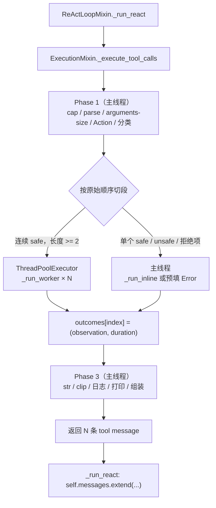

# Parallel Tool Execution：具体实现指南

> 状态说明：本文写于 2026-10-25，是 `doc/PARALLEL_TOOL_EXECUTION_DESIGN.md` 的配套实现指南，对应 `../ROADMAP.md` §4「09 — Parallel Tool Execution」。**本文 §4 的代码已在 2026-10-25 应用，并通过离线 + live 验证（记录见 §5.8）**；当前代码以源码为准，本文保留为实现记录。
>
> 阅读前提：设计文档负责“为什么”（调研、业界、决策、判据），本文负责“怎么做”（精确代码、修改顺序、测试、实测）。本文不重复设计文档的 1,800 行 survey；遇到设计理由，会链接到设计文档的对应小节。
>
> **本轮只新增本文档，不修改任何现有代码。** 文中的代码块是“目标修改”，不是已经应用的改动。

---

## 0. 怎么用这份文档

### 0.1 五个问题 → 章节

| 你的问题 | 本文位置 |
| --- | --- |
| 1. 什么是 parallel tool execution | §1 |
| 2. 我的 mini agent 实现了哪几部分 | §2 |
| 3. 你设计的工作机理和架构 | §3 |
| 4. 如何实现（具体修改代码） | §4 |
| 5. 如何测试（离线 + 自己跑 `python3 main.py`） | §5 |

### 0.2 与设计文档的分工

| 文档 | 负责 | 不负责 |
| --- | --- | --- |
| `doc/PARALLEL_TOOL_EXECUTION_DESIGN.md` | 概念、业界 survey、现状分析、D1–D15 决策、判据、失败矩阵、限制 | 逐步代码、测试文件、live 实测 |
| 本文 | 精确代码、修改顺序、离线测试、`python3 main.py` 实测、排错 | 重复业界 survey |

设计文档里的代码块用 4 空格缩进，**不能直接照抄**：`agent/` 和 `config.py` 必须用 tab；本文的代码块已经按目标文件的缩进写好。

### 0.3 前提：备份、环境、缩进

本仓库**没有 git**（`CLAUDE.md` 明确记录）。在动任何代码前先备份：

```bash
cd /home/bruce/code/mini-agent-system/09-parallel-tool-execution
mkdir -p /tmp/09-parallel-backup
cp -a agent tools config.py tests _test.py main.py /tmp/09-parallel-backup/
```

如果愿意，也可以先初始化版本控制：

```bash
git init
git add -A
git commit -m "baseline before parallel tool execution"
```

环境（当前 shell）：

- Python 3.14.7，`openai` 3.17.0；`python3` 解析到 miniconda base。
- `DEEPSEEK_API_KEY` 已设置；`DEEPSEEK_MODEL_NAME` 默认 `deepseek-flash`；`DEEPSEEK_THINKING` 默认 `enabled`。
- 所有路径相对 cwd；`logs/`、`tmp/`、`memory/` 都在 cwd 下。
- 没有 linter；缩进错了只能靠肉眼/`sed -n l`。

缩进约定（只列本文会改的文件）：

| 文件 | 缩进 |
| --- | --- |
| `agent/*.py`（含 `execution.py`、`react_loop.py`） | **tab** |
| `config.py` | **tab**（`EXPORT_LOG_CHOICES` 里第 37 行 `"planning"` 是 4 空格，是唯一例外） |
| `tools/*.py` | 4 空格 |
| `tests/*.py`、`_test.py` | 4 空格 |
| `main.py` | tab（少量 4 空格例外） |

> 例外：`agent/execution.py` / `agent/react_loop.py` 的 `from config import (...)` **括号续行**在现有文件里是 4 空格；本文代码块为了显示统一用了 tab，复制时以现有文件的续行缩进为准（括号内缩进不影响语法，但保持原风格更好）。

### 0.4 改动地图

| # | 文件 | 改动 | 风险 |
| --- | --- | --- | --- |
| 1 | `tools/_spec.py` | `@tool(..., parallel_safe=False)` + registry key | 低 |
| 2 | `tools/__init__.py` | `isinstance(bool)` 校验 + `TOOL_META` 投影；`TOOLS_DESC` 不变 | 低 |
| 3 | `tools/local.py` | `read_file`/`list_directory` 标 safe；`write_file`/`execute_command` 保持 unsafe | 分类风险 |
| 4 | `tools/network.py` | `search_web`/`fetch_webpage`/`get_news` 标 safe；`download_file` 保持 unsafe | 分类/限流 |
| 5 | `tools/notes.py` | `recall_notes` 标 safe；`write_note`/`forget_note` 保持 unsafe | 分类/共享存储 |
| 6 | `tools/runtime.py` | 不改；`run_python` 保持 unsafe | 分类 |
| 7 | `tools/vcs.py` | `git_*` 标 safe；`_run_git` 加 `GIT_OPTIONAL_LOCKS="0"` | 低/中 |
| 8 | `config.py` | `PARALLEL_ENABLED`/`PARALLEL_MAX_WORKERS`/两个 gate；可选 prompt | 低 |
| 9 | `agent/execution.py` | `_LOG_LOCK`、`_call_tool(..., id)`、`_parallel_safe`、`_run_inline`、`_run_worker`、`_execute_tool_calls` | **高（核心）** |
| 10 | `agent/react_loop.py` | 171–217 整块替换为 `self.messages.extend(...)`；imports 清理 | 中 |
| 11 | `tools/_common.py` | 可选：429 → `ConnectionError` | 低（全局重试行为） |
| 12 | `tests/test_parallel.py` | 新建，9 组离线断言 | 低 |
| 13 | `_test.py` | 加入 `test_parallel`（最后） | 低 |
| 14 | `tests/test_tools.py` | 新 loader case：`parallel_safe=1` | 低 |
| 15 | `tools/zz_parallel_probe.py` | **仅测试用临时插件**；只在临时副本里创建，测完删除 | 无（不保留） |

### 0.5 实施顺序（依赖顺序不能跳）

```text
Step 0  备份
Step 1  tools/_spec.py
Step 2  tools/__init__.py（校验 + TOOL_META）
Step 3  标记 9 个 safe 工具
Step 4  config.py（PARALLEL_* + 两个 gate）
Step 5  agent/execution.py（新执行器）
Step 6  agent/react_loop.py（调用 helper）
Step 7  可选：tools/_common.py 429、tools/vcs.py GIT_OPTIONAL_LOCKS
Step 8  测试：tests/test_parallel.py、_test.py、tests/test_tools.py
Step 9  可选：系统提示词批量引导
```

原因：

- `agent/execution.py` 会 `from config import PARALLEL_ENABLED, PARALLEL_MAX_WORKERS`，所以 `config.py` 必须先改。
- `agent/execution.py` 会 `from tools import TOOL_META`，所以 `tools/_spec.py`、插件、`tools/__init__.py` 必须先改。
- `agent/react_loop.py` 会调用 `self._execute_tool_calls(...)`，所以 `agent/execution.py` 必须先改。
- `tests/test_parallel.py` 依赖以上所有；**先单独跑绿，再加入 `_test.py`**，否则整套 suite 会在 import 时失败，掩盖其他组。

每步后都可以先跑：

```bash
python3 -m compileall -q .
```

### 0.6 术语

| 术语 | 含义 |
| --- | --- |
| **batch** | 一条 assistant 消息里的全部 `tool_calls` |
| **safe run** | 原始顺序中连续的一段 `parallel_safe=True` 的调用 |
| **barrier** | 不能跨过的调用：unsafe 或 cap/parse 拒绝项；它前面的 safe run 必须先结束 |
| **inline** | 在主线程直接执行，不进线程池 |
| **worker** | `ThreadPoolExecutor` 里的线程，只执行 `_call_tool` |
| **outcome** | 一个调用最终产生的 `(observation, duration)` |
| **admission** | cap、JSON 解析、参数检查、Action 打印、分类，全在主线程 |
| **write-back** | 按原始 `tool_calls` 顺序生成 N 条 `role:"tool"` 消息 |

---

## 1. 什么是 parallel tool execution

### 1.1 两个独立层次

**层次 A：模型侧批量（protocol / model）**

模型在一次 assistant 响应里返回多个 tool call。OpenAI 的 `parallel_tool_calls`、Anthropic 的多个 `tool_use` block、Gemini 的多个 `functionCall`、DeepSeek 的多个 `tool_calls`，都是这一层。

**层次 B：运行时并发（harness）**

harness 收到这条消息后，用线程池、`asyncio.gather`、`Promise.all` 或流式执行器，让多个 call 同时在飞。

**两层可以任意组合**。本仓库的现状是：A 已具备，B 为零——模型已经会一次发 2–3 个 call，但循环仍然逐个执行。

### 1.2 五类实现 + 两条边界

| 类型 | 谁负责 | 典型实现 | 本仓库 |
| --- | --- | --- | --- |
| A 模型侧批量 | 模型/协议 | OpenAI/Anthropic/Gemini/DeepSeek | ✅ 已有 |
| B 运行时批次并发 | harness | LangGraph、Agents SDK、Claude Code 批量路径、Gemini CLI | 🎯 本课目标 |
| C 流式/提前执行 | harness + 协议 | Claude Code `StreamingToolExecutor`、`eager_input_streaming` | ❌ 后续 |
| D 依赖感知调度 | planner + harness | LLMCompiler 的 DAG + Task Fetching Unit | ❌ 后续 |
| E 工具内部/子 agent | 工具/agent | `ReadManyFiles`、`Task`、parallel agents | ❌ 边界 |
| Workflow 并行 | workflow | sectioning/voting | ❌ 边界 |
| 多 agent fan-out | agent 层 | subagents | ❌ ROADMAP 15 |

详细 survey（Claude Code、Codex、OpenAI Agents SDK、LangGraph、Gemini CLI、MCP、LLMCompiler、Programmatic Tool Calling、Cline/Roo/Cursor）见设计文档 §3–§4。本文只做 B 类：**一条 assistant 消息内的多个 tool call 的运行时并发**。

### 1.3 一次批量调用的生命周期

```text
assistant: [tc0, tc1, tc2]
    |
    v
admission        cap / JSON / 参数检查 / Action 打印 / 分类
    |
    v
classification   parallel_safe? unknown -> unsafe
    |
    v
scheduling       连续 safe run -> pool；unsafe/拒绝项 -> barrier
    |
    v
execution        per-call _call_tool（自己的重试/超时）
    |
    v
collection       index -> (observation, duration)
    |
    v
write-back       按原始顺序生成 N 条 tool 消息
```

### 1.4 顺序是协议

`context.validate_history()`（`context/history.py:136-192`）要求：

- 一条 assistant 消息携带该轮全部 `tool_calls`；
- 紧跟连续的 N 条 `role:"tool"` 消息；
- `tool_call_id` 列表与 `tool_calls` 的 id 列表**完全相等、顺序一致、数量一致**；
- 带 `tool_calls` 的 assistant 消息必须保留 `reasoning_content`（空字符串也算）。

少一条、乱序、丢字段，下一轮 API 就是 400。**执行顺序可以乱，写回顺序不能乱**。

### 1.5 安全 ≠ 只读

- **只读**：不修改环境。
- **幂等**：同参数重复调用没有额外副作用。
- **并发安全**：与同批其他调用同时跑不会产生错误结果。

只读是好的起点，但不是充分条件：`git_status` 可能刷新 index、抢 `.git/index.lock`；`search_web` 只读但会触发限流。反过来，并发安全也不要求只读。所以分类必须显式、默认关闭（fail-closed）。

### 1.6 本仓库的位置

- A 已具备：日志实测 13 条响应里 6 条带 2–3 个 call。
- B 未实现：`agent/react_loop.py:179-217` 是 `for i, tc in enumerate(msg.tool_calls)` 串行。
- 结论：**协议层 100%，运行时层 0%**。

### 1.7 不做什么

- 不并行 plan steps（`agent/orchestration.py` 的 `for i, step` 不变）。
- 不做多 agent（ROADMAP 15）。
- 不做流式提前执行（C 类）。
- 不做依赖图（D 类）。
- 不引入 asyncio/进程池。
- 不改变 `TOOLS_DESC` 的模型可见 schema。
- 不做权限/审批。

---

## 2. 当前 mini agent 实现了哪几部分

### 2.1 协议层（已具备）

- `_consume_stream`（`agent/execution.py:89-187`）按流式 chunk 的 `index` 累积 `tool_calls`，拼出非流式形状的 `msg`。
- `_run_react` 在执行前把全部 `tool_calls` 构造成**一条** assistant 消息（`agent/react_loop.py:151-169`），并回传 `reasoning_content`（`is not None`）。
- 串行循环（`agent/react_loop.py:179-217`）每个 call 立即 append 一条 tool 消息，所以默认就是 N/N、按序、id 匹配。
- `validate_history` 是协议的检查器；正常路径靠构造方式保证合法。

### 2.2 执行层（已具备）

- `MAX_TOOL_CALLS_PER_ROUND=20`：超限的 call 不执行，但仍生成 `Error: ...` observation。
- `_parse_args`（`agent/execution.py:19-39`）：坏 JSON / 非 object 直接变成 observation，不执行。
- `_call_tool`（`agent/execution.py:41-71`）：per-call 重试 3 次，退避 0.5/1/2 秒；`Exception` → `Error:`；不 catch `BaseException`。
- `clip`：超过 8000 字符保留前 6000 + 后 1500。
- 工具异常、未知工具、坏参数都不会让整轮崩溃，而是变成 observation。

### 2.3 工具与元数据

- 15 个工具，分在 5 个插件文件：`local.py`（4）、`network.py`（4）、`notes.py`（3）、`runtime.py`（1）、`vcs.py`（3）。
- 目前**没有** `parallel_safe`，也没有 `TOOL_META`；`TOOLS_DESC` 只有模型可见的 schema。
- 目标分类：9 safe / 6 unsafe（见 §4.3）。

### 2.4 配置与日志

- 19 个日志 gate（`config.py:18-38`），严格按键读取；新增 gate 必须同时加进 `config.py`。
- 没有 `PARALLEL_*`；没有 `Parallel:`/`Tool duration:` 日志。
- 日志是裸 `open(..., "a")`；worker 可达的写只有 `_call_tool` 的重试行（`agent/execution.py:64-66`）。
- 一个进程一个日志文件，append 模式；`logs/` 会累积。

### 2.5 测试

- `_test.py` 固定导入 7 个模块，import 时断言，失败非零退出。
- `_test.py:4` 先创建 `logs/`，因为 `ReActAgent()` 会安装 `FileHandler`。
- `tests/test_tools.py` 会往 `TOOLS` 注入 `flaky`/`deterministic`/`always_timeout` 且不清理；新测试必须考虑这一点。
- 没有 `tests/test_parallel.py`。

### 2.6 日志实测

| 文件 | assistant 响应数 | 0 call | 1 call | 2 calls | 3 calls | 2+ calls |
| --- | ---: | ---: | ---: | ---: | ---: | ---: |
| `deepseek_log_20261024_220844.log`（1.2 MB） | 13 | 3 | 4 | 5 | 1 | **6** |
| 8 个 3,104 B 测试日志 | 1 each | 1 | 0 | 0 | 0 | 0 |
| 2 个 parser-fallback 日志（442/166 B） | 0 | 0 | 0 | 0 | 0 | 0 |
| `deepseek_log_20261025_103958.log`（0 B） | 0 | 0 | 0 | 0 | 0 | 0 |

6 条多 call 响应的组成：

- 4 条：`execute_command` + `execute_command`（全 unsafe）。
- 1 条：`run_python` + `execute_command`（全 unsafe）。
- 1 条：`read_file` + `read_file` + `execute_command`（2 个 safe + 1 个 unsafe）。

**来源说明**：这个 1.2 MB 日志是从 `08-planning-agent` 复制过来的；它证明模型行为，不证明本目录的并行执行。

结论：模型本来就会批量发调用；真正能并行的比例取决于 safe 工具占比。一个混合批的例子：

```text
当前：[read A, read B, exec C] -> A -> B -> C        wall = t_A + t_B + t_C
目标：[read A, read B, exec C] -> [A || B] -> C      wall = max(t_A, t_B) + t_C
```

### 2.7 结论

| 能力 | 状态 |
| --- | --- |
| 协议层：模型批量 + N/N history | ✅ |
| cap / per-call retry / 错误 observation | ✅ |
| 运行时并发 | ❌ |
| `parallel_safe` / `TOOL_META` | ❌ |
| `PARALLEL_*` 配置 | ❌ |
| 线程安全日志 | ❌ |
| 并行测试 | ❌ |
| 提示词批量引导 | ❌ |
| 流式提前执行 / 依赖图 / 取消 | ❌ |

一句话：**协议层 100%，运行时层 0%。**

---

## 3. 设计的工作机理与架构

### 3.1 三阶段



| 阶段 | 在哪 | 做什么 |
| --- | --- | --- |
| Phase 1 | 主线程 | cap、`_parse_args`、`arguments-size` 日志、Action 打印、`parallel_safe` 分类；cap/parse 失败预填 `Error` |
| Phase 2 | 主线程调度 | 连续 safe 段进池；unsafe/拒绝项主线程串行；结果按 index 收集 |
| Phase 3 | 主线程 | 按原始 index `str()`/`clip()`/日志/打印/生成 tool message；返回给 `_run_react` 一次性 extend |

### 3.2 连续 safe 段

调度按**原始顺序**切段，而不是“全部 safe 先跑、再全部 serial”：

```text
[R, R, W]      -> [R,R] 并行 -> W inline
[W, R, R]      -> W inline -> [R,R] 并行
[R, W, R]      -> R inline -> W inline -> R inline
[W, W]         -> W -> W（按序）
[bad, R, R]    -> bad 屏障 -> [R,R] 并行
```

为什么不能“全部 safe 先跑”：同轮调用不能互相喂返回值（参数在模型生成时就固定了），但会**互相观察副作用**。`write_file → read_file`、`write_note → recall_notes`、`execute_command → list_directory` 如果重排，结果会不同。连续 safe 段 + unsafe 屏障保留了原始顺序语义。

- 一个 safe 段长度 ≥ 2：开一个 `ThreadPoolExecutor`。
- 一个 safe 段长度 = 1：`_run_inline`，不开线程。
- unsafe / 拒绝项：单元素屏障，主线程执行（拒绝项直接预填 Error，不执行）。

### 3.3 线程池与并发预算

```python
with-like:
    executor = ThreadPoolExecutor(
        max_workers=max(1, min(int(PARALLEL_MAX_WORKERS), len(group))),
        thread_name_prefix="tool")
    try:
        futures = [(p["i"], executor.submit(self._run_worker, p)) for p in group]
        for i, future in futures:
            outcomes[i] = future.result()
    except BaseException:
        executor.shutdown(wait=False, cancel_futures=True)
        raise
    else:
        executor.shutdown(wait=True)
```

- **每个连续 safe 段一个池**，不是整个 run 一个常驻池；段与段之间是 barrier。
- `PARALLEL_MAX_WORKERS=4` 是配置上限，不是实际 worker 数；每段取 `min(4, len(group))`。
- `thread_name_prefix="tool"` 方便日志/调试。
- `max(1, ...)` 防止配置 0 时 `ThreadPoolExecutor(0)` 抛 `ValueError`。
- 池在进入下一个段之前 `shutdown(wait=True)`；正常路径没有残留 worker。

### 3.4 异常 / 中断语义

| 路径 | 谁执行 | `BaseException` 行为 |
| --- | --- | --- |
| `_run_worker`（池里） | worker 线程 | catch `BaseException` → `Error: ...`，保证每个 future 都有 observation |
| `_run_inline`（主线程） | 主线程 | **不** catch；`KeyboardInterrupt`/`SystemExit` 冒到 `main.py` 回滚 |

- `_call_tool` 自己 catch `Exception`，所以普通工具错误不会穿透。
- worker 的 `SystemExit` 不会杀掉进程；inline 的 `SystemExit` 会（与今天一致）。
- Ctrl-C 落在 safe 段：主线程在 `future.result()` 收到 `KeyboardInterrupt`，`except BaseException` 执行 `shutdown(wait=False, cancel_futures=True)`，取消排队中的，正在跑的 worker 继续（线程不能杀），然后 `raise`。
- 不做 sibling abort：每个 call 都必须有自己的结果；一个失败是一条 observation，模型可以自我纠正。

### 3.5 有序写回

```python
messages = []
for k, plan in enumerate(plans, 1):
    observation, duration = outcomes[plan["i"]]
    observation = clip(str(observation))
    ...
    messages.append({"role": "tool",
                     "tool_call_id": plan["tc"].id,
                     "content": observation})
return messages
```

- `outcomes` 以**原始 index** 为键；完成顺序不影响写回顺序。
- `_run_react` 只在 helper 成功返回后 `self.messages.extend(...)`；如果 helper 抛异常，history 不会写入半批 tool 消息。
- assistant 消息已经在执行前 append；Ctrl-C 由 `main.py:281-295` 回滚整个 turn。

### 3.6 日志与可观测性

新增两个 gate：

| gate | 内容 |
| --- | --- |
| `parallel` | `enabled`、`calls`、`groups`（段形状）、`max_workers`、`wall`、`sum_call_time` |
| `tool-duration` | 每个 call 的 `[i/N]`、名字、`tool_call_id`、耗时 |

示例：

```text
Parallel: enabled=True calls=2 groups=[safe x2] max_workers=4 wall=2.00Xs sum_call_time=4.00Xs
Tool duration: [1/2] probe_sleep id=call_... 2.00s
Tool duration: [2/2] probe_sleep id=call_... 2.00s
```

- 用 ASCII `safe x2` 而不是 `safe×2`：日志文件是默认编码的裸 `open`，外部解析器不应依赖非 ASCII。
- `Arguments size`/`Observation size` 加 `[i/N]` 前缀；`Tool retry` 加 `id=`。
- 终端的 Action/Observation 在多 call 轮次也加 `[i/N]` 前缀。
- `_LOG_LOCK` 只保护 worker 可达的 retry 写；Phase 1/3 在主线程且没有 worker 运行，所以不需要全局锁。**Ctrl-C 后**正在跑的 worker 可能继续，下一个 turn 的主线程日志可能与旧 worker 的 retry 写交错；这是已知限制（§6）。

### 3.7 为什么这样选

| 选择 | 理由 |
| --- | --- |
| 线程，不是 asyncio | 现有工具、`openai` 客户端、循环都是同步的；I/O-bound；侵入最小 |
| 线程，不是进程池 | 不需要序列化/共享状态；进程隔离留给 stage 18 |
| 连续 safe 段 | 保留 `write→read` 等原始顺序语义 |
| unsafe 主线程 | Ctrl-C 可达；不需要额外的 worker 异常处理 |
| worker catch `BaseException` | 保证每个 call 有 observation |
| inline 不 catch | Ctrl-C/`SystemExit` 保持今天的语义 |
| 显式 shutdown | `with ThreadPoolExecutor` 的 `__exit__` 是 `wait=True`，Ctrl-C 会等所有已提交的 call |
| `is True` 元数据 | 防止 `1`/`"yes"` 被当 safe |
| 不 sibling abort | 协议要求每个 id 有结果 |
| 默认 `PARALLEL_ENABLED=True` | 本课是演示功能；分类 fail-closed；可 `PARALLEL_ENABLED=0` 关闭 |

完整的 D1–D15 决策表见设计文档 §7.2。

### 3.8 不做什么

- 不并行 plan steps、不做多 agent、不做流式提前执行、不做依赖图。
- 不改变 `TOOLS_DESC`、assistant 消息形状、`reasoning_content` 规则、`MAX_ROUNDS` 预算。
- 不做权限/审批。

---

## 4. 具体实现

> 代码块按目标文件缩进：`agent/`/`config.py` 用 tab；`tools/`/`tests/` 用 4 空格。复制时请确认缩进没有被编辑器转成空格。

### 4.0 备份与回滚

```bash
cd /home/bruce/code/mini-agent-system/09-parallel-tool-execution
mkdir -p /tmp/09-parallel-backup
cp -a agent tools config.py tests _test.py main.py /tmp/09-parallel-backup/
```

回滚：

```bash
cp -a /tmp/09-parallel-backup/agent/. agent/
cp -a /tmp/09-parallel-backup/tools/. tools/
cp -a /tmp/09-parallel-backup/tests/. tests/
cp -a /tmp/09-parallel-backup/config.py config.py
cp -a /tmp/09-parallel-backup/_test.py _test.py
cp -a /tmp/09-parallel-backup/main.py main.py   # 如果改过 usage
rm -f tools/zz_parallel_probe.py
```

### 4.1 `tools/_spec.py`

把 `tool()` 的签名和 registry 改成：

```python
"""Binds a tool function and its schema into one declaration — written once per tool."""

_REGISTRY = []


def tool(description, parameters, required=(), name=None, parallel_safe=False):
    '''
    Usage:

        @tool(description="Read content from a file",
              parameters={"path": {"type": "string"}},
              required=["path"],
              parallel_safe=True)
        def read_file(path: str) -> str:
            ...

    name defaults to the function name — so the name used for dispatch and the
    name sent to the model cannot disagree. parallel_safe is client-side
    scheduling policy; the loader validates it and it never enters TOOLS_DESC.
    '''
    def deco(fn):
        _REGISTRY.append({
            "name": name or fn.__name__,
            "fn": fn,
            "description": description,
            "parameters": parameters,
            "required": list(required),
            "parallel_safe": parallel_safe,
        })
        return fn
    return deco


def registry():
    return list(_REGISTRY)
```

- `parallel_safe` 放在签名最后，现有调用（全部 keyword）不受影响。
- 默认 `False`，必须显式打开。
- 装饰器不校验类型；类型校验在 loader（§4.2）。

验证：

```bash
python3 -c "import tools; print(len(tools.TOOLS), tools.FAILED)"
# 仍是 15 {}
```

### 4.2 `tools/__init__.py`

#### 4.2.1 更新模块 docstring

当前 `tools/__init__.py:3-4` 只提 `TOOLS` 和 `TOOLS_DESC`。改成类似：

```python
Every tools/*.py is a plugin; functions declared with @tool are collected automatically.
the application and offline tests consume TOOLS, TOOLS_DESC and TOOL_META —
TOOLS_DESC is the model-facing schema; TOOL_META is client-side scheduling metadata
and is deliberately never sent to the model.
```

#### 4.2.2 在 per-tool 校验循环里加 bool 校验

当前循环在 `tools/__init__.py:117-135`，最后一个检查是：

```python
    _missing = set(_t["required"]) - set(_t["parameters"])
    if _missing:
        raise RuntimeError(
            f"{_t['name']}: required lists parameter(s) absent from properties "
            f"{sorted(_missing)} — the model cannot supply that argument")
```

在它后面加：

```python
    if not isinstance(_t["parallel_safe"], bool):
        raise RuntimeError(
            f"{_t['name']}: parallel_safe must be a bool, "
            f"got {_t['parallel_safe']!r}")
```

- `bool` 是 `int` 的子类，但 `isinstance(1, bool)` 是 `False`；所以 `1`/`"yes"`/`None` 都会被拒绝。
- `@tool` 总是写这个 key；如果某个插件绕过 `@tool`，`KeyError` 会在启动时暴露，这是可接受的（作者错误）。

#### 4.2.3 投影 `TOOL_META`

在**校验循环之后**、`TOOLS` 旁边（`tools/__init__.py:138` 附近）加：

```python
TOOL_META = {t["name"]: {"parallel_safe": t["parallel_safe"]} for t in _tools}
```

**不要**把 `parallel_safe` 加进 `TOOLS_DESC`；`TOOLS_DESC` 的现有投影（145-153）保持不动。加一条注释：

```python
# TOOL_META is client-side policy: the model sees TOOLS_DESC, never this.
```

验证：

```bash
python3 -c "import tools; print(sorted(n for n, m in tools.TOOL_META.items() if m['parallel_safe']))"
# 此时应该是空列表，因为还没有标记任何工具
```

### 4.3 标记 15 个工具

#### 4.3.1 目标分类

| 工具 | 文件 | `parallel_safe` | 理由 |
| --- | --- | --- | --- |
| `read_file` | `tools/local.py` | ✅ True | 只读文件 |
| `list_directory` | `tools/local.py` | ✅ True | 只读目录 |
| `search_web` | `tools/network.py` | ✅ True | 网络读；注意 ddgs 限流 |
| `fetch_webpage` | `tools/network.py` | ✅ True | 网络读 + 本地解析 |
| `get_news` | `tools/network.py` | ✅ True | 网络读；同一 host 可能限流 |
| `git_status` | `tools/vcs.py` | ✅ True | 只读；配 `GIT_OPTIONAL_LOCKS=0` |
| `git_diff` | `tools/vcs.py` | ✅ True | 只读 |
| `git_log` | `tools/vcs.py` | ✅ True | 只读 |
| `recall_notes` | `tools/notes.py` | ✅ True | 只读 JSONL |
| `write_file` | `tools/local.py` | ❌ False | 写路径；两个写同一路径会互相覆盖 |
| `download_file` | `tools/network.py` | ❌ False | 写目标；超限会 `os.remove` |
| `execute_command` | `tools/local.py` | ❌ False | 任意副作用、互相依赖、超时重试会重放 |
| `run_python` | `tools/runtime.py` | ❌ False | 任意代码；`tmp/agent_py_{ms}.py` 同毫秒会碰撞 |
| `write_note` | `tools/notes.py` | ❌ False | `memory.append` 的 `max(id)+1` 读改写 |
| `forget_note` | `tools/notes.py` | ❌ False | 固定 `.tmp` + `os.replace` |

**不要从名字猜**；也不要为了看到加速把 unsafe 标成 safe。

#### 4.3.2 在哪个位置加

在每个 safe 工具的 `@tool(...)` 里，把 `parallel_safe=True,` 放在 `required=...` **之前**。

**为什么放在前面**：`tests/test_tools.py:105-106` 的 `_dup_name` 注入锚点是

```python
'required=["path"],\n)\ndef read_file'
```

如果 `parallel_safe=True,` 插在 `required` 之后，这个锚点就消失，现有 loader 测试会以“注入锚点已失效”失败。放在 `required` 之前，锚点保持完整。

`tools/local.py` 的 `read_file`：

```python
@tool(
    description="Read a UTF-8 text file and return its contents.",
    parameters={
        "path": {"type": "string", "description": "Path to the file to read"},
    },
    parallel_safe=True,
    required=["path"],
)
def read_file(path: str) -> str:
    ...
```

`tools/notes.py` 的 `recall_notes`（示例；实际 description/parameters 以源码为准）：

```python
@tool(
    description="Search long-term notes and return the most relevant ones.",
    parameters={
        "query": {"type": "string", "description": "Search query"},
        "k": {"type": "integer", "description": "Number of notes to return"},
    },
    parallel_safe=True,
    required=["query"],
)
def recall_notes(query: str, k: int = 5) -> str:
    ...
```

全部 9 个 safe 工具的位置（上面两个是完整示例）：

| 文件 | 函数 | 加在 |
| --- | --- | --- |
| `tools/local.py` | `read_file` | `required=["path"],` 之前 |
| `tools/local.py` | `list_directory` | `required=[],` 之前 |
| `tools/network.py` | `search_web` | `required=["query"],` 之前 |
| `tools/network.py` | `fetch_webpage` | `required=["url"],` 之前 |
| `tools/network.py` | `get_news` | `required=[],` 之前 |
| `tools/notes.py` | `recall_notes` | `required=["query"],` 之前 |
| `tools/vcs.py` | `git_status` | `required=[],` 之前 |
| `tools/vcs.py` | `git_diff` | `required=[],` 之前 |
| `tools/vcs.py` | `git_log` | `required=[],` 之前 |

#### 4.3.3 git 读工具的锁

`tools/vcs.py:31-33` 当前：

```python
    cmd = ["git", "-C", path, "--no-pager",
           "-c", "core.quotepath=false", "-c", "color.ui=false"] + args
    env = dict(os.environ, GIT_PAGER="cat", GIT_TERMINAL_PROMPT="0", NO_COLOR="1")
```

把 env 改成：

```python
    env = dict(os.environ, GIT_PAGER="cat", GIT_TERMINAL_PROMPT="0", NO_COLOR="1",
               GIT_OPTIONAL_LOCKS="0")
```

`GIT_OPTIONAL_LOCKS=0` 让 `git status`/`git diff` 不做需要可选锁的索引刷新；它只影响这三个只读工具。若仍然出现 `.git/index.lock` 冲突，就把 `git_*` 标成 unsafe。

#### 4.3.4 验证

```bash
python3 -c "import tools; print(len(tools.TOOLS), tools.FAILED)"
python3 -c "import tools; print(sorted(n for n, m in tools.TOOL_META.items() if m['parallel_safe']))"
```

期望：`15 {}`，以及 9 个名字：

```text
['fetch_webpage', 'get_news', 'git_diff', 'git_log', 'git_status',
 'list_directory', 'read_file', 'recall_notes', 'search_web']
```

### 4.4 `config.py`

#### 4.4.1 新增 `PARALLEL_*`

在 `MAX_TOOL_RETRY_BACKOFF_TIME` 之后（`config.py:59` 附近）加：

```python
# Parallel tool execution. Only "0" disables it; any other value enables it.
PARALLEL_ENABLED = os.getenv("PARALLEL_ENABLED", "1") != "0"
PARALLEL_MAX_WORKERS = 4   # configured cap per safe group; clamped to >= 1
```

- 只认 `"0"` 为关闭；`false`/`no`/空字符串都算开启。想关闭就写 `PARALLEL_ENABLED=0`。
- 保持 `PARALLEL_MAX_WORKERS` 为整数；执行器会 `int(...)` 并 clamp。

#### 4.4.2 新增两个 gate

`EXPORT_LOG_CHOICES` 的 `"memory": True,`（第 36 行）之后、`"planning": True,`（第 37 行，4 空格）之前加两行（**用 tab**）：

```python
	"parallel": True,		# per-round batch shape, wall time, sum(call time)
	"tool-duration": True,	# per-call duration; proves overlap
```

加完后是 21 个 gate。`"planning"` 保留原来的 4 空格，不要改它。

#### 4.4.3 可选：`main.py` 的 usage

如果加了 `PARALLEL_ENABLED` 环境变量，在 `main.py` 的 `USAGE_TEXT` 环境变量列表（`main.py:70-75`）加：

```text
  PARALLEL_ENABLED          0 disables parallel tool execution (default enabled)
```

#### 4.4.4 验证

```bash
python3 -c "import config; print(config.PARALLEL_ENABLED, config.PARALLEL_MAX_WORKERS, len(config.EXPORT_LOG_CHOICES))"
python3 -c "import config; print(config.EXPORT_LOG_CHOICES['parallel'], config.EXPORT_LOG_CHOICES['tool-duration'])"
PARALLEL_ENABLED=0 python3 -c "import config; print(config.PARALLEL_ENABLED)"
```

期望：`True 4 21`、`True True`、`False`。

### 4.5 `agent/execution.py`

#### 4.5.1  imports

把顶部 imports 改成（保留 `_consume_stream` 用的 `json`/`SimpleNamespace`/`MarkdownStream`）：

```python
import json
import time
import subprocess
import threading
from concurrent.futures import ThreadPoolExecutor
from types import SimpleNamespace
from config import (
	EXPORT_LOG, EXPORT_LOG_CHOICES, EXPORT_LOG_PATH, MAX_TOOL_RETRIES,
	TOOL_RETRY_BACKOFF, MAX_TOOL_RETRY_BACKOFF_TIME, MAX_OBS_CHARS,
	MAX_TOOL_CALLS_PER_ROUND, PARALLEL_ENABLED, PARALLEL_MAX_WORKERS,
)
from tools import TOOLS, TOOL_META
from utils import clip
from presentation import MarkdownStream, rendering_enabled
```

在 `RETRIABLE_ERRORS` 后加模块级锁：

```python
RETRIABLE_ERRORS = (subprocess.TimeoutExpired, ConnectionError, TimeoutError)

# Every write reachable from a worker takes this lock. The main-thread log
# writes (arguments-size / observation-clipped / parallel / tool-duration) run
# while no worker is executing, so they intentionally do not take it.
_LOG_LOCK = threading.Lock()
```

#### 4.5.2 `_call_tool`：加可选 id + 锁

把 `_call_tool` 的签名改成：

```python
	def _call_tool(self, action_name: str, action_args: dict,
	               tool_call_id: str | None = None) -> str:
```

其余逻辑不变，只改重试日志：

```python
				if EXPORT_LOG and EXPORT_LOG_CHOICES["tool-retry"]:
					with _LOG_LOCK:
						with open(EXPORT_LOG_PATH, "a") as f:
							f.write(f"Tool retry {attempt}/{MAX_TOOL_RETRIES}: "
							        f"id={tool_call_id or '-'} {action_name} — "
							        f"{type(e).__name__}: {e}\n")
```

- 现有调用 `_call_tool(name, args)` 不受影响；`tests/test_tools.py` 的三组重试测试仍然可用。
- 锁只包住 `open/write`，不包 `time.sleep`。
- 不要在 worker 里加其他日志或 `print`。

#### 4.5.3 新增方法

在 `_call_tool` 之后、`_append_assistant_reply` 之前插入：

```python
	def _parallel_safe(self, name: str) -> bool:
		'''Metadata is the only source; unknown names fail closed.'''
		return TOOL_META.get(name, {}).get("parallel_safe") is True

	def _run_inline(self, plan: dict) -> tuple:
		'''Caller-thread execution: KeyboardInterrupt / SystemExit propagate.'''
		started = time.monotonic()
		observation = self._call_tool(
			plan["name"], plan["args"], tool_call_id=plan["tc"].id)
		return observation, time.monotonic() - started

	def _run_worker(self, plan: dict) -> tuple:
		'''Pool execution: every BaseException becomes an observation.'''
		started = time.monotonic()
		try:
			observation = self._call_tool(
				plan["name"], plan["args"], tool_call_id=plan["tc"].id)
		except BaseException as e:
			observation = (f"Error: {plan['name']} failed due to "
			               f"{type(e).__name__}: {e}")
		return observation, time.monotonic() - started

	def _execute_tool_calls(self, tool_calls: list, parallel=None) -> list:
		'''Execute one round's calls; return tool messages in tool_calls order.

		Phase 1 (caller thread): cap, parse, arguments-size, Action, classify.
		Phase 2: each *consecutive* run of safe calls goes through a pool; every
		unsafe or rejected call is a one-element group on the caller thread.
		Phase 3 (caller thread): clip/log/print in original order; return the
		messages. History is extended by the caller only after this succeeds.
		'''
		if parallel is None:
			parallel = PARALLEL_ENABLED
		n = len(tool_calls)

		if (EXPORT_LOG and EXPORT_LOG_CHOICES["round-tool-call-cap"]
				and n > MAX_TOOL_CALLS_PER_ROUND):
			with open(EXPORT_LOG_PATH, "a") as f:
				f.write(f"Round cap: {n} tool calls requested, "
				        f"executing first {MAX_TOOL_CALLS_PER_ROUND}\n")

		# Phase 1: admission on the caller thread.
		plans = []
		for i, tc in enumerate(tool_calls):
			name = tc.function.name
			if EXPORT_LOG and EXPORT_LOG_CHOICES["arguments-size"]:
				with open(EXPORT_LOG_PATH, "a") as f:
					f.write(f"Arguments size: [{i + 1}/{n}] {name} "
					        f"{len(tc.function.arguments or '')} chars\n")
			if i >= MAX_TOOL_CALLS_PER_ROUND:
				error = (f"Error: The maximum number of tool calls per round is "
				         f"{MAX_TOOL_CALLS_PER_ROUND}, this call was not executed. "
				         f"Please replan and initiate this call in the next round.")
				plans.append({"i": i, "tc": tc, "name": name,
				              "args": None, "error": error, "safe": False})
				continue
			args, error = self._parse_args(tc)
			if not error:
				label = f"[{i + 1}/{n}] " if n > 1 else ""
				print(f"🔧 Action: {label}{name}({args})")
			safe = bool(not error and parallel and self._parallel_safe(name))
			plans.append({"i": i, "tc": tc, "name": name, "args": args,
			              "error": error, "safe": safe})

		# Phase 2: contiguous safe runs; error/unsafe are one-element barriers.
		groups, run = [], []
		for plan in plans:
			if plan["error"] or not plan["safe"]:
				if run:
					groups.append(run)
					run = []
				groups.append([plan])
			else:
				run.append(plan)
		if run:
			groups.append(run)

		phase2_started = time.monotonic()
		outcomes, shape = {}, []
		for group in groups:
			if len(group) == 1:
				plan = group[0]
				outcomes[plan["i"]] = ((plan["error"], 0.0) if plan["error"]
				                       else self._run_inline(plan))
				shape.append(
					f"rejected:{plan['name']}" if plan["error"]
					else f"{'inline' if plan['safe'] else 'serial'}:{plan['name']}")
				continue
			workers = max(1, min(int(PARALLEL_MAX_WORKERS), len(group)))
			shape.append(f"safe x{len(group)}")
			executor = ThreadPoolExecutor(max_workers=workers,
			                              thread_name_prefix="tool")
			try:
				futures = [(p["i"], executor.submit(self._run_worker, p))
				           for p in group]
				for i, future in futures:
					outcomes[i] = future.result()
			except BaseException:
				# Ctrl-C: cancel queued calls; do not wait for running ones.
				executor.shutdown(wait=False, cancel_futures=True)
				raise
			else:
				executor.shutdown(wait=True)
		wall = time.monotonic() - phase2_started

		if EXPORT_LOG and EXPORT_LOG_CHOICES["parallel"]:
			with open(EXPORT_LOG_PATH, "a") as f:
				f.write(f"Parallel: enabled={parallel} calls={n} "
				        f"groups=[{', '.join(shape)}] max_workers={PARALLEL_MAX_WORKERS} "
				        f"wall={wall:.3f}s sum_call_time="
				        f"{sum(d for _, d in outcomes.values()):.3f}s\n")

		# Phase 3: original order; rejected calls are observations like any other.
		messages = []
		for k, plan in enumerate(plans, 1):
			observation, duration = outcomes[plan["i"]]
			observation = str(observation)
			raw_len = len(observation)
			observation = clip(observation)
			if EXPORT_LOG and EXPORT_LOG_CHOICES["observation-clipped"]:
				with open(EXPORT_LOG_PATH, "a") as f:
					f.write(f"Observation size: [{k}/{n}] {plan['name']} "
					        f"{raw_len} chars"
					        f"{f' -> clipped to {len(observation)}' if raw_len > MAX_OBS_CHARS else ''}\n")
			if (EXPORT_LOG and EXPORT_LOG_CHOICES["tool-duration"]
					and not plan["error"]):
				with open(EXPORT_LOG_PATH, "a") as f:
					f.write(f"Tool duration: [{k}/{n}] {plan['name']} "
					        f"id={plan['tc'].id} {duration:.2f}s\n")
			label = f"[{k}/{n}] " if n > 1 else ""
			print(f"👁 Observation: {label}{observation[:200]}"
			      f"{'...' if len(observation) > 200 else ''}")
			messages.append({"role": "tool", "tool_call_id": plan["tc"].id,
			                 "content": observation})
		return messages
```

几个容易看漏的点：

- **拒绝项是屏障**：cap/parse 失败不进入线程池，并切断 safe 段。它没有副作用，理论上可以跨过，但把它当屏障让“只有连续可执行 safe call 才重叠”更容易审计。
- **inline 不 catch `BaseException`**：保住 Ctrl-C 语义。
- **显式 shutdown**：`with ThreadPoolExecutor` 的 `__exit__` 是 `wait=True`；Ctrl-C 时会等所有已提交的 call。
- **`workers = max(1, min(int(...), len(group)))`**：防止 0/负值；`PARALLEL_MAX_WORKERS` 保持整数。
- **`is True`**：防止 `1`/`"yes"` 被当 safe。
- **`TOOL_META.get(..., False)`**：测试只往 `TOOLS` 注入 fake 时，缺失元数据 = unsafe，不会 `KeyError`。
- **`parallel` 参数**：方便测试直接跑 disabled 路径；生产调用不传，读模块级 `PARALLEL_ENABLED`。
- **`tool_call_id` 可选**：现有 `_call_tool(name, args)` 调用不受影响。
- **disabled 路径**：所有 plan 的 `safe=False`，所有段单元素，全部 inline；**history/tool 消息与今天一致**。终端输出的顺序会变成“先打印所有 Action，再打印所有 Observation”，与旧串行逐对输出不同；这是可接受的输出格式差异（§6）。

#### 4.5.4 验证

```bash
python3 -m compileall -q .
python3 -c "import agent.execution"   # 不应 ImportError
```

### 4.6 `agent/react_loop.py`

#### 4.6.1 替换执行块

当前 `agent/react_loop.py:171-217` 从 `# Max tool calls per round limit.` 开始，到 `self.messages.append(tool_message)` 结束。**整块**删掉（包括 cap 日志和 `for i, tc in enumerate(...)` 循环），换成：

```python
			# The helper applies the per-round cap, parses arguments, runs
			# contiguous safe groups in a pool, and returns tool messages in
			# tool_calls order. History is extended only after it succeeds.
			self.messages.extend(self._execute_tool_calls(msg.tool_calls))
```

- 只替换 `171-217`；`151-169` 的 assistant 消息构造不动；`219-223` 的 `messages-after-tool-execution` dump 不动。
- 不要只替换 `179-217` 而留下 `171-176` 的 cap 日志；helper 已经记录了 cap，会重复。
- 如果 helper 抛异常，`self.messages` 不会 extend；assistant 消息已在执行前 append；Ctrl-C 由 `main.py:281-295` 回滚整个 turn。

#### 4.6.2 清理 imports（可选）

抽出后，`react_loop.py` 不再直接使用 `MAX_OBS_CHARS`、`MAX_TOOL_CALLS_PER_ROUND`、`clip`；`time`/`message_chars` 在文件里本来就没有使用。可以改成：

```python
import json
from config import (
	MAX_ROUNDS, EXPORT_LOG, EXPORT_LOG_CHOICES, EXPORT_LOG_PATH,
	MEMORY_INDEX_MAX_NOTES, MEMORY_INDEX_MAX_CHARS,
)
from .helpers import _answer_warning
```

如果不确定，先 `grep -n 'MAX_OBS_CHARS\|MAX_TOOL_CALLS_PER_ROUND\|clip(\|time\.\|message_chars' agent/react_loop.py`；留着未使用的 import 是无害的，但仓库没有 linter，最好清理干净。

#### 4.6.3 验证

```bash
python3 -m compileall -q .
python3 main.py --help
python3 _test.py
```

### 4.7 可选但推荐：429 与 git lock

#### 4.7.1 `tools/_common.py`：429 可重试

当前 `_http_error`（`tools/_common.py:142-168`）把 4xx 一律当确定性错误。在 `if resp.status_code >= 500:` 之前加：

```python
    if resp.status_code == 429:
        raise ConnectionError(
            f"HTTP 429 rate limited for URL: {url}")  # retriable
```

- `ConnectionError` 在 `RETRIABLE_ERRORS` 里，`_call_tool` 会重试。
- `search_web` 的 `ddgs.RatelimitException` 已经映射成 `ConnectionError`；这条主要是 `fetch_webpage`/`get_news`/`download_file`。
- 固定 0.5/1/2 秒退避 + 并行搜索可能放大限流；生产实现应加 jitter，并读 `Retry-After`。本文先只做“可重试”。
- 这是**独立变更**：它影响所有 HTTP 工具的重试，不只是并行场景；单独提交、单独测试。

可选单测：

```python
from types import SimpleNamespace
from tools._common import _http_error

try:
    _http_error(SimpleNamespace(status_code=429, reason="Too Many Requests"), "http://x")
except ConnectionError:
    pass
else:
    raise AssertionError("429 should be retriable")
```

#### 4.7.2 git lock

已在 §4.3.3 给出 `GIT_OPTIONAL_LOCKS="0"`。本目录**不是 git 仓库**；要 live 测试 git 工具，先建一个临时仓库：

```bash
mkdir -p /tmp/parallel-git && cd /tmp/parallel-git
git init -q && printf 'x\n' > a.txt && git add a.txt && git -c user.email=a@b -c user.name=a commit -qm init
```

### 4.8 `tests/test_parallel.py`

> 4 空格缩进；import 时断言；`_test.py` 最后导入它。先单独跑绿，再加入 `_test.py`。

```python
"""Parallel scheduling: overlap, ordering, failure containment, disabled path."""
import threading
from contextlib import redirect_stdout
from io import StringIO
from types import SimpleNamespace

from agent import ReActAgent
from agent import execution
from context import validate_history
from tools import TOOLS, TOOLS_DESC, TOOL_META

agent = ReActAgent()
_added = []


def add_tool(name, fn, safe):
    assert name not in TOOLS and name not in TOOL_META, name
    TOOLS[name] = fn
    TOOL_META[name] = {"parallel_safe": safe}
    _added.append(name)


def cleanup():
    for name in _added:
        TOOLS.pop(name, None)
        TOOL_META.pop(name, None)
    _added.clear()


def call(name, args, call_id):
    return SimpleNamespace(
        id=call_id, type="function",
        function=SimpleNamespace(name=name, arguments=args))


def run_calls(calls, parallel=None):
    with redirect_stdout(StringIO()):
        return agent._execute_tool_calls(calls, parallel)


old_enabled = execution.PARALLEL_ENABLED
old_workers = execution.PARALLEL_MAX_WORKERS
old_cap = execution.MAX_TOOL_CALLS_PER_ROUND
old_log = execution.EXPORT_LOG
execution.PARALLEL_ENABLED = True
execution.PARALLEL_MAX_WORKERS = 2
execution.EXPORT_LOG = False   # 不让测试写 Parallel/Tool duration/retry 日志

try:
    # 0) 真实工具的 safe 集合；过滤本测试的 t_ fakes 和可选的 probe_
    expected_safe = {
        "read_file", "list_directory", "search_web", "fetch_webpage",
        "get_news", "git_status", "git_diff", "git_log", "recall_notes",
    }
    actual_safe = {n for n, m in TOOL_META.items()
                   if m.get("parallel_safe") is True
                   and not n.startswith(("t_", "probe_"))}
    assert actual_safe == expected_safe, actual_safe
    assert all("parallel_safe" not in tc["function"] for tc in TOOLS_DESC)

    # (a) 两个 safe 调用真的重叠。串行实现会让 barrier 超时 -> Error。
    barrier = threading.Barrier(2, timeout=2)
    def overlap(n):
        barrier.wait()
        return f"ok-{n}"
    add_tool("t_overlap", overlap, True)
    out = run_calls([
        call("t_overlap", '{"n": 1}', "c1"),
        call("t_overlap", '{"n": 2}', "c2"),
    ])
    assert [m["tool_call_id"] for m in out] == ["c1", "c2"], out
    assert all(m["content"].startswith("ok-") for m in out), out

    # (b) unsafe 不重叠，且在主线程执行。
    unsafe_barrier = threading.Barrier(2, timeout=2)
    def never_two(n):
        try:
            unsafe_barrier.wait()
        except threading.BrokenBarrierError:
            return "serial"
        return "OVERLAP"
    add_tool("t_unsafe", never_two, False)
    out = run_calls([
        call("t_unsafe", '{"n": 1}', "u1"),
        call("t_unsafe", '{"n": 2}', "u2"),
    ])
    assert [m["content"] for m in out] == ["serial", "serial"], out

    main_ids = []
    def on_main(n):
        main_ids.append(threading.get_ident())
        return "u"
    add_tool("t_main", on_main, False)
    run_calls([call("t_main", '{"n": 1}', "m1"),
               call("t_main", '{"n": 2}', "m2")])
    assert main_ids == [threading.main_thread().ident] * 2, main_ids

    # (c) 连续段保持 read-after-write 顺序。
    store = {}
    def write_x(**_):
        store["x"] = "written"
        return "wrote"
    def read_x(**_):
        return store.get("x", "unset")
    add_tool("t_write", write_x, False)
    add_tool("t_read", read_x, True)
    out = run_calls([
        call("t_read", "{}", "r0"),
        call("t_write", "{}", "w1"),
        call("t_read", "{}", "r2"),
    ])
    assert [m["content"] for m in out] == ["unset", "wrote", "written"], out

    # (d) 完成顺序可以反转，history 顺序不能。
    release = threading.Event()
    def slow(**_):
        if not release.wait(2):
            # 非重试异常：失败时不要触发 _call_tool 的 0.5+1+2s 退避
            raise RuntimeError("second call never started")
        return "slow"
    def fast(**_):
        release.set()
        return "fast"
    add_tool("t_slow", slow, True)
    add_tool("t_fast", fast, True)
    out = run_calls([call("t_slow", "{}", "s1"),
                     call("t_fast", "{}", "s2")])
    assert [m["tool_call_id"] for m in out] == ["s1", "s2"], out
    assert [m["content"] for m in out] == ["slow", "fast"], out

    # (e) 部分失败 + BaseException 仍然每个 slot 都有结果。
    def boom(**_):
        raise RuntimeError("boom")
    def die(**_):
        raise SystemExit(7)
    def ok(**_):
        return "ok"
    for name, fn in (("t_boom", boom), ("t_die", die), ("t_ok", ok)):
        add_tool(name, fn, True)
    out = run_calls([
        call("t_boom", "{}", "f1"),
        call("t_ok", "{}", "f2"),
        call("t_die", "{}", "f3"),
    ])
    assert [m["tool_call_id"] for m in out] == ["f1", "f2", "f3"], out
    assert "RuntimeError" in out[0]["content"], out
    assert out[1]["content"] == "ok", out
    assert "SystemExit" in out[2]["content"], out

    # (f) cap / parse / unknown 仍各有一条消息。
    execution.MAX_TOOL_CALLS_PER_ROUND = 1
    out = run_calls([call("t_ok", "{}", "cap1"),
                     call("t_ok", "{}", "cap2")])
    execution.MAX_TOOL_CALLS_PER_ROUND = old_cap
    assert "maximum number of tool calls" in out[1]["content"], out
    out = run_calls([call("t_ok", "{bad", "p1"),
                     call("t_ok", "{}", "p2")])
    assert "Invalid JSON" in out[0]["content"], out
    out = run_calls([call("t_missing", "{}", "m1")])
    assert "Error" in out[0]["content"], out

    # (g) enabled/disabled 的 tool 消息逐项相等。
    calls = [call("t_ok", "{}", "e1"), call("t_ok", "{}", "e2")]
    enabled = run_calls(calls, True)
    disabled = run_calls(calls, False)
    assert enabled == disabled, (enabled, disabled)
    execution.PARALLEL_ENABLED = False
    assert run_calls(calls) == disabled
    execution.PARALLEL_ENABLED = True

    # (h) 返回的消息能通过 history 协议（必须用同一组 calls 的结果）。
    history = [
        {"role": "system", "content": "s"},
        {"role": "assistant", "content": "", "tool_calls": [
            {"id": c.id, "type": "function",
             "function": {"name": c.function.name,
                          "arguments": c.function.arguments}}
            for c in calls]},
        *disabled,
    ]
    assert validate_history(history) == [], validate_history(history)
    print("Parallel: safe set / overlap / unsafe serial / order / failure / cap / disabled / history")
finally:
    cleanup()
    execution.PARALLEL_ENABLED = old_enabled
    execution.PARALLEL_MAX_WORKERS = old_workers
    execution.MAX_TOOL_CALLS_PER_ROUND = old_cap
    execution.EXPORT_LOG = old_log
```

关键点：

- `write_x`/`read_x`/`slow`/`fast`/`boom`/`die`/`ok` 都接受 `**_`，因为调用参数是 `{}`；否则 `_call_tool` 会因 `TypeError` 返回 Error，测试失败。
- `slow` 用 `RuntimeError`，不是 `TimeoutError`；后者在 `RETRIABLE_ERRORS` 里，会让失败路径多睡 0.5+1+2 秒。
- unsafe barrier 用 2 秒，不是 0.5 秒；负载高时并行实现可能在 0.5 秒后才启动第二个 worker，误判为 serial。
- `(h)` 用 `*disabled`（与 `calls` 的 e1/e2 对应），不要用 `(e)` 或 `(f)` 的 `out`，否则 id 不匹配。
- `TOOL_META` 只断言真实工具；`test_tools` 留在 `TOOLS` 里的 `flaky`/`deterministic`/`always_timeout` 没有 `TOOL_META`，不会影响 safe 集合。
- `probe_` 过滤让可选探针插件不会破坏离线 suite；但最好还是在跑 `_test.py` 前删掉它。
- `EXPORT_LOG=False` 只关掉 `execution` 的日志；`ReActAgent()` 仍会打开 FileHandler 创建日志文件，这是现有测试的既有行为。

`_test.py` 改成：

```python
from tests import (
    test_tools, test_context, test_presentation, test_responses,
    test_memory, test_cli, test_planning, test_parallel,
)
```

`test_parallel` 放最后：它改 `TOOLS`/`TOOL_META`/`execution` 模块全局，并在 `finally` 恢复。**先单独跑绿，再加这一行**：

```bash
mkdir -p logs
python3 -m tests.test_parallel
```

### 4.9 `tests/test_tools.py`：loader case

在 `_bad_required` 附近加一个注入函数（4 空格）：

```python
def _bad_parallel_safe(pkg):
    _patch(pkg, "local.py",
           'parallel_safe=True,\n    required=["path"],',
           'parallel_safe=1,\n    required=["path"],')
```

在 `loader_cases`（`tests/test_tools.py:139-158`）加：

```python
    ("parallel_safe 不是 bool", _bad_parallel_safe, 1, "parallel_safe must be a bool"),
```

说明：

- 锚点包含 `required=["path"],`，只会命中 `read_file`；`list_directory` 的 `required=[]` 不会匹配。
- `_patch` 要求锚点存在；如果以后格式化变了，测试会显式失败并提示“注入锚点已失效”。
- 这个 case 的 temp copy 仍会加载 12 个工具（`notes.py` 的 `import memory` 在 temp copy 里失败）；这是既有行为，不影响 `local.py` 的新校验。
- 现有 `_dup_name` 的锚点 `required=["path"],\n)\ndef read_file` 仍然存在，因为 §4.3.2 把 `parallel_safe=True,` 放在 `required` 之前。

### 4.10 可选：系统提示词批量引导

当前 `DEFAULT_SYSTEM_PROMPT`（`config.py:86-99`）没有批量调用引导；日志显示 DeepSeek 本来就会批量发。**先测量，再决定是否改**。

如果测量后发现 safe 批比例低，可以在 ReAct 格式说明之后加：

```text
Parallel tool use:
- When several independent operations are needed, issue all of their tool calls
  in the same response instead of one per round.
- Never batch calls that depend on each other's results or that modify the same state.
```

这是一项**独立、可测量的行为变更**：

- 变更前：固定 demo prompt 跑 3 次，统计 `Message in LLM response:` 里 `len(tool_calls)` 的分布。
- 变更后：同样 3 次，比较“2+ call 的轮次占比”“其中 safe 批占比”“总轮数/答案质量”。
- 如果批量率没有提升或 wasted call 明显增加，就回退。

### 4.11 改动汇总与逐步验证

| 步骤 | 验证 |
| --- | --- |
| Step 1-3 元数据 | `python3 -c "import tools; print(len(tools.TOOLS), tools.FAILED)"` → `15 {}`；safe 列表 9 个 |
| Step 4 config | `python3 -c "import config; print(config.PARALLEL_ENABLED, config.PARALLEL_MAX_WORKERS, len(config.EXPORT_LOG_CHOICES))"` → `True 4 21` |
| Step 5 execution | `python3 -m compileall -q .`；`python3 -c "import agent.execution"` |
| Step 6 react_loop | `python3 main.py --help`；`python3 _test.py` |
| Step 8 tests | `mkdir -p logs && python3 -m tests.test_parallel`；然后 `python3 _test.py` |
| 全部 | §5.7 验收清单 |

### 4.12 与设计文档的差异 / 勘误

| 设计文档 | 本文 | 理由 |
| --- | --- | --- |
| 代码块 4 空格 | `agent/`/`config.py` 用 tab | 仓库缩进约定 |
| `safe×N` | `safe xN` | 日志 ASCII 可解析 |
| 测试 fake 用 `n` 但传 `{}` | fake 用 `**_` | 避免 TypeError |
| 测试 history 用 `*out` | 用 `*disabled` | 与 `calls` 的 id 对应 |
| unsafe barrier 0.5s | 2s | 避免高负载误判 |
| `slow` 抛 `TimeoutError` | 抛 `RuntimeError` | 避免 3.5s 重试 |
| 未断言 unsafe 主线程 | 断言 `main_thread().ident` | 满足判据 |
| 设计文档只换 179–217 | 本文换 171–217 | 避免重复 cap 日志 |
| 未提 `_dup_name` 锚点 | `read_file` 把 `parallel_safe` 放 `required` 前 | 保持现有 loader 测试 |
| 未提 `_test.py` 顺序 | 先单独跑绿，再加 import | 避免整套 suite 在 import 时失败 |
| 未提 Ctrl-C 日志交错 | 列入限制 | 线程不能杀 |

---

## 5. 怎么测试

### 5.1 测试分层

| 层 | 作用 | 权威性 |
| --- | --- | --- |
| 离线单测 `tests/test_parallel.py` | 用 Barrier/Event 证明并发、顺序、失败隔离、开关等价 | **权威**；不依赖模型是否批量 |
| 全套 `_test.py` | 回归 + 新 loader case | **权威** |
| live `python3 main.py` | 观察真实模型是否批量、真实工具耗时、日志格式 | 参考；模型可能拆分调用 |

**先看离线测试**。live 测试如果模型把两个 call 拆成两轮，运行时根本没有机会并行；这不是实现 bug。

### 5.2 离线测试

```bash
cd /home/bruce/code/mini-agent-system/09-parallel-tool-execution

python3 -m compileall -q .
mkdir -p logs
python3 -m tests.test_parallel
python3 _test.py
```

期望：

- `compileall` exit 0。
- `test_parallel` exit 0，打印 `Parallel: safe set / overlap / unsafe serial / order / failure / cap / disabled / history`。
- `_test.py` exit 0，最后打印 `All offline assertion groups passed.`。

`test_parallel` 的 9 组断言分别证明：

| 组 | 证明 |
| --- | --- |
| 0 | 真实工具 safe 集合 = 9；`TOOLS_DESC` 不含 `parallel_safe` |
| (a) | 两个 safe 调用真的同时到达 Barrier（并发发生） |
| (b) | 两个 unsafe 调用不重叠，且在主线程执行 |
| (c) | `read → write → read` 保持 `["unset", "wrote", "written"]` |
| (d) | 完成顺序反转时，history 仍按原始顺序 |
| (e) | 一个 `RuntimeError` + 一个 `SystemExit` 仍各有一条消息 |
| (f) | cap / 坏 JSON / 未知工具仍各有一条消息 |
| (g) | `parallel=True` 与 `False` 的 tool 消息逐项相等 |
| (h) | 返回消息通过 `validate_history` |

loader case：

```bash
python3 -m tests.test_tools
```

期望输出里出现：

```text
5. parallel_safe 不是 bool            rc=1 (期望 1)  ok
```

### 5.3 自己跑 `python3 main.py`

#### 5.3.1 先决条件

- `DEEPSEEK_API_KEY` 已设置；`python3 main.py --help` 不需要 key。
- `--root` 目录必须**已存在**；`main.py` 不会创建它。
- `--root` 会 `chdir`；`logs/`、`tmp/`、`memory/` 和工具相对路径都在 root 下。
- `tools/` 包始终从 lesson 目录加载（`main.py` 先 import 再 chdir），所以 probe 插件放在 lesson 的 `tools/` 里仍然会被加载。
- one-shot 模式即使 `run()` 返回失败 sentinel 也 exit 0；看日志/答案，不只看 exit code。

**推荐：live 测试用临时副本，避免 probe 污染正式目录。**

```bash
cp -a /home/bruce/code/mini-agent-system/09-parallel-tool-execution /tmp/parallel-live
cd /tmp/parallel-live
mkdir -p /tmp/parallel-root
```

在 `/tmp/parallel-live/tools/` 里创建 probe 插件；正式目录保持 15 个工具。

#### 5.3.2 临时 probe 插件

文件：`/tmp/parallel-live/tools/zz_parallel_probe.py`（4 空格；**测完删除，不要留在正式目录**）

```python
"""Temporary live-test probes for parallel tool execution. Delete after testing."""
import time

from ._spec import tool


@tool(
    description="Sleep for N seconds and return a label. Test probe; parallel-safe.",
    parameters={
        "seconds": {"type": "number", "description": "Seconds to sleep"},
        "label": {"type": "string", "description": "Label to return"},
    },
    parallel_safe=True,
    required=["seconds", "label"],
)
def probe_sleep(seconds: float, label: str) -> str:
    time.sleep(seconds)
    return f"{label}: slept {seconds}s"


@tool(
    description="Sleep for N seconds and return a label. Test probe; unsafe (serial).",
    parameters={
        "seconds": {"type": "number", "description": "Seconds to sleep"},
        "label": {"type": "string", "description": "Label to return"},
    },
    required=["seconds", "label"],
)
def probe_serial(seconds: float, label: str) -> str:
    time.sleep(seconds)
    return f"{label}: slept {seconds}s"
```

验证插件加载：

```bash
cd /tmp/parallel-live
python3 -c "import tools; print(len(tools.TOOLS), tools.FAILED)"
# 期望 17 {}
```

#### 5.3.3 场景 A：两个 safe 调用并发（确定性）

```bash
cd /tmp/parallel-live
python3 main.py --root /tmp/parallel-root --msg 'In a single assistant response, call probe_sleep twice: probe_sleep(seconds=1, label="A") and probe_sleep(seconds=1, label="B"). Do not call them in separate rounds. Then report both results.'
latest=$(ls -t /tmp/parallel-root/logs/deepseek_log_*.log | head -1)
grep -n '^Parallel:' "$latest"
grep -n '^Tool duration:' "$latest"
```

期望：

```text
Parallel: enabled=True calls=2 groups=[safe x2] max_workers=4 wall=1.0XXs sum_call_time=2.0XXs
Tool duration: [1/2] probe_sleep id=call_... 1.00s
Tool duration: [2/2] probe_sleep id=call_... 1.00s
```

判据：`groups=[safe x2]`；`wall` 约 1.0–1.2s；`sum_call_time` 约 2.0s；两条 `Tool duration` 都在 1.0s 左右。模型的回答应包含 A/B 两个结果。

#### 5.3.4 场景 B：unsafe 串行

```bash
python3 main.py --root /tmp/parallel-root --msg 'In a single assistant response, call probe_serial twice: probe_serial(seconds=1, label="A") and probe_serial(seconds=1, label="B"). Do not call them in separate rounds. Then report both results.'
latest=$(ls -t /tmp/parallel-root/logs/deepseek_log_*.log | head -1)
grep -n '^Parallel:' "$latest"
```

期望：

```text
Parallel: enabled=True calls=2 groups=[serial:probe_serial, serial:probe_serial] max_workers=4 wall=2.0XXs sum_call_time=2.0XXs
```

判据：`groups` 是两个 `serial:`；`wall ≈ sum ≈ 2s`；没有 `safe x` 段。

#### 5.3.5 场景 C：混合批

```bash
python3 main.py --root /tmp/parallel-root --msg 'In a single assistant response, call probe_sleep(seconds=1, label="A"), probe_sleep(seconds=1, label="B"), and probe_serial(seconds=1, label="C"). Do not call them in separate rounds. Then report all three results.'
latest=$(ls -t /tmp/parallel-root/logs/deepseek_log_*.log | head -1)
grep -n '^Parallel:' "$latest"
```

期望（顺序取决于模型；两种都合法）：

```text
groups=[safe x2, serial:probe_serial]
# 或
groups=[serial:probe_serial, safe x2]
```

判据：两个 `probe_sleep` 在同一个 `safe x2` 段；`probe_serial` 独占；`wall` 约 2s；`sum_call_time` 约 3s。

#### 5.3.6 场景 D：写后读（屏障）

```bash
cd /tmp/parallel-live
python3 main.py --root /tmp/parallel-root --msg 'In a single assistant response, write the text "hello parallel" to tmp/parallel_probe.txt with write_file, then read tmp/parallel_probe.txt with read_file. Then tell me what you read.'
latest=$(ls -t /tmp/parallel-root/logs/deepseek_log_*.log | head -1)
grep -n '^Parallel:' "$latest"
```

期望：

```text
Parallel: enabled=True calls=2 groups=[serial:write_file, inline:read_file] max_workers=4 ...
```

判据：写是 `serial:` 屏障；读是 `inline:` 或后面的单元素段；模型回答读到 `hello parallel`。如果模型把读放在写前，读可能报不存在；这反映的是模型的调用顺序，不是调度 bug。

#### 5.3.7 场景 E：部分失败

```bash
cd /home/bruce/code/mini-agent-system/09-parallel-tool-execution
python3 main.py --msg 'In a single assistant response, read README.md and read tmp/does_not_exist_12345.txt with two read_file calls. Then tell me which succeeded and which failed.'
latest=$(ls -t logs/deepseek_log_*.log | head -1)
grep -n '^Parallel:' "$latest"
```

期望：

```text
Parallel: enabled=True calls=2 groups=[safe x2] max_workers=4 wall=0.0XXs sum_call_time=0.0XXs
```

判据：模型回答一个成功、一个失败；history 里 2 条 tool 消息，一条是 README 内容，一条是 `Error: read_file failed...`。用 §5.4 的 parser 检查 `validate_history == []`。

#### 5.3.8 场景 F：关闭开关

```bash
cd /tmp/parallel-live
PARALLEL_ENABLED=0 python3 main.py --root /tmp/parallel-root --msg 'In a single assistant response, call probe_sleep twice: probe_sleep(seconds=1, label="A") and probe_sleep(seconds=1, label="B"). Do not call them in separate rounds. Then report both results.'
latest=$(ls -t /tmp/parallel-root/logs/deepseek_log_*.log | head -1)
grep -n '^Parallel:' "$latest"
```

期望：

```text
Parallel: enabled=False calls=2 groups=[serial:probe_sleep, serial:probe_sleep] max_workers=4 wall=2.0XXs sum_call_time=2.0XXs
```

判据：`enabled=False`；两个 `serial:`；`wall ≈ sum ≈ 2s`；tool 消息与开启时一致（顺序/内容/id 模式）。

#### 5.3.9 模型是否真的批量

先看 `Message in LLM response:` 里一条 assistant 消息的 `tool_calls` 数量：

```bash
grep -n 'Message in LLM response:' "$latest"
```

- 一条消息 2 个 call：运行时有机会并行。
- 两条消息各 1 个 call：模型拆成了两轮；运行时无法并行。用更强的 prompt（“in a single assistant response, call ... twice, do not split”）或直接用离线测试判定实现。
- `Parallel: calls=1` 出现多次，说明确实拆了。

#### 5.3.10 清理

```bash
rm -f /tmp/parallel-live/tools/zz_parallel_probe.py
rm -f /tmp/parallel-live/tools/__pycache__/zz_parallel_probe*.pyc
rm -f /tmp/parallel-root/tmp/parallel_probe.txt
# 可选：
rm -rf /tmp/parallel-live /tmp/parallel-root
```

正式目录的 `TOOLS` 应保持 15；probe 只在 `/tmp/parallel-live`。

### 5.4 日志解析与 history 校验

找到最新日志：

```bash
latest=$(ls -t logs/deepseek_log_*.log | head -1)          # 无 --root
latest=$(ls -t /tmp/parallel-root/logs/deepseek_log_*.log | head -1)  # 有 --root
```

看关键行：

```bash
grep -n '^Parallel:' "$latest"
grep -n '^Tool duration:' "$latest"
grep -n '^Arguments size:' "$latest"
grep -n '^Observation size:' "$latest"
grep -n '^Tool retry:' "$latest"
grep -n '^Round cap:' "$latest"
```

解析 `Messages after tool execution:` 并跑 `validate_history`：

```bash
python3 - "$latest" <<'PY'
import json
import sys
from context import validate_history

path = sys.argv[1]
text = open(path, encoding="utf-8").read()
marker = "Messages after tool execution:\n"
dec = json.JSONDecoder()
best = None
pos = 0
while True:
    i = text.find(marker, pos)
    if i < 0:
        break
    try:
        obj, end = dec.raw_decode(text, i + len(marker))
        best = obj
        pos = end
    except json.JSONDecodeError:
        pos = i + len(marker)
if best is None:
    raise SystemExit("no Messages after tool execution block found")
print("messages:", len(best))
print("violations:", validate_history(best))
PY
```

期望：`violations: []`。如果日志里的 marker 被 tool 输出伪造，`best` 可能不是真正的 history；看一眼 `messages:` 的数量和最近的 `Round` 段。

### 5.5 排错表

| 症状 | 可能原因 | 修复 |
| --- | --- | --- |
| `KeyError: 'parallel'` / `'tool-duration'` | 忘了加 gate | §4.4.2 |
| `ImportError: cannot import name 'TOOL_META'` | `tools/__init__.py` 没做投影，或顺序错了 | §4.2.3；先改 tools 再改 execution |
| `ImportError: cannot import name 'PARALLEL_ENABLED'` | config 没改 | §4.4；先改 config 再改 execution |
| `RuntimeError: parallel_safe must be a bool` | 某个 decorator 写了 `1`/`"yes"` | 改成 `True`/`False` |
| `TypeError` / `Error: ... TypeError` in tests | fake 函数不接受 `**_` 或调用参数不匹配 | fake 用 `**_` 或传 `{"n": 1}` |
| 测试 `validate_history` 失败 | history 用了别的测试的 `out` | 用同一组 `calls` 的 `disabled`/`enabled` |
| 400 `BadRequest` | tool 消息少/乱序/id 不匹配 | 看 §5.4；检查 Phase 3 是否按 index 写回 |
| 没有 `Parallel:` | gate 关、`EXPORT_LOG=False`、模型没调用工具 | 检查 config/日志/`Message in LLM response` |
| 有 `Parallel: calls=1` 多次 | 模型拆成多轮 | 用“in a single response”prompt；或离线测试 |
| `groups=[inline:...]` 而不是 `safe x2` | 工具没标 safe，或被 unsafe/拒绝项隔开 | 检查 `TOOL_META`/`tool_calls` 顺序 |
| 没有加速 | 全 unsafe、磁盘读太快、模型拆轮 | 用 probe；看 `wall`/`sum_call_time` |
| 429 | 并行搜索触发限流 | 降低 `PARALLEL_MAX_WORKERS`；§4.7.1 |
| `git ... failed (exit ...)` / index lock | 没加 `GIT_OPTIONAL_LOCKS=0` 或仍冲突 | §4.3.3；必要时把 git 标 unsafe |
| Ctrl-C 后等很久 | 正在跑的 safe call 不能被 kill | 已知限制；用 per-tool 超时/更短调用 |
| `ThreadPoolExecutor` `ValueError` | `PARALLEL_MAX_WORKERS=0` | clamp 或设 >=1 |
| probe 不出现 | 插件没加载/文件名被忽略 | `python3 -c "import tools; print(tools.FAILED)"`；检查文件名不以 `_` 开头 |
| 测试写日志 | `ReActAgent()` 打开 FileHandler | 预期；`logs/` 是 scratch；可 `EXPORT_LOG=False` |
| loader 测试显示 12 个工具 | temp copy 缺 `memory`，`notes` 失败 | 既有行为；不影响新 case |

### 5.6 测试矩阵

| 场景 | 运行方式 | 期望 |
| --- | --- | --- |
| 离线并发 | `python3 -m tests.test_parallel` | exit 0；Barrier 组通过 |
| 全套回归 | `python3 _test.py` | exit 0；最终 banner |
| loader 非 bool | `python3 -m tests.test_tools` | 新 case ok |
| 静态检查 | `python3 -c "import tools; ..."` | 15 `{}`；9 safe；`TOOLS_DESC` 无 `parallel_safe` |
| live safe | probe `probe_sleep` ×2 | `groups=[safe x2]`；wall≈1s；sum≈2s |
| live unsafe | probe `probe_serial` ×2 | `groups=[serial:..., serial:...]`；wall≈2s |
| live mixed | probe_sleep ×2 + probe_serial | `groups=[safe x2, serial:...]`；wall≈2s；sum≈3s |
| live disabled | `PARALLEL_ENABLED=0` + probe | `enabled=False`；wall≈2s |
| live 写后读 | write_file → read_file | `serial:write_file` 屏障；读到内容 |
| live 部分失败 | README + 缺失文件 | 2 条消息；一条 Error；`validate_history == []` |
| history | §5.4 parser | `violations: []` |

### 5.7 验收清单

- [x] `python3 -m compileall -q .` exit 0。
- [x] `python3 -m tests.test_parallel` exit 0。
- [x] `python3 _test.py` exit 0，最终 `All offline assertion groups passed.`。
- [x] `python3 -c "import tools; print(len(tools.TOOLS), tools.FAILED)"` → `15 {}`（无 probe）。
- [x] `python3 -c "import tools; print(sorted(n for n, m in tools.TOOL_META.items() if m['parallel_safe']))"` → 9 个 safe。
- [x] `TOOLS_DESC` 不含 `parallel_safe`。
- [x] live safe：`groups=[safe x2]`，wall≈1s，sum≈2s。
- [x] live unsafe：`groups=[serial:..., serial:...]`，wall≈2s。
- [x] live mixed：`groups=[safe x2, serial:...]`，wall≈2s。
- [x] live disabled：`enabled=False`，wall≈2s。
- [x] history parser：`validate_history == []`。
- [x] 日志无 `BadRequest`；有 `Parallel:`/`Tool duration:`。
- [x] probe 已从正式目录删除；`TOOLS` 回到 15。
- [x] 备份/回滚路径已记录。

### 5.8 实现后验证记录（2026-10-25）

本轮已按 §4 应用核心代码（§4.1–§4.8、§4.9），并完成以下验证。

| 检查 | 结果 |
| --- | --- |
| `python3 -m compileall -q .` | exit 0 |
| `python3 -m tests.test_parallel` | exit 0；打印 `Parallel: safe set / overlap / unsafe serial / order / failure / cap / disabled / history` |
| `python3 _test.py` | exit 0；最终 `All offline assertion groups passed.` |
| 新 loader case | `5. parallel_safe 不是 bool rc=1 (期望 1) ok` |
| 工具注册表 | `15 {}`；safe 9 / unsafe 6 |
| `TOOLS_DESC` | 不含 `parallel_safe` |
| `config` | `True 4 21`；`PARALLEL_ENABLED=0` → `False` |
| 429 | `_http_error(429)` → `ConnectionError` |
| git | `git_status` / `git_log` 在临时仓库上正常返回 |
| live safe | `Parallel: enabled=True calls=2 groups=[safe x2] max_workers=4 wall=1.001s sum_call_time=2.001s`；`validate_history == []` |
| live unsafe | `groups=[serial:probe_serial, serial:probe_serial] wall=2.000s sum_call_time=2.000s` |
| live mixed | `groups=[safe x2, serial:probe_serial] wall=2.001s sum_call_time=3.000s` |
| live disabled | `enabled=False groups=[serial:probe_sleep, serial:probe_sleep] wall=2.001s sum_call_time=2.000s` |

说明：

- live 测试在 `/tmp/parallel-live` 的临时副本里加入 `tools/zz_parallel_probe.py` 后运行；正式目录始终是 15 个工具，副本与 probe 已删除。
- live safe / unsafe / mixed / disabled 都用 `seconds=1`；模型四次都把两个或三个调用放在**同一条** assistant 消息里，可在 `Message in LLM response:` 中核对。
- live safe 的 `Messages after tool execution` 经 §5.4 parser 检查：`messages: 5`、`violations: []`。
- live 运行全部 exit 0；保留的最后一份日志无 `BadRequest`。前三份 live 日志随临时目录清理，运行过程中没有 400。
- live 的 **写后读** 与 **部分失败** 没有单独跑；离线 `(c)` 和 `(e)` 已覆盖这两个语义，且 live safe/mixed 已验证完整 `_run_react` 路径。
- §4.10 的提示词**没有**应用：本轮 live 测试在未改 prompt 的情况下模型已经批量发调用；按文档的“先测量”原则，保留为独立变更。
- 备份保留在 `/tmp/09-parallel-backup-impl/`。

---

## 6. 风险、限制与回滚

### 6.1 已知限制

- **线程不能硬取消**：`ThreadPoolExecutor` worker 是非 daemon；`Future.cancel()` 只取消未开始的；Ctrl-C 只能取消排队中的，正在跑的 safe call 继续到自己的超时。`read_file`/`list_directory` 没有超时，挂起的 FIFO/NFS 会拖住 shutdown。
- **Ctrl-C 后的日志交错**：`_LOG_LOCK` 只保护 retry 写；`shutdown(wait=False)` 后旧 worker 可能继续，下一个 turn 的主线程 `Arguments size`/`Parallel:` 写可能和旧 worker 的 retry 写交错。要彻底解决，需要把所有日志写都过一个带锁的 helper；本文不做。
- **GIL 只帮 I/O**：网络、磁盘、子进程会释放 GIL；纯 Python CPU 工具不会。
- **safe 是正确性分类，不是终止性保证**：`read_file` 可能卡在 FIFO/NFS；`git_status` 可能卡在挂起的文件系统。线程不能杀。
- **429/限流**：并行网络工具会放大限流；固定退避可能不够；`Retry-After`/jitter/每主机 semaphore 是后续工程。
- **外部状态不确定性**：两个 `fetch_webpage`、`search_web`、`get_news` 即使都 safe，结果也可能因为外部状态/限流而不同；`parallel_safe` 不保证确定性。
- **误分类是正确性 bug**：把 `write_file`/`write_note`/`forget_note`/`run_python`/`download_file`/`execute_command` 标成 safe 会产生真实的读写竞争。
- **safe 工具契约**：不能 `print`/`input`、不能访问 history、不能等主线程、不能有共享可变状态、必须有界。
- **重复 tool id**：`validate_history` 只检查顺序/数量；重复 id 是上游协议问题，调度器不修复。
- **输出格式变化**：`Arguments size`/`Observation size`/`Tool retry` 和终端 Action/Observation 加了前缀；旧的 grep/肉眼配对可能失效。实现后应同步 `README.md`/`CLAUDE.md`。
- **disabled 路径输出顺序**：history/protocol 与今天一致，但终端会先打印所有 Action 再打印所有 Observation；如果必须逐对输出，需要单独的串行 fast path。
- **不并行 plan steps/多 agent**：本课只做一条 assistant 消息内的 tool call。
- **free-threaded Python 未验证**：环境是 Python 3.14.7，但不能假设 free-threaded 构建。

### 6.2 回滚

- 用 §4.0 的 `cp -a` 恢复备份文件。
- 删除新增的 `tests/test_parallel.py` 和 probe 插件。
- 如果只改了一部分，按 §0.5 的依赖顺序反向恢复：先 `react_loop.py`，再 `execution.py`，再 `config.py`，再 `tools/`。
- 本仓库没有 git；不要假设能 `git checkout`。

---

## 7. 参考资料

- 设计文档：`doc/PARALLEL_TOOL_EXECUTION_DESIGN.md`（§3–§4 survey、§7.2 D1–D15、§7.5 判据、§7.6 失败矩阵、§7.8 测量）。
- ROADMAP：`../ROADMAP.md` §4「09 — Parallel Tool Execution」。
- Python `concurrent.futures`：https://docs.python.org/3/library/concurrent.futures.html
- Git `GIT_OPTIONAL_LOCKS`：https://git-scm.com/docs/git#Documentation/git.txt-GITOPTIONALLOCKS
- Claude Code / Codex / LangGraph 的具体实现对比：见设计文档 §4.2–§4.5 的链接（Claude Agent SDK `readOnlyHint`、Codex PR #17667/#23750、OpenAI Agents SDK `max_function_tool_concurrency`、LangGraph `ToolNode`）。
- OpenAI function calling `parallel_tool_calls`：https://developers.openai.com/api/docs/guides/function-calling
- Anthropic parallel tool use：https://platform.claude.com/docs/en/agents-and-tools/tool-use/parallel-tool-use

> 再次提醒：本文的代码是目标修改，尚未应用到工作树；实现后以源码为准。所有行号是 2026-10-25 的快照，应用前用 `grep -n` 重新确认锚点。
