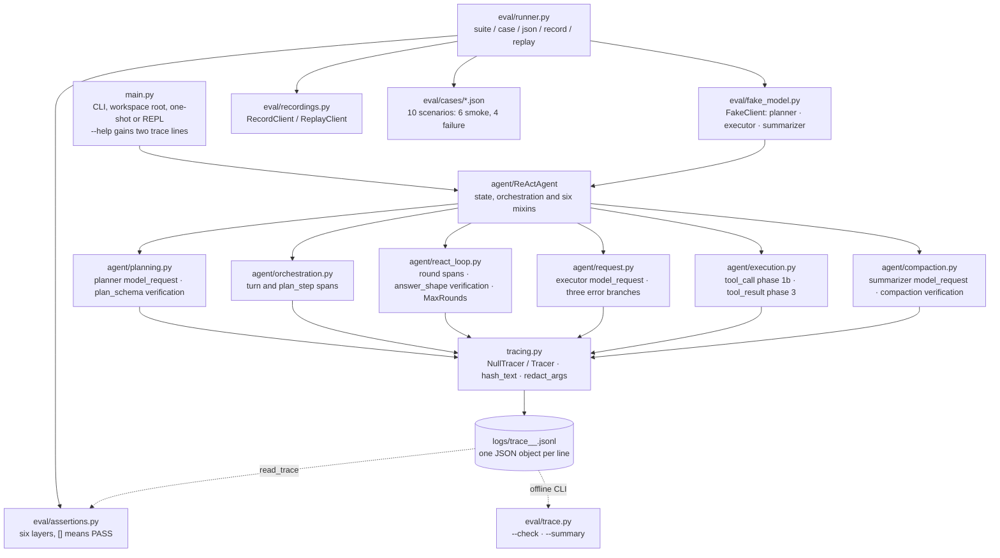

# Eval and Tracing

The tenth entry in the `mini-agent-system/` series: the same multi-turn ReAct agent, context
compaction, long-term memory, Planner stage, parallel tool execution and fifteen tools as
[`../09-parallel-tool-execution/`](../09-parallel-tool-execution/) — with a machine-readable record
around the loop and an offline harness that drives it.

09 ended with two kinds of evidence: a human-readable text log and a suite of direct assertions.
Neither is a record of what a whole request did. The log has no schema, no IDs and no durations, and
its sections dump the history rather than the work; the tests call functions, not `run()`. 10 adds
both kinds of evidence without changing the agent's behavior. `tracing.py` writes one JSON object
per event to a separate file when `MINI_AGENT_TRACE=1`, with a trace id, span ids and a parent link.
`eval/` runs JSON scenarios through the real `run()` with a scripted model, then asserts six layers
over the history, the request contract, the result, the cost and the trace. The trace is for a
machine or a post-mortem; the harness is for the next change.

| What 09 does | What 10 adds |
| --- | --- |
| One human-readable text log per process, navigated by grep | A second, machine-readable JSONL trace with `trace_id`, span IDs and eight event types |
| A failed turn is diagnosed by reading log sections | `eval/trace.py --check --summary` validates parents, tool-call pairing and secret leaks |
| The loop is covered by direct module-level assertions | Ten scenario cases drive the real `run()` through a scripted model |
| There is no way to replay a real response offline | Response record/replay keyed by a request hash; a stale hash fails loudly |
| `ReActAgent` constructs its client from config | `client=` and `tracer=` injection; production defaults are unchanged |

The first two rows are the lesson. The other three are what the lesson dragged in: a scripted model
needs a seam in the constructor; per-case limits need budgets that can be set from outside
`config.py`; and replay needs a request hash stable enough that a prompt or schema change invalidates
the recording instead of silently passing.

Read 10 as a diff against 09. Of the 45 files the two lessons share — excluding the README — **35 are
byte-for-byte identical** and 10 differ; 10 adds 22 files, and 09's README is replaced by this one.
Everything under `tools/`, `context/` and `presentation/`, plus `memory.py`, `utils.py` and
`agent/helpers.py`, is untouched. The change is instrumentation in the six agent-side files, a new
`tracing.py`, a new `eval/` package, two test groups, and two design records. Excluding `README.md`,
`CLAUDE.md` and `doc/`, the code and case-JSON diff is **+1,980/−22 lines**.

## Structure

The entry point is still `ReActAgent`; the package layout is 09's. The new runtime module is
`tracing.py`; `eval/` is a separate consumer that imports the agent, never the other way around:



Three parts of the tree carry the change:

- **`tracing.py` is the only new module the agent imports.** It imports nothing from the project, is enabled
  only by config, and every call site emits unconditionally — when disabled, `NullTracer` makes that
  call a no-op. A trace failure disables tracing and never reaches the agent.
- **`eval/` is a consumer, never a dependency.** `eval/__init__.py` imports nothing, so importing the
  package cannot import the agent; `eval/runner.py` boots `sys.path` and then imports `agent`. The
  direction is `eval → agent → tracing`, and no file under `agent/` imports `eval`.
- **`main.py` and `config.py` change only at the edges.** `main.py` gains two help lines and one
  `Trace:` print; `config.py` gains the `TRACE_*` block, `MINI_AGENT_LOG`, and env overrides for the
  three budgets. No new flag, no new REPL command, no new log gate.

## Requirements

- Python 3.x.
- The `openai` Python package (`pip install openai`); this repository does not pin a version or
  include a dependency manifest.
- A DeepSeek-compatible API key and endpoint for live requests and for `--record`. The configured
  default model is `deepseek-flash`; set a model that supports the configured thinking mode and
  streamed completions.
- Optional tool dependencies are imported lazily by the tool functions that need them: `requests`,
  `beautifulsoup4` with `lxml`, `ddgs`, and `feedparser`. A missing optional package is returned to
  the model as a tool observation when that tool is called.
- `readline` is optional. It enables line editing and Unicode-aware backspace where available;
  without it, the REPL falls back to `input()`.
- **No new dependency.** `tracing.py`, `eval/` and the two new tests use only the standard library:
  `json`, `hashlib`, `uuid`, `threading`, `argparse`, `tempfile`, `re`, `os` and `sys`. There is no
  OpenTelemetry, no collector, no metrics backend, no pytest and no eval framework.

## Setup

Configuration is read from environment variables in `config.py`:

| Variable | Default |
| --- | --- |
| `DEEPSEEK_API_KEY` | `sk-your-key-here` (must be replaced) |
| `DEEPSEEK_BASE_URL` | `https://api.deepseek.com` |
| `DEEPSEEK_MODEL_NAME` | `deepseek-flash` |
| `DEEPSEEK_THINKING` | `enabled` |
| `DEEPSEEK_CONTEXT_WINDOW` | `784000` tokens, for the occupancy display |
| `PARALLEL_ENABLED` | `1` — every value except the literal `0` enables it |

The tracing block is independent of the text log and off by default:

| Variable | Default | Effect |
| --- | --- | --- |
| `MINI_AGENT_TRACE` | `0` | any value except `0` enables JSONL tracing |
| `MINI_AGENT_TRACE_DIR` | `logs` | directory for `trace_<timestamp>_<pid>.jsonl` |
| `MINI_AGENT_TRACE_MAX_BYTES` | `10485760` | rotation threshold (10 MiB) |
| `MINI_AGENT_TRACE_KEEP` | `3` | rotated files kept as `.1` … `.3` |
| `MINI_AGENT_TRACE_FIELD_CHARS` | `500` | per-field clipping limit |
| `MINI_AGENT_TRACE_INCLUDE_CONTENT` | `0` | enables only on the literal `1`; see the caveat below |

The enable rules are deliberately asymmetric, like `PARALLEL_ENABLED`: `MINI_AGENT_TRACE` uses
`!= "0"`, so `false`, `no` and even the empty string enable tracing; `MINI_AGENT_TRACE_INCLUDE_CONTENT`
uses `== "1"`, so only `1` does. 10 also makes the text log and the three budgets switchable without
editing the file:

| Variable | Default | Effect |
| --- | --- | --- |
| `MINI_AGENT_LOG` | `1` | `0` disables the text log; new in 10 |
| `MINI_AGENT_MAX_ROUNDS` | `100` | rounds per user request |
| `MINI_AGENT_MAX_OBS_CHARS` | `8000` | observation clipping budget |
| `MINI_AGENT_MAX_TOOL_CALLS_PER_ROUND` | `20` | per-round tool-call cap |

```python
TRACE_ENABLED = os.getenv("MINI_AGENT_TRACE", "0") != "0"
TRACE_PATH = os.path.join(TRACE_DIR, f"trace_{current_time_str}_{os.getpid()}.jsonl")
TRACE_MAX_BYTES = int(os.getenv("MINI_AGENT_TRACE_MAX_BYTES", str(10 * 1024 * 1024)))
```

All of these are read once when `config.py` is imported. `eval/runner.py` relies on that: it sets
`MINI_AGENT_LOG=0` and `MINI_AGENT_TRACE=1` with `os.environ.setdefault` before importing config or
the agent, then patches the four budget names on their modules per case.

`MINI_AGENT_TRACE_INCLUDE_CONTENT` is wired into the cleaner, not into any caller. No call site emits
a `prompt`, `content`, `observation` or `result` field, and `redact_args` always cleans with
`include_content=False`, so setting the switch to `1` cannot add raw content or un-redact the
argument preview in the current code.

```bash
export DEEPSEEK_API_KEY=sk-...
MINI_AGENT_TRACE=1 python3 main.py --msg 'read these two files and compare them'
```

## Running

The command line is 09's: `--root <dir>`, `--msg <text>`, `--help`, or a bare prompt. There is no new
`main.py` flag and no new REPL command; `--help` gains two environment lines:

```text
MINI_AGENT_TRACE          1 enables JSONL tracing (default 0)
MINI_AGENT_TRACE_DIR      trace directory (default logs)
```

```bash
cd 10-eval-tracing

python3 main.py --help
python3 main.py                                  # multi-turn REPL
python3 main.py --root /path/to/project          # REPL rooted at that project
python3 main.py --msg 'inspect and explain this project'
python3 main.py --root /path/to/project --msg 'summarize the project'
python3 main.py 'inspect and explain this project' # compatible bare-prompt form
MINI_AGENT_TRACE=1 python3 main.py --msg '...'    # also writes logs/trace_<ts>_<pid>.jsonl
```

When tracing is enabled, `main.py` prints `Trace: <absolute path>` after constructing the agent.
There is no `/trace` command: the trace is a file, and the REPL's commands are still `/compact`,
`/context`, `/memory`, `/help` and `/exit`. `--root` still moves every relative path; the trace
follows `MINI_AGENT_TRACE_DIR`, which defaults to `logs` under the current root.

## How it works

The agent is 09's. The lesson is what is recorded around it and how a second, offline program drives
it.

### ① The trace is a second record, not a second log

The text log is for a person. It is append-only, one file per process, and most of its enabled
sections dump the whole message history; `EXPORT_LOG_CHOICES` decides what appears. It has no
transaction ID, no span ID, no duration, and no schema a parser can rely on. It is also shared with
the `openai` SDK's DEBUG bridge, and the inherited `initial-messages` gate opens the same file with
`"w"` on the first turn.

The trace is for a program. It is a separate JSONL file, one compact object per line, with a fixed
envelope and event-specific fields. It is not a log gate: `TRACE_ENABLED` is read from
`MINI_AGENT_TRACE`, and the two records can be on independently. The text log remains the
human-readable record; the trace is the machine-readable one.

```python
def get_tracer(enabled=False, path=None, **kwargs):     # tracing.py
    if not enabled or not path:
        return NullTracer()
    return Tracer(path, **kwargs)
```

Every instrumented call site writes `self.tracer.emit(...)` unconditionally. With tracing off,
`NullTracer.emit` returns `None` and no file is opened; switching tracing on does not add a branch to
the agent loop.

### ② Eight events and one span tree

Every line carries the same seven fields:

| Field | Meaning |
| --- | --- |
| `v` | schema version, currently `1` |
| `ts` | UTC ISO-8601 timestamp with milliseconds |
| `trace_id` | one `uuid4().hex` per `Tracer`, so one per process |
| `span_id` | a 16-hex id for this event's span |
| `parent_span_id` | the enclosing span, or `null` for the turn root |
| `event` | one of the eight names below |
| `actor` | who emitted it, e.g. `orchestrator`, `planner`, `react`, `tool:read_file` |

The eight events are emitted at 24 call sites:

| Event | Actor(s) | Emitted when | Key fields |
| --- | --- | --- | --- |
| `turn` | `orchestrator` | start of `run()`, and once at `_end_turn` | `turn`, `status`, `prompt_chars`/`prompt_hash`; then `duration_ms`, `final_chars`/`final_hash`, `answer_status` |
| `plan_step` | `orchestrator` | each step starts, completes, or fails | `plan_step`, `status`, `step_chars`; then `duration_ms`, `result_chars` or `reason` |
| `round` | `react` | each ReAct round starts and ends | `round`, `round_global`, `max_rounds`, `status`; then `duration_ms` and an answer kind when one was reached |
| `model_request` | `planner`, `react`, `compactor` | after a planner, executor or summarizer request | `component`, `model`, `stream`, `message_count`, `tools_count`, `request_chars`, usage tokens, `finish_reason`, `duration_ms` |
| `tool_call` | `tool:<name>` | Phase 1b, before grouping | `tool`, `tool_call_id`, `call_index`, `args_chars`, `args_hash`, `args_preview`, `parallel_safe`, `scheduled_parallel`, `status` |
| `tool_result` | `tool:<name>` | Phase 3, in original order | the same `span_id` and `tool_call_id`, `duration_ms`, `raw_chars`, `result_chars`, `clipped`, `status` |
| `verification` | `planner`, `react`, `compactor` | a structural or result check | `check` (`plan_schema`, `answer_shape`, `compaction_history`), `layer`, `status` (`pass`/`warn`/`fail`), `reason` |
| `error` | `planner`, `react`, `orchestrator`, `compactor` | a request, step, round cap or compaction failed | `component`, `error_type`, `error`, `retryable` |

`new_span(parent)` mints an id and ignores its argument; parentage is not context propagation. The
tree exists only because each `emit` records the `parent_span_id` its caller passes. The shape is
`turn` at the root (with `parent_span_id: null`); planner and summarizer requests are direct children
of the turn; `plan_step` spans are children of the turn; a `round` is a child of the current
`plan_step`, or of the turn when no plan is active; `model_request`, `verification` and `error` hang
under the round or step that produced them; and a `tool_call`/`tool_result` pair shares one
`span_id` under its round. `round_global` is the request-wide round counter, while `round` restarts
per step, which is why both are recorded.

A tool pair looks like this (fields abridged):

```text
{"v":1,"ts":"2026-10-26T12:00:00.789Z","trace_id":"9f2c...","span_id":"00000000000000b2","parent_span_id":"0000000000000042","event":"tool_call","actor":"tool:read_file","turn":1,"plan_step":null,"round":1,"round_global":1,"tool":"read_file","tool_call_id":"call_1","call_index":1,"args_chars":15,"args_hash":"4a9c...","args_preview":"{\"path\":\"a.txt\"}","parallel_safe":true,"scheduled_parallel":true,"status":"requested"}
{"v":1,"ts":"2026-10-26T12:00:00.801Z","trace_id":"9f2c...","span_id":"00000000000000b2","parent_span_id":"0000000000000042","event":"tool_result","actor":"tool:read_file","turn":1,"plan_step":null,"round":1,"round_global":1,"tool":"read_file","tool_call_id":"call_1","call_index":1,"duration_ms":12.4,"raw_chars":5,"result_chars":5,"clipped":false,"status":"ok"}
```

### ③ Emission stays on the caller thread

The parallel scheduler is 09's, unchanged, and the trace is laid over its deterministic edges. Phase
1b runs on the caller thread after admission and before grouping: every admitted call — including a
rejected one — gets one `tool_call` span and one event. Phase 3 runs on the caller thread after every
group has finished: each plan is visited in the original `tool_calls` order and gets one
`tool_result` on the same span. `_run_worker` returns `(observation, duration)` and emits nothing.

That placement has three consequences. A round with N calls produces N `tool_call`/`tool_result`
pairs even when some calls were rejected, because the protocol still owes N tool messages. The trace
order is the model's order, not the completion order, so it stays readable beside the history. And
`scheduled_parallel` records the admission decision (`True` only for a safe call in an enabled
round), not a promise that the call actually overlapped; the overlap proof remains
`tests/test_parallel.py`'s `threading.Barrier`.

### ④ Redaction, truncation, rotation, failure containment

The tracer is designed to be safe to leave on and impossible to make fatal:

- Credential-shaped keys are replaced with `<REDACTED>`: `api_key`, `authorization`, `password`,
  `secret`, a bare `token`, and `access`/`auth`/`refresh`/`bearer`/`id` + `token`. The regex is
  deliberately written to spare usage counters such as `input_tokens`, `output_tokens` and
  `total_tokens`.
- The keys `prompt`, `content`, `observation` and `result` are dropped by the cleaner unless
  `include_content` is on; no current call site supplies them.
- Text fields are clipped to `TRACE_FIELD_CHARS` (500 by default), and the home directory is replaced
  by `~`. `hash_text()` stores a 16-hex SHA-256 prefix, and `redact_args()` stores a cleaned JSON
  preview plus the full arguments' hash, not the raw string.
- Each file is created with mode `0600`; a lock covers each write; the line is built with compact
  separators and written with one `os.write` loop. Before a write that would cross 10 MiB, the file
  is rotated to `.1`, `.2`, `.3`, keeping the three most recent.
- `Tracer.emit` catches `Exception`, disables itself, and prints one warning to stderr. It does not
  catch `BaseException`, and it never raises into the agent. An unwritable directory disables tracing
  at construction with the same warning.

`eval/trace.py` is the offline reader. `--check` verifies the seven required fields, rejects a span
that is its own parent, rejects an unknown parent (unless `--allow-missing-parent`), pairs
`tool_call`/`tool_result` by `tool_call_id`, requires the two halves to share a span id, and requires
every call to have a result (unless `--allow-open-calls`). It also scans for `sk-…`, `api_key=`,
`authorization=` and absolute home paths. `--summary` prints counts of events, turns, rounds, model
requests, input/output tokens, tools and errors. It exits 0 or 1, unlike the runner's 0/1/2.

The trace-invariant assertion inside the eval harness is weaker: `_check_trace` checks parent
existence, call/result coverage and optional event counts, but not required fields, self-parenting or
same-span pairing. The CLI is the stricter validator; the assertion is the fast in-suite check.

### ⑤ The eval harness runs the real loop behind a scripted client

`eval/runner.py` does not reimplement the agent. It imports `ReActAgent`, injects a client and a
tracer, and calls `agent.run(case["prompt"])` exactly as `main.py` would.

`FakeClient` routes by request shape rather than by a mode flag:

| Request | Routed to | Reply |
| --- | --- | --- |
| `stream=True`, no `tools` | planner | the case's `plan` object, or `plan.raw` verbatim |
| `stream=True`, with `tools` | executor | one script entry per round: `tool_call`, `tool_calls`, `final` or `raise` |
| `stream=False` | summarizer | the case's `summary`, or a fixed sentence |

A `tool_calls` entry produces one assistant message carrying several calls; `final` closes the loop
with `Final Answer: ...`; `raise` makes the model call itself fail; an exhausted script or an unknown
entry is an error, not a pass. Every request is recorded in `client.requests`, which is what the
request-contract layer reads.

A case is data, not code:

```python
{
    "schema_version": 1,
    "id": "parallel-safe",
    "suite": "smoke",
    "prompt": "Run both probes.",
    "plan": {"needs_plan": False, "steps": []},        # or {"raw": "not json"}
    "script": [
        {"type": "tool_calls", "calls": [
            {"name": "probe_a", "arguments": {}, "id": "pa"},
            {"name": "probe_b", "arguments": {}, "id": "pb"}]},
        {"type": "final", "content": "Final Answer: ok"}],
    "tools": {"probe_a": {"mode": "shared_barrier", "result": "ok",
                          "parallel_safe": True},
              "probe_b": {"mode": "shared_barrier", "result": "ok",
                          "parallel_safe": True}},
    "shared_barrier": {"parties": 2, "timeout": 2},
    "limits": {"max_rounds": 3},
    "expect": {"history_valid": True, "tool_sequence": ["probe_a", "probe_b"],
               "max_rounds": 2, "max_model_requests": 3},
}
```

For each case the runner snapshots and then patches four module constants —
`agent.react_loop.MAX_ROUNDS`, `agent.execution.MAX_TOOL_CALLS_PER_ROUND`,
`agent.execution.MAX_OBS_CHARS` and `utils.MAX_OBS_CHARS` — injects the fake tools into `TOOLS` and
`TOOL_META`, runs the agent with stdout redirected, and restores everything in `finally`. The fake
tools never enter `TOOLS_DESC`, so the model-facing schema stays the real one; `parallel_safe`
defaults to `False` unless the case sets it.

Ten cases ship in two suites:

| Suite | Case | What it pins |
| --- | --- | --- |
| smoke | `simple-final` | no tools, one round, token cap, request contract |
| smoke | `single-tool-read` | one read, one tool message, final answer |
| smoke | `two-tool-order` | a safe read followed by an unsafe write, in order |
| smoke | `parallel-safe` | two safe calls meet at a case-level `Barrier(2)` |
| smoke | `plan-two-steps` | two plan steps, four `plan_step` events |
| smoke | `schema-contract` | system prompt and tool schema contain the expected names |
| failure | `bad-tool-json` | `arguments_raw: "{bad"` becomes a recoverable observation |
| failure | `tool-raises` | `probe_boom` raises; the loop still closes |
| failure | `planner-bad-json` | `plan.raw = "not json"` falls back to ReAct |
| failure | `max-rounds` | `limits.max_rounds = 1`; exactly one `error` event |

The parallel case repeats 09's test trick inside the harness: both fake tools call
`shared_barrier.wait()`, so a serial executor times out and the case fails. The harness thus proves
overlap through the real scheduler, not through a timing threshold.

Trace files for eval runs go to a `tempfile.TemporaryDirectory`, one `<case_id>.jsonl` per case, and
the directory is deleted when `runner.main` returns. `--json` prints `trace_path` while the directory
still exists; the path is not usable afterwards. These per-case tracers are constructed with
`Tracer(trace_path)` defaults, so `MINI_AGENT_TRACE_MAX_BYTES`, `TRACE_KEEP`, `TRACE_FIELD_CHARS` and
`TRACE_INCLUDE_CONTENT` do not affect eval traces.

### ⑥ Six assertion layers and why the request contract is one

`eval/assertions.py` returns a list of human-readable failures; an empty list is PASS. The layers are
ordered from the protocol outward:

| Layer | What it checks |
| --- | --- |
| 1. Structure | `context.validate_history(agent.messages)` — system first, reasoning echo, one tool message per call in order |
| 2. Trajectory | `tool_sequence`, `tool_args` (subset match), `tool_call_count`, `no_tool_errors`, `tool_results_contain` |
| 3. Request contract | `planner_called`, `system_prompt_contains`, `tool_schema_names`, read from `client.requests` |
| 4. Result | `final_contains`, `final_regex`, `final_equals` |
| 5. Cost | `max_rounds`, `max_model_requests`, `max_total_tokens` |
| 6. Trace invariants | parent spans exist, every `tool_call` has a `tool_result`, optional `trace_event_counts` |

The request-contract layer exists because a scripted model cannot notice a prompt change by itself.
`FakeClient` ignores the system prompt and the tool schema; only these assertions read the actual
request: the last executor request's `messages[0]` must contain the expected text, and its `tools`
must name the expected functions. Without this layer, deleting the ReAct format or the memory
instructions would leave every case green.

The cost layer reads `total_tokens` from trace `model_request` events, so it needs tracing on. The
planner and executor events carry usage; the summarizer event does not, so a compaction's cost is not
counted. `max_rounds` and `max_model_requests` do not depend on the trace.

The runner's exit code separates the two kinds of bad news: **0** all selected cases passed, **1** at
least one case failed an assertion, **2** the harness itself could not run the case (bad JSON, script
exhaustion, no matching cases, a missing/stale recording, `--record` plus `--replay`). A broken
expectation is a 1, not a 2, and an agent that returns an error string is still a completed case —
only the harness's own failures are 2.

### ⑦ Record/replay fails closed on a stale request hash

A recording is a sanitized stream of model responses, not a transcript. `request_hash()` covers the
model, the messages, the tool schema, `stream`, `max_tokens` and `extra_body.thinking`, sorts the
JSON, and keeps the first 32 hex characters of SHA-256. `RecordClient` wraps a real client, writes a
`{"type": "meta", ...}` header, then appends one `{"type": "response", ...}` record per completed
request: serialized chunks for a stream, `content` for a non-stream call. Prompts and tool output are
never stored.

`ReplayClient` indexes the response records by hash, ignores the meta header, and raises
`RuntimeError` on a request it does not recognize. The runner then reports that as a harness error
(exit 2), not a case failure. A prompt edit, a tool-schema edit, a model change or a thinking-mode
change changes the hash and therefore invalidates the recording — which is the intended behavior:
stale evidence must fail, not quietly pass.

`--record` needs a real `DEEPSEEK_API_KEY`; `--replay` needs none and makes no network call; the two
flags are mutually exclusive. The recording directory `eval/recordings/` is not present in this
snapshot, and the record/replay path was not exercised against a live API here. The offline test does
record a fake stream and replay it, which proves the format and the hash handling.

## Tracing and the existing session features

- **Planning.** The Planner's own request emits a `model_request` with `component="planner"`; a
  rejected plan emits a `plan_schema` verification with `layer="structure"`; and every step gets a
  `plan_step` span under the turn. Rounds inside a step are children of that step, which is what
  makes a multi-step request readable as a tree rather than a flat list.
- **Compaction.** The summarizer is a `model_request` with `component="summarizer"`, a direct child of
  the turn and not of the round that triggered it. The candidate is checked before the swap, so
  `compaction_history` is a `verification` event, not an error; the transactional build-first,
  swap-last behavior is unchanged, and tracing never influences the decision. The summarizer event
  carries no token fields because the non-streaming response is not read for usage.
- **Memory.** There is no memory-specific event. `write_note`, `recall_notes` and `forget_note` are
  ordinary tool pairs, and the index spliced into `messages[0]` is not traced; only the request's
  character count and hash reflect it.
- **Thinking.** `reasoning_content` is not traced. The trace records lengths, hashes, usage and
  `finish_reason`; the reasoning echo rule (`is not None`, including the empty string) is untouched.
- **Parallel execution.** `tool_call` is Phase 1b and `tool_result` is Phase 3, both on the caller
  thread, so the trace preserves `tool_calls` order even when workers finish out of order. A worker
  emits nothing. The trace records `parallel_safe` and `scheduled_parallel`; it does not prove
  overlap — the barrier test does.
- **Rollback.** The Ctrl-C rollback is unchanged, and emitted events are not rolled back. An
  interrupted turn can leave a `turn` start without an end, or a `tool_call` without its
  `tool_result`; `eval/trace.py` flags both unless `--allow-open-calls` is passed, and the harness's
  trace layer may report the unpaired call.

## Tools

The same fifteen tools in five plugins; nine declare `parallel_safe=True`:

| Class | Tools |
| --- | --- |
| Safe — may share a contiguous run | `read_file`, `list_directory`, `search_web`, `fetch_webpage`, `get_news`, `git_status`, `git_diff`, `git_log`, `recall_notes` |
| Unsafe — always a barrier | `write_file`, `execute_command`, `download_file`, `run_python`, `write_note`, `forget_note` |

All eight files under `tools/` are byte-identical to 09's. No tool was added, no marker changed, and
`TOOLS_DESC` is unchanged. The loader still validates `parallel_safe` as a bool and projects
`TOOL_META`; the trace reads that projection and never changes it.

The eval harness can inject runtime-only fake tools — `probe_a`, `probe_b`, `probe_boom`, and
overrides of `read_file` or `write_file` — into `TOOLS` and `TOOL_META` for one case. They never
enter `TOOLS_DESC`, so the model still receives the real fifteen schemas, and the runner restores the
registries in `finally`. The `parallel-safe` case reuses 09's `threading.Barrier` proof through a
case-level `shared_barrier`, which is why the harness can test overlap with no network and no clock.

## Logging and testing

The text log is 09's: **21 gates, 19 enabled and 2 disabled by default** (`initial-messages`,
`llm-response`). 10 adds **no gate**. The trace is a separate switch and a separate file, so
`EXPORT_LOG_CHOICES` does not grow; `config.py` grows by `MINI_AGENT_LOG`, the `TRACE_*` block and
the three budget overrides.

The offline suite now imports **10 modules**; `_test.py` creates `logs/` before importing them,
because the groups construct `ReActAgent` at import time and that installs an `openai` file handler:

```bash
cd 10-eval-tracing
python3 _test.py
python3 -m tests.test_tracing        # group 11
python3 -m tests.test_eval_harness   # group 12
python3 eval/runner.py --suite smoke
python3 eval/runner.py --suite failure
python3 eval/runner.py --case simple-final --json
python3 eval/trace.py --file logs/trace_*.jsonl --check --summary
```

- Group 11 covers the tracer: `NullTracer` is a true no-op; one event is one parseable line with the
  seven required fields; four threads × fifty emits produce 200 whole lines and 200 unique spans;
  credential keys are redacted while `total_tokens` survives; rotation keeps whole lines and creates
  `.1`; an unwritable path disables tracing instead of raising.
- Group 12 covers the harness: a passing case exits 0 and produces a valid trace; a broken
  expectation exits 1, not 2; an unknown suite exits 2; `FakeClient` routes planner, executor and
  summarizer correctly; a tool case produces a matched `tool_call`/`tool_result` pair; request hashes
  are stable for identical requests and different for changed messages; record-then-replay works with
  no network.
- The suite is offline: no API call and no key. It still takes a few seconds because
  `tests/test_tools.py` sleeps through the real retry backoff. `unittest discover` imports the
  groups but reports `Ran 0 tests` and exits 5, because the groups are plain scripts rather than
  `TestCase` classes — judge that command by the printed assertions, not the exit status.

The runner prints one row per case with `id`, `result`, `rounds`, `tools`, `tokens` and `ms`, and
prints each failure under its case. `--json` prints the `CaseResult` dictionaries instead. The trace
directory is temporary and is removed after the table is printed; `trace_path` in the JSON is a
convenience for that run, not an archive.

## Differences from 09

This directory started as a copy of 09. Of the 45 files the two lessons share — excluding the README
— 35 are byte-for-byte identical and 10 differ; 10 adds 22 files and replaces 09's README. Excluding
`README.md`, `CLAUDE.md` and `doc/`, the change is +1,980/−22 lines. The agent's protocol, tool
schemas and execution algorithm are unchanged; the change is a record around the loop and a second
program that drives the loop offline.

### The tracer

| | 09 | 10 |
| --- | --- | --- |
| Record | one human-readable text log | the text log plus an optional JSONL trace |
| Switch | none | `MINI_AGENT_TRACE`, default off; `TRACE_DIR`, rotation and field caps |
| Event schema | none | a seven-field envelope and eight event types at 24 call sites |
| Span tree | none | `trace_id`/`span_id`/`parent_span_id`; `turn` is the root |
| Durability | one text file per process; `initial-messages` can truncate it | a separate `0600` file, rotated at 10 MiB keeping 3, self-disabling on error |
| Thread model | n/a | `tool_call` in Phase 1b and `tool_result` in Phase 3; workers emit nothing |
| Agent seam | the client is built in `__init__` | `client=` and `tracer=` injection |
| Config | `EXPORT_LOG = True`; fixed budgets | `MINI_AGENT_LOG`, `TRACE_*`, and three budget env overrides |

### The eval harness

| | 09 | 10 |
| --- | --- | --- |
| Scenario runs | none | 10 cases: 6 smoke, 4 failure |
| Model | the real client only | `FakeClient` routes planner, executor and summarizer; record/replay clients also fit the same seam |
| Assertions | direct module-level assertions | six layers including the request contract and trace invariants |
| Exit codes | `_test.py` exits 0 or non-zero | 0 pass, 1 case failure, 2 harness error |
| Trace checking | none | `eval/trace.py --check --summary` validates and summarizes |
| Replay | none | record/replay keyed by a request hash; a stale hash fails |
| Tests | 8 modules, including `test_parallel` | adds `test_tracing` (group 11) and `test_eval_harness` (group 12), 10 in all |

### Everything else

| File | 09 | 10 |
| --- | --- | --- |
| `tracing.py` | — | new, 149 lines |
| `eval/runner.py` | — | new, 281 lines |
| `eval/assertions.py` | — | new, 175 lines |
| `eval/fake_model.py` | — | new, 111 lines |
| `eval/recordings.py` | — | new, 156 lines |
| `eval/trace.py` | — | new, 145 lines |
| `eval/cases/` | — | new, 10 files, 463 lines |
| `agent/core.py` | 97 lines | 122 — client/tracer injection and span state |
| `agent/orchestration.py` | 108 lines | 176 — turn/plan_step spans |
| `agent/planning.py` | 68 lines | 93 — planner request and schema check |
| `agent/react_loop.py` | 184 lines | 230 — round spans and answer check |
| `agent/request.py` | 117 lines | 155 — executor request and error events |
| `agent/execution.py` | 336 lines | 367 — tool spans |
| `agent/compaction.py` | 205 lines | 231 — summarizer request and compaction check |
| `config.py` | 157 lines | 169 — `TRACE_*`, `MINI_AGENT_LOG`, budget envs |
| `main.py` | 297 lines | 302 — two help lines and the trace-path print |
| `_test.py` | 11 lines | 12 — two imports |
| `tools/`, `context/`, `presentation/` | — | byte-identical |
| `memory.py`, `utils.py`, `agent/helpers.py` | — | byte-identical |
| `tests/` (8 inherited modules) | — | byte-identical; two new modules |
| `doc/` | 4 records | 6 — two eval/tracing records |
| `CLAUDE.md` | — | new, 204 lines |

Four things about the change are substantive:

**The trace is a second record, not a richer log.** It has its own file, its own switch, its own
schema and its own failure mode. Keeping it out of `EXPORT_LOG_CHOICES` is what makes it safe to
leave on: a trace write that fails disables the trace and does not touch the log or the agent. The
text log remains the thing a person reads; the trace is the thing `eval/trace.py` and the assertion
layer read.

**The seam is constructor injection, not monkey-patching.** `ReActAgent(client=None, tracer=None)`
keeps the production path identical — a missing argument builds the configured `OpenAI` client and
`get_tracer` — while the harness supplies a scripted client and a per-case tracer. The alternative,
patching module globals in the harness, would test a different object than the one production
constructs. `agent/` still never imports `eval/`.

**The harness runs the real loop.** It does not reimplement `run()`, `_run_react()` or the executor;
it injects a client, injects tools into the registry, patches the four budget names, and calls
`agent.run()`. That is why the structure, trajectory and trace assertions are meaningful: they read
the history the real code produced, not a simulation of it.

**Absence of evidence is a failure.** A missing recording, a stale hash, an exhausted script, a
malformed case or a `--suite` with no matching cases all exit 2. None of them can be mistaken for a
pass. The request hash is the load-bearing part: it includes the model, messages, tool schema,
stream flag, `max_tokens` and thinking mode, so a change to any of them invalidates the recording.

Three things got worse or remain open:

- **`MINI_AGENT_TRACE_INCLUDE_CONTENT` is doubly unwired.** No call site emits a content field, and
  `redact_args` always redacts, so the switch currently changes nothing.
- **`setdefault` can make the trace and cost layers vacuous.** If `MINI_AGENT_TRACE=0` is already
  exported, `eval/runner.py` honors it; `_check_trace` returns no failures when there are no events,
  and `max_total_tokens` sums to zero. Trajectory, request-contract, `max_rounds` and
  `max_model_requests` still work. `MINI_AGENT_LOG=1` similarly re-enables the text log and requires
  `logs/`.
- **The trace is local JSONL only.** There is no OpenTelemetry exporter, collector, metrics backend
  or dashboard, and no multi-agent trace tree; `parent_span_id` is ready for one, but `agent_id` is
  not emitted anywhere in this lesson.

Everything else is unchanged: the Planner, the ordered plan steps, the ReAct loop, the parallel
scheduler and its `TOOL_META` policy, history validation, compaction's build-first/swap-last
transaction, long-term memory, the CLI and REPL, the retry ladder, all fifteen tools and the 21 log
gates.

## Limitations

- **The eval uses a scripted model.** It tests the loop, the tool contract, the history shape, the
  request contract and the trace, not model quality, reasoning or answer correctness in the world.
- **The fake model cannot notice a prompt change by itself.** Only the request-contract assertions
  read the system prompt and tool schema, and they are only as good as the cases that declare them.
- **`--record` / `--replay` were not exercised against a live API here.** The recording directory is
  absent, and the offline test proves only the format and the hash behavior.
- **Eval traces are ephemeral.** They live in a temporary directory that is deleted when the runner
  returns; `trace_path` in `--json` is not an archive.
- **`--suite live` is advertised but empty.** `--help` lists it, and `eval/cases/` contains only
  `smoke` and `failure` cases, so it exits 2 with "no cases matched". `schema_version` is present in
  every case but never validated.
- **The summarizer's `model_request` carries no token fields**, so `max_total_tokens` undercounts a
  run that compacts. The planner and executor events do carry usage.
- **`Tracer.emit` catches `Exception`, not `BaseException`.** A `KeyboardInterrupt` or `SystemExit`
  can still interrupt a write; at most the final line is lost, but the trace is not rolled back.
- **Mode `0600` applies at creation.** A pre-existing file keeps its mode; the tracer does not
  `chmod` it.
- **`--record` appends.** Re-recording a case adds records to the existing file; duplicate hashes
  resolve last-wins on replay, so an old and a new response can coexist.
- **The trace is a data-leak surface.** Content is off by default and credential-shaped keys are
  redacted, but `args_preview` still contains tool arguments, and the file sits under `logs/`.
- **An interrupted turn can leave open spans.** `eval/trace.py` reports them unless
  `--allow-open-calls` is passed, and the harness's trace layer may report the unpaired call.
- **Timing assertions can flake.** The harness uses `Barrier`/`Event` where it can. The token cap is
  stable only because `FakeClient` reports fixed usage; a recorded response can change it.
- **Existing limitations remain:** the tools are unsandboxed, compaction is manual, long-term notes
  can be stale, retries ignore idempotency, `download_file` writes arbitrary URLs and `run_python`
  executes model-written code. Use the tools only in a workspace and environment you trust.

## Layout

```text
main.py              CLI, workspace root, one-shot or REPL; + two trace help lines and one print
config.py            API/model settings, budgets, prompts, 21 log gates, TRACE_* and env overrides
agent/
  core.py            ReActAgent state, client/tracer injection and span state
  planning.py        Planner request and plan_schema verification
  orchestration.py   turn and plan_step spans around the plan loop
  react_loop.py      ReAct rounds, answer_shape verification and MaxRounds
  request.py         streamed executor request and three error branches
  execution.py       Phase 1b tool_call and Phase 3 tool_result
  compaction.py      summarizer request and compaction_history verification
  helpers.py         stream and plan helpers — unchanged
context/             history validation and compaction — unchanged
memory.py            long-term note storage — unchanged
presentation/        Markdown, tables, math, terminal and plan progress — unchanged
tools/               loader + 15 tools; all files byte-identical to 09's
tracing.py           NullTracer / Tracer, hash_text, redact_args
eval/
  runner.py          case discovery, injection, restoration and exit codes
  fake_model.py      scripted client and chunk helpers
  assertions.py      six assertion layers; [] means PASS
  recordings.py      request hash, RecordClient and ReplayClient
  trace.py           trace reader, validator, secret scan and summary CLI
  cases/             10 JSON scenarios: 6 smoke, 4 failure
tests/               offline groups; test_tracing and test_eval_harness are new
_test.py             stable offline entry point (imports 10 modules)
doc/                 four inherited records + the eval/tracing design and implementation records
CLAUDE.md            local workspace guidance (gitignored by the root .gitignore)
```

Agent-side files (`main.py`, `config.py`, `utils.py`, `agent/`, `presentation/`) are tab-indented;
`tracing.py`, `memory.py`, `context/`, `tools/`, `tests/`, `eval/` and `_test.py` use 4 spaces. Match
the file you are editing.
