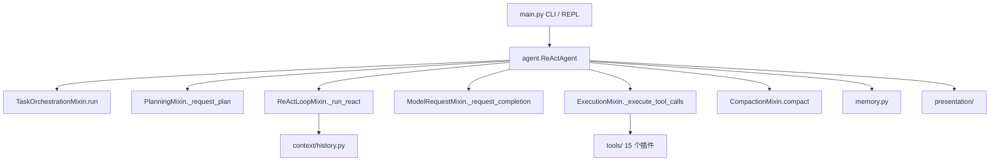
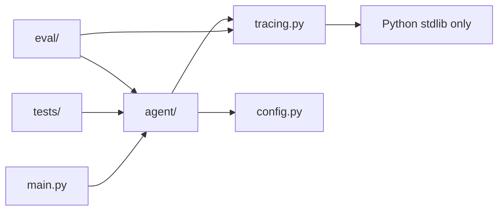
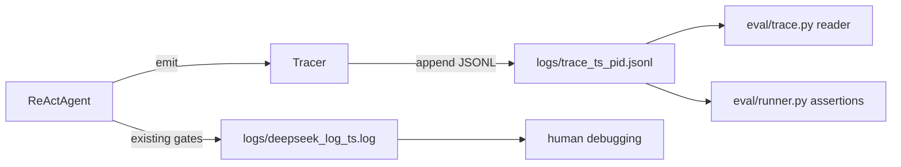
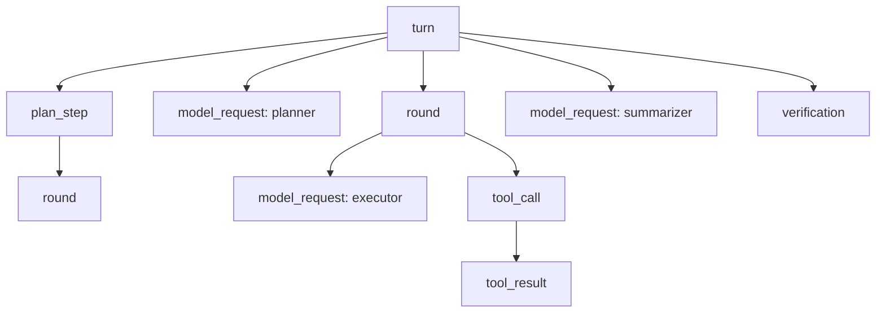
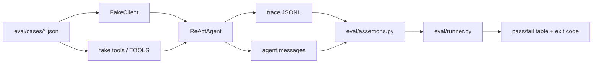

# Eval & Tracing：调研、业界实现与本仓库设计

> 状态说明：本文写于 2026-10-26，对应 `../ROADMAP.md` §4「10 — Eval & Tracing」。设计已在 2026-10-26 实现并通过离线验证；逐文件、可复制的完整代码见同目录的 `EVAL_AND_TRACING_IMPLEMENTATION.md`。文中的行号是写作时的基线，实现后以源码为准。
>
> 来源标注：Claude Code 是闭源产品，本文只把官方文档当作事实；它的会话 JSONL 字段级 schema 来自社区分析，会随版本变化。Codex CLI 是开源仓库，结论来自官方文档 + `openai/codex` 源码 / 测试；rollout 没有官方 prose spec，属于源码级事实。所有外部链接访问于 2026-10-26。负结论（“未找到官方通用 eval 套件”）只代表截至该日的检索结果。

---

## 0. 一页结论

### 0.1 直接回答六个问题

| 问题 | 一句话回答 | 详见 |
| --- | --- | --- |
| eval 是什么？ | 用**场景 + 脚本化模型 + 断言**跑完整 agent 循环，判定“行为有没有变好 / 变坏”；它不是更全的单元测试。 | §1.2、§1.4 |
| tracing 是什么？ | 把一次运行拆成带 `trace_id / span_id / parent_span_id` 的结构化事件流（JSONL），给机器读、给 eval 用、给回放用；它不是更短的日志。 | §1.3、§1.5 |
| 两者什么关系？ | trace 是记录仪，eval 是裁判。eval 消费 trace 做轨迹 / 成本断言；trace 没有 eval 就只是一堆数据。 | §1.6 |
| Claude Code / Codex 有没有？ | 都有 tracing 的公开实现；eval 的公开程度低得多：Claude Code 有 plugin 级 `claude plugin eval`，Codex 仓库没有通用 eval harness，只有事件 / rollout 集成测试。 | §2 |
| 本仓库现在有什么？ | 改动前只有 21 个文本日志 gate 和 8 组离线模块断言；实现后新增 `tracing.py`、10 个 eval case、2 组测试和 JSONL trace。 | §3、§9 |
| 要加什么？ | 根目录 `tracing.py` + 新增 `eval/`；生产代码只依赖 `tracing.py`，`eval/` 永远不进入生产依赖。默认关闭，显式开启。 | §4–§6 |

### 0.2 五条结论

1. **eval 不是“更完整的 tests”。** tests 测代码对不对；eval 测 agent 的行为对不对。测试失败 = 代码有 bug；eval 失败 = 行为回归，或者模型 / prompt / 工具 schema 变了，需要人判断是修代码还是更新 case。
2. **trace 不是“更简洁的 log”。** log 是给人读的整段 dump；trace 是有固定 schema、可聚合、可断言、可回放、可拼成调用树的事件流。两者的读者、格式、用途都不同，**并存，不互相替代**。
3. **先有判据，后有实现。** 没有“怎么算通过”的 eval 会变成永远绿的摆设；没有 trace 的 eval 只能看最终字符串，无法回答“第几轮、调了什么、参数是什么、花了多少 token”。
4. **生产代码不能依赖 eval。** 依赖方向必须是 `eval → agent → tracing`，不是 `agent → eval`。否则 eval 会变成运行时负担，也无法在无 eval 的环境里运行 agent。
5. **默认关闭、显式开启、独立文件。** `MINI_AGENT_TRACE=1` 才写 trace；trace 写到独立 JSONL，不复用 `EXPORT_LOG_PATH`（后者可能被 `initial-messages` gate 以 `"w"` 截断）。关闭时是 `NullTracer`，行为与现在的代码完全一致。

### 0.3 本文不做什么

- 不引入 OpenTelemetry、collector、Prometheus、Jaeger 或任何监控后端。
- 不做多 agent 的 trace tree 调度；只预留 `parent_span_id` 和 `agent_id` 字段（ROADMAP 的 15 才需要）。
- 不做自动压缩、自动重规划、自动评测调度；这些分别是 14、11、后续课程。
- 不改变现有文本日志的语义，也不删除任何日志 gate。
- 不把 eval 做成“模型智商排行榜”；本仓库的 eval 是**回归网**，不是 benchmark。

### 0.4 阅读路线

- 只想快速知道怎么改：读 §0、§4.6、§6、§7.8。
- 想理解概念和业界做法：读 §1–§2。
- 想评审设计：重点看 §5.1（事件 schema）、§5.3（Tracer API）、§5.8（config-by-value）、§8（风险与差异）。

### 0.5 用户问题与章节对应

| 用户问题 | 本文回答位置 |
| --- | --- |
| 1. 什么是 eval & tracing？为什么要有？ | §1、§3.4 |
| 2. Codex / Claude Code 有没有？怎么实现？ | §2 |
| 3. 本 mini agent 的架构应该怎么设计？ | §4、§5 |
| 4. 具体应该怎么修改代码？ | §6 |
| 5. 改完后怎么测试？ | §7 |

---

## 1. 概念：eval 与 tracing 是什么

### 1.1 三层能力，不要混为一谈

| 层 | 回答的问题 | 现有 / 本课 | 输入 | 输出 |
| --- | --- | --- | --- | --- |
| L1 单元 / 模块断言 | 这个函数、这个模块对不对？ | 现有 `tests/` | 直接调用函数、构造消息 | 断言通过 / 抛异常 |
| L2 轨迹级 eval | 这个 agent 在一次场景里的行为对不对？ | **本课新增 `eval/`** | case JSON + 脚本化模型 + fake tools | 逐 case pass/fail + 成本 |
| L3 生产遥测 | 线上整体健康度、成本、延迟趋势？ | 本课不做（未来可接 OTel） | 真实流量 | metrics / logs / traces 后端 |

本课只做 L2，并为 L3 留出字段。不要用 L3 的复杂度做 L2 的事，也不要用 L1 的断言冒充 L2。

### 1.2 eval 的术语

| 术语 | 含义 | 在本仓库的对应物 |
| --- | --- | --- |
| task | 一个要完成的任务 | `eval/cases/<id>.json` 的 `prompt` |
| trial | 一次尝试 | 一次 `agent.run(prompt)` |
| grader | 判分器 | `eval/assertions.py` 的检查函数 |
| transcript / trace | 一次 trial 的完整记录（输出、工具调用、推理、中间结果） | `logs/trace_<ts>_<pid>.jsonl` |
| outcome | 最终结果 | `run()` 的返回值、最终答案、测试是否通过 |
| harness | 驱动 task、收集 transcript、跑 grader 的框架 | `eval/runner.py` + `eval/fake_model.py` |

判分器分三类：

- **code-based**：字符串包含、正则、工具序列、参数子集、`validate_history()`、可执行测试（例如跑一遍 `pytest`）。**优先用这一类**，因为确定、便宜、可复现。
- **model-based / LLM-as-judge**：用另一个模型按 rubric 打分。适合开放式答案，但不能是唯一信号；judge 的模型、prompt、版本都要记录。
- **human**：人工抽查，用来校准 judge。

两个统计口径：

- **pass@k**：k 次尝试里至少成功一次。适合“一次成功就够”的工具型任务。
- **pass^k**：k 次尝试全部成功。适合“必须稳定”的 agent 行为。

本仓库的离线 eval 用脚本化模型，天然是确定性的，所以默认只跑 1 次（pass@1 的退化形式）；live smoke 才需要讨论 pass@k / pass^k。

### 1.3 tracing 的术语

| 术语 | 含义 | 本仓库的对应物 |
| --- | --- | --- |
| trace | 一次完整运行的全部事件，通常有一棵树 | 一个进程 / 会话的 `trace_id` |
| span | 树上的一个工作单元，有开始、结束、耗时 | 一次模型请求、一次工具调用、一个计划步骤 |
| parent span | 父工作单元 | `parent_span_id` |
| event | span 内发生的一个结构化事实 | `tool_call`、`tool_result`、`error` |
| trace tree | 由 `parent_span_id` 串起来的调用树 | `turn → plan_step → round → model_request / tool_call` |

trace 和 log 的对比：

| 维度 | 文本日志 `logs/*.log` | trace `logs/trace_*.jsonl` |
| --- | --- | --- |
| 读者 | 人 | 机器 / eval / 回放器 |
| 格式 | 自由文本，section 之间靠标题 | 每行一个 JSON 对象，固定字段 |
| 关联 | 靠时间顺序和 grep | `trace_id / span_id / parent_span_id` 显式关联 |
| 聚合 | 很难 | 可直接统计工具次数、平均耗时、token 分布 |
| 断言 | 文本匹配，脆 | 事件序列、字段值、父子链 |
| 多 agent | 无法表达调用树 | 给子 agent 填 `parent_span_id` 就是 trace tree |
| 体积 | 每个 section 重 dump 整个历史，按 轮数 × 历史 增长 | 每事件一行，体积可控，可轮转 |

**结论：trace 不是 log 的压缩版，而是另一种数据。** log 继续用于人类调试；trace 用于机器判定、回放和跨 agent 关联。

### 1.4 eval 与 tests 的对比

| 维度 | `tests/` | `eval/` |
| --- | --- | --- |
| 被测对象 | 函数、模块、消息形状 | 一次完整用户请求的行为轨迹 |
| 驱动方式 | 直接调函数 / 替换单个方法 | 脚本化模型按 case 返回 tool_call / final，跑完整循环 |
| 断言 | 返回值、异常、`validate_history()` | 工具序列、参数子集、轮数、token、最终答案、请求契约 |
| 失败意味着 | 代码有 bug | 行为回归，或模型 / prompt / schema 变了 |
| 是否关心成本 | 不关心 | 关心轮数、token、耗时、估算成本 |
| 是否覆盖失败路径 | 通常不要求 | **强制要求**（坏 JSON、工具失败、Planner 失败） |
| 何时跑 | 每次改代码 | 每次改 prompt / 工具 / 模型 / 循环，以及 CI |

关键区别：**tests 是确定性契约，eval 是行为度量。** 测试失败，你改代码；eval 失败，你先判断“是回归还是预期变化”，再决定改代码还是更新 case / 录制。

这也是为什么 eval 必须包含**请求契约断言**：脚本化模型不会因为 system prompt 改了而改变行为，所以只断言最终答案，prompt 改坏了也可能全绿。请求契约断言检查“发给模型的 system prompt 是否包含关键片段”“工具 schema 是否还包含必需参数”，能捕获这类回归。

### 1.5 为什么现在做

1. **09 的并行让“读日志”不够用了。** 并行之后，执行顺序可以变、部分失败要补齐、并发是否真的发生，都不是读文本日志能可靠判断的；必须让机器断言。
2. **后面每一课都要回答“变好了没有”。** 11 的重规划、12 的验证、13 的预算、14 的上下文工程、16 的持久化、19 的模型路由，都会悄悄改变行为。没有 eval，你只能得到“感觉变好了”，而且无法回滚。
3. **15 的多 Agent 是硬依赖。** ROADMAP 明确写“没有 trace tree 不要开始；10 是硬前置”。多 Agent 的调用是一棵树，没有 `parent_span_id` 无法调试；没有 eval 基线，也无法证明多 Agent 比单 agent 更好。
4. **ROADMAP 把 eval / trace 列为工程主线。** 从 10 开始，后面每课都要用；越晚补，历史行为越难重建。

### 1.6 边界与常见误解

| 误解 | 纠正 |
| --- | --- |
| “eval 就是 Python 的 `eval()`” | 完全无关。这里的 eval 是 evaluation（评测）。 |
| “eval 就是更全的单测” | 单测测代码；eval 测行为。eval 会复用单测的 fake / 断言技术，但对象和目的不同。 |
| “tracing 就是把 log 写短一点” | trace 的核心是 schema、id、父子关系、可聚合；体积小只是副作用。 |
| “有 log 就不需要 trace” | log 给人看，trace 给机器和 eval 用。ROADMAP 原话：“别把日志当 trace。” |
| “eval 只测成功路径” | 只测成功路径的 eval 会给你虚假的安全感；失败路径是必测项。 |
| “LLM-as-judge 可以当唯一信号” | judge 有偏差、会漂移；必须用 rubric + 人工抽查校准，并版本化。 |
| “录制的响应可以一直用” | 模型升级、prompt 改动、工具 schema 改动都会让录制失效；必须校验 hash 并允许过期失败。 |

---

## 2. 业界怎么做：Claude Code 与 Codex CLI

### 2.1 Claude Code

Claude Code 是闭源 CLI。它的可观测能力可以分成四块：**OTel 遥测、会话 JSONL、headless 事件流、plugin eval**。

#### 2.1.1 OpenTelemetry（官方）

通过 `CLAUDE_CODE_ENABLE_TELEMETRY=1` 开启；metrics 与 logs 是稳定能力，traces 在官方文档中标注为 beta。

| 能力 | 官方事实 |
| --- | --- |
| 开关 | `CLAUDE_CODE_ENABLE_TELEMETRY=1` |
| metrics exporter | `OTEL_METRICS_EXPORTER=otlp / prometheus / console / none` |
| logs exporter | `OTEL_LOGS_EXPORTER=otlp / console / none` |
| traces exporter | `OTEL_TRACES_EXPORTER=console / otlp / none`（beta） |
| 传输 | `OTEL_EXPORTER_OTLP_PROTOCOL=grpc / http/json / http/protobuf`，没有默认值，必须显式设置 |
| 指标例子 | `claude_code.session.count`、`claude_code.token.usage`、`claude_code.cost.usage`、`claude_code.code_edit_tool.decision` |
| 日志事件例子 | `claude_code.user_prompt`、`claude_code.assistant_response`、`claude_code.tool_result`、`claude_code.api_request`、`claude_code.api_error`、`claude_code.tool_decision` |
| 默认脱敏 | prompt / response 默认显示为 `<REDACTED>`；需要显式 `OTEL_LOG_USER_PROMPTS=1`、`OTEL_LOG_ASSISTANT_RESPONSES=1`、`OTEL_LOG_TOOL_DETAILS=1` 才记录内容 |
| 内容上限 | `CLAUDE_CODE_OTEL_CONTENT_MAX_LENGTH` 默认 61,440 个 UTF-16 单元（约 60 KB） |
| beta span 层级 | `claude_code.interaction` → `claude_code.llm_request` / `claude_code.hook` / `claude_code.tool` → `tool.blocked_on_user` / `tool.execution` / 子 agent span |

对本文的启示：

- **默认脱敏**是硬规则，不是可选项。本仓库的 trace 默认不写 prompt / 工具结果，只写长度、hash、脱敏预览。
- **事件 + 指标分离**：事件回答“发生了什么”，指标回答“总体多少”。本课先做事件，指标留给后续。
- **trace 树**：interaction → llm_request / tool 的层级，和本仓库 `turn → round → model_request / tool` 是同一个思路。

官方文档：<https://code.claude.com/docs/en/monitoring-usage>（访问 2026-10-26）。

#### 2.1.2 会话 JSONL（官方路径，非官方 schema）

Claude Code 把会话写到：

```text
~/.claude/projects/<project>/<session-id>.jsonl
```

`<project>` 是工作目录路径中的非字母数字字符替换成 `-`；每行是一个“message、tool use 或 metadata”条目。默认保留 30 天，可用 `cleanupPeriodDays` 调整；`CLAUDE_CONFIG_DIR` 可以改根目录。

**官方明确警告**：条目格式是 Claude Code 的内部实现，**会随版本变化**，直接解析这些文件的脚本可能在任意版本失效。官方推荐用 `/export`、`claude -p --output-format json`、hooks 的 `transcript_path`，或 Agent SDK。

社区分析（**非官方，置信度中低**）观察到的字段包括：`type`、`uuid`、`parentUuid`、`sessionId`、`cwd`、`version`、`gitBranch`、`timestamp`、`message`；assistant 记录还有 `requestId`；tool result 记录还有 `sourceToolAssistantUUID`；子 agent 记录还有 `agentId`。内容块包括 `text`、`thinking`、`redacted_thinking`、`tool_use`、`tool_result` 等。**这些字段不能当作官方承诺。**

对本文的启示：

- 会话记录本身不是 eval；它只是 trace 的一种持久化形式。要判定行为，仍然需要 grader。
- 格式要有版本号（`v: 1`）和“内部格式可能变化”的声明；本仓库的 trace schema 也要版本化。
- 不要依赖别人未公开的字段；自己定义 schema，自己负责演进。

官方文档：<https://code.claude.com/docs/en/sessions>（访问 2026-10-26）。

#### 2.1.3 Headless 与结构化输出（官方）

`claude -p`（`--print`）是非交互模式；`--output-format` 支持 `text`、`json`、`stream-json`。`stream-json` 是 newline-delimited JSON 事件流，常见事件：

| 事件 | 关键字段 / 含义 |
| --- | --- |
| `system/init` | `session_id`、`model`、`tools`、`mcp_servers`、`permissionMode`、`cwd`、`claude_code_version`、`slash_commands`、`skills`、`plugins` |
| `assistant` / `user` | SDK message 对象；子 agent 消息带 `parent_tool_use_id` |
| `stream_event` | 包装原始 API 流事件：`message_start`、`content_block_start`、`content_block_delta`、`content_block_stop`、`message_delta`、`message_stop` |
| `result` | 最后一行；`subtype` 为 `success` 或 `error_max_turns` / `error_during_execution` / `error_max_budget_usd` / `error_max_structured_output_retries`；成功时带 `result`、`structured_output`、`total_cost_usd`、`usage`、`modelUsage`、`num_turns`、`duration_ms`、`session_id` |
| `system/api_retry` | `attempt`、`max_retries`、`retry_delay_ms`、`error_status`、`error` |
| hook 事件 | `hook_started`、`hook_progress`、`hook_response`；还有 `permission_denied` 等 |

相关 flag：`--include-partial-messages`、`--include-hook-events`、`--forward-subagent-text`、`--session-id` / `--resume`、`--max-turns`、`--max-budget-usd`、`--bare`（CI 推荐，跳过 hooks / skills / plugins / MCP / CLAUDE.md）、`--no-session-persistence`。

对本文的启示：

- **headless 事件流是 eval 的天然接口**：CI 可以直接消费 JSONL，不需要解析终端文本。
- `result` 里的 `total_cost_usd`、`usage`、`num_turns`、`duration_ms` 就是成本断言的字段。本仓库的 `turn` 结束事件应带 `final_chars`、`total_tokens`、`duration_ms`。
- `subtype` 把失败分成“超轮数”“执行错误”“超预算”“结构化输出重试失败”，比一个 `"Max steps reached"` 字符串更适合机器判定。

官方文档：<https://code.claude.com/docs/en/headless>、<https://code.claude.com/docs/en/cli-reference>（访问 2026-10-26）。

#### 2.1.4 Plugin eval（官方）

`claude plugin eval`（官方文档标注 v2.1.269+）是 plugin / skill 级别的评测工具：

- 目录：`evals/<case>/`，每个 case 有 `prompt.md` 和一个或多个 grader。
- 默认跑两组：with plugin 与 without plugin baseline；每个 case 每组跑 3 次，报告 delta。
- 六类 grader：`regex`、`tool_used`、`tool_order`、`file_exists`、`llm`、`baseline`；没有自定义代码 grader。
- flag：`--runs`、`--threshold`（默认 1.0，低于阈值 exit 1）、`--ablation none|with-without`、`--json [path]`、`--model`、`--judge-model`、`--max-cost-usd`、`--trust-plugin`、`--mocks record|off`、`--output-dir`。
- 结果：`aggregate-result.json`（`schemaVersion: 1`）和 `report.html`。
- 录制回放：`context.history_file` 恢复保存的 `.jsonl` transcript；`--mocks record` 保存 agent-mock 回答到 `mock-recordings/`；采用后的录制放在 `.replay/<server>/`。

对本文的启示：

- **grader 类型可以直接借鉴**：`tool_used`、`tool_order`、`file_exists`、`llm` 对应本仓库的轨迹断言、结果断言、judge。
- **with / without baseline** 是证明“这个特性有用”的方法；本仓库的 eval 可以先只跑 with，但后续做多 agent / 新工具时应加 baseline。
- **录制回放**是官方能力，不是社区偏方；但它是 plugin 级工具，不是通用 Claude Code benchmark。

官方文档：<https://code.claude.com/docs/en/plugin-evals>（访问 2026-10-26）。

#### 2.1.5 方法论与公开 eval 现状

Anthropic 的官方文章 *Demystifying evals for AI agents* 给出了通用框架：

- 术语：task、trial、grader、transcript（也叫 trace / trajectory）、outcome、eval harness。
- grader 三类：code-based、model-based / LLM-as-judge、human。
- 建议：优先代码判分；judge 用 rubric、分维度独立判分、允许 “Unknown”、用人工专家校准。
- 轨迹建议：**“grade what the agent produced, not the path it took”**；不要逐字匹配工具序列，但可以用 transcript 检查轮数、工具调用、token、行为约束。
- pass@k vs pass^k：工具型任务看 pass@k，需要稳定性的 agent 看 pass^k。

公开 eval 现状（截至 2026-10-26）：

- 官方公开的、CLI 集成的 eval 工具是 `claude plugin eval`，它是 plugin / skill 级，不是通用 Claude Code benchmark。
- 未找到官方公开的通用 Claude Code eval 套件或基准 harness。
- Anthropic 公布的 SWE-bench Verified 数字是**模型级**，用的是“简单 scaffold（bash + 文件编辑）”，不是 Claude Code 本身。
- `anthropics/claude-code` 仓库顶层没有 eval / benchmark 代码。

官方文章：<https://www.anthropic.com/engineering/demystifying-evals-for-ai-agents>（访问 2026-10-26）。

### 2.2 OpenAI Codex CLI

Codex CLI 是开源仓库 `openai/codex`。它的可观测能力同样可以分成四块：**`exec --json` 事件流、rollout 会话文件、OTel、集成测试**。

#### 2.2.1 `codex exec --json`（官方）

`codex exec "<task>" --json` 把 JSON Lines 写到 stdout，进度写到 stderr。官方文档列出的事件：

| 事件 | 字段 / 含义 |
| --- | --- |
| `thread.started` | `thread_id` |
| `turn.started` | — |
| `item.started` / `item.updated` / `item.completed` | `item`，item 类型见下 |
| `turn.completed` | `usage`（`input_tokens`、`cached_input_tokens`、`output_tokens`、`reasoning_output_tokens` 等） |
| `turn.failed` | `error.message` |
| `error` | `message` |

item 类型（官方测试 + 文档）：`command_execution`（`command`、`aggregated_output`、`exit_code`、`status`）、`agent_message`（`text`）、`reasoning`（`text`）、`web_search`、`mcp_tool_call`（`server`、`tool`、`arguments`、`result`、`error`、`status`）、`collab_tool_call`、`file_change`（`changes`，`path` / `kind`）、`todo_list`、`error`。

其他 flag：`-o/--output-last-message`、`--output-schema`、`--ephemeral`（不持久化 rollout）、`--sandbox read-only|workspace-write|danger-full-access`、`--approve-for-me`、`--ignore-user-config`、`--skip-git-repo-check`、`codex exec resume --last|<SESSION_ID>`。

对本文的启示：

- **事件命名以 `type` 为第一字段**，并且 `item.started/updated/completed` 成对出现；本仓库的 `tool_call/tool_result` 是同一思路的简化版。
- **`turn.completed` 带 usage**，本仓库的 `turn` 结束事件也应带 usage / cost。
- **`--ephemeral` 关闭持久化**，对应本仓库的 `MINI_AGENT_TRACE=0`。

官方文档：<https://learn.chatgpt.com/docs/non-interactive-mode>（由 `developers.openai.com/codex/*` 重定向，访问 2026-10-26）。

#### 2.2.2 Session rollout（官方源码）

Codex 把会话 rollout 写到：

```text
$CODEX_HOME/sessions/<YYYY>/<MM>/<DD>/rollout-<timestamp>-<conversation_id>.jsonl
```

`$CODEX_HOME` 默认 `~/.codex`；归档会话在 `archived_sessions/`；`--ephemeral` 阻止持久化。

每行是 `RolloutLineRef`：`timestamp`、可选 `ordinal`、扁平化的 `RolloutItem`。源码列出的 `RolloutItem` 变体包括：`SessionMeta`、`TurnContext`、`ResponseItem`、`InterAgentCommunication`、`InterAgentCommunicationMetadata`、`Compacted`、`WorldState`、`RealtimeItem`、`TokenUsageRecord`、`RetainedContext`、`SecurityRiskScore`、`EventMsg`。

`SessionMeta` 包括 `session_id`、`id`、`forked_from_id`、`parent_thread_id`、`timestamp`、`cwd`、`runtime_workspace_roots`、`originator`、`creator_user_id`、`creator_account_id`、`cli_version`、`agent_nickname`、`agent_role`、`agent_path`、`source`、`thread_source`、`model_provider`、`base_instructions`、`dynamic_tools`、context window 等；git 信息单独存 `commit_hash`、`branch`、`repository_url`。

官方测试 `cli_stream.rs` 断言：第一条记录是 `session_meta`，带 `id` 和 `timestamp`；后续记录包含 `response_item` 的 `message`；resume 追加到同一个文件。

对本文的启示：

- **会话文件是“可恢复的状态”，trace 是“可分析的记录”**；两者可以合流，但不要混为一谈。
- 每条记录带 `timestamp` 和可选 `ordinal`；本仓库的 trace 也要有 `ts` 和单调的 `sequence`（可选）。
- 子 agent 字段（`parent_thread_id`、`agent_path`）是 15 才需要的；本课只预留 `parent_span_id`。

源码：<https://github.com/openai/codex/blob/main/codex-rs/rollout/src/recorder.rs>（访问 2026-10-26）。

#### 2.2.3 OTel（官方 config + 源码）

Codex 的 OTel 配置在用户级 `~/.codex/config.toml` 的 `[otel]` 段；项目本地 `.codex/config.toml` 会忽略它。

| key | 值 / 默认 |
| --- | --- |
| `otel.environment` | 字符串，默认 `"dev"` |
| `otel.exporter` | `"none"`（默认）、`otlp-http`、`otlp-grpc` |
| `otel.exporter.<id>.endpoint` | 字符串 |
| `otel.exporter.<id>.headers` | map |
| `otel.exporter.<id>.protocol` | `"binary"` 或 `"json"` |
| `otel.log_user_prompt` | 布尔，默认 `false`（prompt 脱敏） |
| `otel.trace_exporter` | `none`、`otlp-http`、`otlp-grpc` |
| `otel.metrics_exporter` | `none`、`statsig`、`otlp-http`、`otlp-grpc`；默认 `statsig` |
| `analytics.enabled` | 布尔；`false` 同时关闭自定义 OTLP metrics exporter |

官方事件：`codex.conversation_starts`、`codex.api_request`、`codex.sse_event`、`codex.websocket_request`、`codex.websocket_event`、`codex.user_prompt`、`codex.tool_decision`、`codex.tool_result`。指标包括 `codex.api_request.duration_ms`、`codex.tool.call.duration_ms`、`turn.e2e_duration_ms`、`turn.token_usage` 等；traces 用 `BatchSpanProcessor`。

源码级补充：`session_telemetry.rs` 还定义了 `codex.startup_phase`、`codex.turn_ttft`、`codex.turn_cost`、`codex.websocket_connect`、`codex.auth_recovery`、`codex.sandbox_outcome`；`metrics/names.rs` 定义了 66 个指标名，包括 `codex.turn.cost_microusd`。这些没有全部出现在官方 prose 文档里，属于源码级事实。

对本文的启示：

- **默认脱敏**（`log_user_prompt=false`）和 Claude Code 一致；本仓库必须默认关闭内容记录。
- **事件和指标分开**；本课只做事件，指标可以作为 `eval/trace.py --summary` 的聚合结果。
- 不需要为了“像 Codex”而引入 OTel；本仓库的规模用 JSONL + 本地 CLI 更合适。

官方文档：<https://learn.chatgpt.com/docs/config-file/config-advanced>；源码：<https://github.com/openai/codex/blob/main/codex-rs/otel/src/config.rs>、<https://github.com/openai/codex/blob/main/codex-rs/otel/src/provider.rs>（访问 2026-10-26）。

#### 2.2.4 Eval 现状

- 仓库顶层没有 `evals/`、`benchmarks/` 或 `trajectory-eval` crate；`codex-rs` 的 crate 列表里也没有。
- 有大量集成测试，用 canned SSE / mock model server，断言事件与 rollout 行为：
  - `event_processor_with_json_output.rs` 断言 JSON 序列化：`item.completed` 的所有 item 类型与字段、`thread.started.thread_id`、`turn.started`、`turn.completed.usage`、`turn.failed.error.message`、`error.message`。
  - `items.rs` 断言 `ItemStarted` / `ItemCompleted` 成对与 ID、agent message delta 的顺序、plan item 顺序、`EventMsg::ItemCompleted` 持久化到 rollout。
  - `cli_stream.rs` 断言 `session_meta` / `response_item` 记录和 resume 追加。
  - `json_result.rs` 断言 structured output 的请求格式（`codex_output_schema`、`json_schema`、`strict: true`）和 `AgentMessage` 事件。
- 这些是**轨迹级集成测试**，不是任务成功率基准：它们不跑 SWE-bench 式任务，不计算 pass/fail 对仓库测试的影响，也不用 LLM-as-judge。
- OpenAI 另有 Evals API / trace grading 指南，但其 Evals 平台已宣布下线（现有内容 2026-10-31 起只读、2026-11-30 关闭），本文只把它当背景，不依赖。

源码：<https://github.com/openai/codex/tree/main/codex-rs/exec/tests>、<https://github.com/openai/codex/tree/main/codex-rs/core/tests/suite>（访问 2026-10-26）。

### 2.3 两者对比

| 维度 | Claude Code | Codex CLI | 本仓库可借鉴 |
| --- | --- | --- | --- |
| 结构化会话记录 | `~/.claude/projects/**/<session-id>.jsonl`；格式官方声明为内部实现 | `$CODEX_HOME/sessions/**/rollout-*.jsonl`；源码级格式 | 独立 JSONL，带 `v` / `ts` / id |
| Headless 事件流 | `claude -p --output-format stream-json` | `codex exec --json` | `eval/runner.py --json` / trace JSONL |
| 生产遥测 | OTel metrics/logs 稳定、traces beta | OTel config + traces/metrics | 本课不做，留字段 |
| 默认脱敏 | prompt/response 默认 `<REDACTED>` | `log_user_prompt=false` | 默认不写内容，只写 hash / 长度 |
| 任务级 eval | `claude plugin eval`（plugin 级） | 无通用 harness，只有集成测试 | `eval/` + fake model + grader |
| 录制回放 | `--mocks record`、`context.history_file`、`.replay/` | `--ephemeral`、`resume`、测试用 canned SSE | `eval/recordings/` |
| 公开程度 | 闭源，文档为主 | 开源，源码可查 | 文档 + 源码锚点 |

### 2.4 共同模式与给本仓库的启示

成熟 agent 的共同骨架是四件套：

1. **结构化会话记录**：每次运行落一个可回放的事件 / 消息文件。
2. **headless 事件流**：让 CI / eval 消费，而不是解析终端。
3. **遥测**：metrics / logs / traces 上报，默认脱敏。
4. **任务级 eval**：用任务 + grader 证明行为，而不是只看 demo。

本仓库不需要复制 OTel 的复杂度，但应该复制这四件套的**最小版本**：

- 结构化 trace：`tracing.py` + JSONL。
- headless eval：`eval/runner.py` + `FakeClient`。
- 脱敏：默认不写内容，显式开启才写，且截断。
- 任务级 eval：8–10 个 case，覆盖成功 + 失败路径。

---

## 3. 本仓库现状与差距

### 3.1 架构



六个 mixin 的职责：

| Mixin | 文件 | 负责 |
| --- | --- | --- |
| `TaskOrchestrationMixin` | `agent/orchestration.py` | `run()`：请求路由、计划步骤、失败短路 |
| `PlanningMixin` | `agent/planning.py` | planner 请求、计划解析 / 渲染、`messages[0]` 刷新 |
| `ReActLoopMixin` | `agent/react_loop.py` | 一轮 ReAct：模型轮次、工具调用、历史写入 |
| `ModelRequestMixin` | `agent/request.py` | 一次流式模型请求、API 错误、usage / finish / context 日志 |
| `ExecutionMixin` | `agent/execution.py` | 参数解析、工具重试、三阶段执行、流式重组 |
| `CompactionMixin` | `agent/compaction.py` | `context_stats()`、`compact()`、摘要 |

### 3.2 现有可观测性：只有文本日志

- `config.py:17-40`：`EXPORT_LOG` 全局开关 + **21 个** `EXPORT_LOG_CHOICES` gate。
- `config.py:41-46`：`logs/deepseek_log_<YYYYmmdd_HHMMSS>.log`，时间戳在 import 时冻结；一个进程一个文件；同名秒级碰撞可能共享文件。
- 每个 section 把**整个历史**重新 dump 一遍，体积按 轮数 × 历史 增长。ROADMAP 记录过一次 17 轮 3.3 MB；本目录 `logs/` 现有约 98 MB，最大单文件约 97 MB。
- 没有时间戳、没有事件 id、没有 session id、没有 span、没有 metrics。
- `agent/execution.py:23` 的 `_LOG_LOCK` 只保护 `tool-retry` 日志；其他主线程写入不加锁。
- `agent/react_loop.py:44-48` 在 `initial-messages` gate 打开时以 `"w"` 打开日志文件，**会截断**同文件的既有内容。这是 trace 必须写独立文件的直接原因。

现有 section header（节选）：

| header | 位置 | gate |
| --- | --- | --- |
| `Turn N` | `agent/orchestration.py:27-29` | `turn` |
| `Plan:` / `Step N completed:` | `agent/orchestration.py:49-50, 103` | `planning` |
| `Round N` | `agent/react_loop.py:73-77` | 仅 `EXPORT_LOG` |
| `Messages at the beginning:` | `agent/react_loop.py:79-83` | `message-beginning` |
| `Content in LLM response message:` | `agent/react_loop.py:91-95` | `llm-response-message-content` |
| `Thought:` | `agent/react_loop.py:119-123` | `thought` |
| `Final Answer:` | `agent/react_loop.py:130-134` | `final-answer` |
| `Messages after tool execution:` | `agent/react_loop.py:172-176` | `messages-after-tool-execution` |
| `Usage:` | `agent/request.py:79-83` | `llm-usage` |
| `Finish:` | `agent/request.py:89-91` | `llm-finish-reason` |
| `Context:` | `agent/request.py:95-100` | `context` |
| `Tool duration:` | `agent/execution.py:210-214` | `tool-duration` |
| `Parallel:` | `agent/execution.py:191-196` | `parallel` |

### 3.3 现有测试：模块断言，不是行为评测

`_test.py` 改动前依次 import 8 个模块，实现后为 10 个（新增 `test_tracing` / `test_eval_harness`）：

```text
test_tools, test_context, test_presentation, test_responses,
test_memory, test_cli, test_planning, test_parallel
```

每个模块在 **import 时**执行断言；失败即非零退出；没有 pytest、没有 fixture、没有 discovery。运行单个模块用 `python3 -m tests.test_context`。

可复用的基础：

- `tests/test_planning.py:9-15` 的 `fake_chunk(content, reasoning, finish, usage, with_choices=True)` 构造 `SimpleNamespace` 形状的流块。
- 测试通过替换 `agent.client.chat.completions.create` 注入假流；`tests/test_responses.py:57-67` 是唯一一个走完整 `run()` 的离线例子。
- `tests/test_parallel.py` 用 `threading.Barrier` / `Event` 控制并发与完成顺序，用 `tool_call_id` 断言顺序，用 `validate_history` 断言协议；全局 `TOOLS` / `TOOL_META` 修改后在 `finally` 恢复。
- `agent/execution.py:90-106` 已有 per-call 计时；`agent/request.py:77-78` 已有 `last_usage`；`agent/compaction.py:16-39` 已有 `context_stats()`。

现有测试**能证明**：解析、重试分类、历史协议、并行顺序、压缩失败路径、CLI 解析。
现有测试**不能证明**：一次完整请求的工具序列、prompt 是否被改坏、轮数 / token 成本、失败路径下的行为、trace 是否存在、回放是否一致。

### 3.4 差距表

| 缺口 | 现状 | 影响 |
| --- | --- | --- |
| session id | 无；只有 `self.turn` 和 import 时的 `current_time_str` | 多次运行无法关联 |
| trace / span | 无 | 无法回答“谁调用了谁、花了多久” |
| 结构化事件 | 无；只有文本 section | 无法聚合、断言、回放 |
| metrics | 无 | 无法看 token / 延迟趋势 |
| eval case | 无 | 无法证明行为回归 |
| 录制回放 | 无 | 无法离线复现真实运行 |
| 成本断言 | 只有 `last_usage` 日志 | 无法阻止“轮数 / token 爆炸” |
| 脱敏 | 日志直接写 prompt / 结果 | trace 若照抄会泄露秘密 |

### 3.5 日志的四个硬伤

1. **体积按 轮数 × 历史 增长。** 每个 section 重 dump 整段历史；17 轮可以到 3.3 MB，长跑可以到 97 MB。
2. **没有 schema。** 文本 section 只能 grep；`BadRequest` 会误命中源码出现在工具输出里的情况；`list_directory` 的错误串是 `Error listing directory:`（没有 `Error:` 前缀），`grep 'Error: '` 会漏。
3. **没有 id / 时间戳。** 无法把一次工具调用和它的结果、模型请求、轮次关联起来；只能靠顺序猜。
4. **写入不事务。** 每个 section 独立 `open(..., "a")`；线程写会交织；`initial-messages` 还会用 `"w"` 截断。

这些硬伤决定了：**trace 必须是独立文件、每行一个 JSON、整行一次写、带 id 和时间。**

---

## 4. 目标架构

### 4.1 目标与非目标

目标：

- 每次运行可选地产生一条 JSONL trace，事件覆盖 `turn / plan_step / round / model_request / tool_call / tool_result / verification / error`。
- 每个事件有 `trace_id / span_id / parent_span_id / turn / plan_step / round / round_global / actor`。
- 关闭 trace 时行为与现在完全一致（`NullTracer`）。
- 提供 `eval/`：case JSON、脚本化模型、fake tools、分层断言、runner、录制回放。
- eval 离线、无 key、确定性、可 CI；live 录制单独标记、手动触发。
- 默认不写 prompt / 工具结果内容；只写长度、hash、脱敏预览。

非目标：

- OTel / collector / 监控后端。
- 多 agent 调度与 trace tree 渲染 UI。
- 自动压缩、自动重规划、自动评测调度。
- LLM-as-judge 作为唯一判分器。
- 修改现有日志的语义。

### 4.2 依赖方向



硬规则：**`agent/` 永远不 import `eval/`。** `eval/` 是开发期 harness，不是运行时依赖。`tracing.py` 只依赖标准库，避免循环依赖，也方便单独测试。

### 4.3 运行时数据流



trace 与现有日志**并行存在**：日志继续给人看，trace 给机器和 eval 用。不要在 trace 里复制整段历史；只写事件与摘要。

### 4.4 Trace 树



规则：

- `turn` 是根，`parent_span_id = null`。
- planner / summarizer 是 `turn` 的直接子 span，不属于某个 ReAct round。
- `plan_step` 是 `turn` 的子 span；每个计划步骤内部的 round 挂在 `plan_step` 下。
- `round` 是 `plan_step`（有规划时）或 `turn`（直接 ReAct）的子 span。
- `tool_call` 与 `tool_result` **共用一个 span_id**；`tool_result` 的 `parent_span_id` 指向 round。
- 未来的子 agent 只需要填 `parent_span_id` 和 `agent_id`，就能变成 trace tree。

### 4.5 Eval harness 数据流



### 4.6 关键决策

| # | 决策 | 选择 | 理由 |
| --- | --- | --- | --- |
| D1 | trace writer 放哪 | 根目录 `tracing.py` | 生产代码可 import；`eval/` 不能成为生产依赖；`trace.py` 会遮蔽 stdlib |
| D2 | trace 写哪个文件 | 独立 `logs/trace_<ts>_<pid>.jsonl` | 现有日志可能被 `"w"` 截断；JSONL 需要整行原子写 |
| D3 | 默认开关 | `MINI_AGENT_TRACE=0` 默认关闭 | 不改变现有行为；eval 显式开启 |
| D4 | 事件发射线程 | 只在主线程 | 工具 worker 只返回 `(observation, duration)`；避免锁竞争与乱序 |
| D5 | 内容记录 | 默认只写长度 / hash / 脱敏预览 | trace 是数据泄露面；Claude Code / Codex 都默认脱敏 |
| D6 | fake model 注入 | `agent.client = FakeClient(case)` | 复用现有测试模式，不改生产循环 |
| D7 | eval 依赖方向 | `eval → agent`，不反向 | 生产可以在没有 eval 的环境运行 |
| D8 | 断言优先级 | 结构 > 轨迹 > 请求契约 > 结果 > 成本 | 先保证协议，再保证行为；文本相等最脆 |
| D9 | 录制存储 | 响应 chunk + 请求 hash | 不存完整 prompt / 工具输出；hash 检测过期 |
| D10 | 判据顺序 | 先写判据，再写代码 | 与仓库“先判据、后实现”的惯例一致 |

---

## 5. 详细设计

### 5.1 事件 schema

所有事件共享公共字段：

| 字段 | 类型 | 必填 | 含义 |
| --- | --- | --- | --- |
| `v` | int | 是 | schema 版本，当前 `1` |
| `ts` | string | 是 | UTC ISO-8601，毫秒精度 |
| `trace_id` | string | 是 | 一个进程 / 会话一个，`uuid4().hex` |
| `span_id` | string | 是 | 16 hex；`tool_call` / `tool_result` 共用 |
| `parent_span_id` | string / null | 是 | 父 span；只有 `turn` 为 null |
| `event` | string | 是 | 事件类型 |
| `actor` | string | 是 | `orchestrator` / `planner` / `react` / `executor` / `tool:<name>` / `compactor` / `eval` |
| `turn` | int | 是 | `agent.turn` |
| `plan_step` | int / null | 是 | 计划步骤 1-based；直接 ReAct 为 null |
| `round` | int / null | 是 | 每个 `_run_react` 内部的轮次；planner 为 null |
| `round_global` | int | 是 | `agent._rounds_used`，一个用户请求内单调递增 |
| `agent_id` | string / null | 否 | 预留给 15 的多 agent；本课为 null |

事件类型与字段：

| event | 必填字段 | 可选字段 | 发射点 |
| --- | --- | --- | --- |
| `turn` | `status=start/end` | `prompt_chars`、`prompt_hash`、`duration_ms`、`final_chars`、`final_hash`、`plan_decision` | `agent/orchestration.py:8-106` |
| `plan_step` | `plan_step`、`status=start/completed/failed` | `step_chars`、`step_preview`、`duration_ms`、`result_chars`、`reason` | `agent/orchestration.py:54-103` |
| `round` | `round`、`round_global`、`status=start/end` | `max_rounds`、`duration_ms` | `agent/react_loop.py:68-71` |
| `model_request` | `component`、`model`、`stream`、`message_count`、`duration_ms`、`status` | `request_chars`、`tools_count`、`input_tokens`、`output_tokens`、`total_tokens`、`finish_reason` | `agent/request.py:38-40`、`agent/planning.py:27-30`、`agent/compaction.py:75-85` |
| `tool_call` | `tool`、`tool_call_id`、`call_index`、`args_chars`、`args_hash`、`parallel_safe`、`scheduled_parallel`、`status=requested/rejected` | `args_preview`、`error_type` | `agent/execution.py:127-148` |
| `tool_result` | `tool`、`tool_call_id`、`call_index`、`duration_ms`、`raw_chars`、`result_chars`、`clipped`、`status=ok/error` | `error_type` | `agent/execution.py:198-220` |
| `verification` | `check`、`status=pass/warn/fail`、`layer` | `reason`、`actor` | `agent/react_loop.py:102-108`、`agent/compaction.py:166-172`、eval runner |
| `error` | `component`、`error_type`、`error`、`retryable` | `error_code` | `agent/request.py:41-74`、`agent/planning.py:32-35`、`agent/orchestration.py:81-98`、`agent/react_loop.py:178-183` |

示例 JSONL（为了可读性分成了多行；真实文件是一行一个 JSON）：

```json
{"v":1,"ts":"2026-10-26T12:00:00.123Z","trace_id":"9f2c...","span_id":"00000000000000a1","parent_span_id":null,"event":"turn","actor":"orchestrator","turn":1,"plan_step":null,"round":null,"round_global":0,"status":"start","prompt_chars":42,"prompt_hash":"7d1e..."}
{"v":1,"ts":"2026-10-26T12:00:00.456Z","trace_id":"9f2c...","span_id":"0000000000000042","parent_span_id":"00000000000000a1","event":"round","actor":"react","turn":1,"plan_step":null,"round":1,"round_global":1,"status":"start"}
{"v":1,"ts":"2026-10-26T12:00:00.789Z","trace_id":"9f2c...","span_id":"00000000000000b2","parent_span_id":"0000000000000042","event":"tool_call","actor":"tool:read_file","turn":1,"plan_step":null,"round":1,"round_global":1,"tool":"read_file","tool_call_id":"call_1","call_index":1,"args_chars":15,"args_hash":"4a9c...","args_preview":"{\"path\":\"a.txt\"}","parallel_safe":true,"scheduled_parallel":true,"status":"requested"}
{"v":1,"ts":"2026-10-26T12:00:00.801Z","trace_id":"9f2c...","span_id":"00000000000000b2","parent_span_id":"0000000000000042","event":"tool_result","actor":"tool:read_file","turn":1,"plan_step":null,"round":1,"round_global":1,"tool":"read_file","tool_call_id":"call_1","call_index":1,"duration_ms":12.4,"raw_chars":5,"result_chars":5,"clipped":false,"status":"ok"}
```

### 5.2 ID 方案

| ID | 生成 | 作用域 | 说明 |
| --- | --- | --- | --- |
| `trace_id` | `uuid4().hex` | 进程 / 会话 | 一个进程一个；多次 `run()` 共享 |
| `span_id` | `uuid4().hex[:16]` | 事件 | `tool_call` / `tool_result` 共用；`model_request` / `round` / `plan_step` 各自独立 |
| `parent_span_id` | 由调用方传入 | 事件 | `turn` 为 null；其他指向父 span |
| `turn` | `self.turn` | 用户请求 | 从 1 开始 |
| `plan_step` | `i + 1` | 计划步骤 | 直接 ReAct 为 null |
| `round` | 局部 `round` | `_run_react` | 每个计划步骤重新从 1 开始 |
| `round_global` | `self._rounds_used` | 用户请求 | 跨计划步骤单调递增，解决 `round` 重号 |
| `agent_id` | 预留 | 子 agent | 本课为 null；15 填充 |

**为什么需要 `round_global`：** `_run_react` 每个计划步骤都会把局部 `round` 重置为 0；如果 trace 只有 `round`，第 2 个计划步骤的 round 1 会和第 1 个步骤的 round 1 撞号。`_rounds_used` 是跨步骤共享的预算计数器（`agent/react_loop.py:42`、`agent/orchestration.py:21`），用它做全局轮次。

### 5.3 Tracer API

`tracing.py` 是根目录模块，**只 import 标准库**。核心接口：

```python
class NullTracer:
    enabled = False
    def new_span(self, parent=None): return None
    def emit(self, event, *, actor, span_id=None, parent_span_id=None, **fields): return None

class Tracer:
    def __init__(self, path, *, max_bytes=10 * 1024 * 1024, keep=3,
                 max_field_chars=500, include_content=False): ...
    def new_span(self, parent=None): ...
    def emit(self, event, *, actor, span_id=None, parent_span_id=None, **fields): ...

def get_tracer(enabled=False, path=None, **kwargs): ...
def hash_text(text): ...
def redact_args(args, limit=500): ...
```

行为约定：

| 主题 | 设计 |
| --- | --- |
| 禁用 | `get_tracer` 返回 `NullTracer`；所有调用点无条件调用，不写文件、不改行为 |
| 线程安全 | 每行写入持有一把 `threading.Lock`；生产发射点本来就在主线程，锁是防御性的 |
| 原子性 | 先 `json.dumps` 成一行，再一次 `os.write`；`O_APPEND | O_CREAT | O_WRONLY`，权限 `0600` |
| 轮转 | 写入前检查 `current_size + len(line) > max_bytes`；`trace.jsonl` → `.1` → `.2` … 保留 `keep` 个 |
| 失败策略 | 任何 `OSError` / 序列化异常 → 关闭 tracing、向 stderr 打一次警告、**绝不抛出** |
| Ctrl-C | 不捕获 `BaseException`；不启后台线程；每行独立写，最多丢最后一行 |
| 内容 | 默认不写 prompt / 工具结果；只写长度、hash、脱敏 `args_preview` |
| 脱敏 | 递归匹配 `api_key|authorization|password|secret|access_token|auth_token|refresh_token|bearer_token` 等凭据型 key；**不匹配 `input_tokens` / `output_tokens` / `total_tokens`**；家目录替换为 `~`；字符串截断到 `max_field_chars` |
| 时间 | UTC ISO-8601 毫秒；不依赖本地时区 |
| 文件路径 | `logs/trace_<YYYYmmdd_HHMMSS>_<pid>.jsonl`；eval 用绝对路径 |

核心骨架（实现版；完整代码见 `EVAL_AND_TRACING_IMPLEMENTATION.md`）：

```python
# tracing.py
import hashlib, json, os, re, sys, threading, time, uuid

# 只匹配凭据型 key；不能匹配 input_tokens / total_tokens 等计数器。
_SECRET = re.compile(
    r"(api[_-]?key|authorization|password|secret|^token$|"
    r"(?:access|auth|refresh|bearer|id)[_-]?token)$", re.I)
_HOME = os.path.expanduser("~")

class Tracer:
    def __init__(self, path, *, max_bytes=10 * 1024 * 1024, keep=3,
                 max_field_chars=500, include_content=False):
        self.path = path
        self.trace_id = uuid.uuid4().hex
        self.max_bytes, self.keep = max_bytes, keep
        self.max_field_chars = max_field_chars
        self.include_content = include_content
        self.enabled = True
        self._lock = threading.Lock()
        try:
            os.makedirs(os.path.dirname(path) or ".", exist_ok=True)
        except OSError as e:
            self.enabled = False
            print(f"⚠ tracing disabled: {type(e).__name__}: {e}", file=sys.stderr)

    def new_span(self, parent=None):
        return uuid.uuid4().hex[:16]

    def emit(self, event, *, actor, span_id=None, parent_span_id=None, **fields):
        if not self.enabled:
            return
        try:
            record = {
                "v": 1, "ts": _utc_now(), "trace_id": self.trace_id,
                "span_id": span_id or self.new_span(),
                "parent_span_id": parent_span_id,
                "event": event, "actor": actor,
            }
            record.update(_clean_value(fields, self.max_field_chars, self.include_content))
            line = json.dumps(record, ensure_ascii=False, separators=(",", ":")) + "\n"
            with self._lock:
                self._rotate(len(line.encode("utf-8")))
                fd = os.open(self.path, os.O_APPEND | os.O_CREAT | os.O_WRONLY, 0o600)
                try:
                    os.write(fd, line.encode("utf-8"))
                finally:
                    os.close(fd)
        except Exception as e:
            self.enabled = False
            print(f"⚠ tracing disabled: {type(e).__name__}: {e}", file=sys.stderr)
```

辅助函数的设计：

```python
def _utc_now():
    now = time.time()
    return time.strftime("%Y-%m-%dT%H:%M:%S", time.gmtime(now)) + f".{int(now * 1000) % 1000:03d}Z"

def hash_text(text):
    return hashlib.sha256(str(text).encode("utf-8")).hexdigest()[:16]

def redact_args(args, limit=500):
    # 递归：敏感 key -> "<REDACTED>"；dict/list 保留结构；字符串截断 + 家目录替换
    ...

def get_tracer(enabled=False, path=None, **kwargs):
    return Tracer(path, **kwargs) if enabled and path else NullTracer()

def _clean(fields, limit, include_content):
    # 递归脱敏；include_content=False 时丢弃内容字段；字符串截断 + 家目录替换。
    # 返回的 dict 必须 JSON 可序列化；否则 emit 会降级为禁用 tracing。
    ...

# Tracer 的内部方法：写入前检查大小，超出就滚动。
def _rotate(self, incoming):
    try:
        size = os.path.getsize(self.path)
    except OSError:
        return
    if size + incoming <= self.max_bytes:
        return
    for i in range(self.keep, 0, -1):
        src = self.path if i == 1 else f"{self.path}.{i - 1}"
        dst = f"{self.path}.{i}"
        if os.path.exists(src):
            os.replace(src, dst)
```

`_clean` 的规则：

- dict 递归；key 命中 `_SECRET` → `"<REDACTED>"`。
- list 递归。
- 其他值 `str()` 后截断到 `max_field_chars`；家目录替换为 `~`。
- 如果 `include_content=False`，调用方本来就不传 `prompt` / `content` / `observation`；`_clean` 还要**主动丢弃** key 为 `prompt` / `content` / `observation` / `result` 的字段，作为第二道防线。

**不要用 `trace.py` 作为文件名**：Python 的 stdlib 有 `trace` 模块，仓库根目录在 `sys.path` 时可能遮蔽标准库。用 `tracing.py`。

### 5.4 eval case schema

一个 case 是一个 JSON 文件：

```json
{
  "schema_version": 1,
  "id": "single-tool-read",
  "suite": "smoke",
  "prompt": "Read a.txt and answer.",
  "plan": {"needs_plan": false, "steps": []},
  "script": [
    {"type": "tool_call", "name": "read_file", "arguments": {"path": "a.txt"}},
    {"type": "final", "content": "Final Answer: hello"}
  ],
  "tools": {
    "read_file": {"result": "hello", "parallel_safe": true}
  },
  "limits": {"max_rounds": 3, "max_model_requests": 4},
  "expect": {
    "history_valid": true,
    "tool_sequence": ["read_file"],
    "tool_args": [{"path": "a.txt"}],
    "final_contains": ["hello"],
    "max_rounds": 3,
    "max_total_tokens": 200,
    "request": {
      "system_prompt_contains": ["Final Answer:"],
      "tool_schema_names": ["read_file", "write_file"]
    }
  }
}
```

字段说明：

| 字段 | 必填 | 含义 |
| --- | --- | --- |
| `schema_version` | 是 | case 格式版本 |
| `id` | 是 | 唯一 id，也是文件名 |
| `suite` | 是 | `smoke` / `failure` / `live` |
| `prompt` | 是 | 用户输入 |
| `plan` | 否 | planner 的脚本；默认 `{"needs_plan": false, "steps": []}`；`{"raw": "not json"}` 表示坏输出 |
| `script` | 是 | ReAct 执行器的脚本：`tool_call` / `final` |
| `tools` | 否 | fake tool 的结果 / 异常 / 并发控制；不写则用真实工具（仅 live） |
| `limits` | 否 | 该 case 的预算；runner 会 patch 消费模块的全局变量 |
| `expect` | 是 | 断言；见 5.4.1 |

#### 5.4.1 断言分层

| 层 | 字段 | 说明 |
| --- | --- | --- |
| 结构 | `history_valid` | `validate_history(agent.messages) == []` |
| 轨迹 | `tool_sequence`、`tool_args`、`tool_call_count`、`parallel_overlap` | 工具名序列、参数子集、调用次数、是否真的并发 |
| 请求契约 | `request.system_prompt_contains`、`request.tool_schema_names`、`request.planner_called` | 捕获 prompt / 工具 schema 回归 |
| 结果 | `final_contains`、`final_regex`、`final_equals`（慎用） | 优先包含 / 正则，不逐字相等 |
| 成本 | `max_rounds`、`max_model_requests`、`max_total_tokens` | 防止轮数 / token 爆炸 |
| trace | `trace_parent_links`、`trace_event_counts` | 父子链、事件数量 |

**为什么要有请求契约层：** 脚本化模型不读 prompt，所以 prompt 改坏了，最终答案仍然可能对。请求契约断言检查“真正发给模型的 system prompt / tools schema 是否还包含关键内容”，这是 fake model eval 能发现 prompt 回归的唯一办法。

### 5.5 FakeClient

`eval/fake_model.py` 复用 `tests/test_planning.py:9-15` 的 `fake_chunk` 形状：

```python
from types import SimpleNamespace

def fake_chunk(content=None, reasoning=None, finish=None, usage=None, with_choices=True):
    delta = SimpleNamespace(content=content, reasoning_content=reasoning, tool_calls=None)
    choices = [SimpleNamespace(delta=delta, finish_reason=finish)] if with_choices else []
    return SimpleNamespace(choices=choices, usage=usage)

def tool_call_chunk(index, call_id, name, arguments):
    tc = SimpleNamespace(index=index, id=call_id, type="function",
                         function=SimpleNamespace(name=name, arguments=arguments))
    delta = SimpleNamespace(content=None, reasoning_content=None, tool_calls=[tc])
    return SimpleNamespace(
        choices=[SimpleNamespace(delta=delta, finish_reason=None)], usage=None)
```

`FakeClient` 的路由：

| 请求形状 | 走哪条路 | 返回 |
| --- | --- | --- |
| `stream=True` 且没有 `tools` | planner | case 的 `plan`，序列化成 JSON content |
| `stream=True` 且有 `tools` | ReAct 执行器 | 按 `script` 顺序返回 tool_call / final |
| `stream=False` | summarizer | 固定摘要字符串（或 case 指定） |
| 其他 | 记录并报错 | 让 case 失败，不静默 |

```python
class FakeClient:
    def __init__(self, case):
        self.case = case
        self.requests = []
        self._script = list(case.get("script", []))
        self.max_retries = 0
        self.chat = SimpleNamespace(completions=SimpleNamespace(create=self.create))

    def create(self, **kwargs):
        self.requests.append(kwargs)
        if kwargs.get("stream") and "tools" not in kwargs:
            return iter(self._planner())
        if kwargs.get("stream") and "tools" in kwargs:
            return iter(self._next_script())
        return self._summary()
```

`_next_script` 的规则：

- `tool_call`：返回一个 `tool_call_chunk`，再返回一个 `finish_reason="tool_calls"` 的空 content chunk；`_consume_stream` 会把它重组成 `msg.tool_calls`。
- `final`：返回 content chunk + `finish_reason="stop"` + usage。
- 脚本耗尽：抛 `RuntimeError`，runner 记为 harness error（exit 2），不是 case fail。
- 失败 case：`script` 可以包含 `{"type": "raise", "error": "..."}`，让 `create` 抛异常。

`FakeClient` 必须记录 `requests`，供请求契约断言使用；不要只记录最后一次，因为 planner / executor / summarizer 都会调用。

### 5.6 Runner

CLI：

```bash
python3 eval/runner.py --suite smoke          # 离线，无 key
python3 eval/runner.py --case single-tool-read
python3 eval/runner.py --suite smoke --json
python3 eval/runner.py --case simple-final --record   # 有 key，更新录制
python3 eval/runner.py --case simple-final --replay   # 离线回放
```

退出码：

| 码 | 含义 |
| --- | --- |
| 0 | 全部 pass |
| 1 | 至少一个 case 断言失败 |
| 2 | harness / 配置错误：坏 JSON、脚本耗尽、录制缺失 / 过期、未知 suite |

输出表格：

```text
id                  result  rounds  tools        tokens  ms
single-tool-read    PASS    2       read_file    123     45
two-tool-order      PASS    2       read,write   210     61
bad-tool-json       PASS    2       -            98      33
plan-two-steps      PASS    3       read,read    340     90
max-rounds          PASS    2       read_file    150     40
```

`runner.py` 的导入顺序很关键：

```python
import os, sys
ROOT = os.path.dirname(os.path.dirname(os.path.abspath(__file__)))
if ROOT not in sys.path:
    sys.path.insert(0, ROOT)

# 必须在 import config / agent 之前设置 env
os.environ.setdefault("MINI_AGENT_LOG", "0")
os.environ.setdefault("MINI_AGENT_TRACE", "1")
os.environ.setdefault("MINI_AGENT_TRACE_DIR", os.path.join(ROOT, "logs"))
```

如果直接 `python3 eval/runner.py`，`sys.path[0]` 是 `eval/`，不是仓库根；不 bootstrap 会 `ModuleNotFoundError: config`。`python3 -m eval.runner` 也需要 `eval/__init__.py`。

每个 case 的隔离：

1. 新建一个 `ReActAgent()`（或 `ReActAgent(client=fake, tracer=tracer)`）。
2. 快照 `TOOLS` / `TOOL_META`，注入 case 的 fake tools，`finally` 恢复。
3. 设置 `TRACE_PATH` 到临时目录；不要用全局 `config.TRACE_PATH`。
4. patch 消费模块的预算全局（见 5.8）。
5. 用 `contextlib.redirect_stdout` 捕获终端输出，避免污染表格。
6. 跑 `agent.run(prompt)`，再跑 `assertions.check_case(...)`。
7. 读取 trace JSONL，跑 `eval/trace.py` 的结构校验。

### 5.7 Recordings

录制文件是 JSONL：

```json
{"type":"meta","case_id":"simple-final","date":"2026-10-26","model":"deepseek-flash","thinking":"enabled","tools_hash":"...","prompt_hash":"..."}
{"type":"response","request_hash":"...","chunks":[{"content":"Final Answer: 4","finish_reason":"stop","usage":{"prompt_tokens":10,"completion_tokens":3,"total_tokens":13}}]}
```

规则：

- **只存响应 chunk + 请求 hash**，不存完整 prompt / 工具输出。
- `request_hash` = 对“模型 + messages + tools schema + thinking + stream 参数”做 SHA-256；请求变了，hash 不匹配，replay 直接失败（exit 2），而不是静默通过。
- `meta` 记录模型名、日期、thinking、tools hash、prompt hash；`--strict-recordings` 时，超过 30 天或 hash 不匹配都失败。
- 录制只允许只读工具（`read_file`、`list_directory`、`git_status`、`git_diff`、`git_log`、`search_web`、`fetch_webpage`、`get_news`、`recall_notes`）；写工具 / `execute_command` / `run_python` 拒绝录制。
- 回放时 `ReplayClient` 按 `request_hash` 查表；缺失就报错，不调用真实 API。

### 5.8 config-by-value 的坑

`config.py` 的值在 import 时被各模块**按值捕获**：

| 模块 | 捕获的配置 |
| --- | --- |
| `agent/core.py:6-10` | `API_KEY`、`BASE_URL`、`MAX_API_RETRIES`、`API_TIMEOUT`、`EXPORT_LOG`、`EXPORT_LOG_PATH`、内存索引预算 |
| `agent/request.py:7-10` | `MODEL`、`THINKING`、`REQUEST_USAGE`、`EXPORT_LOG`、`EXPORT_LOG_CHOICES`、`EXPORT_LOG_PATH` |
| `agent/execution.py:9-13` | `MAX_TOOL_RETRIES`、`MAX_OBS_CHARS`、`MAX_TOOL_CALLS_PER_ROUND`、`PARALLEL_ENABLED`、`PARALLEL_MAX_WORKERS` |
| `agent/react_loop.py:4-7` | `MAX_ROUNDS`、`EXPORT_LOG`、`EXPORT_LOG_CHOICES`、`EXPORT_LOG_PATH` |
| `agent/planning.py:3-6` | `MODEL`、`PLAN_PROMPT`、`PLAN_MAX_TOKENS`、`THINKING`、`REQUEST_USAGE` |
| `agent/compaction.py:3-8` | `CONTEXT_WINDOW_TOKENS`、`COMPACT_*`、`MODEL` |
| `utils.py:3` | `MAX_OBS_CHARS` |

后果：

- 运行时改 `config.MAX_ROUNDS` **不会**影响 `agent.react_loop.MAX_ROUNDS`；runner 必须 patch 后者。
- `MAX_OBS_CHARS` 有两份：`utils.py` 的 `clip()` 和 `agent/execution.py` 的日志判断；per-case 改预算要同时 patch 两处。
- `EXPORT_LOG` 在多个模块各有一份；runner 要在 import 前设 `MINI_AGENT_LOG=0`，或者在 import 后逐模块 patch。
- `TRACE_PATH` 是相对路径；`main.py --root` 会 `chdir`，写入时按当前 cwd 解析。eval 要用绝对路径，避免 case 之间互相覆盖。

推荐的 per-case patch 清单：

```python
import agent.react_loop as react_loop
import agent.execution as execution
import utils

old = (react_loop.MAX_ROUNDS, execution.MAX_TOOL_CALLS_PER_ROUND,
       execution.MAX_OBS_CHARS, utils.MAX_OBS_CHARS)
react_loop.MAX_ROUNDS = case["limits"]["max_rounds"]
execution.MAX_TOOL_CALLS_PER_ROUND = case["limits"].get("max_tool_calls", 20)
execution.MAX_OBS_CHARS = case["limits"].get("max_obs_chars", 8000)
utils.MAX_OBS_CHARS = execution.MAX_OBS_CHARS
try:
    ...
finally:
    react_loop.MAX_ROUNDS, execution.MAX_TOOL_CALLS_PER_ROUND, \
        execution.MAX_OBS_CHARS, utils.MAX_OBS_CHARS = old
```

### 5.9 trace 读取与校验

`eval/trace.py` 是 reader，不是 writer：

```bash
python3 eval/trace.py --file logs/trace_20261026_120000_12345.jsonl --check
python3 eval/trace.py --file logs/trace_*.jsonl --summary
```

`--check` 检查：

1. 每行是合法 JSON，`v` / `ts` / `trace_id` / `span_id` / `parent_span_id` / `event` / `actor` 齐全。
2. 所有非根 `parent_span_id` 都能在同文件找到对应 `span_id`（允许跨文件时用 `--allow-missing-parent`）；`span_id` 不能等于自己的 `parent_span_id`。
3. 每个 `tool_result` 都有一个同 `span_id` / `tool_call_id` 的 `tool_call`；每个 `tool_call` 都有一条 `tool_result`（允许失败 case 用 `--allow-open-calls`）。
4. 没有明显的秘密：`sk-`、`api_key`、`authorization`、绝对家目录路径。
5. 事件时间非递减（允许同一毫秒内乱序，用 `--strict-time` 才强制）。

`--summary` 输出：

```text
trace_id=... events=42 turns=1 plan_steps=2 rounds=3
model_requests=4 input_tokens=1234 output_tokens=567
tools=read_file x2, write_file x1; errors=0; duration_ms=...
```

---

## 6. 逐文件改动

> 本节代码已在 2026-10-26 实现并通过离线验证；逐文件完整版本见 `EVAL_AND_TRACING_IMPLEMENTATION.md`。仓库无 git，改动前请先备份；`agent/`、`config.py`、`main.py` 用 **tab** 缩进，根目录 `tracing.py` 用 4 空格（与 `memory.py` 一致），`eval/`、`tests/` 用 4 空格。

### 6.1 `config.py`（必改）

新增 trace 配置，并给 eval 增加 env override：

```python
# Trace：默认关闭；打开后才写 JSONL。目录与文件名在 import 时确定。
TRACE_ENABLED = os.getenv("MINI_AGENT_TRACE", "0") != "0"
TRACE_DIR = os.getenv("MINI_AGENT_TRACE_DIR", "logs")
TRACE_PATH = os.path.join(
    TRACE_DIR, f"trace_{current_time_str}_{os.getpid()}.jsonl")
TRACE_MAX_BYTES = int(os.getenv("MINI_AGENT_TRACE_MAX_BYTES", str(10 * 1024 * 1024)))
TRACE_KEEP = int(os.getenv("MINI_AGENT_TRACE_KEEP", "3"))
TRACE_FIELD_CHARS = int(os.getenv("MINI_AGENT_TRACE_FIELD_CHARS", "500"))
TRACE_INCLUDE_CONTENT = os.getenv("MINI_AGENT_TRACE_INCLUDE_CONTENT", "0") == "1"

# 现有预算改为 env 可覆盖，方便 eval 按 case 调小。
EXPORT_LOG = os.getenv("MINI_AGENT_LOG", "1") != "0"
MAX_ROUNDS = int(os.getenv("MINI_AGENT_MAX_ROUNDS", "100"))
MAX_OBS_CHARS = int(os.getenv("MINI_AGENT_MAX_OBS_CHARS", "8000"))
MAX_TOOL_CALLS_PER_ROUND = int(os.getenv("MINI_AGENT_MAX_TOOL_CALLS_PER_ROUND", "20"))
```

注意：

- `current_time_str` 在 `config.py:7-8` 已经定义；`os.getpid()` 需要 `import os`（已有）。
- 两个进程同一秒启动时，`pid` 区分文件名；现有日志没有 pid，会共享文件。
- 不要把 `TRACE_PATH` 放进 `EXPORT_LOG_CHOICES`；trace 不是文本 section，不需要 gate。它的开关是 `TRACE_ENABLED`。
- `EXPORT_LOG` 的默认值必须保持 `True`，否则现有行为改变。

### 6.2 新增 `tracing.py`（必改）

根目录新建，只依赖标准库。完整实现约 100 行；核心见 §5.3。需要实现：

- `NullTracer` / `Tracer` / `get_tracer`
- `hash_text` / `redact_args`
- `_utc_now` / `_clean` / `_rotate`
- 失败降级（任何异常 → `enabled=False` + stderr 警告）
- 轮转与 `0600` 权限

不要：

- 不要 import `config`、`agent`、`eval`。
- 不要把 `Tracer` 做成单例；每个 agent 一个，测试可注入。
- 不要在 `emit` 里做网络 / 重 IO；只做序列化和一次 `os.write`。

### 6.3 `agent/core.py`（必改）

当前 `__init__(self, system_prompt=DEFAULT_SYSTEM_PROMPT)` 在 `:26`，客户端在 `:33-35` 构造。改为可选注入：

```python
import tracing
from config import (
    ..., TRACE_ENABLED, TRACE_PATH, TRACE_MAX_BYTES, TRACE_KEEP,
    TRACE_FIELD_CHARS, TRACE_INCLUDE_CONTENT,
)

class ReActAgent(...):
    def __init__(self, system_prompt: str = DEFAULT_SYSTEM_PROMPT,
                 client=None, tracer=None):
        self.client = client if client is not None else OpenAI(
            api_key=API_KEY, base_url=BASE_URL,
            max_retries=MAX_API_RETRIES, timeout=API_TIMEOUT)
        self.tracer = tracer or tracing.get_tracer(
            enabled=TRACE_ENABLED, path=TRACE_PATH,
            max_bytes=TRACE_MAX_BYTES, keep=TRACE_KEEP,
            max_field_chars=TRACE_FIELD_CHARS,
            include_content=TRACE_INCLUDE_CONTENT)
        self._turn_span = None
        self._plan_step = None
        self._plan_step_span = None
        self._round = 0
        self._round_span = None
        ...
```

`reset()` 末尾清空：

```python
self._turn_span = None
self._plan_step = None
self._plan_step_span = None
self._round = 0
self._round_span = None
```

注意：

- 默认 `client=None` 时行为完全不变；测试可以 `ReActAgent(client=FakeClient(case))`。
- `tracer=None` 时按 `TRACE_ENABLED` 决定 `NullTracer` / `Tracer`；eval 可以传一个临时路径的 `Tracer`。
- 构造 `Tracer` 时 `os.makedirs` 创建目录；如果 `TRACE_ENABLED=0`，`NullTracer` 不做任何 IO。

### 6.4 `agent/orchestration.py`（必改）

`run()` 入口（`:8`）开始一个 turn span：

```python
import time
from tracing import hash_text

def run(self, prompt: str) -> str:
    started = time.monotonic()
    self.turn += 1
    self._turn_span = self.tracer.new_span()
    self._plan_step = None
    self._plan_step_span = None
    self._round = 0
    self._round_span = None
    self.tracer.emit(
        "turn", actor="orchestrator", span_id=self._turn_span,
        parent_span_id=None, turn=self.turn, status="start",
        prompt_chars=len(prompt), prompt_hash=hash_text(prompt))
    ...
```

注意 `self.turn += 1` 在 `:20`；把 emit 放在它之后，避免 off-by-one。

计划步骤（`:54-103`）：

```python
self._plan_step = i + 1
self._plan_step_span = self.tracer.new_span(self._turn_span)
self.tracer.emit(
    "plan_step", actor="orchestrator", span_id=self._plan_step_span,
    parent_span_id=self._turn_span, turn=self.turn,
    plan_step=self._plan_step, status="start",
    step_chars=len(step["text"]))
```

步骤完成 / 失败时发 `plan_step` 的 `completed` / `failed`，失败同时发 `error`：

```python
self.tracer.emit(
    "plan_step", actor="orchestrator", span_id=self._plan_step_span,
    parent_span_id=self._turn_span, turn=self.turn,
    plan_step=self._plan_step, status="failed",
    duration_ms=..., result_chars=len(result), reason=result[:200])
self.tracer.emit(
    "error", actor="orchestrator", span_id=self._plan_step_span,
    parent_span_id=self._turn_span, turn=self.turn,
    component="plan", error_type="PlanStepFailed",
    error=result[:500], retryable=False)
```

turn 结束：`run()` 有多个 `return`（直接 ReAct `:39`、计划结果 `:104`、失败 `:88/:98`）。推荐抽一个局部函数：

```python
def _end_turn(self, result: str, status: str = "ok") -> str:
    self.tracer.emit(
        "turn", actor="orchestrator", span_id=self._turn_span,
        parent_span_id=None, turn=self.turn, status="end",
        duration_ms=round((time.monotonic() - started) * 1000, 1),
        final_chars=len(result), final_hash=hash_text(result),
        answer_status=status)
    return result
```

`started` 需要传给 `_end_turn`，或者用实例属性 `self._turn_started`。不要把 `result` 全文写进 trace；只写长度 / hash，`TRACE_INCLUDE_CONTENT=1` 时才写 preview。

### 6.5 `agent/planning.py`（必改）

`_request_plan()` 在 `:11-36`。加计时和事件：

```python
import time
started = time.monotonic()
span = self.tracer.new_span(self._turn_span)
try:
    ...
    msg = self._consume_stream(stream, show_content=False)
    if msg.usage is not None:
        self.last_usage = msg.usage
    needs_plan, steps, error = _parse_plan_response(msg.content)
    self.tracer.emit(
        "model_request", actor="planner", span_id=span,
        parent_span_id=self._turn_span, component="planner",
        model=MODEL, stream=True, message_count=2, tools_count=0,
        request_chars=len(prompt), duration_ms=...,
        input_tokens=getattr(msg.usage, "prompt_tokens", None),
        output_tokens=getattr(msg.usage, "completion_tokens", None),
        total_tokens=getattr(msg.usage, "total_tokens", None),
        finish_reason=msg.finish_reason, status="ok")
except Exception as e:
    self.tracer.emit(
        "error", actor="planner", span_id=span,
        parent_span_id=self._turn_span, component="planner",
        error_type=type(e).__name__, error=str(e), retryable=False)
    return False, [], f"Planner request failed: ..."
```

`_parse_plan_response` 返回 error 时，发 `verification`（`check="plan_schema"`、`status="fail"`），不要只返回字符串：

```python
if error:
    self.tracer.emit(
        "verification", actor="planner", span_id=span,
        parent_span_id=self._turn_span, check="plan_schema",
        status="fail", layer="structure", reason=error[:200])
```

### 6.6 `agent/react_loop.py`（必改）

`_run_react()` 进入 round（`:68-71`）：

```python
self._round = round
parent = self._plan_step_span or self._turn_span
self._round_span = self.tracer.new_span(parent)
self.tracer.emit(
    "round", actor="react", span_id=self._round_span,
    parent_span_id=parent, turn=self.turn,
    plan_step=self._plan_step, round=round,
    round_global=self._rounds_used, status="start",
    max_rounds=max_rounds)
```

`_answer_warning`（`:102-108`）之后：

```python
warning = _answer_warning(content, msg.finish_reason)
self.tracer.emit(
    "verification", actor="react", span_id=self._round_span,
    parent_span_id=parent, turn=self.turn,
    check="answer_shape", status="warn" if warning else "pass",
    layer="result", reason=warning[:200])
```

`Max steps reached`（`:178-183`）之前：

```python
self.tracer.emit(
    "error", actor="react", span_id=self._round_span,
    parent_span_id=parent, turn=self.turn,
    component="react", error_type="MaxRounds",
    error="Max steps reached", retryable=False)
```

可选：在 `_execute_tool_calls` 返回后调用 `validate_history` 并发 `verification`。**不要默认加到生产路径**：它每次都要遍历整个历史，长会话会变慢；把它放在 eval 的 `assertions.py` 里，或用 `TRACE_VALIDATE_HISTORY=1` 显式开启。

### 6.7 `agent/request.py`（必改）

`_request_completion()` 在 `:16-117`。在 `:38` 前开始计时：

```python
import time
started = time.monotonic()
span = self.tracer.new_span(self._round_span or self._turn_span)
request_chars = sum(len(str(m.get("content") or "")) for m in self.messages)
```

成功返回前发 `model_request`：

```python
usage = getattr(msg, "usage", None)
self.tracer.emit(
    "model_request", actor="react", span_id=span,
    parent_span_id=self._round_span or self._turn_span,
    component="executor", model=MODEL, stream=True,
    message_count=len(self.messages), tools_count=len(TOOLS_DESC),
    request_chars=request_chars,
    duration_ms=round((time.monotonic() - started) * 1000, 1),
    input_tokens=getattr(usage, "prompt_tokens", None),
    output_tokens=getattr(usage, "completion_tokens", None),
    total_tokens=getattr(usage, "total_tokens", None),
    finish_reason=msg.finish_reason, status="ok")
```

三个异常分支（`:41-74`）各发一条 `error`：

```python
self.tracer.emit(
    "error", actor="react", span_id=span,
    parent_span_id=self._round_span or self._turn_span,
    component="executor",
    error_type=type(e).__name__, error=str(e)[:500],
    retryable=False)   # APIConnectionError / RateLimitError / InternalServerError 为 True
```

注意：

- `BadRequestError` 是确定性错误，`retryable=False`；连接 / 限流 / 5xx 是暂时性，`retryable=True`（SDK 已重试过）。
- `duration_ms` 包含流式消费时间，不是单纯的网络 RTT。
- `request_chars` 只算 content，不含 tools schema；如果要算总请求大小，用 `len(json.dumps(request))`，但不要把整个请求写进 trace。

### 6.8 `agent/execution.py`（必改）

`_execute_tool_calls()` 在 `:108`。

Phase 1（`:127-148`）之后，为每个 plan 建 span 并发 `tool_call`：

```python
import tracing
for plan in plans:
    plan["span_id"] = self.tracer.new_span(self._round_span)
    raw_args = plan["tc"].function.arguments or ""
    self.tracer.emit(
        "tool_call", actor=f"tool:{plan['name']}", span_id=plan["span_id"],
        parent_span_id=self._round_span, turn=self.turn,
        plan_step=self._plan_step, round=self._round,
        round_global=self._rounds_used,
        tool=plan["name"], tool_call_id=plan["tc"].id,
        call_index=plan["i"] + 1, args_chars=len(raw_args),
        args_hash=tracing.hash_text(raw_args),
        args_preview=tracing.redact_args(plan["args"] or {}),
        parallel_safe=self._parallel_safe(plan["name"]),
        scheduled_parallel=plan["safe"],
        status="rejected" if plan["error"] else "requested",
        error_type="Rejected" if plan["error"] else None)
```

Phase 3（`:198-220`）发 `tool_result`，用同一个 `span_id`：

```python
for k, plan in enumerate(plans, 1):
    observation, duration = outcomes[plan["i"]]
    observation = str(observation)
    raw_len = len(observation)
    observation = clip(observation)
    self.tracer.emit(
        "tool_result", actor=f"tool:{plan['name']}", span_id=plan["span_id"],
        parent_span_id=self._round_span, turn=self.turn,
        plan_step=self._plan_step, round=self._round,
        round_global=self._rounds_used,
        tool=plan["name"], tool_call_id=plan["tc"].id, call_index=k,
        duration_ms=round(duration * 1000, 1),
        raw_chars=raw_len, result_chars=len(observation),
        clipped=raw_len > len(observation),
        status="error" if observation.startswith("Error:") else "ok")
```

注意：

- **不要在 `_run_worker` 里 emit**：worker 线程只返回 `(observation, duration)`；所有 trace 写在主线程 phase 3，避免锁竞争和乱序。
- `status="error"` 用 `observation.startswith("Error:")` 是启发式；如果工具本身返回以 `Error:` 开头的正常文本，会被误判。可以接受（trace 不是判分器），或者在 `_call_tool` 返回值里加一个状态位（更大改动）。
- `parallel_safe` 是工具元数据；`scheduled_parallel` 是本次实际调度（`parallel` 开关 + 解析成功 + 安全）。两个都记，避免把“元数据是 safe”误读成“这次真的并发了”。
- 被 cap / 参数错误拒绝的调用也要有 `tool_call` + `tool_result`，duration 为 0；这样“N 个 call → N 个结果”在 trace 里也成立。

### 6.9 `agent/compaction.py`（可选）

`_summarize_once()` 是唯一非流式请求（`:75-85`）。加：

```python
self.tracer.emit(
    "model_request", actor="compactor", span_id=self.tracer.new_span(self._turn_span),
    parent_span_id=self._turn_span, component="summarizer",
    model=MODEL, stream=False, message_count=1, tools_count=0,
    request_chars=len(transcript), duration_ms=...,
    status="ok")
```

`compact()` 在 `validate_history(candidate)` 之后（`:166-172`）：

```python
problems = validate_history(candidate)
self.tracer.emit(
    "verification", actor="compactor",
    span_id=self.tracer.new_span(self._turn_span),
    parent_span_id=self._turn_span, check="compaction_history",
    status="fail" if problems else "pass", layer="structure",
    reason="; ".join(problems[:3])[:500])
```

这是可选的：本课的核心是 turn / round / model_request / tool；压缩事件可以等 14 再做。

### 6.10 `main.py`（可选）

v1 不加 `--trace` CLI flag。原因：`main.py` 在顶层 `from config import ...`，`config.py` 在 import 时就把 `TRACE_ENABLED` / `TRACE_PATH` 固化了；`parse_args` 之后再改 flag 已经来不及。用环境变量更可靠：

```bash
MINI_AGENT_TRACE=1 python3 main.py --msg '...'
```

可以在 `USAGE_TEXT` 的 Environment 段加：

```text
MINI_AGENT_TRACE          1 enables JSONL tracing (default 0)
MINI_AGENT_TRACE_DIR      trace directory (default logs)
```

构造 agent 后，如果启用了 trace，打印一次路径：

```python
if TRACE_ENABLED:
    print(f"Trace: {os.path.abspath(TRACE_PATH)}")
```

REPL 可选加 `/trace`：

```text
/trace     Show the current trace file and a one-line event count
```

不要在 REPL 命令里调用 `compact()` 之外的写操作；`/trace` 只读。

### 6.11 新增 `eval/`（必改）

```text
eval/
  __init__.py
  fake_model.py      FakeClient / fake_chunk / tool_call_chunk / ReplayClient
  assertions.py      check_case：结构 / 轨迹 / 请求契约 / 结果 / 成本
  runner.py          case 发现、隔离、表格、退出码、--json / --record / --replay
  recordings.py      响应录制 / 回放、hash、脱敏、过期检查
  trace.py           读取 / 校验 / 汇总 JSONL（不是 writer）
  cases/*.json       8–10 个场景
  recordings/*.jsonl 脱敏后的响应录制
```

模块职责：

| 模块 | 职责 | 不做什么 |
| --- | --- | --- |
| `fake_model.py` | 按 case 返回 planner / executor / summarizer 响应；记录请求 | 不判断 case 通过与否 |
| `assertions.py` | 读 `agent.messages`、`FakeClient.requests`、trace 事件，返回失败列表 | 不跑 agent、不写文件 |
| `runner.py` | 加载 case、隔离环境、跑 agent、调 assertions、打印 / 退出 | 不含具体断言逻辑 |
| `recordings.py` | 录制 / 回放、hash、脱敏、过期 | 不驱动 agent |
| `trace.py` | 解析 / 校验 / 汇总 trace | 不产生 trace |

`__init__.py` 只放 docstring，不要 import 重模块；否则 `python3 -m eval.runner` 会在 import 阶段拉起 `agent`，env 还没设。

### 6.12 新增测试（必改）

`tests/test_tracing.py`：

```python
import json, os, tempfile, threading
from tracing import Tracer, NullTracer, hash_text, redact_args

with tempfile.TemporaryDirectory() as d:
    path = os.path.join(d, "t.jsonl")
    t = Tracer(path, max_field_chars=20)
    t.emit("turn", actor="test", turn=1, status="start", prompt_hash=hash_text("x"))
    line = json.loads(open(path).read().strip())
    assert line["v"] == 1 and line["event"] == "turn" and line["span_id"]
    ...
```

断言组：

1. `NullTracer` 不创建文件、不抛异常。
2. `Tracer` 每行可解析，公共字段齐全。
3. 4 线程 × 50 次 `emit`，`threading.Barrier` 同步起跑，最终 200 行、`span_id` 唯一。
4. `redact_args` 隐藏 `api_key` / `authorization` / `password` / `secret` / `token`，家目录变 `~`。
5. 小 `max_bytes` 轮转：所有行都还在，文件名 `.1` / `.2` 出现。
6. 不可写路径：`Tracer` 不抛，`enabled` 变 `False`。

`tests/test_eval_harness.py`：

1. 一个 pass case（`simple-final`）跑通，`runner.main([...]) == 0`。
2. 改坏 `expect.final_contains` → `1`。
3. 脚本耗尽 / 坏 case JSON → `2`。
4. `FakeClient` 的 planner / executor / summarizer 路由正确。
5. trace 的 `tool_call` / `tool_result` 父子链与 `tool_call_id` 对应。
6. 并行 case：`Barrier(2)` 证明 safe 工具真的重叠；串行会 `BrokenBarrierError` → `Error:` observation。

`_test.py` 末尾加：

```python
from tests import test_tracing, test_eval_harness
```

注意：`_test.py` 在 import 前已经 `os.makedirs("logs")`；`test_tracing` 用 `tempfile.TemporaryDirectory()`，不要写进 `logs/`。

### 6.13 `README.md` / `CLAUDE.md`（后续，不在本步骤）

实现完成后应补：

- `README.md` 的 `## Differences from 09` / `## Limitations`，链接本文。
- `CLAUDE.md` 的 Status、测试模块数、日志 gate 数、trace 命令。
- 当前 `CLAUDE.md:5` 仍说“08 复制、并行未开始”，`CLAUDE.md:111` 仍说 `_test.py` 7 个模块；实现后应一起更新，否则下一个读文档的人会被误导（本次实现已同步更新）。

### 6.14 实施顺序

| 阶段 | 内容 | 可独立回滚 |
| --- | --- | --- |
| Phase 0 | 新增 `tracing.py` + `tests/test_tracing.py`；config 加 trace 开关（默认关） | 是 |
| Phase 1 | 接入 `core.py` / `request.py` / `execution.py` / `react_loop.py` / `orchestration.py` 的事件 | 是 |
| Phase 2 | 新增 `eval/fake_model.py` + `eval/runner.py` + 3 个 smoke case | 是 |
| Phase 3 | 补 `eval/assertions.py` 五层断言 + 失败 case | 是 |
| Phase 4 | `eval/recordings.py` + `--record` / `--replay` | 是 |
| Phase 5 | 文档 / README / CLAUDE / 日志 gate 收尾 | 是 |

每一步都先写判据，再写代码；每步结束跑 `python3 _test.py`。

---

## 7. 测试与验收

### 7.1 测试金字塔

```text
        live record/replay（手动，有 key）
      offline smoke suite（8–10 case，< 30s）
    eval harness self-tests（runner / fake model）
  tracer unit tests（schema / 锁 / 轮转 / 脱敏）
```

### 7.2 Tracer 单测

| # | 断言 | 怎么测 | 期望 |
| --- | --- | --- | --- |
| T1 | 禁用 no-op | `NullTracer().emit(...)` | 无文件、无异常 |
| T2 | 每行合法 | `Tracer` 写 1 条，`json.loads` | 公共字段齐全 |
| T3 | 并发安全 | 4 线程 × 50 条，`Barrier` 起跑 | 200 行、span 唯一 |
| T4 | 脱敏 | `redact_args({"api_key": "sk-..."})` | `"<REDACTED>"` |
| T5 | 轮转 | `max_bytes=200` 写 50 条 | 所有行可读，`.1` 存在 |
| T6 | 失败降级 | 路径不可写 | 不抛，`enabled=False` |

### 7.3 顺序与并发：不要用墙钟

错误做法：`assert elapsed < 0.5`。机器负载、CI 抖动、Python 启动都会让这条 flaky；`tests/test_tools.py` 已经出现过 3.22 s 超界。

正确做法：

- **证明重叠**：两个 fake safe 工具在函数里 `barrier.wait()`；如果串行执行，第一个会等到 `BrokenBarrierError`，observation 变成 `Error:`，case 失败。这证明的是“真的同时进入了工具”，不是“耗时小于某值”。
- **证明不重叠**：unsafe 工具用反向 barrier；如果重叠会返回 `"OVERLAP"`，失败；串行会 `BrokenBarrierError` → `"serial"`。
- **证明顺序**：`slow` 等 `Event`，`fast` 先完成并 `set()`；断言 `tool_result` 仍按 `call_index` 排序，history 仍按 `tool_call_id` 排序。
- **耗时**：只断言 `duration_ms >= 0`，不做上限；runner 的 per-case timeout 是失败保护，不是性能门禁。

### 7.4 Eval harness 自测

| # | 断言 | 期望 |
| --- | --- | --- |
| H1 | pass case | `runner.main(["--case", "simple-final"]) == 0` |
| H2 | 改坏 `final_contains` | `== 1` |
| H3 | 坏 case JSON | `== 2` |
| H4 | 脚本耗尽 | `== 2` |
| H5 | planner / executor / summarizer 路由 | `FakeClient.requests` 的形状正确 |
| H6 | trace 父子链 | 每个 `tool_result.parent_span_id == round.span_id` |

### 7.5 离线 smoke suite

8–10 个 case，< 30 秒：

| id | 场景 | 期望 |
| --- | --- | --- |
| `simple-final` | 直接回答，无工具 | `final_contains`、0 工具、1 轮 |
| `single-tool-read` | 读文件再回答 | `tool_sequence=["read_file"]` |
| `two-tool-order` | 读 + 写，顺序敏感 | 工具序列、`validate_history` |
| `parallel-safe` | 两个 safe 工具，barrier | 真的重叠、顺序不变 |
| `plan-two-steps` | planner 返回 2 步 | `plan_step` 事件 2 个、步骤结果 |
| `bad-tool-json` | 参数是坏 JSON | 工具不执行、observation 是 `Error:`、后续继续 |
| `tool-raises` | 工具抛异常 | observation 是 `Error:`、history 合法 |
| `planner-bad-json` | planner 输出非 JSON | 回退到 ReAct、`plan_error` |
| `max-rounds` | 模型一直发 tool_call | 返回 `Max steps reached`、`error` 事件 |
| `schema-contract` | 检查 tools schema | 包含 `read_file` / `write_file` 的必需参数 |

### 7.6 回归证明

这是 ROADMAP 判据里最关键的一条：**故意改坏一个 prompt / 工具 schema，至少一个 case 失败。**

无 git 的做法：

```bash
cp config.py /tmp/config.py.bak
# 改坏 DEFAULT_SYSTEM_PROMPT（去掉 "Final Answer:"）
python3 eval/runner.py --suite smoke; test $? -eq 1
cp /tmp/config.py.bak config.py

cp tools/local.py /tmp/local.py.bak
# 改坏 read_file 的 parameters（去掉 path）
python3 eval/runner.py --suite smoke; test $? -eq 1
cp /tmp/local.py.bak tools/local.py
```

如果改坏后仍然全绿，说明 eval 没有真正测行为，需要补请求契约断言。

### 7.7 Live record / replay

```bash
# 录制（需要 key，只录只读 case）
python3 eval/runner.py --case simple-final --record

# 回放（离线）
python3 eval/runner.py --case simple-final --replay
```

检查：

- 回放的工具序列与录制时一致。
- 改 prompt / 工具 schema 后，`request_hash` 不匹配，replay 失败（exit 2），而不是静默通过。
- 录制文件里没有 `sk-`、`authorization`、绝对家目录路径。

### 7.8 验收判据

| # | 判据 | 怎么测 | 期望 |
| --- | --- | --- | --- |
| A1 | 现有套件不回归 | `python3 _test.py` | exit 0 |
| A2 | 语法不回归 | `python3 -m compileall -q .` | exit 0 |
| A3 | smoke 规模 | `python3 eval/runner.py --suite smoke` | 8–10 case，< 30s，exit 0 |
| A4 | 真实回归能被发现 | 改坏 prompt / schema | 至少 1 case fail，exit 1 |
| A5 | trace 每行合法 | `eval/trace.py --check` | 0 个 schema 错误 |
| A6 | 父子链完整 | `eval/trace.py --check` | 非根 span 都有父 |
| A7 | 每个 tool_call 有结果 | `eval/trace.py --check` | 无悬空 call |
| A8 | 能回答六个问题 | 读 trace | 第几轮、调了什么、参数、结果大小、token、谁调用 |
| A9 | 无秘密 | `grep -E 'sk-|api_key|authorization'` | 无命中（或只有 `<REDACTED>`） |
| A10 | 轮转 | `max_bytes` 调到很小，写 50 条 | 所有行可读，`.1` 存在 |
| A11 | Ctrl-C | 运行中 Ctrl-C | trace 最后一行是完整 JSON（最多丢一行） |
| A12 | replay 一致 | `--record` 后 `--replay` | 工具序列一致，exit 0 |
| A13 | 禁用 no-op | `MINI_AGENT_TRACE=0` | 无 trace 文件，行为不变 |

### 7.9 失败矩阵

| 失败 | 现象 | 处理 |
| --- | --- | --- |
| `ModuleNotFoundError: config` | runner 直接脚本运行 | `sys.path` bootstrap |
| `KeyError: 'trace'` | 把 trace 当日志 gate | trace 用 `TRACE_ENABLED`，不要放 `EXPORT_LOG_CHOICES` |
| trace 文件为空 | `TRACE_ENABLED=0` 或 `NullTracer` | 检查 env / 传入的 tracer |
| 行被截断 | 多线程 / 进程写同一文件 | 每行一次 `os.write`；独立文件；锁 |
| replay 全失败 | 模型 / prompt / schema 变了 | 重新录制；不要放宽 hash |
| case 全绿但 bug 仍在 | 断言太弱 | 加请求契约 / 结构断言；做 7.6 回归证明 |
| 墙钟 flaky | 断言了耗时上限 | 改成 Barrier / Event，只断言 `>= 0` |
| trace 泄露秘密 | `TRACE_INCLUDE_CONTENT=1` 且未脱敏 | 默认关闭；`redact_args`；发布前 grep |

---

## 8. 风险、限制与实施顺序

### 8.1 风险表

| 风险 | 影响 | 缓解 |
| --- | --- | --- |
| trace 体积 | 长会话写满磁盘 | 轮转 `TRACE_MAX_BYTES` / `TRACE_KEEP`；只写事件，不写历史 |
| 秘密泄露 | trace 是数据泄露面 | 默认不写内容；`redact_args`；`0600`；发布前 grep |
| 日志截断 | 复用 `EXPORT_LOG_PATH` 会被 `"w"` 清空 | 独立 trace 文件 |
| 录制过期 | 模型 / prompt / schema 变化 | 请求 hash + 日期 + `--strict-recordings` |
| fake model 保真度 | 脚本化模型不反映 prompt 质量 | 请求契约断言 + 手动 live smoke |
| config-by-value | per-case 预算不生效 | 在 import 前设 env；patch 消费模块全局 |
| 无 git | 改坏无法回滚 | 先 `cp` 备份；文档先于代码 |
| Ctrl-C | worker 线程不退出 | 每行独立写；`main.py` 回滚；不捕获 `BaseException` |
| GIL | CPU 密集工具并行无收益 | 只对 I/O 密集工具并行；文档说明 |
| 多 agent 扩展 | 当前只有单 agent | 预留 `parent_span_id` / `agent_id`，不建树 |

### 8.2 与 ROADMAP 建议的差异

| ROADMAP 建议 | 本文调整 | 理由 |
| --- | --- | --- |
| `eval/trace.py` 作为 JSONL writer | 根目录 `tracing.py` 做 writer；`eval/trace.py` 做 reader | 生产不能 import `eval/` |
| 文件名 `trace.py` | 改 `tracing.py` | 避免遮蔽 stdlib `trace` |
| trace 只有 `round` | 加 `plan_step` / `round_global` | `_run_react` 每个计划步骤重置局部 round |
| trace 只有 `args_hash` | 加脱敏 `args_preview` | 判据要求“参数是什么”，hash 答不了 |
| `duration_ms` 到处硬门禁 | 只记录，不做上限断言 | 墙钟 flaky |
| recordings 存完整请求 / 响应 | 只存响应 chunk + 请求 hash | 避免存 prompt / 工具输出；hash 检测过期 |
| `python3 eval/runner.py` 直接跑 | 加 `sys.path` bootstrap + `eval/__init__.py` | 直接脚本的 `sys.path[0]` 是 `eval/` |
| 5–10 case，不提 per-case 预算 | 加 `limits` + patch 全局 | config 按值捕获 |
| 未来多 agent 再考虑 parent span | 现在就加 `parent_span_id` / `agent_id` 字段 | 15 需要；本课不建树 |

### 8.3 开放问题

1. **trace 默认开关**：本文建议默认关（`MINI_AGENT_TRACE=0`）。如果希望“默认就有记录”，可以改成默认开，但必须同时设置轮转，否则长跑会写满磁盘。
2. **是否加 `turn_end` / `session` 事件**：本文用 `turn` 的 `status=start/end` 表达，足够；如果未来要做跨进程会话，再加 `session`。
3. **runner 子进程 vs 进程内**：进程内快，但全局状态（`TOOLS`、`config` 副本）要恢复；子进程干净，但启动慢。建议 v1 进程内 + `finally` 恢复，live/录制用子进程隔离。
4. **是否加构造参数 `client=` / `tracer=`**：本文建议加，默认 `None` 保持行为；如果不想改构造函数，测试可以继续事后替换 `agent.client`，tracer 也可以事后替换。
5. **是否加 `/trace` REPL 命令**：可选；先有文件路径和 `eval/trace.py --summary` 就够。

### 8.4 回滚

- 所有改动按 Phase 0–5 分步；每步只依赖前一步。
- Phase 0 的 `tracing.py` + 默认关闭开关可以独立存在，不影响任何现有行为。
- 如果 trace 出问题，`MINI_AGENT_TRACE=0` 立即回到现状；不需要删代码。
- 如果 eval 出问题，删 `eval/` 即可；生产不依赖它。

---

## 9. 验证记录（2026-10-26）

### 9.1 已核对（写作前）

| 检查 | 命令 | 结果 |
| --- | --- | --- |
| 离线套件 | `python3 _test.py` | exit 0，末尾 `All offline assertion groups passed.` |
| 语法 | `python3 -m compileall -q .` | exit 0 |
| CLI help | `python3 main.py --help` | exit 0，打印用法 |
| 工具注册表 | `python3 -c "import tools; print(len(tools.TOOLS), tools.FAILED)"` | `15 {}` |
| 日志 gate | `python3 -c "import config; print(len(config.EXPORT_LOG_CHOICES))"` | `21` |
| 日志体积 | `du -sh logs` | 约 98 MB；最大单文件约 97 MB |
| 目录状态 | 与 `../09-parallel-tool-execution/` 对比 | 源码一致，仅多 `story/`；`CLAUDE.md` 的“并行未开始”已过期 |

### 9.2 实现后的验证（2026-10-26）

| 检查 | 命令 | 结果 |
| --- | --- | --- |
| 离线套件 | `python3 _test.py` | exit 0；10 个测试模块，新增 `11. Tracer` / `12. Eval harness` 两组断言 |
| 语法 | `python3 -m compileall -q .` | exit 0 |
| CLI help | `python3 main.py --help` | exit 0；Environment 段包含 `MINI_AGENT_TRACE` / `MINI_AGENT_TRACE_DIR` |
| smoke suite | `python3 eval/runner.py --suite smoke` | 6/6 PASS，exit 0 |
| failure suite | `python3 eval/runner.py --suite failure` | 4/4 PASS，exit 0 |
| trace 校验 | `python3 eval/trace.py --file /tmp/real_trace.jsonl --check --summary` | 17 events，0 problems，0 secret hits |
| 开关默认值 | `MINI_AGENT_TRACE=0/1 python3 -c "import config; print(config.TRACE_ENABLED)"` | `False` / `True` |
| 录制 / 回放 | `tests/test_eval_harness.py` 的 12e/12f；`eval/runner.py --replay` | 同请求 hash 稳定，改 prompt 后 hash 不同；缺失录制时 runner exit 2；录制→回放内容一致 |

实现新增/修改的文件：

- 新增：`tracing.py`、`eval/`（`__init__.py` / `fake_model.py` / `assertions.py` / `runner.py` / `recordings.py` / `trace.py` / `cases/*.json`）、`tests/test_tracing.py`、`tests/test_eval_harness.py`。
- 修改：`config.py`、`main.py`、`_test.py`、`agent/core.py`、`agent/orchestration.py`、`agent/planning.py`、`agent/react_loop.py`、`agent/request.py`、`agent/execution.py`、`agent/compaction.py`、`README.md`、`CLAUDE.md`。
- 完整逐文件代码见 `EVAL_AND_TRACING_IMPLEMENTATION.md`。

### 9.3 复跑命令

```bash
cd /home/bruce/code/mini-agent-system/10-eval-tracing
python3 _test.py
python3 -m compileall -q .
python3 main.py --help
python3 eval/runner.py --suite smoke
python3 eval/runner.py --suite failure
python3 eval/trace.py --file logs/trace_*.jsonl --check --summary
```

### 9.4 未验证 / 未执行

- OTel / collector / 监控后端（本课不做）。
- live `--record` / `--replay`：录制代码与哈希校验已实现；离线 fake 录制→回放、缺失录制 exit 2 已测；**没有发起真实 API 请求**（本轮只做离线验证）。
- 多 agent trace tree（15 才做）。
- 外部系统的内部细节：Claude Code 的 transcript 字段级 schema、Codex 的 rollout 完整 wire format；本文只把它们标为“官方文档 / 源码级 / 社区分析”，不作为本仓库实现依据。

---

## 10. 参考资料

### 10.1 官方文档

- Anthropic, *Claude Code — Monitoring*：<https://code.claude.com/docs/en/monitoring-usage>
- Anthropic, *Claude Code — Manage sessions*：<https://code.claude.com/docs/en/sessions>
- Anthropic, *Claude Code — CLI reference*：<https://code.claude.com/docs/en/cli-reference>
- Anthropic, *Claude Code — Run programmatically / headless*：<https://code.claude.com/docs/en/headless>
- Anthropic, *Claude Code — Hooks reference*：<https://code.claude.com/docs/en/hooks>
- Anthropic, *Claude Code — Test plugins with evals*：<https://code.claude.com/docs/en/plugin-evals>
- Anthropic Engineering, *Demystifying evals for AI agents*：<https://www.anthropic.com/engineering/demystifying-evals-for-ai-agents>
- OpenAI, *Codex — Non-interactive mode*：<https://learn.chatgpt.com/docs/non-interactive-mode>
- OpenAI, *Codex — Advanced configuration / observability*：<https://learn.chatgpt.com/docs/config-file/config-advanced>
- OpenAI, *Codex — Configuration reference*：<https://learn.chatgpt.com/docs/config-file/config-reference>
- OpenAI, *Evaluate agent workflows*：<https://developers.openai.com/api/docs/guides/agent-evals>
- OpenAI, *Working with evals*：<https://developers.openai.com/api/docs/guides/evals>

### 10.2 源码 / 仓库

- `openai/codex` — rollout recorder：<https://github.com/openai/codex/blob/main/codex-rs/rollout/src/recorder.rs>
- `openai/codex` — OTel config：<https://github.com/openai/codex/blob/main/codex-rs/otel/src/config.rs>
- `openai/codex` — OTel provider：<https://github.com/openai/codex/blob/main/codex-rs/otel/src/provider.rs>
- `openai/codex` — exec JSON output test：<https://github.com/openai/codex/blob/main/codex-rs/exec/tests/event_processor_with_json_output.rs>
- `openai/codex` — core test suite：<https://github.com/openai/codex/tree/main/codex-rs/core/tests/suite>
- `anthropics/claude-code`：<https://github.com/anthropics/claude-code>

### 10.3 第三方 / 社区分析（非官方，可能随版本失效）

- Claude Code session persistence analysis：<https://github.com/openedclaude/claude-reviews-claude/blob/main/architecture/09-session-persistence.md>
- Claude Agent SDK Go session package（v0.6.22）：<https://pkg.go.dev/github.com/severity1/claude-agent-sdk-go@v0.6.22/internal/session>
- Codex schema notes：<https://github.com/repowise-dev/skiplevel/blob/main/docs/schema-notes-codex.md>

> 再次提醒：闭源产品的内部格式、社区分析里出现的字段名 / 类名 / 默认并发数，都不是官方承诺；实现前以当前官方文档和源码为准。本文引用它们只用于说明“业界有这种做法”，不用于定义本仓库的 schema。
