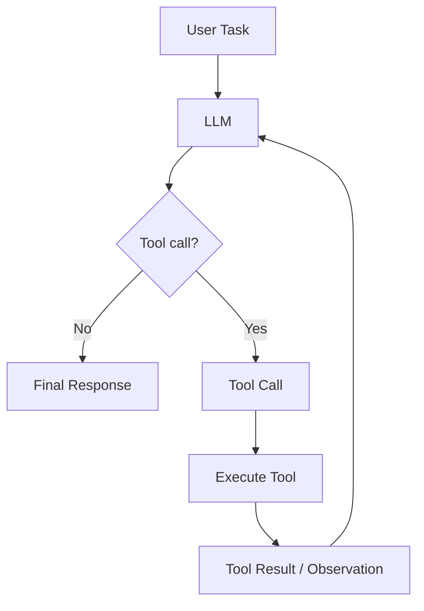
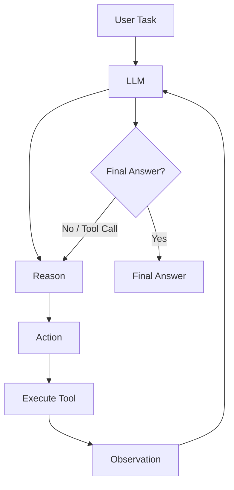
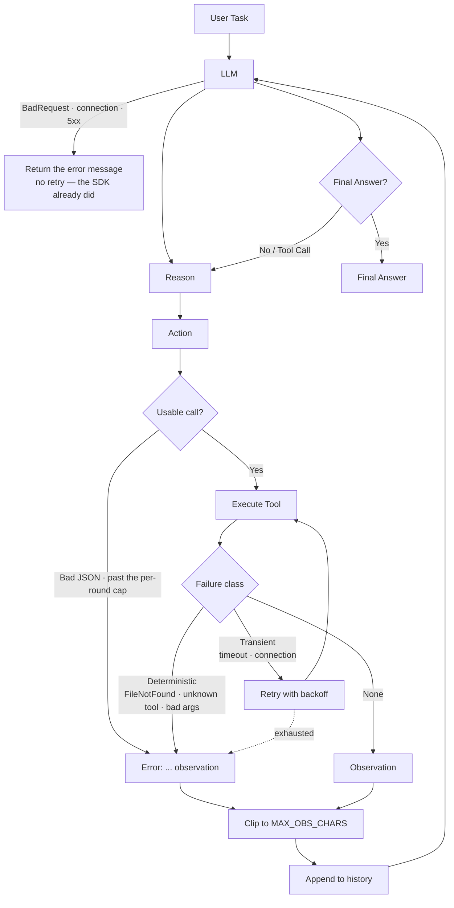
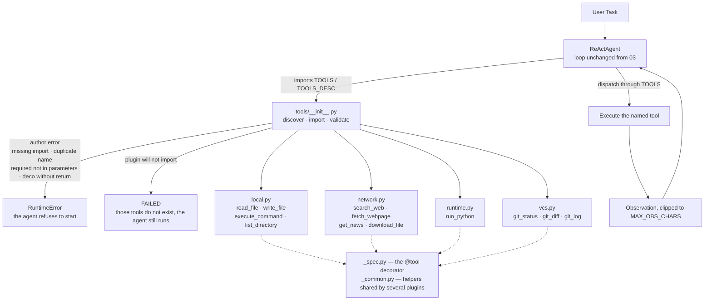
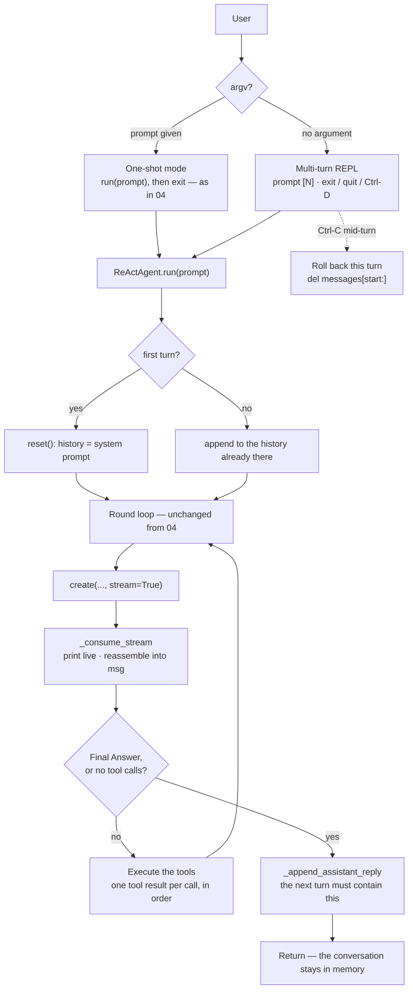
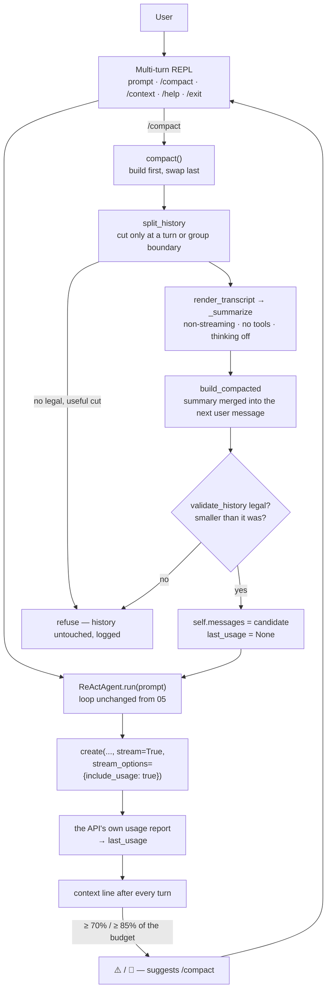
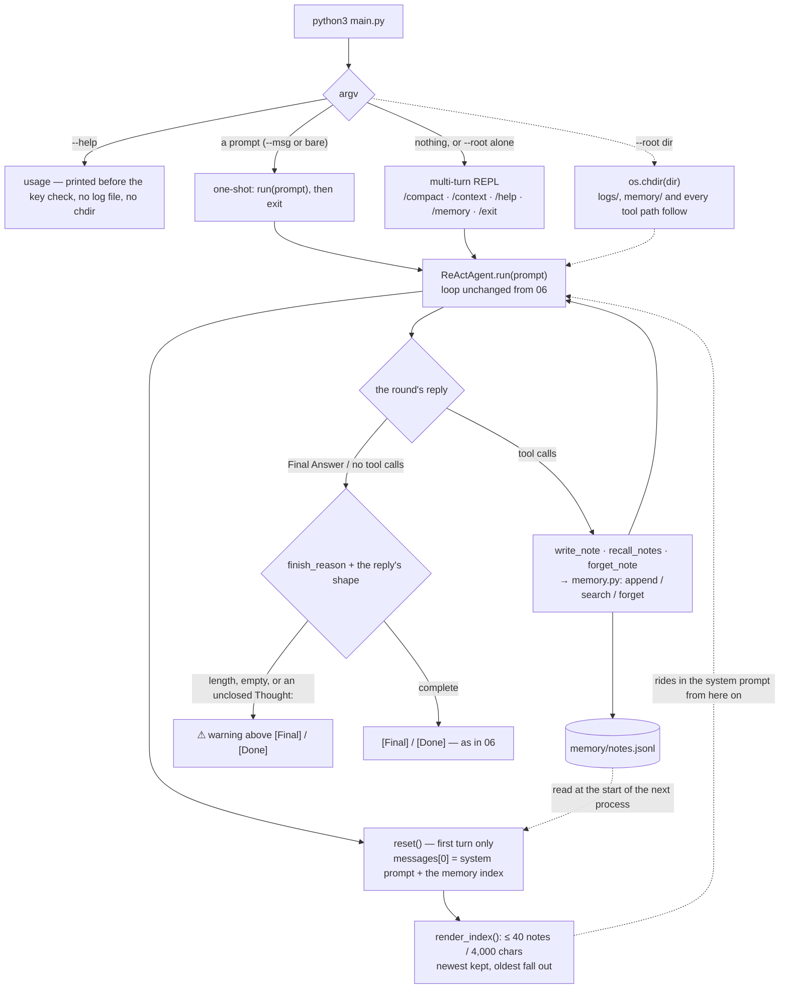
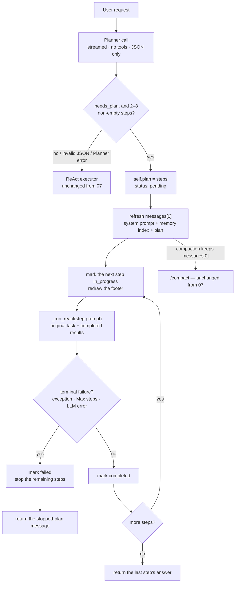
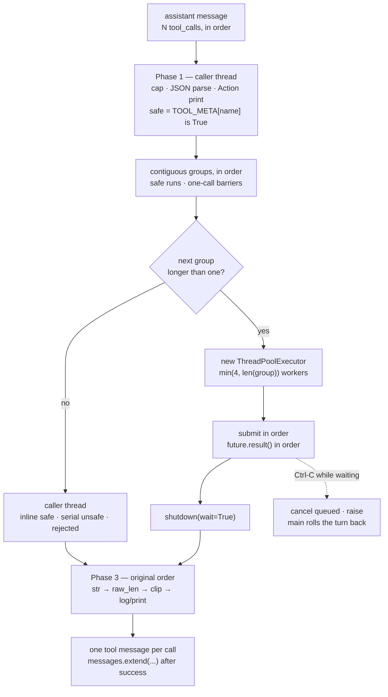

# Mini-Agent-System

Author: Zichen Zhao

## Introduction

This is a series of mini Agent systems evolving from the simplest one to more complicated ones. It demonstrates how to construct an agent system step by step, and how to implement different types of agents and their interactions. The goal is to provide a clear understanding of the principles behind agent-based modeling and simulation.

## Versions

### 01 Bare Agent

[01-bare-agent](01-bare-agent/) demonstrates the simplest agent system, where agents have basic properties and behaviors. It serves as a foundation for understanding how agents operate in isolation.

Generally, a bare LLM follows the following structure:

```python
response = llm.generate_response(input)
```

However, a simple bare agent follows the following structure:



In pseudocode, the bare agent can be represented as follows:

```python
while not finished:

    response = llm(messages)

    if response.tool_call:
        observation = execute(response.tool_call)
        messages.append(observation)
    else:
        return response
```

### 02 ReAct Agent

[02-react-agent](02-react-agent/) introduces a ReAct (Reasoning + Acting) agent that can perceive its environment and make decisions based on its observations. This version showcases how agents can interact with their surroundings and adapt their behavior accordingly.

Here's the structure of a ReAct agent:



The core difference between a bare agent and a ReAct agent is that the ReAct agent can reason about its observations and decide whether to take an action or provide a final answer. This allows for more complex interactions and decision-making processes.

### 03 ReAct Agent with Error Handling

[03-react-agent-with-error-handling](03-react-agent-with-error-handling/) adds error handling to the ReAct agent. It is the same three-tool loop as 02; what changes is that every failure now has a route, decided by who can actually fix it — the model, the code, or nobody.

Here's the structure of an error-handling ReAct agent:



In pseudocode, the error-handling ReAct agent can be represented as follows:

```python
while not finished:

    try:
        response = llm(messages)
    except BadRequestError as e:              # our request is invalid — retrying cannot help
        return f"Error: {e}"

    if response.tool_call:
        args, error = parse(response.tool_call)   # syntax and type, one choke point
        if error:
            observation = error                   # deterministic — the model can fix this
        else:
            observation = call_tool(args)         # retries transient failures inside;
                                                  # returns "Error: ..." for the rest
        messages.append(clip(observation))        # bounded before it enters the history
    else:
        return response
```

The core difference between the 02 ReAct agent and the error-handling one is not that it fails less often, but that every failure is routed to whoever can fix it. Deterministic failures go straight back to the model as an observation, transient ones are absorbed by the code with bounded backoff, and a request the API rejects ends the run instead of being retried — so the agent turns failures into feedback instead of stopping on them.

### 04 ReAct Agent with More Tools

[04-react-agent-with-more-tools](04-react-agent-with-more-tools/) grows the toolkit from three tools to twelve. The agent itself is untouched — `react_agent.py`, `config.py` and `utils.py` are byte-for-byte identical to 03's, and the only change outside the tools layer is six lines in `main.py`. What changes is how tools are declared: `tools.py` becomes a `tools/` package in which each plugin carries its own schema next to the function, a single `@tool` decorator is the whole registration, a loader discovers and imports the plugins, and a set of load-time checks turns the mistakes that would otherwise surface only as "this tool is a bit flaky" into a refusal to start.

Here's the structure of a plugin-loaded ReAct agent:



In pseudocode, the loader can be represented as follows:

```python
for name in sorted(plugins):                 # every tools/*.py; "_" means shared code, not a plugin
    try:
        import_module(name)                  # runs each @tool decorator, filling one registry
    except Exception as e:
        FAILED[name] = e                     # environment problem — degrade, but record

check_undefined_names()                      # author errors — raise, so the agent refuses to start
check_duplicate_names()
check_declarations()

TOOLS      = {t.name: t.fn for t in registry()}   # dispatch
TOOLS_DESC = [schema(t)    for t in registry()]   # what the model sees
```

The core difference between the 03 and 04 agents is not in the agent at all: the loop, the error routing and the budgets are identical, and only the tools layer changed. 03 asked who can fix a failure at runtime; 04 asks the same question one step earlier. A plugin whose function body references a name that does not exist is deterministic and fixable by editing the file, so the agent refuses to start; a plugin that cannot be imported is an environment problem, so it degrades, is recorded in `FAILED`, and is printed by `main.py`. The payoff is a toolkit that can grow from three tools to twelve — and keep growing — without `react_agent.py` knowing that anything happened.

### 05 Multi-Round ReAct Agent

[05-multi-round-agent](05-multi-round-agent/) turns the one-shot agent into a conversation. The loop, the retry policy, the twelve tools and the plugin loader are unchanged — every file under `tools/` is byte-for-byte identical to 04's — and what changes is that the history is no longer thrown away between runs. `reset()` stops taking a prompt and runs only on the first turn, `run()` appends to the existing messages instead of rebuilding them, and the model's closing reply is written back into the history so the next turn can see what it already answered. `main.py` grows a second mode: with an argument it is 04, without one it is a REPL. Output becomes streaming — the chunks are re-assembled into the exact message shape the rest of the loop already expected — and rendered as markdown when stdout is a terminal.

Here's the structure of a multi-round ReAct agent:



In pseudocode, the REPL's turn boundary and the re-assembly can be represented as follows:

```python
while True:                                        # main.py, when there is no argument
    prompt = input(f"[{agent.turn + 1}] you > ")
    if prompt in ("exit", "quit"):
        break

    snapshot = len(agent.messages)                 # a turn is atomic from the outside
    try:
        agent.run(prompt)
    except KeyboardInterrupt:
        del agent.messages[snapshot:]              # a half-written turn is a 400 waiting to happen
```

```python
def run(self, prompt):
    prompt = scrub_surrogates(prompt)              # terminal input can carry invalid UTF-8
    if not self.messages:                          # first turn only — the whole multi-turn change
        self.reset()                               # history = [system prompt]
    self.messages.append({"role": "user", "content": prompt})

    while round < max_rounds:
        stream = create(self.messages, tools=TOOLS_DESC, stream=True)
        msg = consume_stream(stream)               # printed as it arrives; shape is the old one

        if "Final Answer:" in msg.content or not msg.tool_calls:
            self._append_assistant_reply(msg, msg.content)   # keep it — the next turn needs it
            return msg.content

        execute_tools_and_append_one_result_each(msg)        # unchanged from 03
```

The core difference between the 04 and 05 agents is where the state lives. 04's agent was a function of one prompt: it built a history, ran it to an answer, and returned. 05's agent is a function of a conversation: the history *is* the agent, it outlives the call, and every turn appends to it. The rest follows from that — the reply has to be written back because the history must be complete at the end of a turn, the Ctrl-C rollback exists because it must also be complete at every point a keyboard can interrupt it, and a malformed history now costs the session rather than the run. The tools layer, which 04 spent its whole budget on, needed no changes at all — not even a comment.

### 06 Multi-Round ReAct Agent with Compaction

[06-multi-round-agent-with-compact](06-multi-round-agent-with-compact/) makes the unbounded conversation compressible. The loop, the retry policy, the twelve tools and the plugin loader are unchanged — every file under `tools/` is byte-for-byte identical to 05's — and what changes is that the older part of the history can now be replaced by a summary. Context occupancy is read from the API's own `usage` report (no local tokenizer, no extra dependency) and shown after every turn, `/compact` summarizes everything but the last couple of turns, and the REPL grows `/context`, `/help` and `/exit` beside it. The compaction is a transaction: a candidate history is built, validated against the message-shape rules that 03–05 enforced only by convention, checked for actually being smaller, and swapped in on the last line — every failure path leaves the history untouched.

Here's the structure of a compacting ReAct agent:



In pseudocode, the two new pieces can be represented as follows:

```python
while True:                                    # main.py — the REPL, now with commands
    prompt = input(f"[{agent.turn + 1}] you > ")
    if prompt.split()[0] in COMMANDS:          # dispatched *before* the rollback snapshot:
        handle_command(agent, prompt)          #   /compact rewrites the list the snapshot indexes into
        continue

    start = len(agent.messages)                # a turn is still atomic from the outside
    try:
        agent.run(prompt)                      # unchanged from 05, plus the usage report
    except KeyboardInterrupt:
        del agent.messages[start:]
    show_context(agent)                        # the number the /compact decision is made on
```

```python
def compact(self):
    cut = split_history(self.messages)                     # turn boundaries, else group boundaries
    if cut is None:
        return False, "nothing to compact"                 # too short — the recent turns are protected

    summary = self._summarize(render_transcript(self.messages[1:cut]))
    candidate = build_compacted(self.messages, cut, summary)   # summary rides inside the next user message

    if not summary or validate_history(candidate):          # structural rules, checked not assumed
        return False, "refused — history untouched"
    if message_chars(candidate) >= message_chars(self.messages):
        return False, "refused — the summary is not smaller"

    self.messages = candidate                               # build first, swap last
    self.last_usage = None                                  # that measurement described the old history
```

The core difference between the 05 and 06 agents is what the history is allowed to become. 05's history was append-only: the conversation *was* the record, and nothing could ever be taken out of it, which made a context-limit `400` unrecoverable inside a session. 06 keeps the history as the source of truth but makes it replaceable — a summary takes the place of everything older than the last few turns, and the messages that remain are still shaped exactly as the API requires. The rules 03–05 carried in comments became a validator, because compaction is the first operation that could break them silently; the number that decides *when* to compact comes from the server rather than from a second, disagreeing tokenizer; and nothing compacts automatically, because throwing away the record of a session is a decision for the person who knows what the session is for.

### 07 Multi-Round ReAct Agent with Long-Term Memory

[07-multi-round-agent-with-memory](07-multi-round-agent-with-memory/) gives the agent something that outlives the process. The loop, the retry policy, the thinking channel, the REPL and the whole compaction machinery are unchanged — seven of the eight files under `tools/` are still byte-for-byte identical to 06's — and what changes is that knowledge now has a place to live outside the conversation. `memory.py` (new, pure) is an append-only `memory/notes.jsonl` plus the index built from it; `tools/notes.py` (new) exposes `write_note`, `recall_notes` and `forget_note`; and `reset()` splices the index into `messages[0]`, so a fresh session starts knowing what earlier ones chose to keep — inside the one message compaction never touches. Retrieval is a tool the model decides to call, not a per-turn top-k injection, and writing is the model's decision too. The same lesson closes a gap 02–06 never noticed: `finish_reason` was parsed from every response and thrown away, so a reply the server cut short was reported as a finished answer; it is now captured, logged every round, and judged on closing replies. `main.py` grows a command line — `--root`, `--msg`, `--help` — and a fifth REPL command, `/memory`.

Here's the structure of an agent with long-term memory:



In pseudocode, the two halves of the memory — the write path and the session-start read — can be represented as follows:

```python
def write_note(summary, body="", type="project"):     # tools/notes.py → memory.append()
    if summary in {n["summary"] for n in load(NOTES_PATH)}:
        return "Already stored (not written again): " + summary
    append({"id": next_id(), "ts": now(), "type": type, "summary": summary, "body": body})
    return f"Stored note {id} ({type}): {summary}"
```

```python
def reset(self):                                       # react_agent.py — first turn only
    index = render_index(NOTES_PATH, max_notes=40, max_chars=4000)   # 40 lines is the fixed cost
    self.messages = [{"role": "system",
                      "content": self.system_prompt + MEMORY_INDEX_HEADER + index}]
```

The core difference between the 06 and 07 agents is where knowledge is allowed to live. 06's agent knew only its system prompt at startup, and everything it learned had to be discovered again inside the session that needed it — the conversation had become compressible, but it was still mortal. 07's agent begins each process by reading what earlier processes chose to keep, and the model is told both what the store holds (the index) and how to look deeper (`recall_notes`). The two budgets are kept apart on purpose: the index is prompt text and is paid for on every request, the bodies are tool results and are paid for only when a lookup is worth making. That is also why the store is refusal-first — writes idempotent on the summary, deletion taking an id and nothing else — and why the missing signal in 02–06 was worth fixing in the same lesson: an agent that persists what it learned should not report a truncated answer as a finished one.

### 08 Planning Agent

[08-planning-agent](08-planning-agent/) puts an explicit plan in front of each request. The ReAct executor, the retry policy, compaction, long-term memory and the fifteen tools are unchanged — four of the eight files under `tools/` are still byte-for-byte identical to 07's, and the other four changed only in comments and docstrings — and what changes is that a task's outline now exists as program state. Every request begins with one streamed Planner call — no tools, thinking on, a cap of `PLAN_MAX_TOKENS` — returning a JSON object with `needs_plan` and an ordered `steps` list. The reply is checked as a boolean plus a list of non-empty steps: a simple request returns `needs_plan=false`, a planned task must have 2–8 steps, and invalid JSON, a shape violation or a Planner exception falls back to 07's ReAct path. A valid plan is kept in `self.plan`, runs step by step through the same `_run_react`, and every step carries the original task plus the results already completed. The steps share the request's one `MAX_ROUNDS` budget, their status moves through `pending`, `in_progress`, `completed` and `failed`, and a terminal executor failure marks the step failed and stops the rest. The plan is refreshed into `messages[0]` whenever it changes, inside the message compaction's `keep_head=1` protects; it is task state, not a note, so it is never written to `memory/notes.jsonl`. On a TTY a fixed-bottom footer shows the plan while it runs, and Ctrl-C restores the plan along with the history. The lesson also reorganises the code: the single agent module becomes `agent/` (state plus planning, orchestration, loop, request, execution and compaction mixins), compaction and rendering move into `context/` and `presentation/`, and `_test.py` becomes a `tests/` package with a planning group — still offline.

Here's the structure of a planning agent:



In pseudocode, the Planner's validation and the ordered execution can be represented as follows:

```python
def _parse_plan_response(content):                      # agent/helpers.py — pure, testable offline
    data = json.loads(content)                          # one JSON object, no fences
    if not isinstance(data.get("needs_plan"), bool):
        return False, [], "needs_plan must be a boolean"
    steps = data.get("steps")
    if not isinstance(steps, list) or any(not isinstance(s, str) or not s.strip() for s in steps):
        return False, [], "steps must be non-empty strings"
    steps = [s.strip() for s in steps]
    if not data["needs_plan"]:
        return False, [], ""                            # simple request — no plan
    if not 2 <= len(steps) <= PLAN_MAX_STEPS:           # 2..8, PLAN_MAX_STEPS = 8
        return False, [], "plan rejected"
    return True, steps, ""
```

```python
def run(self, prompt):                                  # agent/orchestration.py
    if not self.messages:                               # first turn only
        self.reset()                                    # system prompt + memory index
    self.plan = []

    needs_plan, steps, error = self._request_plan(prompt)   # one streamed call, no tools
    if error or not needs_plan:                         # simple / invalid / Planner failure
        return self._run_react(prompt)                  # unchanged from 07

    self.plan = [{"text": s, "status": "pending"} for s in steps]
    self._refresh_plan_context()                        # writes into messages[0]

    for i, step in enumerate(self.plan):
        step["status"] = "in_progress"
        self._refresh_plan_context()                    # the plan is also prompt text
        result = self._run_react(step_prompt(prompt, self.plan, i))   # same ReAct loop
        if self._execution_failed(result):              # exception, Max steps, LLM error
            step["status"] = "failed"
            return f"Plan stopped at step {i + 1}/{len(self.plan)}: {result}"
        step["status"] = "completed"
    return result
```

The core difference between the 07 and 08 agents is whether the task has an outline apart from the conversation. 07's agent chose every next action from the history as it went: flexible, but the only record of the whole task was the conversation itself, and compaction could summarize that record away. 08's plan is small, disposable program state — for this request only, not a tool result and not a lasting note — so order and progress exist outside the transcript and are refreshed into `messages[0]`, the one message compaction never touches. The executor stays ReAct because each step still has to react to what its tools return; the Planner only decides the order. The price is one extra model call per request, a plan the model can get wrong, and a round budget early steps can exhaust — accepted because the alternative is the thing 07 already did: no separate record of intent at all.

### 09 Parallel Tool Execution

[09-parallel-tool-execution](09-parallel-tool-execution/) lets one round's tool calls overlap. The Planner, the ordered plan steps, the ReAct loop, compaction, long-term memory and the same fifteen tools are unchanged — 29 of the 42 files the two lessons share are byte-identical, and seven of the eight tool files changed: four only add a `parallel_safe` marker, and three carry the metadata plumbing and the 429 fix — and what changes is the executor between one assistant message and its tool results. 08 ran a round's calls one after another on the caller's thread, so a batch of reads cost the sum of their times. 09 replaces that loop with three phases. Phase 1 runs on the caller thread and does everything that must stay deterministic: the per-round cap, JSON parsing, the arguments-size log, the `Action` print and the classification. Phase 2 splits the admitted calls into contiguous groups — a run of `parallel_safe` calls becomes one group, while every unsafe, unparseable or over-cap call is a one-element barrier — and runs the groups in order: a one-element safe run runs inline, an unsafe call runs serially on the caller thread, a rejected call is never executed, and a longer safe run gets a fresh `ThreadPoolExecutor` with `max(1, min(PARALLEL_MAX_WORKERS, len(group)))` workers. Phase 3 runs on the caller thread again and writes the results back in the original `tool_calls` order: `str()` → `raw_len` → `clip()` → log → print → one tool message per call — and `react_loop.py` extends the history with those tool messages only after the scheduler returns. The policy lives with the tools: `@tool(..., parallel_safe=False)` is the default, nine tools opt in (`read_file`, `list_directory`, `search_web`, `fetch_webpage`, `get_news`, `git_status`, `git_diff`, `git_log`, `recall_notes`) and six do not (`write_file`, `execute_command`, `download_file`, `run_python`, `write_note`, `forget_note`). The metadata is projected into `TOOL_META`, validated as a bool at load time and never sent to the model — `TOOLS_DESC` is still the 08 schema. `PARALLEL_ENABLED=0` restores the serial shape with an identical list of tool messages; `PARALLEL_MAX_WORKERS` is a constant (4), not an environment variable. The lesson also drags in a 429 → `ConnectionError` fix so rate limits are retried, `GIT_OPTIONAL_LOCKS=0` for the read-only git tools, a `_LOG_LOCK` and a `tool_call_id` in the retry log because workers now share one file, and `[i/N]` labels on multi-call Action/Observation output. `tests/test_parallel.py` pins the safe set, real overlap, barriers, failure containment and ordering without an API call.

Here's the structure of an agent with parallel tool execution:



In pseudocode, the scheduler and its safety boundary can be represented as follows:

```python
def _execute_tool_calls(self, tool_calls, parallel=None):        # agent/execution.py
    parallel = PARALLEL_ENABLED if parallel is None else parallel
    plans = admit(tool_calls, parallel)   # cap · parse JSON · log size · Action · classify
    outcomes = {}
    for group in contiguous_groups(plans):    # safe runs; every other call is a barrier
        if len(group) == 1:
            outcomes[group[0]["i"]] = self._run_inline(group[0])
            continue
        workers = max(1, min(int(PARALLEL_MAX_WORKERS), len(group)))
        executor = ThreadPoolExecutor(max_workers=workers)
        try:
            futures = [(p["i"], executor.submit(self._run_worker, p)) for p in group]
            for i, future in futures:
                outcomes[i] = future.result()      # submission order, not as_completed
        except BaseException:                      # Ctrl-C while waiting
            executor.shutdown(wait=False, cancel_futures=True)
            raise
        else:
            executor.shutdown(wait=True)
    return write_back(plans, outcomes)             # original order; one message per call
```

```python
def _parallel_safe(self, name):                    # metadata is the only source
    return TOOL_META.get(name, {}).get("parallel_safe") is True   # unknown → False

def _run_worker(self, plan):                       # pool thread: nothing escapes
    started = time.monotonic()
    try:
        observation = self._call_tool(plan["name"], plan["args"],
                                      tool_call_id=plan["tc"].id)
    except BaseException as e:                     # SystemExit becomes an observation
        observation = f"Error: {plan['name']} failed due to {type(e).__name__}: {e}"
    return observation, time.monotonic() - started

# agent/react_loop.py — the serial block is gone; the history grows only after success
self.messages.extend(self._execute_tool_calls(msg.tool_calls))
```

The core difference between the 08 and 09 agents is whether a round has one lane. 08 chose which tools to call and then called them in the order the model wrote them, because that order was also the protocol: the API requires one tool message per `tool_calls` entry, in position. 09 keeps that protocol order exactly and separates it from execution order — the results still come back in the model's order, and only the work inside a contiguous safe run overlaps. That is why the scheduler is conservative in every direction: opt-in metadata that defaults to unsafe, a barrier at every unknown or unparseable call, a fresh pool per run rather than one shared pool, and results collected by submission index rather than by completion. The gain is wall time on batches the model already writes; the price is that the gain exists only when it batches, that a Python thread cannot be killed once a tool is running, and that a wrong `parallel_safe=True` stops being a performance bug and becomes a data race. 08 could be wrong about a plan; 09 can be wrong about a tool's safety, which is why the policy is a declaration in code and a test pins the exact set.
